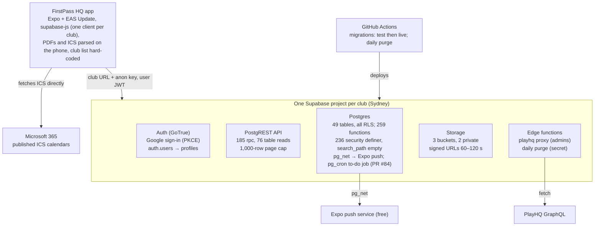

# FirstPass HQ architecture and scalability review

Reviewed 13 October 2026 against `main` at d711b5e (65 migrations, 21,933 lines of SQL), the open
[PR #84](https://github.com/zapheus-runplaywin/thunderapp/pull/84), and current pricing pages (see
[Sources](#sources)). Prices are in US dollars. The same review, with its drawings, is the Claude
Doc "FirstPass HQ architecture and scalability review" in the project.

## Summary

The architecture is sound for the next few years and is far less locked in than it looks. Almost
everything that matters is plain Postgres: 49 tables with row level security, 259 SQL functions,
and an Expo app that talks to them through PostgREST. The Supabase-only pieces are small and
replaceable: Google sign-in through Supabase Auth, three storage buckets, two tiny edge functions,
two `pg_net` calls to Expo's push service, and (in the open PR #84) one `pg_cron` job. There is no
realtime use at all.

The first things to break are not technical limits but the free plan and manual club setup.
Thunder already uses both free projects, free projects pause after a week idle (an off-season club
would go dark), and adding a club today means about ten dashboard steps, a code change and an app
update. Upgrading to Supabase Pro fixes the first problem now: one organisation, as many projects
as you like, about $10 a month per club project on top of the $25 plan fee. A club-sign-up
directory and a scripted setup fix the second.

The recommended path is in four stages:

1. **Now.** Move to one Supabase Pro organisation ($45 a month for Thunder live, test and the
   directory). Keep one project per club. Charge clubs enough to cover about $15 a month each.
2. **Before club three.** Build the FirstPass directory and a setup script that creates a club's
   project, sets its sign-in, runs the migrations and adds it to the app's club list. Extend the
   deploy workflows to every club.
3. **At about 20 to 30 clubs.** Decide whether the $10 a month floor per club still fits the price
   clubs pay. If not, move clubs that accept it onto a shared Pro project with one Postgres schema
   per club (about $2 a club at 200 clubs), keeping separate projects for clubs that insist on
   their own.
4. **Only if Supabase's pricing or terms change.** Self-host the same open-source stack (Postgres,
   PostgREST, GoTrue, Storage) on a Sydney VPS. The code moves as is; the cost is Matt's time
   running it. A move to a different kind of backend (Firebase, Cloudflare D1) would be a rewrite
   and is not worth planning for.

## What the app is today

The phone holds one supabase-js client per club and talks straight to that club's project;
nothing sits between the app and Postgres. Writes go through SQL functions (`security definer`,
`search_path` empty, revoked from `anon`), reads through row level security. Nothing is granted to
signed-out visitors. The club list, with each club's project URL and public key, is hard-coded in
`src/constants/clubs.ts` and is empty apart from Thunder.

What is Supabase-specific is a short list:

- **Auth:** `auth.uid()` in 375 places, a trigger on `auth.users` that creates the profile,
  `auth.users` deleted when a member is removed, and an `email_confirmed_at` check. No JWT claims
  are read directly; roles live in `profiles`.
- **Storage:** three buckets (`injury-documents`, `training-certificates`, public
  `club-branding`), five policies on `storage.objects`, and 18 places where SQL functions query
  `storage.objects` directly.
- **Edge functions:** two. `playhq` proxies PlayHQ's GraphQL for admins; `purge-expired-injuries`
  deletes expired files and rows once a day, called by a GitHub Actions cron with a secret.
- **pg_net:** two `net.http_post` calls to Expo's push API (new join requests). PR #84 adds a
  `pg_cron` job every five minutes that works out every member's to-do list in SQL and pushes what
  is new.
- **Realtime:** not used. **pg-safeupdate:** on by default for API calls, so functions on the
  one-row `club_settings` carry a `where id`.
- **Dashboard settings not in code:** Site URL and redirect URLs, the Google provider, email
  sign-up off, `PURGE_SECRET`.

Everything else is portable by construction: reports and PDFs are built on the phone
(`src/lib/pdf.ts`), ICS calendars are fetched and parsed on the phone, and over-the-air updates go
through EAS, which does not care what the backend is.

## Breaking points, in the order they will bite

The design scales by adding projects, so the limits that matter are per club (members and years of
data) and per fleet (how many clubs Matt can run by hand).

| # | When it bites | What breaks | Evidence | Fix |
| --- | --- | --- | --- | --- |
| 1 | Club 2, or the directory | The free plan allows two active projects per account and Thunder uses both. Free projects pause after a week idle, so an off-season club's database would go dark until someone opens the dashboard. Free compute is Nano (shared CPU, up to 0.5 GB RAM, 60 connections). | [Supabase pricing](https://supabase.com/pricing); `docs/environments.md` | Supabase Pro: no pausing, Micro compute per project. |
| 2 | Club 2 | Adding a club is about ten manual steps: create the project, set Site URL and redirects, add the Google callback, link and run the migrations by hand, edit `src/constants/clubs.ts`, publish an app update, make the first admin with SQL. The deploy workflows only reach Thunder's projects (a matrix of test clubs 2 and 3, no real clubs), the daily purge runs only against live, and edge functions and `PURGE_SECRET` are not in the new-club steps. | `docs/new-club-setup.md`; `.github/workflows/deploy-migrations.yml`, `purge-expired-injuries.yml` | A clubs file the workflows loop over (already planned), a setup script against the Supabase Management API, and the FirstPass directory serving the club list so no app update is needed per club. |
| 3 | Club 3 to 5 | Every club needs its project's callback URL added to the one Google OAuth client, and the consent screen shows `<ref>.supabase.co` rather than FirstPass. Google caps the number of redirect URIs per client (check the current cap before you need it). | `README.md` step 3; `docs/environments.md` | A Google client per batch of clubs, or Supabase custom domains (a paid add-on per project), or sign-in moved to a shared auth project later. |
| 4 | A club of 1,000+ members (an association rather than a club) | PostgREST returns at most 1,000 rows and the app's member lists do not page: Administration > Members, member pages, team pages, safeguarding, affiliation and pending requests would silently drop people. Reports already page 1,000 at a time (`fetchAll`). | `src/app/admin/index.tsx:26`, `admin/[id].tsx:159`, `admin/team/[id].tsx:75`, `admin/safeguarding.tsx:52`, `lib/use-pending-requests.ts:15`; `src/lib/reports.ts:74` | Page those queries with `.range`, or raise the API max rows on Pro. A few hours of work; do it before the first association joins. |
| 5 | Per club, once PR #84 merges, at roughly 1,000 to 2,000 members | The to-do push job loops over every approved member with a phone every five minutes and calls about ten SQL functions for each (injuries, goals, awards, training, safety). That is about 3,000 function calls a run for a 300-member club, fine on Micro; for a 2,000-member body a run may take longer than five minutes on shared CPU and runs would overlap. | PR #84 `20261017160000_todo_push_notifications.sql`, `send_todo_pushes` | Make it incremental: only members whose data changed since the last run, or write to-dos to an outbox when the underlying rows change. Also the step that makes push portable. |
| 6 | 20 to 30 clubs | Cost and operations of one project per club: about $10 a month each for compute, one dashboard, one database password in GitHub secrets, one purge secret, one Site URL and one set of auth settings each. Daily backups per project, but point-in-time recovery is $100 a month per project, too dear per club. | [Supabase pricing](https://supabase.com/pricing) | Decide between staying per project (fine if clubs pay) and a shared project with a schema per club. Script everything either way. |
| 7 | 50 to 100 clubs | Pro quotas are summed across the organisation: 250 GB egress, 100 GB file storage, 100,000 monthly active users included. At 150 members a club, 100 clubs is 15,000 users (fine), roughly 50 GB of injury documents and certificates (fine), and egress that depends on how often phones pull rosters, images and calendars; over the included 250 GB it is $0.09 a GB. | [Supabase billing](https://supabase.com/docs/guides/platform/billing-on-supabase) | Watch the egress graph once there are 20 clubs; cache club logos and avoid re-fetching rosters on every screen. |
| 8 | Years of data in one club | Growth tables are check-ins (one row per athlete per day), attendance marks, message recipients (one row per recipient per message; club-wide messages fan out to everyone plus guardians), the record access log and injury document events. All are indexed for their reads, and the retention job (PR #107, off by default) trims them. A 300-member club adds under 200,000 rows a year; Postgres handles tens of millions. The 8 GB disk included per project will not be reached for many years. | `supabase/migrations/*` indexes; `20261013100000_record_retention.sql` | Nothing now. Turn on retention where clubs agree. |
| 9 | Any size | Everything is in Sydney in one provider. There is no documented restore drill, and the dashboard settings that security depends on are not in code. | `docs/security/security-review-2026-10-12.md` findings 6 and 16 | A weekly `pg_dump` of each club to object storage FirstPass controls, and the auth settings applied by script so they can be re-applied anywhere. |

Two things are not breaking points. Microsoft 365 calendars are fetched by each phone, so calendar
load never touches the database. And Expo's push service is free at any volume; what costs money
there is EAS Update, which bills by monthly active users and is in the cost tables.

## Moving to a paid Supabase plan

Pro is the right plan, and it keeps the one-project-per-club model intact: a Pro organisation can
hold as many projects as you create, each with its own database, sign-in and storage, under one
account and one invoice. Prices from [supabase.com/pricing](https://supabase.com/pricing) and the
[billing guide](https://supabase.com/docs/guides/platform/billing-on-supabase), 13 October 2026.

| | Free | Pro | Team |
| --- | --- | --- | --- |
| Plan fee, per organisation | $0 | $25 a month | $599 a month |
| Projects | 2 active, counted across every org you own or administer | No stated limit | No stated limit |
| Compute per project | Nano (shared CPU, up to 0.5 GB RAM, 60 connections), free | Micro ($10 a month, 1 GB RAM, 60 connections, 200 pooled) and up; a $10 credit covers the first | Same as Pro |
| Pausing | After 1 week idle | Never | Never |
| Database disk | 500 MB | 8 GB per project, then $0.125 a GB | Same |
| File storage, egress, monthly active users (summed across the org) | 1 GB, 5 GB, 50,000 | 100 GB, 250 GB, 100,000; then $0.021 a GB, $0.09 a GB, $0.00325 a user | Same |
| Backups | None | Daily; point-in-time recovery $100 a month per project per 7 days | Same, plus SOC 2 and priority support |

What the upgrade changes for the model:

- **One account, many projects.** Thunder's live and test projects can be transferred into the new
  organisation (Supabase supports project transfers between organisations). The FirstPass
  directory is a third project. Every club after that is one more project.
- **The floor is about $10 a club a month.** Compute is billed per project and Nano is not
  available on paid plans, so each club project costs a Micro, whether it has 20 members or 2,000.
  The $10 credit offsets one. A club's data will not come near the 8 GB disk or the storage quota.
- **Clubs that own their project.** A club could still create its own free project and invite
  Matt, but then its database pauses in the off-season and runs on Nano, and its deploys depend on
  an access token from that club's account. Not worth it for the saving; fine for a club that
  insists on owning its data, provided it pays for Pro itself.
- **Team ($599) is not needed** unless a club or governing body asks for SOC 2 reports or an SLA.

**Cost of the per-project model.** Assumes 150 members a club on average, the test project and
the directory included, EAS Update at [expo.dev/pricing](https://expo.dev/pricing) (Free 1,000
monthly active users; Starter $19 plus $0.005 a user over 3,000), and egress of about 30 MB a
member a month.

| Clubs | Supabase projects | Supabase a month | EAS a month | Total a month | Per club a month |
| --- | --- | --- | --- | --- | --- |
| 1 | 3 | $45 | $0 | $45 | $45 |
| 10 | 12 | $135 | $19 | $154 | $15 |
| 50 | 52 | $535 | $42 | $577 | $12 |
| 200 | 202 | $2,095 (incl. ~$60 egress) | $154 | $2,250 | $11 |

So if clubs pay from about A$25 a month (US$16) the per-project model covers its own cost at any
scale. What it never does is get cheaper per club, because the Micro floor is fixed.

## Options beyond Supabase as it scales

There are three realistic shapes, and only the first keeps every club in its own project.

| Clubs | A. Pro, project per club | B. Pro, one project, schema per club | C. Self-hosted on a Sydney VPS |
| --- | --- | --- | --- |
| 1 | $45 ($45 a club) | $45 ($45 a club) | $35 ($35 a club) |
| 10 | $154 ($15.40 a club) | $64 ($6.40 a club) | $54 ($5.40 a club) |
| 50 | $577 ($11.50 a club) | $147 ($2.90 a club) | $97 ($1.90 a club) |
| 200 | $2,250 ($11.20 a club) | $381 ($1.90 a club) | $330 ($1.70 a club) |

Totals a month including EAS Update, at 150 members a club; self-hosting leaves out the time to
run it.

**A. Supabase Pro, one project per club** is the current model and is costed above. Per club it
settles at about $11 a month and never falls further.

**B. Supabase Pro, one shared project with a Postgres schema per club** keeps a hard boundary
between clubs inside one database: every club gets its own copy of the 49 tables, policies and
functions in its own schema (`club_thunder`, `club_hawks`), and the app sets the schema on its
client instead of the project URL. Nothing in one schema can see another unless a function names
it. It is cheaper because 200 clubs share one Large compute ($110) instead of 200 Micros
($2,000). The costs are the plan, one compute sized to the fleet (Micro to 10 clubs, Medium to
50, Large to 200), the test and directory projects, disk over 8 GB at $0.125 a GB, EAS and
egress. What it gives up: one sign-in directory shared by all clubs (which is also a feature: a
coach in two clubs signs in once), a restore that is per database rather than per club (a club
can still be restored from a schema dump), and the migration tooling, which today assumes
`public` and would need to apply each migration once per schema. Because every function already
names `public.` explicitly with an empty `search_path`, that rewrite is mechanical. This is the
shape to move to if the $10 floor matters; it does not have to be all or nothing, since clubs
that insist on their own project can stay on A.

**C. Self-hosted Supabase** is the same open-source stack (Postgres, PostgREST, GoTrue, Storage,
Edge runtime) run with Docker Compose on a VPS in Sydney. Supabase's
[self-hosting guide](https://supabase.com/docs/guides/self-hosting) is clear that you take on
provisioning, hardening, Postgres upkeep, backups, high availability and monitoring, with
community support only, and that Studio manages a single project, so this is really shape B on
your own machine. Costed on [Fly.io](https://docs.fly.io/about/pricing) (Sydney region; a 4 GB
shared machine is roughly $25 a month, volumes $0.15 a GB, Oceania egress $0.04 a GB) with object
storage for backups. Hetzner is cheaper but has no Australian region (Singapore is nearest) and
raised prices twice in 2026, so it is not costed. The money saved over B is small; the real price
is Matt's time, which at even two days a month exceeds the saving until well past 100 clubs.
Worth keeping as the exit if Supabase's pricing or terms change, not as a plan.

**Other hosts for the database alone.** [Neon](https://neon.com/pricing) (serverless Postgres,
Launch plan: $0.106 a compute-unit hour, $0.35 a GB-month, 100 projects an organisation, scales
to zero after five minutes idle) would make an idle off-season club cost almost nothing, perhaps
$2 to $4 a club-month for a database per club.
[DigitalOcean managed Postgres](https://www.digitalocean.com/pricing/managed-databases) starts at
$15.15 a month for 1 GB and can hold many databases.
[Fly Managed Postgres](https://docs.fly.io/about/pricing) starts at $38. In every case you still
run PostgREST, GoTrue and a storage service yourself, and PostgREST serves one database, so a
database per club means a service set per club. That lands near shape A's cost with shape C's
operations. Not recommended.

**Different kinds of backend.** [Firebase](https://firebase.google.com/pricing) (Firestore,
1 GiB and 50,000 reads a day free) and
[Cloudflare D1](https://developers.cloudflare.com/d1/platform/pricing/) ($5 a month Workers Paid,
up to 50,000 SQLite databases of 10 GB each, 25 billion reads included) both offer a database per
club at near-zero marginal cost. Both would mean rewriting the 22,000 lines of SQL functions and
policies and the 73 client files that call them, and re-building row level security in
application code. A rewrite, not a migration; not worth planning for.

Pricing for [EAS](https://expo.dev/pricing) applies to all shapes: Free to 1,000 monthly active
users, then Starter at $19 plus $0.005 a user over 3,000, so about $150 a month at 30,000 users.
Expo's push service stays free.

## Portability: what is tied to Supabase and what a move would involve

The cheapest exit is not a different kind of backend but the same open-source pieces run
elsewhere. Postgres, PostgREST, GoTrue (Supabase Auth) and the Storage API are all open source,
so the schema, the 259 functions, the 47 policies and the app's 185 `rpc` calls move unchanged to
a self-hosted stack. The inventory, worst first:

| Piece | How much of the app depends on it | Tied to Supabase? | What a move would involve | Effort |
| --- | --- | --- | --- | --- |
| PostgREST as the API | 185 `rpc` and 76 table calls across 73 client files, resource embedding, `.range` paging, Postgres error codes | Open source; any host that runs PostgREST works as is | Nothing for self-hosted Supabase or your own PostgREST. A non-PostgREST backend means an API layer and every screen touched | None, or weeks |
| Row level security and `security definer` functions | 49 tables with RLS, 236 definer functions, `pgcrypto` through the `extensions.` schema, `authenticated`/`anon`/`service_role` roles | Plain Postgres plus PostgREST's role convention | Create the three roles and the `extensions` schema on the new Postgres; `pg_dump`/`pg_restore` per club | Hours |
| Auth | `auth.uid()` in 375 places; trigger on `auth.users` makes the profile; `auth.users` deleted with a member; `email_confirmed_at` check; PKCE Google flow in the app; Site URL and provider set in the dashboard | GoTrue, open source; the `auth` schema is GoTrue's | Self-hosted GoTrue keeps everything. Any other identity provider (Clerk, Firebase Auth, Keycloak, Auth0) needs PostgREST configured with its JWT keys, an `auth.uid()` function that reads the token's subject, a replacement for the profile trigger, and the sign-in screen rewritten | Days (GoTrue) to two weeks (other) |
| Storage | 3 buckets, 5 `storage.objects` policies, 18 SQL references to `storage.objects`, uploads and signed URLs in three client files | Supabase Storage API (open source, S3-backed) | Self-hosted Storage API keeps it. Plain S3 or Cloudflare R2 needs an upload and signing service and those 18 functions reworked to a `documents` table | Days, or one to two weeks for plain S3 |
| Edge functions | 2 small Deno functions (PlayHQ proxy, daily purge) | Supabase Edge Runtime, open source | Rewrite as a Cloudflare Worker or a Fly app; both are under 300 lines | A day |
| `pg_net` and `pg_cron` | 2 `net.http_post` calls to Expo's push API; PR #84 adds a 5-minute `pg_cron` job | Supabase-provided extensions; available self-hosted, usually not on other managed Postgres | Write pushes to an outbox table and have a small worker send them. Also fixes breaking point 5 | A day or two |
| Realtime | Not used | - | Nothing | None |
| Dashboard settings | Site URL, redirect URLs, Google provider, email sign-up off, `PURGE_SECRET`, safeupdate | Supabase-specific configuration, not in the repo | Keep a per-club setup script that applies them through the Management API; a self-hosted stack takes them as environment variables | Half a day, and it pays off now |
| Migrations and CI | 65 migrations applied with the Supabase CLI; checks for data loss and security; deploy per project | Supabase CLI conventions (`supabase_migrations` table) | Any migration runner works on the same files; the checks are plain Python | A day |
| The app itself | Expo, EAS Update, supabase-js as a thin HTTP client, PDFs and ICS on the phone | supabase-js only | Point `src/constants/clubs.ts` at the new URLs and keys, publish an update | Hours |

In short: a move to self-hosted Supabase or to Postgres plus the same open-source services is a
week or two of work and mostly data copying; a move to a different kind of platform is a rewrite.
Three habits keep it that way:

1. Keep the write path in SQL functions and the read path in RLS, as now. Do not start calling
   Supabase-only client features (realtime, Supabase Vectors, Auth hooks) without noting the exit.
2. Send side effects (push, email) through an outbox table drained by a worker, not from `pg_net`
   inside triggers. Then `pg_net` and `pg_cron` become optional.
3. Script every dashboard setting so a club's project can be rebuilt from the repository. That is
   also what makes club setup automatic.

## Recommended path and the decisions to make

Stay on Supabase, pay for Pro now, keep one project per club until the per-club floor actually
hurts, and spend the next engineering effort on automation rather than on moving.

| Stage | Gate | What happens |
| --- | --- | --- |
| 1. Now | Pro organisation live | Supabase Pro, one organisation; move Thunder live and test in; add the directory project; clubs pay from A$25 a month. $45 a month. |
| 2. Before club 3 | Club 3 signs up | FirstPass directory; setup script against the Management API; deploy workflows loop over every club; page the member lists; outbox for push (PR #84). |
| 3. At 20 to 30 clubs | About $300 a month of compute | Decide: stay per project, or one shared project with a schema per club, with an opt-out for clubs that want their own project. |
| 4. Only if needed | Pricing or terms change | Self-host the same stack on a Sydney VPS: `pg_dump` per club, same code, new URLs and keys. A week or two of work. |

**Decisions for Matt**

1. **Upgrade to Pro now?** Recommended: yes. One FirstPass organisation, transfer Thunder's live
   and test projects into it, create the directory project there. $45 a month until club two.
2. **Who pays, and how much?** Recommended: each club from about A$25 a month (US$16), which
   covers the $11 to $15 per-club cost of the per-project model with margin. Thunder and the
   association may be free or at cost; that is a commercial call, not a technical one.
3. **May clubs ever share a database?** The 9 October decision was one project per club for data
   safety. A schema per club in one project keeps a hard boundary in Postgres and halves to fifths
   the cost, but it is one database to back up and one sign-in directory. Recommended: keep the
   decision for now, revisit it at 20 clubs, and plan the directory so a club record can say
   either "project URL and key" or "shared project and schema".
4. **Where does the directory live?** Recommended: its own small Supabase project in the same
   organisation ($10 a month), serving the club list to the app so new clubs need no app update.
   A static JSON file on a FirstPass domain is the cheaper fallback.
5. **Backups.** Pro includes daily backups per project; point-in-time recovery is $100 a month per
   project, too dear per club. Recommended: daily Supabase backups plus a weekly `pg_dump` of every
   club to storage FirstPass controls, and one restore drill written up in `docs/`.
6. **PR #84 (to-do pushes).** Merge it, then schedule the outbox refactor so the five-minute job
   stops looping every member and `pg_net` is no longer load-bearing. Or refactor before merging;
   either is fine at Thunder's size.
7. **Sign-in at scale.** Nothing to decide yet. Before club five, choose between one Google OAuth
   client per batch of clubs and Supabase custom domains, so the consent screen can say FirstPass.
8. **Data residency.** Everything is in Sydney today. Recommended: keep it so, state it in the
   privacy policy, and make it a requirement for any future host (Fly and DigitalOcean have
   Sydney; Hetzner does not).

## Sources

All pages opened on 13 October 2026.

- Repository at `main` d711b5e: `supabase/migrations/` (65 files), `supabase/functions/`, `src/`,
  `.github/workflows/`, `scripts/`, `docs/environments.md`, `docs/new-club-setup.md`,
  `docs/security/security-review-2026-10-12.md`; open
  [PR #84](https://github.com/zapheus-runplaywin/thunderapp/pull/84)
  (`20261017160000_todo_push_notifications.sql`).
- [Supabase pricing](https://supabase.com/pricing);
  [Billing on Supabase](https://supabase.com/docs/guides/platform/billing-on-supabase);
  [Compute and disk](https://supabase.com/docs/guides/platform/compute-and-disk);
  [Monthly active users](https://supabase.com/docs/guides/platform/manage-your-usage/monthly-active-users);
  [Self-hosting](https://supabase.com/docs/guides/self-hosting).
- [Neon pricing](https://neon.com/pricing) and [plans](https://neon.com/docs/introduction/plans).
- [Fly.io pricing](https://docs.fly.io/about/pricing).
- [DigitalOcean managed databases](https://www.digitalocean.com/pricing/managed-databases).
- [Cloudflare D1 pricing](https://developers.cloudflare.com/d1/platform/pricing/),
  [D1 limits](https://developers.cloudflare.com/d1/platform/limits/),
  [Workers pricing](https://developers.cloudflare.com/workers/platform/pricing/).
- [Firebase pricing](https://firebase.google.com/pricing).
- [Expo EAS pricing](https://expo.dev/pricing).
- Hetzner's own pages showed plans without prices and "currently unavailable" labels on
  13 October 2026; third-party reports of 2026 price rises were not used as figures.

Assumptions used in the cost tables: 150 members a club; one test project and one directory
project in every option; about 30 MB of egress a member a month; EAS Starter from 1,000 monthly
active users; Micro compute to 10 clubs, Medium to 50 and Large to 200 in the shared-project
option; a 4 GB machine for one to ten clubs and two 8 GB machines at 200 clubs when self-hosting.
