# West Coast Thunder app: user guide

This guide explains what the club's FirstPass HQ app does and how to use it, role by role. Every screen
shown is from the app itself, filled with made-up sample people.

**Printing:** open this file in any Markdown viewer (GitHub, VS Code, Typora) and print to PDF.
Each role starts on a new page when the viewer supports page breaks.

<!-- Maintainers: this guide must match the app. See "Keeping this guide up to date" at the end. -->

## Contents

1. [Roles at a glance](#1-roles-at-a-glance)
2. [Getting started](#2-getting-started)
3. [Things everyone can do](#3-things-everyone-can-do)
4. [Athletes](#4-athletes)
5. [Parents and guardians](#5-parents-and-guardians)
6. [Coaches](#6-coaches)
7. [Managers](#7-managers)
8. [Committee](#8-committee)
9. [Physios and guests](#9-physios-and-guests)
10. [Admins](#10-admins)
11. [Who can see what](#11-who-can-see-what)
12. [Keeping this guide up to date](#12-keeping-this-guide-up-to-date)

## 1. Roles at a glance

Everyone in the app has one **club role**. Coaches, managers, athletes and guardians also belong to
one or more **squads** or **teams** for the current season.

| Role          | Who it's for                                                                                         |
| ------------- | ---------------------------------------------------------------------------------------------------- |
| **Athlete**   | Registered players. Some are club captains, or captains or vice captains of a squad or team.        |
| **Guardian**  | Parents and guardians of athletes under 18.                                                          |
| **Coach**     | Head coaches and assistant coaches. Both have the same permissions; the title only shows who is who. Need a current Working With Children Check. |
| **Manager**   | Squad and team managers. Need a current Working With Children Check.                                 |
| **Committee** | Club committee members.                                                                              |
| **Physio**    | The club's physiotherapists. Need a current Working With Children Check.                             |
| **Guest**     | Anyone else the club lets in, such as partners and sponsors. Guests can only look.                   |
| **Admin**     | The people who run the app. Admin is granted by another admin, never requested.                      |

**Squads and teams.** Each season, members join a **squad** (Mixed Open Squad, Open Squad,
20 & Under Squad, 17 & Under Squad, Lightning Academy). At selections, admins name **teams** from a
squad and pick each team's final team athletes and training partners. People selected for a team stay
in their squad as well. A club that doesn't use squads can switch them off in
[Club settings](#club-settings): members then join a **team** straight away, as a final team athlete
or training partner, and the app talks about teams wherever it would say squad.

**Captains.** Admins choose **club captains** from the season's athletes, and admins or a squad or
team's coaches choose its **captain** and **vice captains**. Captains stay athletes; captaincy only
adds the right to send messages. Club captains can message the whole club, and captains and vice
captains can message their own squad or team. Captaincy ends when the season is archived.

What each role sees on its home screen:

| Feature                                | Athlete |     Guardian    |    Coach     |  Manager   |   Committee   |     Physio    |  Guest  |     Admin     |
| -------------------------------------- | :-----: | :-------------: | :----------: | :--------: | :-----------: | :-----------: | :-----: | :-----------: |
| To-do list, calendar, squads and teams |    ✓    |        ✓        |      ✓       |     ✓      |       ✓       |       ✓       |    ✓    |       ✓       |
| Read messages                          |    ✓    |        ✓        |      ✓       |     ✓      |       ✓       |       ✓*      |         |       ✓       |
| Send messages                          | Captains† |                 |  Own groups  | Own groups |   Whole club  |               |         |     Anyone    |
| Daily check-in                         |    ✓    |                 |              |            |               |               |         |               |
| Game goals and reflections             |   Own   | Their athlete's | Own athletes |            |               |               |         |               |
| Team goals for a game                  |   See   |       See       | Set, review  |            |               |               |         |               |
| Check-ins of others                    |         |                 | Own athletes |            | Averages only | Averages only |         | Averages only |
| Report an injury                       |   Own   | Their athlete's |              |            |               |               |         |               |
| See injuries                           |   Own   | Their athlete's | Own athletes |            |      All      |      All      |         |      All      |
| Sign off injury clearances             |         |                 |   Endorse    |            |     Accept    |    Endorse    |         |     Accept    |
| Take attendance                        |         |                 |      ✓       |     ✓      |       ✓       |               |         |       ✓       |
| See athletes' attendance history       |         |                 |      ✓       |            |       ✓       |               |         |       ✓       |
| Vote in club awards                    |    ✓    |        ✓        |      ✓       |     ✓      |       ✓       |               |         |       ✓       |
| Set up awards and see results          |         |                 |              |            |               |               |         |       ✓       |
| Import fixtures from PlayHQ            |         |                 |              |            |               |               |         |       ✓       |
| Club name, colours, logo and features  |         |                 |              |            |               |               |         |       ✓       |
| Invite members (QR code and link)      |         |                 |              |            |               |               |         |       ✓       |
| Administration                         |         |                 |              |            |               |               |         |       ✓       |

† Athletes who are captains: club captains can message the whole club, and squad and team
captains and vice captains their own squad or team. Messages from captains under 18 are copied to
their parents or guardians.

\* Physios get messages sent to the Physio role. They get messages sent to everyone in the club only
when an admin turns on **Physios get club messages** in Club settings.

"Own groups" and "own athletes" mean the squads and teams you're listed in as a coach or manager.
Club awards are voted on by the roles, squads and teams each award names, so not every award is
open to everyone.

Admins can turn off Messages, Calendar, Daily check-ins, Injuries, Attendance and Awards for the
whole club in **Club settings**. A feature that's off disappears for every role.

## 2. Getting started

### Install the app

The club sends a link to install the app on iPhone (TestFlight) or Android. The app is called
FirstPass HQ, made by FirstPass. It opens on the FirstPass 1P mark on deep navy, and the first
time, before it knows which club you're in, asks for your club and then shows the sign-in screen.
Once you pick your club and sign in it switches to West Coast Thunder's logo and colours and
remembers them. From then on, each time the app opens, the 1P mark appears in the middle, then
rises to make room for the Thunder logo beneath it.

Whatever the club's look, "Powered by" and the FirstPass HQ logo stay at the foot of every
screen.

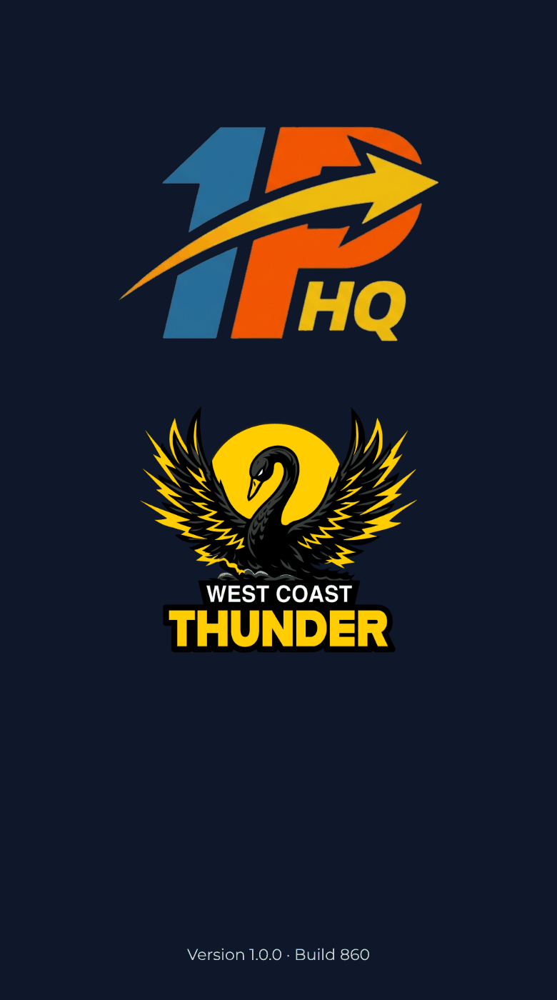

### Find your club

FirstPass HQ is one app for several clubs, and each club keeps its own members and records
separate from every other club. So the first time it opens, the app asks for your **club code**.
West Coast Thunder's is `THUNDER`. Type it in, check the club's name that appears, and tap
**Continue to West Coast Thunder**. If the club gives you a QR code, scan it with your phone's
camera instead, or open the club's invite link: either one opens the app with the club already
picked. The app remembers your club after that.

### Sign in with Google

Tap **Continue with Google** and choose your Google account. There are no passwords to remember:
Google sign-in is the only way in. The same button is used whether you're new or coming back.

If you picked the wrong club, tap **Change club** under the button.

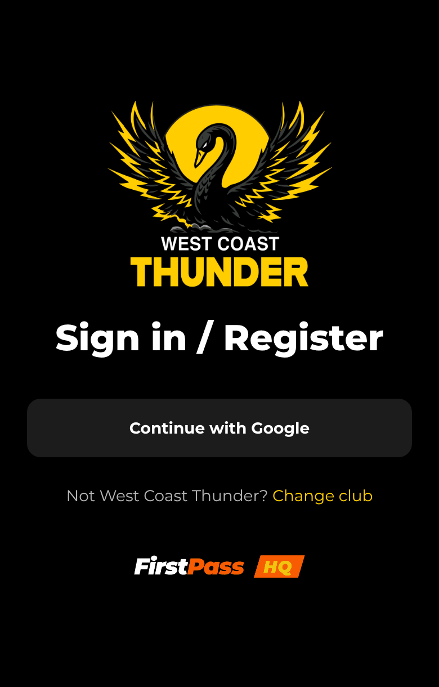

### Belonging to more than one club

If you're in two clubs that both use FirstPass HQ, tap **Switch club** at the foot of the home
screen and enter the other club's code. You ask to join each club separately, and each club only
sees what you do in that club. After that, **Switch club** lists **Your clubs**: tap one to go
straight back to it. The app stays signed in to each club, so switching doesn't need another
sign-in.

### Ask to join the club

The first time you sign in, the home screen asks you to request to join. Tap **Request to join**
and fill in:

- **Your name.**
- **PlayHQ email**: only if you registered with PlayHQ using a different email to the Google account
  you signed in with. Parents and guardians must enter the email they used to register their
  athlete, so the club can confirm who they are. An admin must verify a guardian before linking
  them to a child.
- **I am a**: the role that best describes you.
- **Squad**: athletes, coaches, managers and guardians pick their squad (guardians pick their
  athlete's squad). In a club without squads this is **Team**.
- **Club password**: if the club has set one, ask a club admin for it.

Tap **Send request**.

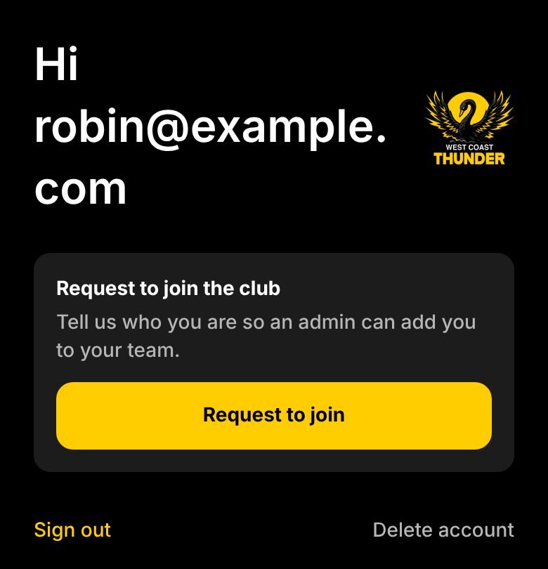
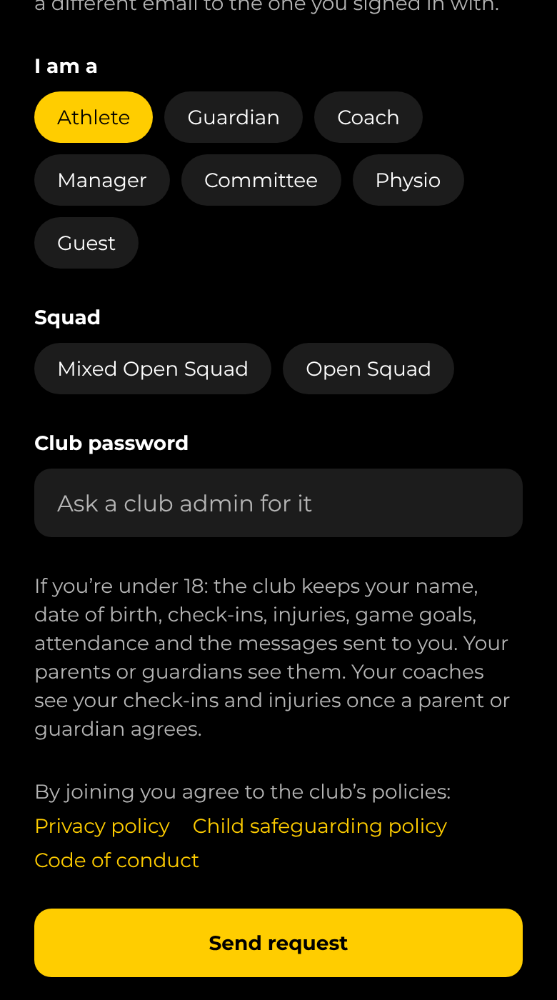

### Wait for approval

An admin checks your request against the club's PlayHQ registrations, sets your role and adds you
to your squad. Pull down on the home screen to check again.

If the admin can't match you to a registration, they may ask you for the **6-digit code** shown on
your home screen. The code proves who you are, so the admin needs to get it from you in person or
over a channel they already trust. Only ever give it to a club admin, and never share it with
anyone else.

If your request isn't approved, the home screen says why and you can tap **Request again** after
fixing your details.

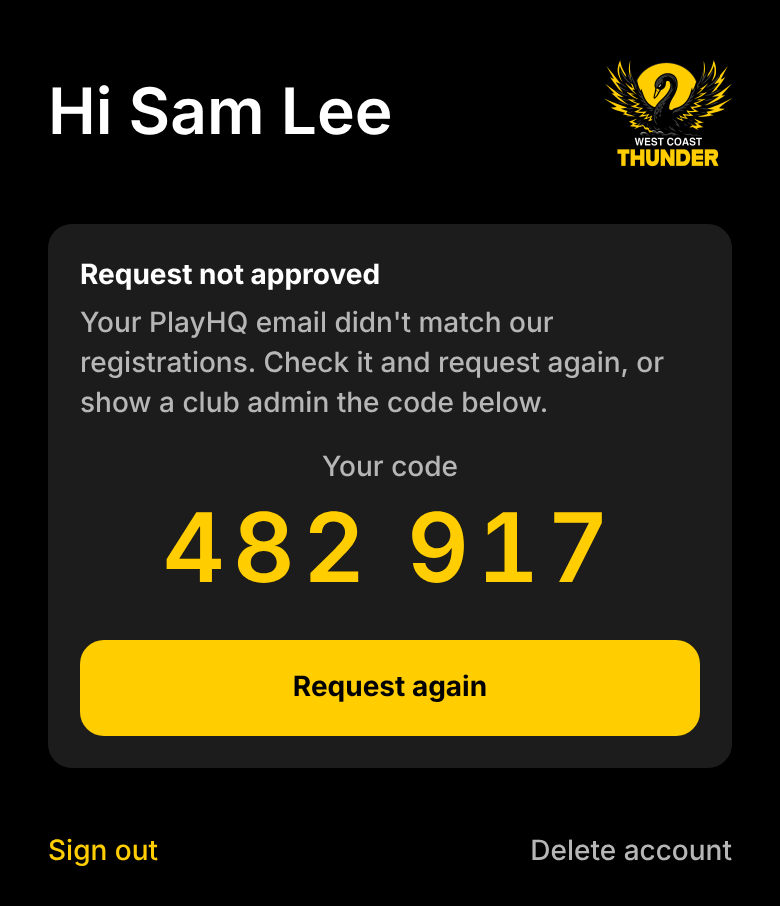

## 3. Things everyone can do

### The home screen

Once you're approved, the home screen is where everything starts. From the top:

- **To do**: things you need to do, such as your daily check-in, an award vote or an injury
  clearance to sign off.
  Tap an item to go straight to it. Each item disappears once it's done. When there's nothing,
  it says "You're all caught up."
- **Cards** for the features your role uses: Messages, Daily check-in, Check-ins,
  Injuries, Attendance, Awards and Administration. The Awards card shows while an award vote is open to you. A yellow number means something new or waiting for you.
- **Coming up**: the next six events from your calendars. Tap **Full calendar** to see them all.
- **My squads and teams**: tap one to see who's in it. A team's page also has its
  [game goals](#game-goals) for its athletes and coaches.
- **Sign out**, **Switch club** and **Delete account** at the bottom.

Pull down on any screen to refresh it.

### Messages

Messages from your coaches, managers, captains and the club arrive in **Messages**. Unread messages have a
yellow dot, and the home card shows how many are new. Opening a message marks it as read, and the
sender can see that you've read it.

Who a message went to is shown under the sender's name, for example "To Mixed Open Squad" or
"To Everyone in the club".

Guests don't get messages. Physios get messages sent to the Physio role, and messages sent to
everyone in the club only when an admin turns that on.

### Calendar

The calendar shows events from the club's Outlook calendars. You see the club calendar, plus the
calendars of the squads and teams you belong to. Committee members and admins also see the
committee calendar.

- **List** shows a week strip and the events after it, grouped by day. Use the arrows to move
  between weeks, and **Load more** at the bottom to see further ahead. The list starts today, or at
  the week you move to.
- **Month** shows a month grid with that month's events below it. Dots under a day are events,
  coloured by calendar. Tap a day to see only its events, and tap it again (or **Show all of** the
  month) to see the whole month. Days from the months either side are greyed out.
- Switching from **Month** to **List** keeps the month you were looking at: the list starts at the
  1st of that month (or today, for this month).
- You can look back 12 months (to the start of that month) and ahead 12 months. The arrow fades
  out when you reach either end.
- The chips (**All**, **Club**, your squads and teams) filter which calendars are shown.

Your teams' matches from PlayHQ appear in the calendar too, for example "Mixed Open A v Rockets"
with the venue and court. A bye shows as an all-day event. Match times follow PlayHQ, so a changed
time shows once an admin refreshes the fixtures.

Tap an event to see when and where it is. Tap the location to open it in maps, or **Copy** to copy
the address.

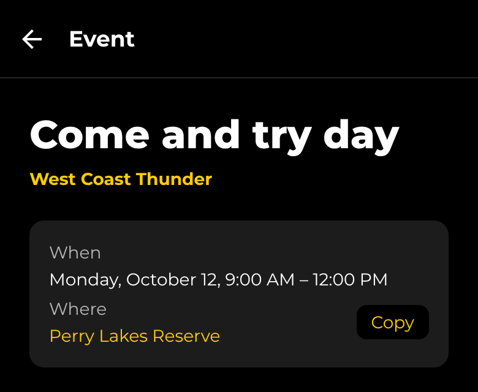

### Squads and teams

Tap a squad or team under **My squads and teams** to see everyone in it, with their position:
Head Coach, Assistant Coach, Manager, Athlete, Final team athlete or Training partner. Captains,
vice captains and club captains are marked next to their position. When Game goals is switched on,
a team's page also shows its [game goals](#game-goals) for its athletes and coaches. In a club
without squads the list is called **My teams**.

### Club awards

When the club runs an award vote that includes you, it appears in your to-do list and on the
**Awards** card. Who can vote depends on the award: for example, every member votes for Volunteer
of the year, and athletes vote for their own team's Players' player. Physios and guests don't vote.

1. Tap the vote. It shows the award, what to think about, and when voting closes.
2. Tap who you're voting for. For a 3-2-1 vote, tap three people in order: first place gets 3
   votes, second 2 and third 1. Tap someone again to take them off.
3. Tap **Vote**.

You can't vote for yourself. You can change your vote until it closes: open it again, change your
picks and tap **Change my vote**. Votes are secret. Nobody, admins included, can see who you voted
for, and only admins see the results.

Match awards, such as a coach's MVP, open for voting when each match starts and stay open for a
day or two after it.

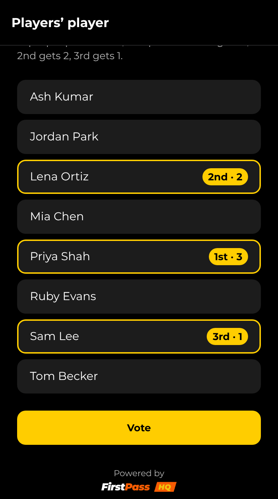

### Deleting your account

**Delete account** at the bottom of the home screen permanently deletes your account at the club
you're in: your profile, your squad and team places, guardian links and your messages inbox. Messages you sent to
a group stay with the people who received them.

The club keeps your injury records and clearance documents for 12 months after you leave, where
only the committee and admins can see them, and then deletes them. Deleting your account doesn't
change your PlayHQ registration or club membership, or your account at any other club in
FirstPass HQ.

## 4. Athletes

Athletes see Messages, Daily check-in and Injuries on their home screen, plus their calendar and
squads. Game goals are on each team's page.

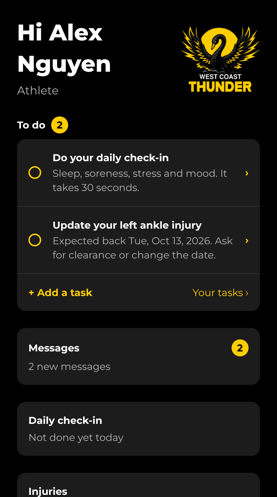

### Daily check-in

Once a day, answer four questions on a scale of 1 (bad) to 5 (good):

- How did you sleep?
- How does your body feel?
- How stressed are you?
- How's your mood?

You can add a note for your coach, such as "tight calves after Sunday's game". The line under the
note says who can read it: your coaches, and also your parents or guardians if you're under 18. Tap
**Save check-in**. It takes about thirty seconds. You can change today's answers until the end of
the day with **Update check-in**.

Your coaches see your answers so they can adjust training. A score of 2 or less on any question
flags you so a coach knows to check in with you. Below the form you can see your last two weeks,
with low scores marked.

Until you've checked in, "Do your daily check-in" stays in your to-do list.

### Game goals

**Game goals** uses the club's PlayHQ fixtures, which belong to teams, so they start once you're
picked for a team. Tap your team under **My squads and teams** on the home screen: its page shows
the team's games at the top and the people in it underneath.

- **Before a game:** in the 7 days before your next game, open it under **Next game** and add
  your goals, up to 5, such as "win 3 centre pass receives each quarter". Only your next game is
  open for goals. You can change or remove your goals until the game starts. Your coaches can add
  goals for you too; those show "set by Coach …" and only a coach can change them. Until you've set
  a goal, "Set your goals for …" stays in your to-do list.
- **After the game:** about 90 minutes after the start (the next day if PlayHQ had no start time),
  the game moves to **Played games**. For each goal, pick **Achieved**, **Partly** or **Not yet**,
  write a few words about how it went and tap **Save reflection**. You can update it later. For a
  week after the game, "Reflect on …" stays in your to-do list until every goal has a reflection.
  Your coaches' comments show under each goal.
- **Played games** lists this season's games for that team, newest first, 10 at a time; tap **Load more** for
  older ones. Games drop off the list when an admin archives the season.

Your coaches can see your goals and reflections. If you're under 18, your parents or guardians can
too, and they can set goals and reflect for you. Bye rounds are left out.

**Team goals** that your coaches set for the whole team show at the top of the game,
above your own goals. After the game you'll see how the coaches think the team went on each one.

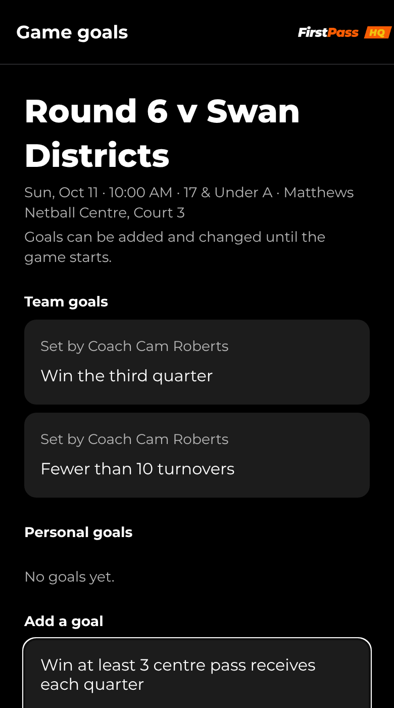

### Reporting an injury

1. Tap **Injuries**, then **Report an injury**.
2. Say where the injury is, what happened and when.
3. Add any restrictions (for example "no jumping") and when you expect to be back, if you know.
4. Tap **Report injury**.

Your coaches and the committee can see it straight away.

### Updating an injury

Open the injury to see its details and history. While you're injured:

- **Add physio update** records what the physio said, any change to restrictions or your expected
  return date, and optionally a physio report (PDF or photo, up to 10 MB).
- If your expected return date passes, your to-do list reminds you to ask for clearance or change
  the date.

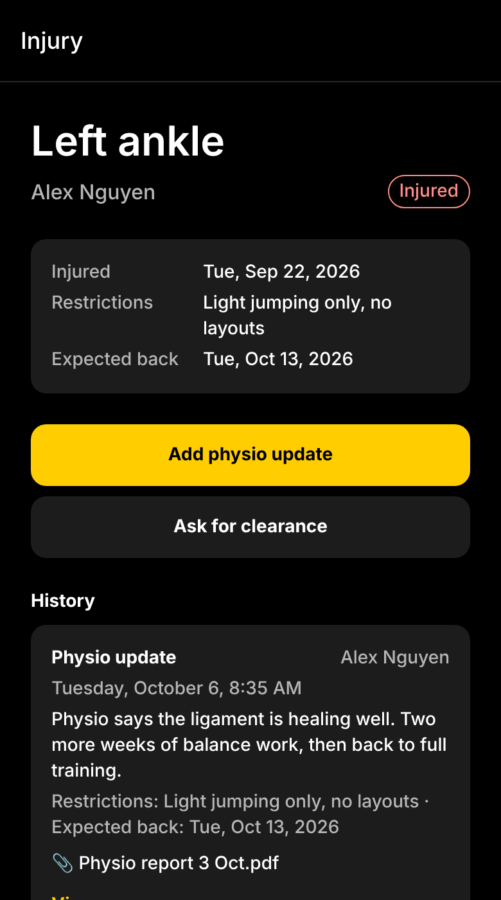

### Getting cleared to play

When you're ready to return, tap **Ask for clearance** and attach **proof of clearance**, such as a
letter from your physio or doctor. Proof is required. The people who sign it off view it inside the
app, where they can zoom in to read it.

Two people then sign off, in order:

1. **One of your coaches or a club physio endorses it** (status "Waiting for a coach or physio").
2. **A committee member accepts it** (status "Waiting for the committee"). It must be someone other
   than the person who endorsed it.

When it's accepted, the injury shows **Cleared to play**. If either of them sends it back, you'll
see their note in the history; fix what they ask and ask for clearance again.

Documents can't be removed once they're sent, so the record can't be altered later.

### Captains

If you're a **club captain**, a squad or team **captain** or a **vice captain**, you can send
messages:

- **Club captains** can send to **Everyone** in the club.
- **Captains and vice captains** can send to their own squad or team, like its coaches.

Open **Messages**, tap **New message**, choose who it goes to, write it and tap **Send**. You'll
see who has read it in **Sent**. Club admins can read every message. If you're under 18, your
parents or guardians get a copy of every message you send.

## 5. Parents and guardians

Parents and guardians of athletes under 18 sign in with their own Google account and ask to join
as **Guardian**, entering the email they used to register their athlete with PlayHQ. An admin
verifies who you are (against PlayHQ, or with the 6-digit code on your home screen) and then links
you to your athlete. Every athlete under 18 must have at least one verified guardian before they're
approved. A guardian can be linked to more than one athlete, and an athlete can
have more than one guardian.

The home screen shows who you're the guardian of. Until an admin links you, it says so.

As a guardian you:

- **Receive a copy of every message** sent to your athlete, whether it went to their squad, their
  team, all athletes or the whole club. You get each message once, even if you're also in the
  squad.
- **Receive a copy of every message your athlete sends** if they're a captain, so you see what
  they send to their squad, team or the club.
- **See your athlete's daily check-ins**, including any note they write. Your athlete is told that
  you can read their notes.
- **See the calendars** for your athlete's squad.
- **Set game goals and reflect** for your athlete, exactly as an athlete does (see
  [Game goals](#game-goals)). Tap your athlete under **Guardian of** on the home screen to see all
  their games.
- **Report and update injuries** for your athlete, and ask for clearance, exactly as an athlete
  does (see [Athletes](#4-athletes)). If you look after more than one athlete, choose which one
  when reporting.

## 6. Coaches

Head coaches and assistant coaches have the same permissions. Everything below applies to the
squads and teams you're listed in as a coach.

Coaches and managers need a current Working With Children Check, recorded by an admin, before
they're approved.

After an admin marks a squad's **squad phase complete**, coaches look after only the
athletes in their named teams. Before that, they look after everyone in the squad.

### Sending messages

1. Open **Messages** and tap **New message**.
2. Choose the squad or team (if you coach just one, it's already chosen).
3. Write the message and tap **Send**.

Everyone in that squad or team gets it, including the parents and guardians listed in it. Parents
and guardians of athletes under 18 always get a copy, even if they aren't in the squad. Open
**Sent** to see how many people have read each message, and open a message to see exactly who has
and hasn't read it. Club admins can read every message.

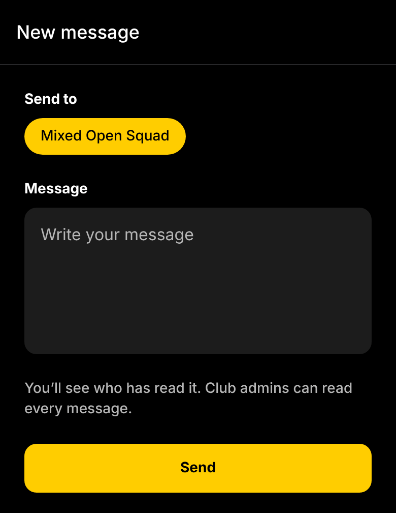

### Choosing captains

Coaches choose the captain and vice captains of the squads and teams they coach (admins can too).
Open the squad or team from **My squads and teams** and tap **Choose captains** at the bottom. For
each athlete choose **Captain**, **Vice captain** or **Neither**, then tap **Save captains**. A
group has one captain and any number of vice captains; picking a new captain makes the old one
**Neither**.

Captains and vice captains can then message everyone in that squad or team, like you. They must be
athletes in it, and they stop being able to message it if they leave it or the season is archived.
Messages from captains under 18 are copied to their parents or guardians.

### Athletes' check-ins

The **Check-ins** card shows how many of your athletes have checked in today and how many are
flagged. If any are flagged, your to-do list says "Check in with N athletes".

- **Day by day** lists today's (or yesterday's) check-ins for a squad or team: athletes to check
  in with first, with what scored low and any note, then those feeling good, then who hasn't
  checked in.
- **Trends** graphs the group's average sleep, soreness, stress and mood over 2 weeks, 4 weeks or
  3 months, with the number who checked in each day. The red line is 2, the score that flags an
  athlete.
- Tap an athlete to see their last four weeks.

### Game goals

Game goals are on the page of each team you coach: tap it under **My squads and teams**. Squads
don't have PlayHQ games, so their pages don't show goals.
**Team goals** sits at the top, and under **People** each athlete shows their next game (within
7 days) and how many goals they've set.

- Tap an athlete, then their next game, and type under **Add a goal for the athlete**. Their goals
  and yours show together; you can change or remove goals set by a coach until the game starts,
  but not the athlete's own.
- After the game, open it from **Played games** to read how the athlete thinks each goal went, and
  tap **Comment on this goal** to reply. Any of the athlete's coaches can comment.
- A number next to an athlete counts reflections no coach has commented on yet, and your to-do list
  says "Comment on N goal reflections", which opens the team.

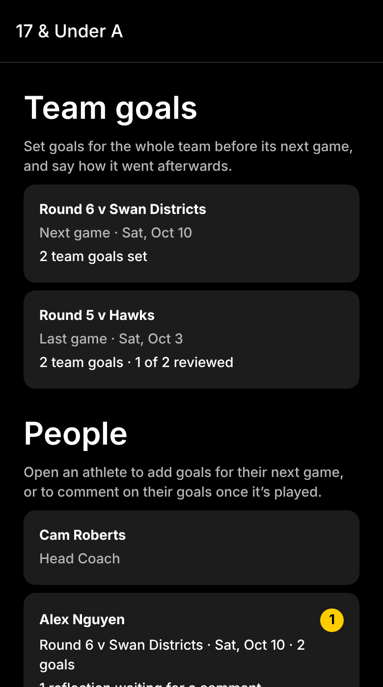

#### Team goals

At the top of a team's page, **Team goals** shows its next game (within 7 days) and its
last played game.

- Open the next game and add goals for the whole team under **Add a team goal**, up to 5, such as
  "win the third quarter". You can change or remove them until the game starts. Any coach of the
  team can. Until a team goal is set, "Set team goals for …" stays in your to-do list.
- The team's athletes and their parents or guardians see the team goals above each
  athlete's own goals.
- After the game, open the last game, pick **Achieved**, **Partly** or **Not yet** for each team
  goal, add a few words for the team and tap **Save review**. Athletes see your review.

### Match awards

Awards such as the coach's MVP can be voted on by coaches after every match. Each match your team
plays opens its own vote when it starts, in your to-do list and under **Awards**, for example
"Coach's MVP · Mixed Open A · Round 3 v Rockets". Some awards also have one **Preseason** vote,
which counts for a set share of the result.

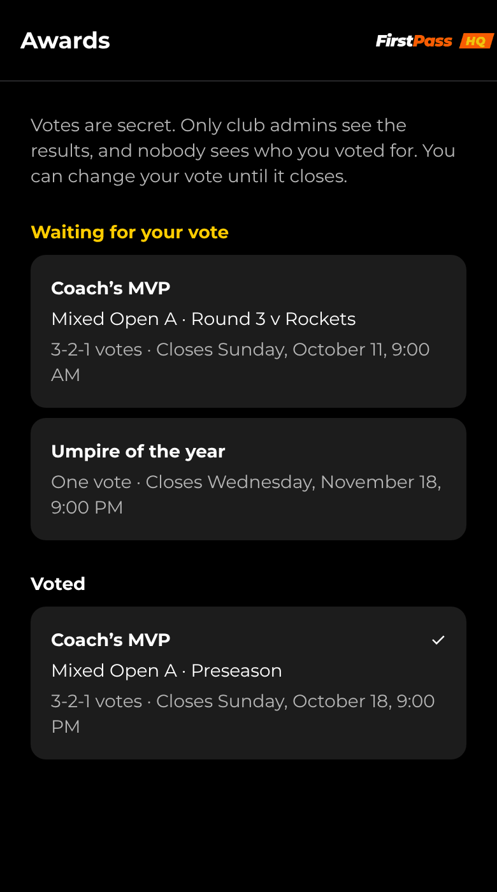

### Injuries and clearances

**Injuries** lists your athletes' current injuries with their restrictions and expected return
date. Choose **Including cleared** to see past injuries too.

When one of your athletes asks for clearance, it appears under **Waiting for your sign-off** and in
your to-do list. Open it, check the proof in the history (tap **View**), then:

- **Endorse clearance** to pass it to the committee, with an optional note such as "trained fully
  on Tuesday", or
- **Send back** with a note saying what's missing.

If an athlete has no coach, a club physio endorses instead. Admins can't endorse a clearance; they
accept it like the committee.

#### Viewing proof documents

**View** opens a document inside the app. A photo fills the screen: pinch to zoom in on the
details, drag to move around, and double-tap to zoom in or back out. A PDF shows its pages one
under the next, and you can pinch to zoom there too. There's no save or share button, and the
document isn't kept on your phone.

### Taking attendance

1. Tap **Attendance**, then **Take attendance**.
2. Choose the squad or team. You can also choose **Whole squad** for any current squad, or
   **Whole club** for club events, where every approved athlete is on the register.
3. Name the session. If a calendar event is on now (from an hour before it starts to 30 minutes
   after it ends), its name is filled in for you; other events from today are offered as chips.
4. Mark each athlete **Present** or **Absent**, or tap **Mark the rest present**.
5. Tap **Save attendance**.

If attendance was already taken for the same group in the last 3 hours, a warning shows who took
it, in case it's a duplicate. You can open that record, or carry on if it really is a different
session.

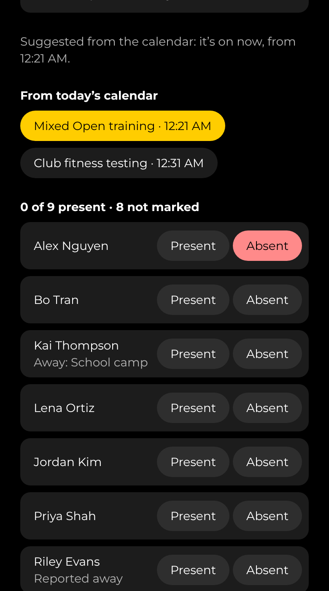

### Attendance records

- **Sessions** lists past sessions. Open one to see who was there, and **Change attendance** to
  correct it.
- **Athletes** shows each athlete's attendance over 4 weeks, 3 months or 12 months, with the last
  time they were there. Tap an athlete to see every session.

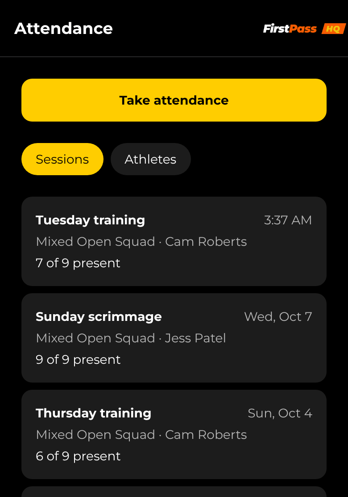

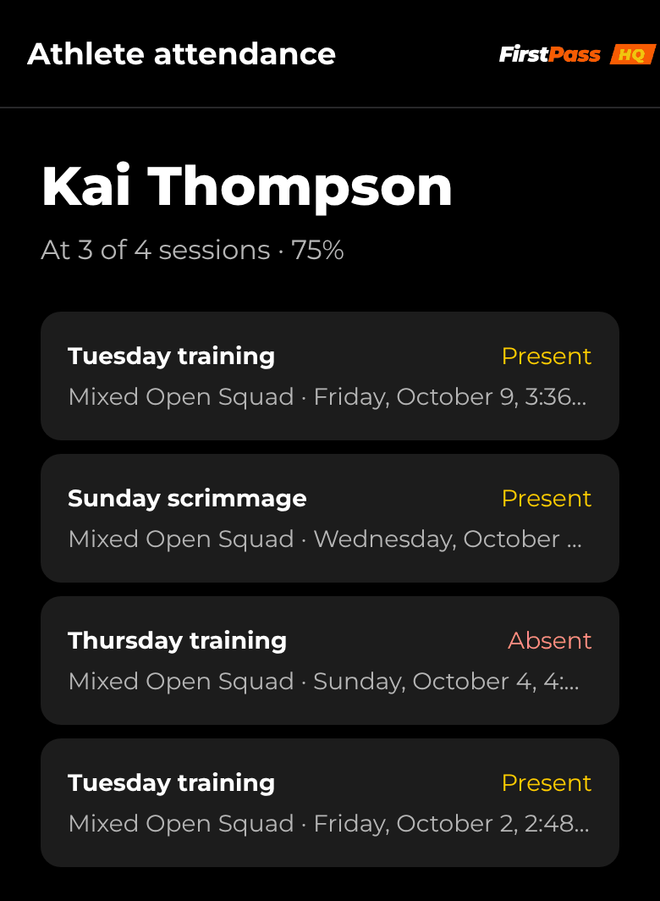

## 7. Managers

Managers look after the logistics of their squads and teams. As a manager you can:

- **Send messages** to the squads and teams you manage, and see read receipts, the same way as
  coaches (see [Sending messages](#sending-messages)).
- **Take attendance** for your groups, a whole squad or the whole club, and see and correct your
  own groups' sessions (see [Taking attendance](#taking-attendance)).

Managers don't see athletes' attendance histories, check-ins or injuries.

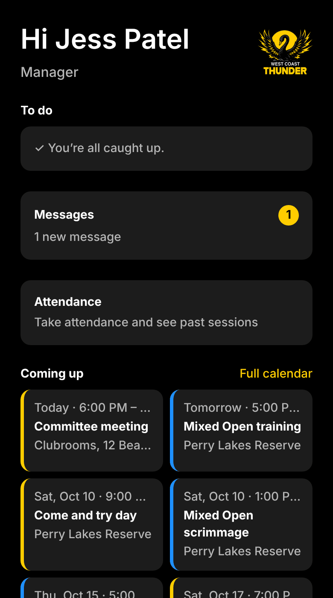

## 8. Committee

Committee members oversee the club's athletes without seeing anyone's private check-in answers.

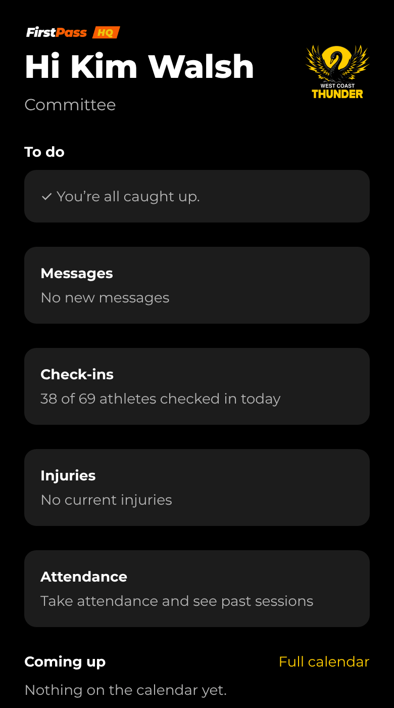

### Messages to the club

Committee members can send a message to everyone in the club. Open **Messages**, tap **New
message**, write it and tap **Send**. Guardians of athletes under 18 get a copy, and **Sent** shows
who has read it. Only admins can message a single role, such as all coaches. A committee member who
also coaches or manages a squad or team can choose **A squad or team** to message it instead.

### Check-in averages

**Check-ins** shows average scores for each squad, and for each team once its squad phase is
complete, plus how many checked in and how many are flagged. **Trends** graphs the
averages for one group or the whole club. Scores only show once at least 3 athletes in a group
have checked in, so they can't point to one person. Individual answers are only for the athlete,
their guardians and their coaches.

### Accepting clearances

The committee sees every athlete's injuries. When a coach or physio endorses a clearance, it
appears under **Waiting for your sign-off** and in the to-do list of every committee member except
the person who endorsed it. Open it, check the proof, then:

- **Accept clearance** clears the athlete to train and play, or
- **Send back** with a note.

The committee can also send back a request that no coach or physio has looked at yet. Tap **View**
on a document to read it in the app (see [Viewing proof documents](#viewing-proof-documents)).
Committee members and admins also get **Share**, to save a document to OneDrive or attach it to an
email; nobody else can save or share documents.

### Attendance

Committee members can take attendance for any whole squad or the whole club, and see every
session and every athlete's attendance (see [Taking attendance](#taking-attendance)).

### Committee calendar

Calendars an admin shares with the **Committee** appear only for committee members and admins.

## 9. Physios and guests

Physios and guests see the squads and teams and the club calendar. They don't vote in club awards,
so their home screen has no **Awards** card. Guests don't get messages. Physios have a **Messages**
card and get messages an admin sends to the Physio role. They also get messages sent to everyone in
the club when an admin turns on **Physios get club messages** in [Club settings](#club-settings).

### Physios

Physios need a current Working With Children Check, recorded by an admin, before they're approved.

- **Check-ins** shows the same squad, team and club averages the committee sees (see
  [Check-in averages](#check-in-averages)). Physios never see an individual athlete's answers.
- **Injuries** lists every current athlete's injuries, restrictions and proof documents. When an
  athlete asks for clearance, it appears under **Waiting for your sign-off** and in the physio's
  to-do list. Open it, check the proof, then **Endorse clearance** to pass it to the committee, or
  **Send back** with a note. A committee member other than the physio then accepts it. Physios
  also endorse clearances for athletes who have no coach.

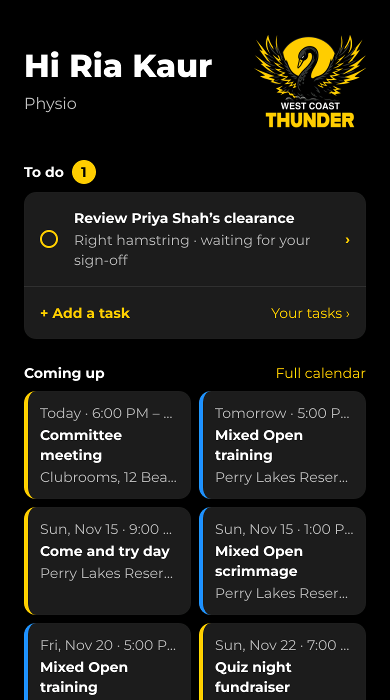

### Guests

Guests, such as the club's partners and sponsors, can only look: squads and teams, and the club
calendar.

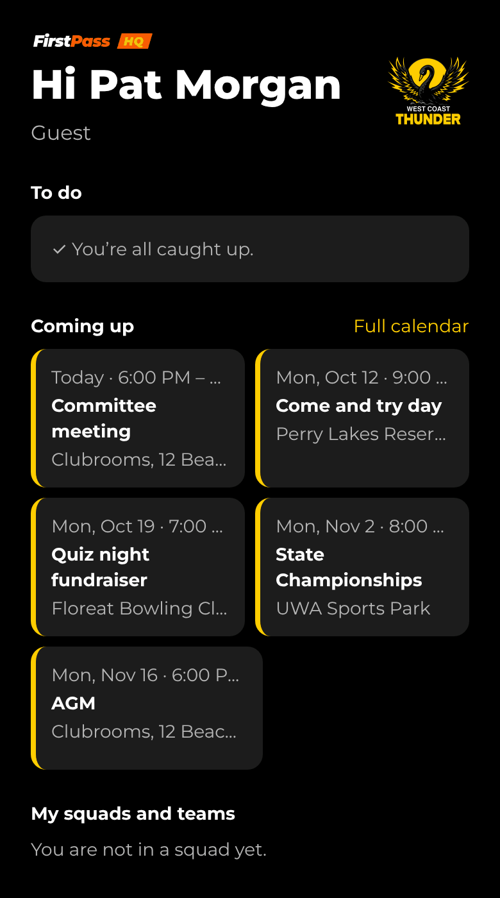

## 10. Admins

Admins can do everything above except endorse injury clearances (they accept them, like the
committee), plus run the club's set-up from **Administration** on the home
screen. Admins' to-do lists include join requests waiting for approval and clearances waiting for
sign-off, plus child-safety follow-ups: athletes under 18 with no guardian linked, Working With
Children Checks that are missing, expired or expire within 30 days, and athletes turning 18 within
30 days. Tapping a child-safety to-do opens **Members**, where the people behind it are listed
first under **Needs checking**. On an installed app, admins also get a push notification for each
new join request.

### Inviting members

**Administration > Invite members** shows the club's QR code, club code and invite link. Put the
QR code on a screen or a printed sign at training, or tap **Share invite** to send the link and
code by message or email (**Copy link** copies just the link). Scanning the code or opening the
link opens FirstPass HQ with your club picked, ready to sign in. People still ask to join, with the
[club password](#club-password) if you've set one, and you approve them as below. The password
isn't part of the invite, so share it separately.

### Approving members

**Members** lists everyone, grouped into **Waiting for approval**, **Members**, **Signed in, no
request yet** and **Not approved**. Search by name or email.

**Needs checking**, at the top, lists the members behind the child-safety to-dos on your home
screen, with the reason under each name: no Working With Children Check recorded, one that has
expired or expires within 30 days, an athlete under 18 with no guardian linked, or an athlete about
to turn 18. They also show "Needs checking" in the main list. Open someone to fix it; once saved,
they drop off the list.

Open a request to see the person's sign-in email, PlayHQ email and what they asked for. Check them
against PlayHQ, then:

1. Choose their **Role**.
2. Choose their **Squads** and, once teams are named, **Teams**. For coaches, choose **Head Coach**
   or **Assistant Coach** for each group. For athletes in a team, choose **Final team athlete** or
   **Training partner**.
3. For athletes, enter their **Date of birth** (DD/MM/YYYY). Anyone under 18 gets a **Parents and
   guardians** section: search for a guardian and tap to link them (tap ✕ to unlink). Only
   verified guardians can be linked; unverified ones show "(not verified)". Until you have a date of
   birth, choose **Under 18** or **18 or over** instead.
4. For coaches, managers and physios, enter their **Working With Children Check** card number and
   expiry date.
5. Tap **Approve**.

The app won't approve or save:

- an athlete under 18 without at least one verified guardian;
- a coach, manager or physio without a current Working With Children Check.

**Verifying someone.** Guardians must be verified before they can be linked to a child. If their
PlayHQ email matches the registration, tap **Checked against PlayHQ**. Otherwise get the 6-digit code
from their home screen yourself, in person or over a channel you already trust, enter it
under **Their code** and tap **Check code**. The member then shows as "Verified".

When an athlete turns 18, the next time you save them their guardian links are removed.

To turn someone down, choose a reason (**PlayHQ email doesn't match**, **Not registered with the
club** or **Other**) and tap **Don't approve**. They see the reason and can request again.

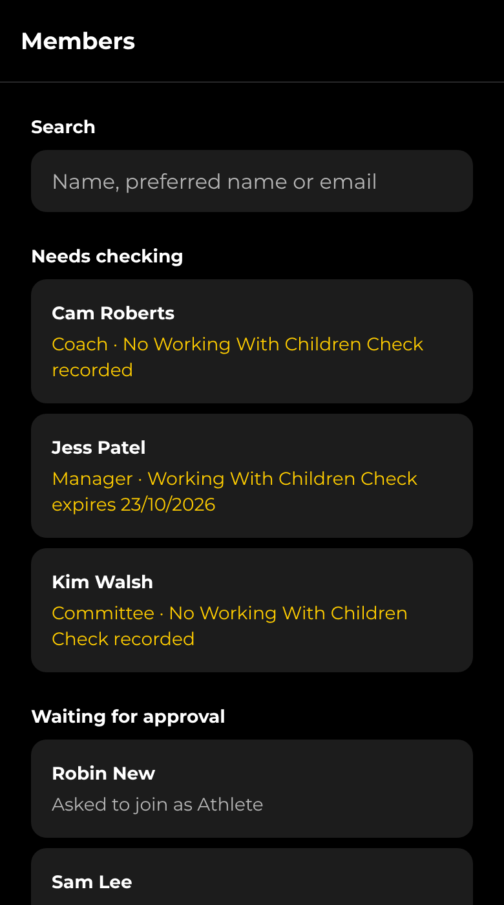
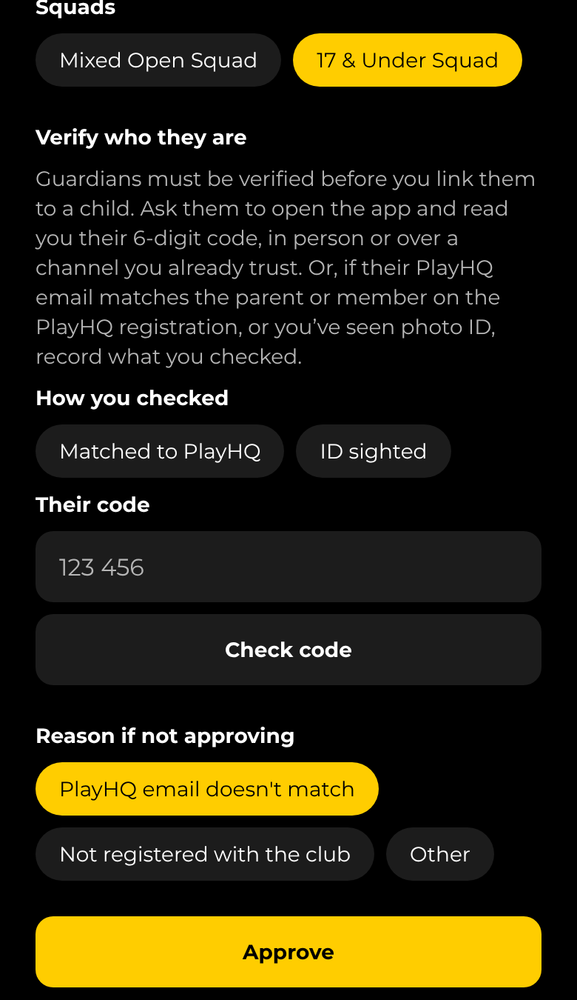

### Changing or removing members

Open any member to change their role, squads, teams or titles, then tap **Save changes**.

- **Remove access** stops someone using the app but keeps their account. Choose a reason first.
- **Delete member** permanently deletes their account, squad and team places, guardian links and
  message receipts. Messages they sent stay, and their injury records are kept for 12 months.

### Squads, teams and selections

**Squads and teams** lists the current season's squads with the teams named from each.
If the club has switched squads off in [Club settings](#club-settings), it's called **Teams** and
works more simply:

- **Add a team**: give it a name. There are no squads to choose from.
- **Choose who is in a team** (tap it): every approved athlete, coach and manager is listed. Pick
  **Final team**, **Training partner** or **Not selected** for athletes, and **In this team** or
  **Not in this team** for coaches and managers. Guardians are added from their member page and
  stay when you save.
- On a member's page, **Teams** replaces **Squads**, and athletes are picked as a final team athlete
  or training partner for each team.
- There is no squad phase to mark complete: coaches look after their team's athletes from the start.

Switching squads off part way through a season moves nobody and deletes nothing: the squads you
already have, and the teams named from them, keep working until that season ends, and the next
season starts with teams only. If you don't want to wait, **End squads now instead** on the Teams
screen does it straight away after an **Are you sure?** step: every team leaves its squad and the
squads are removed from the season. Athletes who are only in a squad, not in a team, then drop off
coaches' lists and stop getting squad messages until you add them to a team. Nothing is deleted.
Switching squads on when you only have teams works the other way:
add squads as usual, and **Put in a squad** under a team puts it in a squad of the same season.
Everyone in the team joins the squad too and keeps their place in the team.

With squads on:

- **Add a squad or team**: choose Team or Squad, give it a name, and for a team pick the squad it's
  named from.
- **Name a team** (tap it): for each person in the squad, choose **Final team**, **Training partner**
  or **Not selected** for athletes, and **In this team** or **Not in this team** for coaches and
  managers. People not selected stay in the squad.
- **Rename** or **Remove** a squad or team. Removing it takes it off this season's lists, home
  screens and coaches' to-dos; its attendance and other records are kept and you can **Bring
  back** it later.
- **Mark squad phase complete** when a squad's teams are named. From then on, coaches only
  look after their own team's athletes, and clearances for athletes left only in the squad fall to
  admins. You can **Undo** it.

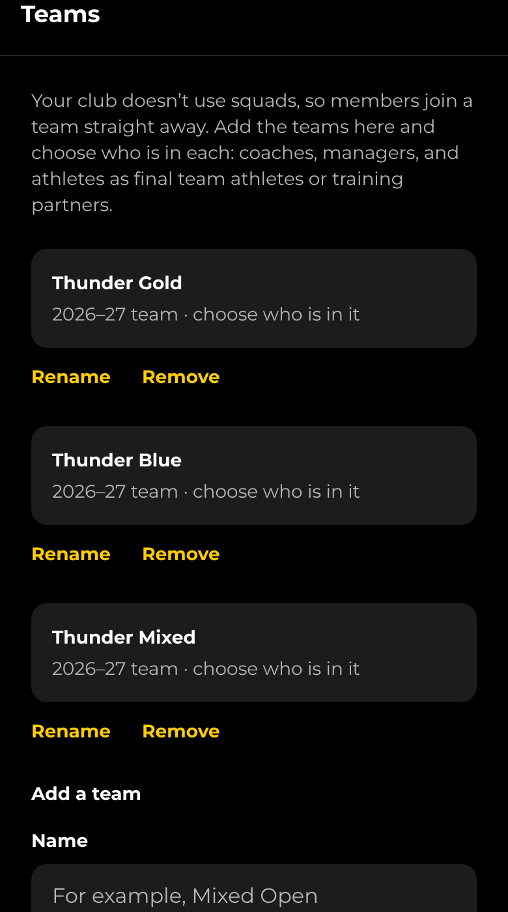
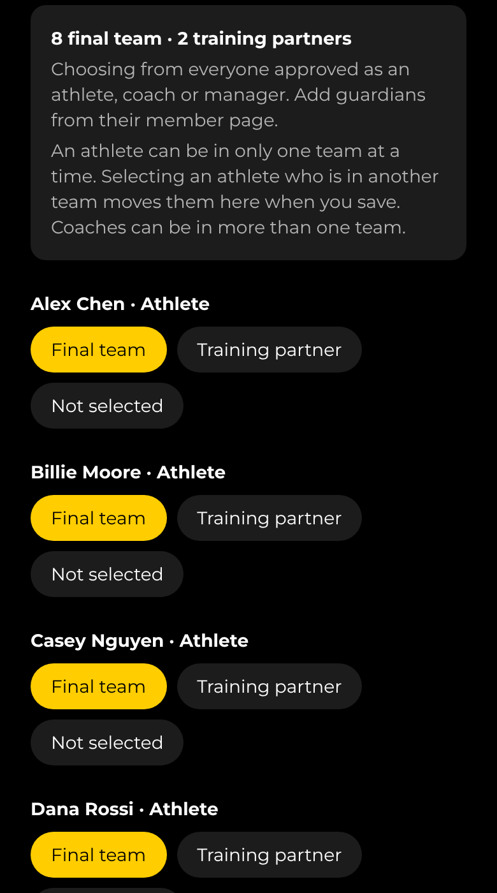

### Seasons

The club year runs May to May. **Seasons** handles the change-over:

1. **In May, start the next season.** This creates empty squads with the same names, and their
   squad calendars, for the new season (for example 2027–28). Nobody is moved, and last season
   keeps running alongside.
2. **Place returning members.** Open each new squad and pick who's coming back from last season's
   squads. They keep their club role, and coaches keep their title. New people still send a join
   request and join the newest season's squads.
3. **About 4–6 weeks after Easter, archive the old season.** Its squads and teams leave everyone's
   home screen, calendars, messages and to-dos. Attendance, injuries and check-ins are kept, and
   you can bring the season back.

Nothing is deleted when a season is archived.

In a club without squads, starting a season copies last season's teams (and their calendars)
instead, and you place returning members in each team. Athletes keep being a final team athlete or
training partner, as they were last season. If the club has just switched squads off, the new
season starts with the teams that were named from last season's squads.

### Awards

**Awards** lists the club's awards by season. Tap **New award**. You can tap one of the club's
past awards under **Start from a past award** to fill in its settings, then enter the **Name** and
**Description** (what voters should think about).

The rest of the form is in sections. Each one shows a one-line summary of what it is set to; tap
it to open it and change the settings. A section opens by itself, with its summary in colour,
when something in it needs a look. If **Save award** is greyed out, the line above it says what's
still needed.

- **Season and closing date**: the season, and when **Voting closes**. Pick the day on the
  calendar, using the arrows to move to later months.
- **Voters**: **The whole club**, or **Chosen squads and teams**. For chosen groups, pick **One
  winner** or **A winner for each** squad or team. With a winner for each, members vote only in
  their own group. Then the **Roles that vote**. Athletes, coaches, managers and guardians vote in
  the squads and teams they're in. Committee and admins vote wherever they are. **Every member**
  opens it to everyone except physios and guests, who don't vote.
- **Nominees**: **Athletes** or **Coaches** in the voting groups, **Any member**, or **Names I
  list**, one per line, for people who aren't in the app, such as umpires.
- **Age restricted** (not for listed names): **Any age**, or **Set ages** to match the committee's
  definition of the award, such as Rising Star. Enter a **Minimum age**, a **Must be under** age,
  or both: minimum 16 and under 21 means nominees aged 16 to 20. Then choose when ages are
  measured: **The day voting closes**, or **A day I choose** such as 1 January. Only people with a
  date of birth can be voted for, so the award's page says in colour how many possible nominees
  have none: add it on their page in **Members**. The ages can't change once anyone has voted.
- **Ballot**: **One vote**, **3-2-1 votes** or **5-4-3-2-1 votes**. For awards with a winner for
  each group, **When people vote**: **Once, before it closes**, or **After every match**, using
  the PlayHQ fixtures. Match votes stay open for a set time after each match starts (see **How
  match awards find their games** below). Match awards can also have a **Preseason share of the
  result**: voters get one preseason ballot, and with 25% the result is 25% each nominee's share
  of the preseason points and 75% their share of the match points.

Open an award to see its standings for each squad or team, and how many people have voted in each
match or ballot. Once anyone has voted, only the name, description, closing dates, match voting
window and listed names can change, and the award can't be removed.

**How match awards find their games.** When you import fixtures, each PlayHQ team is linked to
one squad or team in the app (step 3 under **Fixtures**). A match award only opens votes for the
games linked to the exact squads and teams it names. For example, if "West Coast Thunder Mixed" is
linked to **Mixed Open A**, an award for **Mixed Open Squad** gets no match votes for those games:
choose **Mixed Open A** in the award, or change the link under **Fixtures**. A team's games don't
count for its squad, or the other way round. The award form shows how many PlayHQ games each
chosen squad or team has, and warns in colour when it has none. Each award's page shows the next
match for each squad or team, or says that none are linked.

**Duplicate** on an award opens a new award with the same settings, ready for this season, so
you can run it again. Pick when voting closes, check the rest and tap **Save award**. It picks the
squads and teams with the same names in the chosen season. Teams are usually named after the
season starts, so it says when a team has no match yet: add it once the team is named.

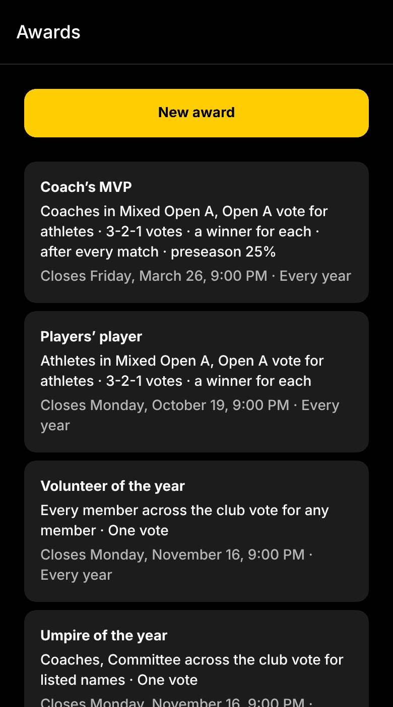

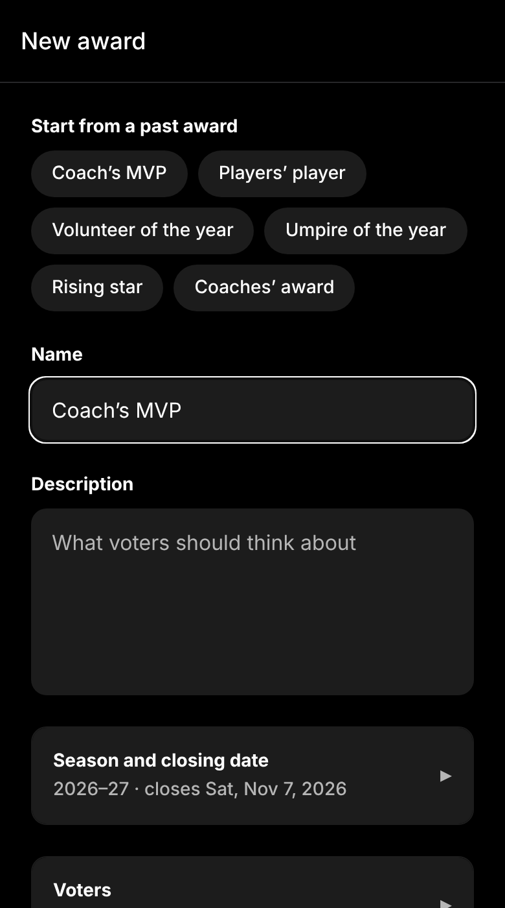
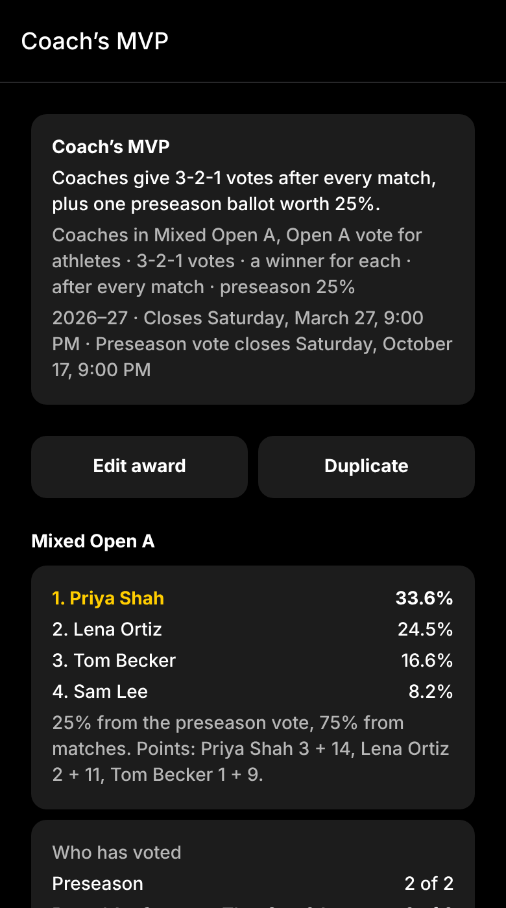

### Fixtures

**Fixtures** brings in match fixtures from PlayHQ:

1. On playhq.com, open the competition and copy its link, for example
   `https://www.playhq.com/netball-australia/org/…/australian-championships-summer-202526/ec69e46d`.
2. Paste it under **Add a PlayHQ competition** and tap **Look up**. A **PlayHQ check** shows how
   quickly PlayHQ answered, how many teams it found, and how many games the competition has in the
   last 12 months and scheduled in the next 12 months. Once you link teams it adds the same counts
   for our teams. A red note means PlayHQ has no games within 12 months of today, so check the link
   is for the right season.
3. Teams with "Thunder" in their name are listed. To find another, type part of its name under
   **Find a team**. Tap each of our teams and choose the squad or team it is. Choose the same
   squad or team your match awards name: match votes only open for games linked to exactly that
   squad or team (see **How match awards find their games** under **Awards**).
4. Tap **Import games**.

The games then show in each team's calendar, open match award votes and let athletes set game
goals. PlayHQ changes times and
courts as a competition goes on, so tap **Refresh from PlayHQ** to pick up changes, or
**Change teams** to link more teams. A refresh shows the PlayHQ check on that competition again, so
it is also the way to confirm PlayHQ is still working. **Coming up** lists the next matches.

If a look-up or refresh fails, the message says which part failed: PlayHQ itself, your connection,
an expired sign-in, or the club's PlayHQ service not being set up on the server. The details also
go to the app's log on your phone.

### Calendars

**Calendars** connects the club's Outlook calendars. In Outlook, publish the calendar and copy its
ICS link, then paste it under **Add a calendar**, give it a name and choose who it's shown to:
**Everyone**, the **Committee**, or one squad or team. Each calendar has a colour, used for its
events in the app. **Edit name or link** and **Delete** change or remove one.

### Club captains

**Club captains** in Administration lists the athletes in the current season's squads and teams.
Tap the athletes who are club captains (yellow means chosen) and tap **Save club captains**. Club
captains can message everyone in the club until that season is archived; choose new ones each
season. If last season is still running alongside the new one, pick the season first. Athletes
under 18 are marked, and their parents or guardians get a copy of everything they send.

Admins can also choose any squad or team's captain and vice captains, the same way coaches do (see
[Choosing captains](#choosing-captains)).

### Messages to the club or a role

Admins can send a message to **Everyone**, to **A role** (such as all guardians or all coaches), or
to **A squad or team**. Admins can read every message and its read receipts.

### Injury report

**Injury report** lists injuries reported or cleared in the last few months (3 by default), plus
every injury not yet cleared, with totals. **Export CSV** opens the share sheet so you can save it
to OneDrive or attach it to an email.

### Club settings

**Club settings** sets up the app for the club. Anything left empty uses the app's built-in
FirstPass look: the name "FirstPass HQ", the FirstPass 1P mark as the logo, and blaze orange
(`#F75C03`) on deep navy (`#0F172A`). West Coast Thunder's name, logo and yellow-on-black colours are saved here,
so leave them filled in.

- **Club name** is used in the app's wording and read out by screen readers for the logo. The **short name** (for example
  "Thunder") finds the club's teams when importing PlayHQ fixtures and names exported files.
- **Logo**: **Choose logo** to upload a square PNG or JPEG up to 2 MB. It shows on the home screen
  and the sign-in screen, and under the FirstPass 1P mark when the app opens. **Use the FirstPass
  mark** goes back to the built-in FirstPass 1P mark. "Powered by" and the FirstPass HQ logo always
  stay at the foot of every screen, and the 1P mark on the opening screen.
- **Colours**: type a colour code such as `#FFCD00` for the **background** and the **hero
  colour** (buttons, links and highlights), and choose **Light text** or **Dark text** to suit the
  background. Panels and the softer text for details are worked out from these (on the built-in deep navy
  they use the FirstPass brand guide's panel and text colours). The preview shows
  how they look together and warns when text or buttons would be hard to read. **Use the built-in
  colours** goes back to deep navy, white and blaze orange.
- **Features**: switch off any of Messages, Calendar, Daily check-ins, Injuries, Attendance,
  Awards and Game goals. A switched-off feature disappears from every member's home screen, to-do list and menus,
  and its Administration pages are hidden. Nothing is deleted, so switching it back on brings
  everything back.
- **Squads**: **Members join a squad first** is on unless the club switches it off. Switched off,
  members join a team straight away, admins add teams without squads and choose their athletes from
  the whole club, attendance takers can take attendance for any team, and each new season copies
  the teams. Squads the club already has stay until that season ends, and nobody is moved.
- **Physios get club messages**: when on, messages sent to everyone in the club also go to
  physios. Physios always get messages sent to the Physio role. It starts off.

Tap **Save club settings**. Members see the changes the next time they open the app. Someone
who has just installed the app sees the FirstPass look on the sign-in screen until they sign in.
The app's icon (the FirstPass 1P mark), its name under the icon (FirstPass HQ) and the splash screen are
part of the app build and don't change here.

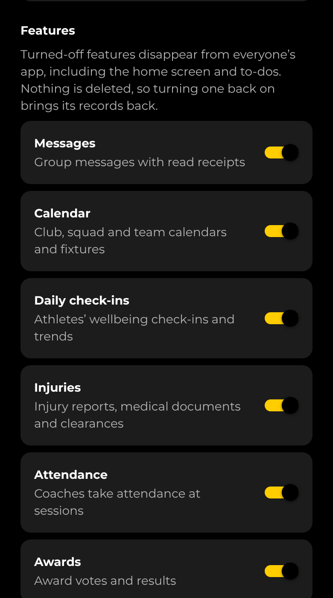

### Club password

**Club password** sets a password new members must enter to ask to join. It stops strangers who
find the app from sending requests. Approved members never need it. For security it can't be shown
once saved, only replaced or removed.

## 11. Who can see what

| Information             | Who can see it                                                                                                              |
| ----------------------- | --------------------------------------------------------------------------------------------------------------------------- |
| Your profile and squads | You, the people in your squads and teams (names and positions only), and admins.                                            |
| Captains                | Club captains: every member. A squad or team's captains: the people in it, and admins.                                     |
| Date of birth and Working With Children Check | You and admins. Awards with an age limit use it to decide who can be voted for, without showing it.   |
| Messages                | The people they were sent to, the sender, and admins. Guardians of athletes under 18 get a copy of every message sent to their athlete, and of every message their athlete sends as a captain. Guests don't get messages; physios get messages sent to the Physio role, and whole-club messages only if an admin turns that on. |
| Read receipts           | The sender and admins.                                                                                                      |
| Daily check-in answers and notes | The athlete, their guardians and their coaches. The committee, physios and admins see only group averages, hidden below 3 check-ins. |
| Injuries and documents  | The athlete, their guardians, their coaches, physios, the committee and admins. Managers don't see injuries. Only the committee and admins can save or share documents; everyone else views them in the app. |
| Game goals and reflections | The athlete, their guardians and their coaches. The committee, physios and admins don't see them. |
| Team goals              | The team's athletes, their guardians and its coaches. Only its coaches set and review them. |
| Attendance records      | Coaches, the committee and admins. Managers see their own groups' sessions. Athletes and guardians don't see attendance.    |
| Committee calendar      | Committee members and admins.                                                                                               |
| Award votes             | Only the voter sees their own ballot. Nobody, admins included, can see who someone voted for.                               |
| Award results           | Admins only: standings and how many people have voted.                                                                      |
| Match fixtures          | The members of each squad or team, and admins.                                                                              |
| Club name, colours and logo | Every signed-in member. The logo file is public so it can show before sign-in. Only admins can change them.            |
| Other clubs' members and records | Nobody in this club. Each club's members, messages, injuries and documents are kept in that club's own database, which other clubs can't reach. |

When someone leaves, injury records and proof documents are kept for 12 months, visible only to the
committee and admins, then deleted automatically.

## 12. Keeping this guide up to date

This guide lives in the app's repository at `docs/user-guide.md`, with its screenshots in
`docs/user-guide/`. Any change that adds, removes or changes something a member can see or do must
update the matching section, the tables in sections 1 and 11, and any screenshot that no longer
matches, in the same pull request.

Screenshots are taken from the web build with sample data (no real club data), at a 390 × 844
phone screen at 2× scale. The tooling (`shoot.mjs`, `serve.py` and the fixtures, including
`user-guide.mjs` for screens only this guide uses) is kept in the project's shared files under
`thunder/screenshots/`.
