# West Coast Thunder app: user guide

This guide explains what the club's FirstPass HQ app does and how to use it, role by role. Every screen
shown is from the app itself, filled with made-up sample people.

**Printing:** open this file in any Markdown viewer (GitHub, VS Code, Typora) and print to PDF.
Each role starts on a new page when the viewer supports page breaks.

<!-- Maintainers: this guide must match the app. See "Keeping this guide up to date" at the end. -->

**Child safety comes first.** Anyone signed in can **Raise a concern** from the home screen, and the
club's Child Safety Officer and Complaints Manager act on it. If a child is in danger now, call
000. [Section 12](#12-child-safety-and-safeguarding) explains every protection the app gives
children, for parents, committees, boards and the sport's governing body.

## Contents

1. [Roles at a glance](#1-roles-at-a-glance)
2. [Getting started](#2-getting-started)
3. [Things everyone can do](#3-things-everyone-can-do)
4. [Athletes](#4-athletes)
5. [Parents and guardians](#5-parents-and-guardians)
6. [Coaches](#6-coaches)
7. [Managers](#7-managers)
8. [Committee](#8-committee)
9. [Physios and guests](#9-physios-and-guests)
10. [Admins](#10-admins)
11. [Who can see what](#11-who-can-see-what)
12. [Child safety and safeguarding](#12-child-safety-and-safeguarding)
13. [Keeping this guide up to date](#13-keeping-this-guide-up-to-date)

## 1. Roles at a glance

Everyone in the app has a main **club role**, and some people have **other roles** as well, such as
a coach who is also a parent. Coaches, managers, physios, athletes and guardians also belong to one or more
**squads** or **teams** for the current season. Someone with more than one role can do everything
each of their roles can.

| Role          | Who it's for                                                                                         |
| ------------- | ---------------------------------------------------------------------------------------------------- |
| **Athlete**   | Registered players. Some are club captains, or captains or vice captains of a squad or team.        |
| **Guardian**  | Parents and guardians of athletes under 18.                                                          |
| **Coach**     | Head coaches and assistant coaches. Both have the same permissions; the title only shows who is who. Need a current Working With Children Check; the role pauses while it's expired. A parent volunteering at their child's club, or a volunteer under 18, has an exemption instead (see [Volunteer exemptions](#volunteer-exemptions)). |
| **Manager**   | Squad and team managers. Need a current Working With Children Check; the role pauses while it's expired. A parent volunteering at their child's club, or a volunteer under 18, has an exemption instead (see [Volunteer exemptions](#volunteer-exemptions)). |
| **Committee** | Club committee members. Each can add a title, such as President or Secretary, shown with their role. Need a current Working With Children Check unless an admin exempts them; the role pauses if a recorded check expires. |
| **Physio**    | The club's physiotherapists. A physio can be placed in squads or teams to look after their athletes, and one can be the **Head Physio**, who looks after every athlete. Need a current Working With Children Check; the role pauses while it's expired. A parent volunteering at their child's club, or a volunteer under 18, has an exemption instead (see [Volunteer exemptions](#volunteer-exemptions)). |
| **Guest**     | Anyone else the club lets in, such as partners and sponsors. Guests can only look.                   |
| **Admin**     | The people who run the app. Admin is granted by another admin, never requested. Admins can add a title too. Need a current Working With Children Check unless another admin exempts them. An expired check doesn't pause the admin role, so the club is never locked out, but it stays on the admins' to-do list until it's renewed. |

**Safeguarding contacts.** An admin names one member as the club's **Child Safety Officer** and
another as its **Complaints Manager**. They're not separate roles: each keeps their own role and also
sees and acts on the concerns members raise (see [The concerns register](#the-concerns-register)).

**Squads and teams.** Each season, members join a **squad** (at West Coast Thunder: Mixed Open
Squad, Open Squad, 20 & Under Squad, 17 & Under Squad, Lightning Academy). At selections, admins name
**teams** from a squad and pick each team's final team athletes and training partners. People selected for a team stay
in their squad as well. A club that doesn't use squads can switch them off in
[Club settings](#club-settings): members then join a **team** straight away, as a final team athlete
or training partner, and the app talks about teams wherever it would say squad.

**Combining roles.** An admin adds other roles from the member's page. Some roles can't go
together:

- **Guests** can't have any other role.
- **Admins** can also be a coach, manager, physio, committee member or guardian, but not an athlete.
- **Athletes** can't also be a manager or a physio. An athlete can coach, but only a squad or team
  they don't play in.
- **Athletes under 18** can only add Coach. Parents and guardians must be 18 or over.
- **Who is under 18** is decided by the date of birth an admin checks against PlayHQ or ID. An
  athlete can't be approved without one.
- Nobody endorses or accepts an injury clearance for themselves or their own child, and whoever
  endorsed a clearance can't also accept it.

The home screen lists every role someone holds, such as "Coach, Guardian", and shows what each of
those roles would show on its own.

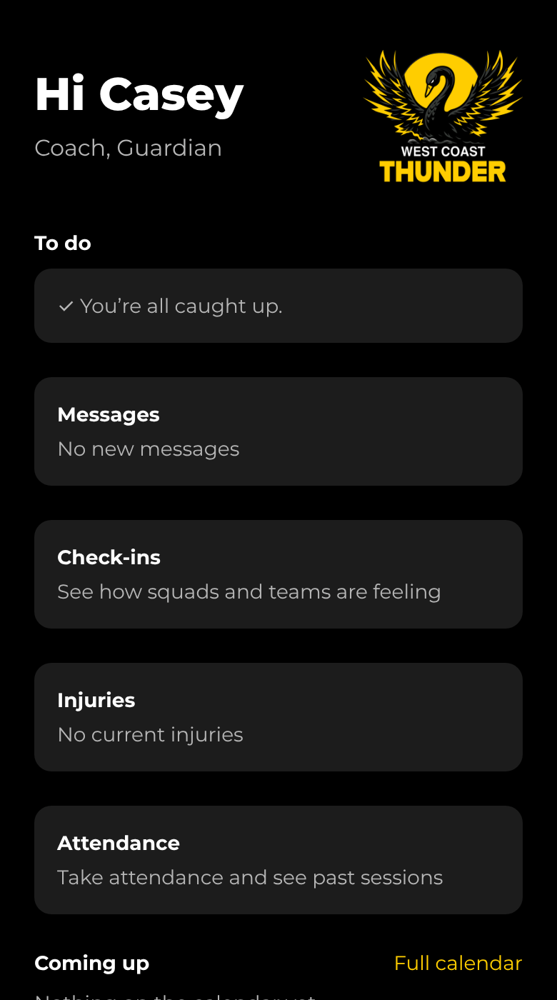

**Captains.** Admins choose **club captains** from the season's athletes, and admins or a squad or
team's coaches choose its **captains** and **vice captains**. Captains stay athletes; captaincy only
adds the right to send messages. Club captains can message the whole club, and captains and vice
captains can message their own squad or team. Captaincy ends when the season is archived.

What each role sees on its home screen:

| Feature                                | Athlete |     Guardian    |    Coach     |  Manager   |   Committee   |     Physio    |  Guest  |     Admin     |
| -------------------------------------- | :-----: | :-------------: | :----------: | :--------: | :-----------: | :-----------: | :-----: | :-----------: |
| To-do list and calendar                |    ✓    |        ✓        |      ✓       |     ✓      |       ✓       |       ✓       |    ✓    |       ✓       |
| My squads and teams                    |    ✓    |        ✓        |      ✓       |     ✓      |  If in one    |       ✓       |    ✓    |   If in one   |
| Read messages                          |    ✓    |        ✓        |      ✓       |     ✓      |       ✓       |       ✓*      |         |       ✓       |
| Send messages                          | Captains† |                 |  Own groups  | Own groups |   Whole club  |               |         |     Anyone    |
| Daily check-in                         |    ✓    |                 |              |            |               |               |         |               |
| Game goals and reflections             |   Own   |  See athlete's  | Own athletes |            |               |               |         |               |
| Team goals for a game                  | See, comment |       See       | Set, review, comment |            |               |               |         |               |
| Check-ins of others                    |         |                 | Own athletes |            | Averages only | Averages only |         | Averages only |
| Report an injury                       |   Own   | Their athlete's |              |            |               |               |         |               |
| See injuries                           |   Own   | Their athlete's | Own athletes |            |      All      |  Own athletes‡ |         |      All      |
| Sign off injury clearances             |         |                 |   Endorse    |            |     Accept    |   Endorse‡    |         |     Accept    |
| See who opened injury documents        |   Own   | Their athlete's |              |            |               |               |         |       ✓       |
| Consent for a child's check-ins and injuries |         |        ✓        |              |            |               |               |         |  See status   |
| Take attendance                        |         |                 |      ✓       |     ✓      |       ✓       |               |         |       ✓       |
| See athletes' attendance history       |         |                 |      ✓       |            |       ✓       |               |         |       ✓       |
| Vote in club awards                    |    ✓    |        ✓        |      ✓       |     ✓      |       ✓       |               |         |       ✓       |
| Set up awards and see results          |         |                 |              |            |               |               |         |       ✓       |
| Complete integrity training            |   Own   | Their athlete's |     Own      |    Own     |      Own      |      Own      |         |      Own      |
| Check training certificates            |         |                 |              |            |       ✓       |               |         |       ✓       |
| Set integrity training                 |         |                 |              |            |               |               |         |       ✓       |
| Governance reports as PDFs             |         |                 |              |            |               |               |         |       ✓       |
| Import fixtures from PlayHQ            |         |                 |              |            |               |               |         |       ✓       |
| Preferred name                         |    ✓    |        ✓        |      ✓       |     ✓      |       ✓       |       ✓       |    ✓    |       ✓       |
| Title, such as President               |         |                 |              |            |       ✓       |               |         |       ✓       |
| Club name, colours, logo and features  |         |                 |              |            |               |               |         |       ✓       |
| Invite members (QR code and link)      |         |                 |              |            |               |               |         |       ✓       |
| Administration                         |         |                 |              |            |               |               |         |       ✓       |

† Athletes who are captains: club captains can message the whole club, and squad and team
captains and vice captains their own squad or team. Messages from captains under 18 are copied to
their parents or guardians.

\* Physios get messages sent to the Physio role and to the squads and teams they're in. They get
messages sent to everyone in the club only when an admin turns on **Physios get club messages** in
Club settings.

‡ A physio placed in squads or teams looks after the athletes in them. The Head Physio, and a
physio who isn't in any squad or team, looks after every athlete.

"Own groups" and "own athletes" mean the squads and teams you're listed in as a coach or manager.
Club awards are voted on by the roles, squads and teams each award names, so not every award is
open to everyone.

Integrity training applies to the roles, squads and teams an admin chooses for each course, so not
everyone has training to complete.

Admins can turn off Messages, Calendar, Daily check-ins, Injuries, Attendance, Awards, Game goals
and Integrity training for the whole club in **Club settings**. A feature that's off disappears for every role.

## 2. Getting started

### Install the app

The club sends a link to install the app on iPhone (TestFlight) or Android. The app is called
FirstPass HQ, made by FirstPass. It opens on the FirstPass 1P mark on deep navy, and the first
time, before it knows which club you're in, asks for your club and then shows the sign-in screen.
Once you pick your club and sign in it switches to West Coast Thunder's logo and colours and
remembers them. From then on, each time the app opens, the 1P mark appears in the middle, then
rises to make room for the Thunder logo beneath it.

Whatever the club's look, "Powered by" and the FirstPass HQ logo stay at the foot of every
screen.

### Find your club

FirstPass HQ is one app for several clubs, and each club keeps its own members and records
separate from every other club. So the first time it opens, the app asks for your **club code**.
West Coast Thunder's is `THUNDER`. Type it in, check the club's name that appears, and tap
**Continue to West Coast Thunder**. If the club gives you a QR code, scan it with your phone's
camera instead, or open the club's invite link: either one opens the app with the club already
picked. The app remembers your club after that.

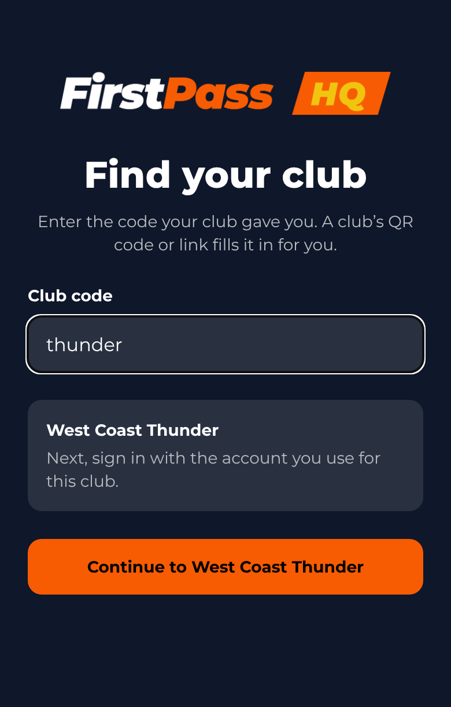

### Sign in with Google

Tap **Continue with Google** and choose your Google account. There are no passwords to remember:
Google sign-in is the only way in. The same button is used whether you're new or coming back.

If you picked the wrong club, tap **Change club** under the button.

### Belonging to more than one club

If you're in two clubs that both use FirstPass HQ, tap **Switch club** at the foot of the home
screen and enter the other club's code. You ask to join each club separately, and each club only
sees what you do in that club. After that, **Switch club** lists **Your clubs**: tap one to go
straight back to it. The app stays signed in to each club, so switching doesn't need another
sign-in.

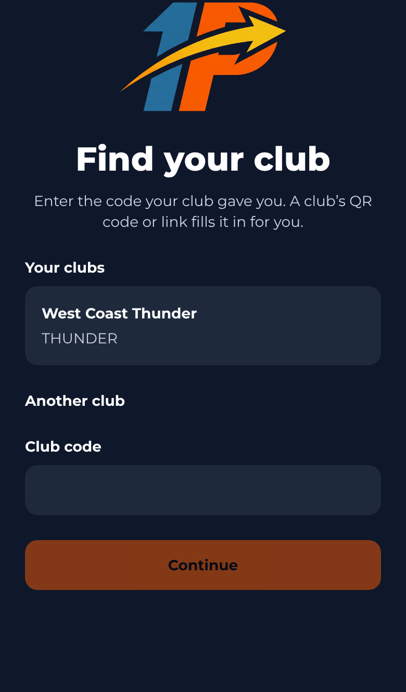

### Ask to join the club

The first time you sign in, the home screen asks you to request to join. Tap **Request to join**
and fill in:

- **Your name.**
- **Date of birth** (DD/MM/YYYY): everyone gives it. An admin checks it against PlayHQ or ID before
  approving you, and it decides whether the club's rules for under 18s apply.
- **PlayHQ email**: only if you registered with PlayHQ using a different email to the Google account
  you signed in with. Parents and guardians must enter the email they used to register their
  athlete, so the club can confirm who they are. An admin must verify a guardian before linking
  them to a child.
- **I am a**: the role that best describes you.
- **Squad**: athletes, coaches, managers and guardians pick their squad (guardians pick their
  athlete's squad). In a club without squads this is **Team**.
- **Club password**: if the club has set one, ask a club admin for it. Five wrong tries in a row
  lock you out of asking for 15 minutes.

The club's policies are linked above **Send request**: by joining you agree to them. If you choose
**Athlete**, a note explains what the club keeps about athletes under 18 and who sees it.

An athlete under 18 also gives a **Parent or guardian's email**: the email their parent or guardian
will sign in with. A parent or guardian needs to join the club in the app too, and an admin links
them to the child before the child can be approved.

Tap **Send request**.

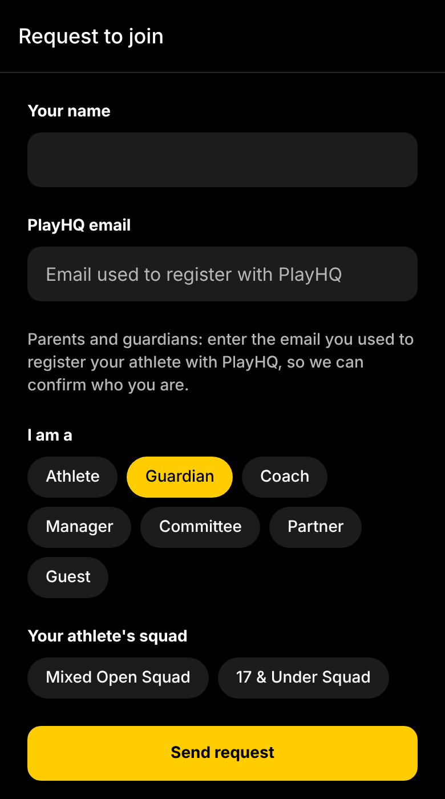

### Wait for approval

An admin checks your request against the club's PlayHQ registrations, sets your role and adds you
to your squad. Pull down on the home screen to check again.

If the admin can't match you to a registration, they may ask you for the **6-digit code** shown on
your home screen. The code proves who you are, so the admin needs to get it from you in person or
over a channel they already trust. Only ever give it to a club admin, and never share it with
anyone else.

An athlete under 18 also sees **Ask your parent or guardian to join**, with the email they gave,
and the people they can talk to if anything worries them: the club's Child Safety Officer and
Complaints Manager, the governing body and helplines.

If your request isn't approved, the home screen says why and you can tap **Request again** after
fixing your details.

## 3. Things everyone can do

### The home screen

Once you're approved, the home screen is where everything starts. From the top:

- **To do**: things you need to do, such as your daily check-in, an award vote, integrity training
  due or an injury clearance to sign off.
  Tap an item to go straight to it. Each item disappears once it's done. When there's nothing,
  it says "You're all caught up."
- **Cards** for the features your role uses: Messages, Daily check-in, Check-ins,
  Injuries, Attendance, Awards, Integrity training and Administration. The Awards card shows while an award vote is open to you. A yellow number means something new or waiting for you.
- **Coming up**: the next six events from your calendars. Tap **Full calendar** to see them all.
- **My squads and teams**: tap one to see who's in it. A team's page also has its
  [game goals](#game-goals) for its athletes and coaches. Committee members and admins only see
  this when they're in a squad or team, for example as a coach too.
- **Your details**, **Sign out**, **Switch club** and **Delete account** at the bottom.

Pull down on any screen to refresh it.

### Your preferred name

The home screen greets you by name. To be called something else, such as a nickname, tap **Your
details** at the bottom of the home screen, enter your **Preferred name** and tap **Save**. Leave it
blank to go back to your full name. Admins still see your full name, with your preferred name on
your member page, and can search for you by either.

Committee members and admins also see a **Title** field, for a position such as President,
Secretary or Treasurer. It shows under your name with your role, like "Committee · President".

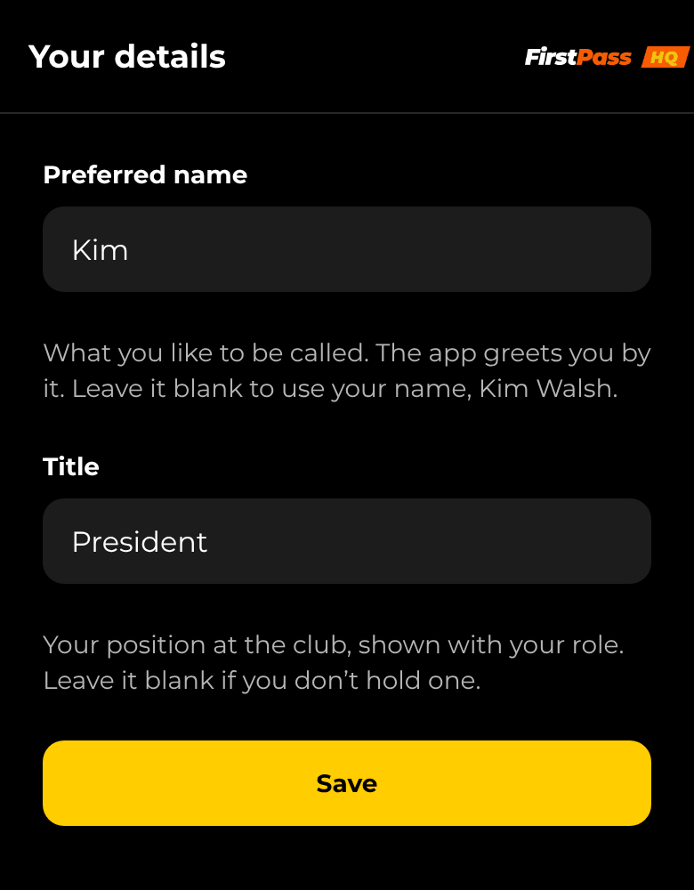

### Messages

Messages from your coaches, managers, captains and the club arrive in **Messages**. Unread messages have a
yellow dot, and the home card shows how many are new. Opening a message marks it as read, and the
sender can see that you've read it.

Who a message went to is shown under the sender's name, for example "To Mixed Open Squad" or
"To Everyone in the club". Messages from **Club safeguarding** tell a family about a change, such
as a parent or guardian linked to or unlinked from a child.

Guests don't get messages. Physios get messages sent to the Physio role and to the squads and teams
they're in, and messages sent to everyone in the club only when an admin turns that on.

### Calendar

The calendar shows events from the club's Outlook calendars. You see the club calendar, plus the
calendars of the squads and teams you belong to. Committee members and admins also see the
committee calendar.

- **List** shows a week strip and the events after it, grouped by day. Use the arrows to move
  between weeks, and **Load more** at the bottom to see further ahead. The list starts today, or at
  the week you move to.
- **Month** shows a month grid with that month's events below it. Dots under a day are events,
  coloured by calendar. Tap a day to see only its events, and tap it again (or **Show all of** the
  month) to see the whole month. Days from the months either side are greyed out.
- Switching from **Month** to **List** keeps the month you were looking at: the list starts at the
  1st of that month (or today, for this month).
- You can look back 12 months (to the start of that month) and ahead 12 months. The arrow fades
  out when you reach either end.
- The chips (**All**, **Club**, your squads and teams) filter which calendars are shown.

Your teams' matches from PlayHQ appear in the calendar too, for example "Mixed Open A v Rockets"
with the venue and court. A bye shows as an all-day event. Match times follow PlayHQ, so a changed
time shows once an admin refreshes the fixtures.

Tap an event to see when and where it is. Tap the location to open it in maps, or **Copy** to copy
the address.

### Squads and teams

Tap a squad or team under **My squads and teams** to see everyone in it, with their position:
Head Coach, Assistant Coach, Manager, Physio, Athlete, Final team athlete or Training partner. Captains,
vice captains and club captains are marked next to their position. When Game goals is switched on,
a team's page also shows its [game goals](#game-goals) for its athletes and coaches. In a club
without squads the list is called **My teams**.

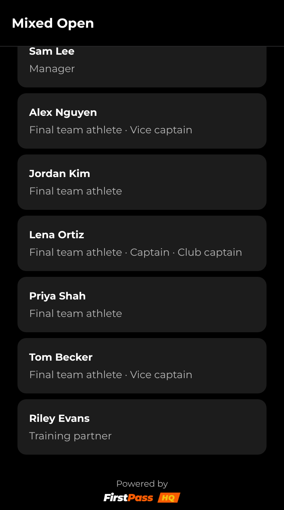

### Club awards

When the club runs an award vote that includes you, it appears in your to-do list and on the
**Awards** card. Who can vote depends on the award: for example, every member votes for Volunteer
of the year, and athletes vote for their own team's Players' player. Physios and guests don't vote.

1. Tap the vote. It shows the award, what to think about, and when voting closes.
2. Tap who you're voting for. For a 3-2-1 vote, tap three people in order: first place gets 3
   votes, second 2 and third 1. Tap someone again to take them off.
3. Tap **Vote**.

You can't vote for yourself. You can change your vote until it closes: open it again, change your
picks and tap **Change my vote**. Votes are secret. Nobody, admins included, can see who you voted
for, and only admins see the results.

Match awards, such as a coach's MVP, open for voting when each match starts and stay open for a
day or two after it.

### Integrity training

Each season the club lists the integrity training its members must complete, such as Sports
Integrity Australia's Safeguarding in Sport or anti-doping courses, with a due date. Training is
set for roles (for example athletes and coaches), across the whole club or only some squads and
teams, so junior and senior athletes can have different courses.

Training you still need to complete shows in your **To do** list with its due date, and on the
**Integrity training** card. To complete it:

1. Tap **Open the course** and do the course on the provider's website. Download or photograph
   the certificate of completion at the end.
2. In the app, tap the to-do item or **Add a certificate** on the Integrity training screen.
3. Under **Certificate achieved**, tick each course the certificate shows you completed. If one
   PDF holds several certificates or badges, tick them all and attach it once: each ticked course
   is checked with that file.
4. Choose the day you completed it, attach the certificate (a PDF or photo, up to 10 MB), add a
   note if you like and tap **Send for checking**.

The training then shows **Waiting to be checked** until a committee member or admin approves it
(**✓ Approved**). If they send it back, you'll see their note and the to-do comes back so you can
upload a new certificate. Certificates can't be removed once they're sent, so the club keeps a
record. Overdue training says **Overdue since** its due date.

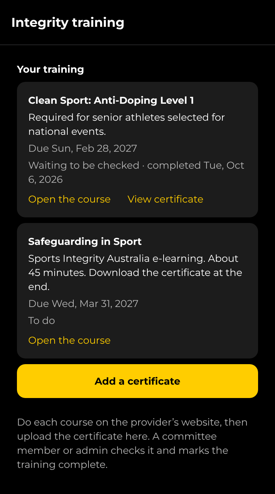
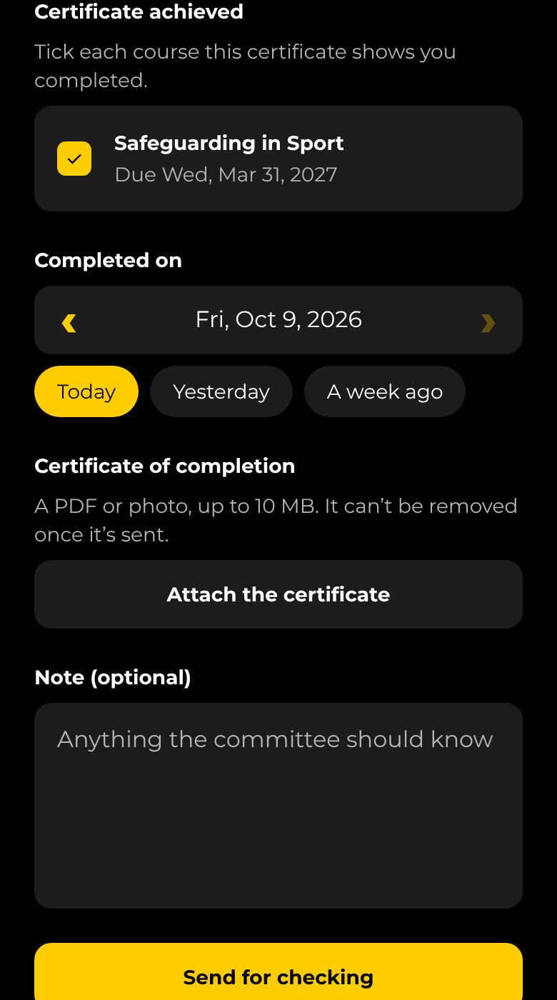

### Raising a concern

**Raise a concern**, at the bottom of the home screen, is for anyone signed in: athletes, parents,
coaches, guests and people still waiting for approval. Use it for anything that worries you about a
child or about how someone at the club behaves. You don't need to be sure. The same link is on the
daily check-in screen, on every injury and, as **Report this message**, on every message, so the
concern notes where it came from.

The screen starts with who to talk to: the club's **Child Safety Officer** and **Complaints
Manager**, the sport's governing body if the club has added it, and services anyone can call
(Police on 000, Kids Helpline and the Safe Sport Hotline). Tap a number to call it.

Then say what happened, and optionally who it's about (pick a club leader by name, or describe
them), when it happened and whether a child's safety is involved. Choose **Show my name** or
**Don't show my name**. If you hide your name, the people who look into it won't see who you are,
so they can't ask you more; the app still keeps it with your account so you can follow it. If you
show your name, say whether they can contact you and how. Tap **Send to the club**.

The Child Safety Officer, the Complaints Manager and admins see it straight away, but the person
it's about never does, even if they're one of them. **Concerns you've raised** on the same screen
shows each one and where it's up to: Received, Referred, Being looked into or Closed.

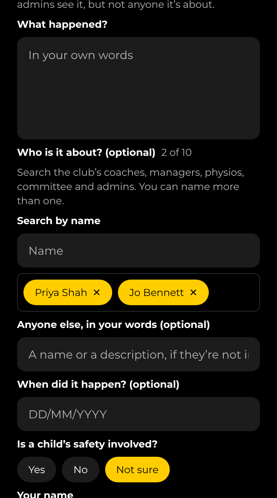

### Deleting your account

**Delete account** at the bottom of the home screen permanently deletes your account at the club
you're in: your profile, your squad and team places, guardian links and your messages inbox. Messages you sent to
a group stay with the people who received them.

The club keeps your injury records and clearance documents for 12 months after you leave, where
only the committee and admins can see them, and then deletes them. Deleting your account doesn't
change your PlayHQ registration or club membership, or your account at any other club in
FirstPass HQ.

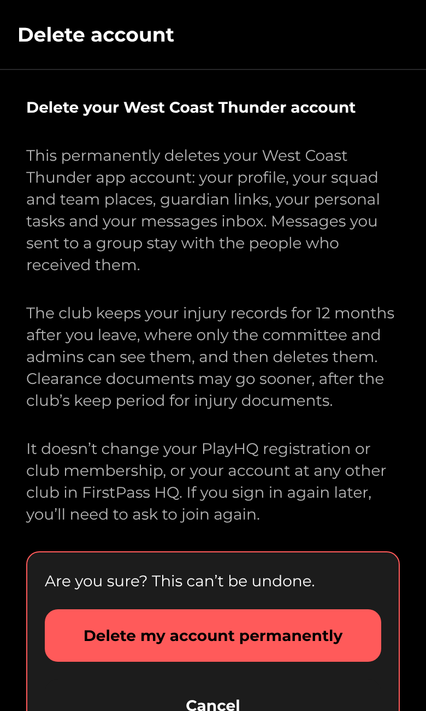

## 4. Athletes

Athletes see Messages, Daily check-in and Injuries on their home screen, plus their calendar and
squads. Game goals are on each team's page.

### Daily check-in

Once a day, answer four questions on a scale of 1 (bad) to 5 (good):

- How did you sleep?
- How does your body feel?
- How stressed are you?
- How's your mood?

You can add a note for your coach, such as "tight calves after Sunday's game". The line under the
note says who can read it: your coaches if you're 18 or over; if you're under 18, your parents or
guardians, and your coaches once a parent or guardian has given consent. Tap
**Save check-in**. It takes about thirty seconds. You can change today's answers until the end of
the day with **Update check-in**.

Your coaches see your answers so they can adjust training (if you're under 18, once a parent or
guardian has given consent). A score of 2 or less on any question
flags you so a coach knows to check in with you. Below the form you can see your last two weeks,
with low scores marked.

Until you've checked in, "Do your daily check-in" stays in your to-do list.

### Game goals

**Game goals** uses the club's PlayHQ fixtures, which belong to teams, so they start once you're
picked for a team. Tap your team under **My squads and teams** on the home screen: its page shows
the team's games at the top and the people in it underneath.

- **Before a game:** in the 7 days before your next game, open it under **Next game** and add
  your goals, up to 5, such as "win 3 centre pass receives each quarter". Only your next game is
  open for goals. You can change or remove your goals until the game starts. Your coaches can add
  goals for you too; those show "set by Coach …" and only a coach can change them. Until you've set
  a goal, "Set your goals for …" stays in your to-do list.
- **After the game:** about 90 minutes after the start (the next day if PlayHQ had no start time),
  the game moves to **Played games**. For each goal, pick **Achieved**, **Partly** or **Not yet**,
  write a few words about how it went and tap **Save reflection**. You can update it later. For a
  week after the game, "Reflect on …" stays in your to-do list until every goal has a reflection.
  Your coaches' comments show under each goal.
- **Played games** lists this season's games for that team, newest first, 10 at a time; tap **Load more** for
  older ones. Games drop off the list when an admin archives the season.

Your coaches can see your goals and reflections. If you're under 18, your parents or guardians can
see them too, but only you and your coaches set goals, and only you reflect on yours. Bye rounds are
left out.

**Team goals** that your coaches set for the whole team show at the top of the game,
above your own goals. After the game you'll see how the coaches think the team went on each one.
Everyone in the team has a say: tap **Comment** under a team goal, write what you think or what
you'll do to help, and tap **Add comment**. You can comment before or after the game. Your name
shows on your comment, and everyone in the team, their parents or guardians and the coaches can
read it. Tap **Remove** on your own comment to take it down.

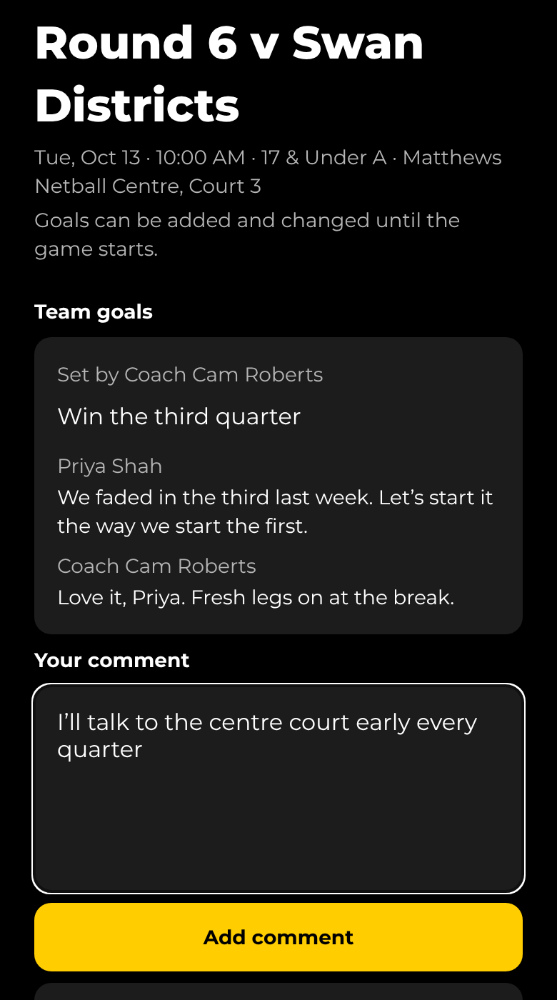

### Reporting an injury

1. Tap **Injuries**, then **Report an injury**.
2. Say where the injury is, what happened and when.
3. Add any restrictions (for example "no jumping") and when you expect to be back, if you know.
4. Tap **Report injury**.

Your coaches and the committee can see it straight away.

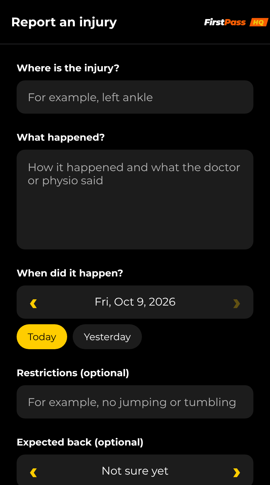

### Updating an injury

Open the injury to see its details and history. While you're injured:

- **Add physio update** records what the physio said, any change to restrictions or your expected
  return date, and optionally a physio report (up to 10 MB). Adults can attach a PDF or a photo.
  If you're under 18, attach the letter or report as a PDF or a photo of the letter, and switch
  on **This is a photo of the letter** before sending a photo. Never send a photo of the injury
  itself (see [Injury documents and photos](#injury-documents-and-photos)).
- If your expected return date passes, your to-do list reminds you to ask for clearance or change
  the date.

### Getting cleared to play

When you're ready to return, tap **Ask for clearance** and attach **proof of clearance**, such as a
letter from your physio or doctor. Proof is required. The people who sign it off view it inside the
app, where they can zoom in to read it.

Two people then sign off, in order:

1. **One of your coaches or a club physio endorses it** (status "Waiting for a coach or physio").
2. **A committee member accepts it** (status "Waiting for the committee"). It must be someone other
   than the person who endorsed it.

Nobody signs off their own clearance or their own child's, so a coach or committee member who is
also your parent or guardian leaves it to someone else.

When it's accepted, the injury shows **Cleared to play**. If either of them sends it back, you'll
see their note in the history; fix what they ask and ask for clearance again.

Documents can't be removed once they're sent, so the record can't be altered later.

Under each document you see everyone who has opened or shared it, with their role and when (for
example "Viewed by Casey Coach (coach)"). Your parents or guardians and the club's admins see the
same list.

### Captains

If you're a **club captain**, a squad or team **captain** or a **vice captain**, you can send
messages:

- **Club captains** can send to **Everyone** in the club.
- **Captains and vice captains** can send to their own squad or team, like its coaches.

Open **Messages**, tap **New message**, choose who it goes to, write it and tap **Send**. You'll
see who has read it in **Sent**. Club admins can read every message. If you're under 18, your
parents or guardians get a copy of every message you send.

## 5. Parents and guardians

Parents and guardians of athletes under 18 sign in with their own Google account and ask to join
as **Guardian**, entering the email they used to register their athlete with PlayHQ. An admin
verifies who you are (against PlayHQ, or with the 6-digit code on your home screen) and then links
you to your athlete. Every athlete under 18 must have at least one verified guardian before they're
approved. A guardian can be linked to more than one athlete, and an athlete can
have more than one guardian.

Whenever a guardian is linked to or unlinked from your child, you and your child's other guardians
get a message from **Club safeguarding** in **Messages**, naming the guardian and the admin who made
the change. Your child gets it too if they're 13 or over. If it isn't right, tell the club's Child
Safety Officer or an admin.

The home screen shows who you're the guardian of. Until an admin links you, it says so.

### Giving consent

Once you're linked and verified, **Consent** on your home screen lists each child under 18, and
your to-do list says **Give consent for** them until you have. Open it to choose who else sees two
kinds of information about your child:

- **Daily check-ins**: their answers and notes are seen by their coaches.
- **Injuries and health information**: their injuries, restrictions, physio updates and documents
  are seen by their coaches, the physios who look after them and the committee, who sign off
  clearances.

Until you give a consent, only your child, you and the club's admins see that information. Their
coaches, physios and the committee don't see your child's check-ins or injuries at all, and only an
admin can clear an injury. Links to the club's policies are on the same screen. Tap **Save**.

You can change your mind at any time: switch a consent off and save. Every consent given and
withdrawn is kept with who did it, when and the policy version, and listed under **History**. Any
of your child's parents or guardians can give or withdraw consent. Photos of injuries are separate:
you're asked each time (see [Injury documents and photos](#injury-documents-and-photos)).

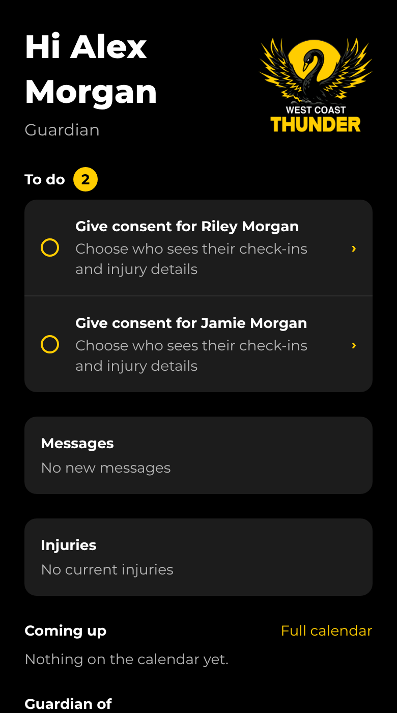

As a guardian you:

- **Receive a copy of every message** sent to your athlete, whether it went to their squad, their
  team, all athletes or the whole club. You get each message once, even if you're also in the
  squad.
- **Receive a copy of every message your athlete sends** if they're a captain, so you see what
  they send to their squad, team or the club.
- **See your athlete's daily check-ins**, including any note they write. Your athlete is told that
  you can read their notes.
- **See the calendars** for your athlete's squad.
- **See your athlete's game goals and reflections**: the goals they and their coaches set for
  each game, how your athlete thinks each one went, their coaches' comments and the team goals (see
  [Game goals](#game-goals)). Tap your athlete under **Guardian of** on the home screen to see all
  their games. You can't set goals or reflect: your athlete and their coaches do that in the app.
- **Report and update injuries** for your athlete, and ask for clearance, exactly as an athlete
  does (see [Athletes](#4-athletes)). If you look after more than one athlete, choose which one
  when reporting. Proof is the physio's or doctor's letter, as a PDF or a photo of the letter; with
  a photo you confirm it shows the letter, not the injury. If the club allows photos of injuries and
  your identity has been verified, you can choose **The injury** and add one after switching on
  **I consent**; your consent is kept with the photo. Your child can't add photos of injuries.
- **See who opened your athlete's injury documents**: under each document, every view and share,
  by whom and when, and what was confirmed about each photo.
- **Complete integrity training** for your athlete: their training shows in your to-do list and
  on the **Integrity training** screen under their name, and you upload their certificates
  exactly as they would (see [Integrity training](#integrity-training)).

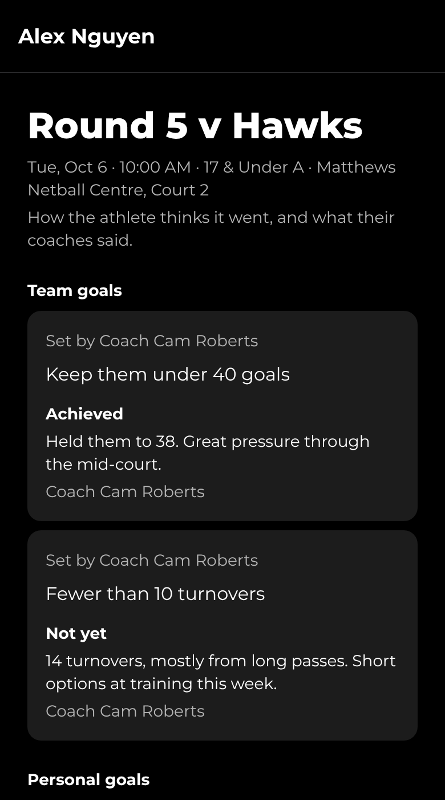

## 6. Coaches

Head coaches and assistant coaches have the same permissions. Everything below applies to the
squads and teams you're listed in as a coach.

Coaches and managers need a current Working With Children Check, recorded by an admin, before
they're approved. The check is looked at every time you use the app: on the day it expires, your
coach or manager role pauses and your home screen says so. You keep your squad and team places, and
everything comes back as soon as an admin records the renewed check. Renew it well before it
expires; admins are reminded 60 days ahead.

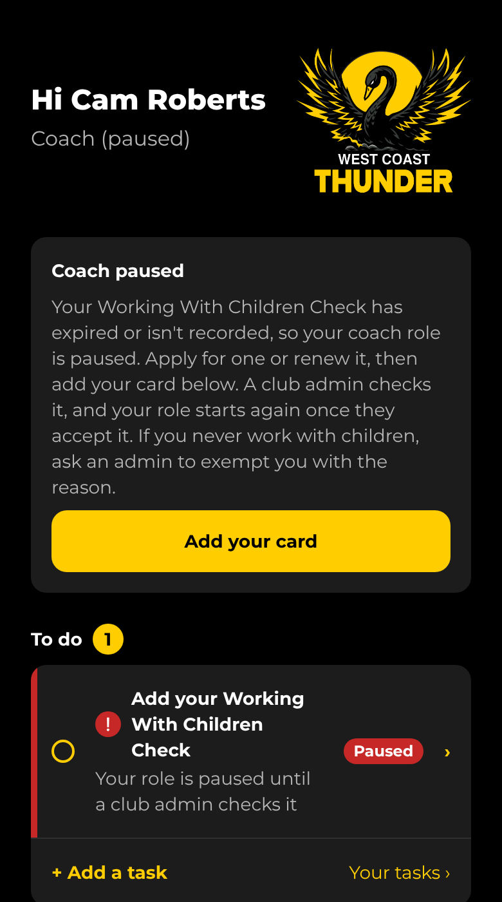

### Volunteer exemptions

In WA, a parent who volunteers at the club their own child is in, and any volunteer under 18,
doesn't need a Working With Children Check and can't apply for one. If that's you, an admin
records an exemption instead of a card number, and you get a to-do: **Accept the volunteer
declaration**. It opens the declaration, which says you're not paid for the role, you don't have a
negative notice or an interim negative notice, no other state has refused or cancelled a working
with children clearance for you, and you'll tell a club admin straight away if any of that changes.
Tap **I agree** if it's true; if it isn't, don't agree and talk to a club admin. Your coach, manager
or physio role starts once you agree, and the club keeps the words you agreed to.

The exemption ends by itself when your child turns 18, stops being an athlete at the club or is
no longer linked to you, or, for a volunteer under 18, on your 18th birthday. Your role then pauses
and your home screen asks you to apply for a check. A parent's exemption doesn't cover overnight
camps.

After an admin marks a squad's **squad phase complete**, coaches look after only the
athletes in their named teams. Before that, they look after everyone in the squad.

### Sending messages

1. Open **Messages** and tap **New message**.
2. Choose the squad or team (if you coach just one, it's already chosen).
3. Write the message and tap **Send**.

Everyone in that squad or team gets it, including the parents and guardians listed in it. Parents
and guardians of athletes under 18 always get a copy, even if they aren't in the squad. Open
**Sent** to see how many people have read each message, and open a message to see exactly who has
and hasn't read it. Club admins can read every message.

### Choosing captains

Coaches choose the captains and vice captains of the squads and teams they coach (admins can too).
Open the squad or team from **My squads and teams** and tap **Choose captains** at the bottom. For
each athlete choose **Captain**, **Vice captain** or **Neither**, then tap **Save captains**. A
group can have any number of captains and any number of vice captains, so it's up to you: co-captains
and no vice captains, one captain and four vice captains, or anything in between.

Captains and vice captains can then message everyone in that squad or team, like you. They must be
athletes in it, and they stop being able to message it if they leave it or the season is archived.
Messages from captains under 18 are copied to their parents or guardians.

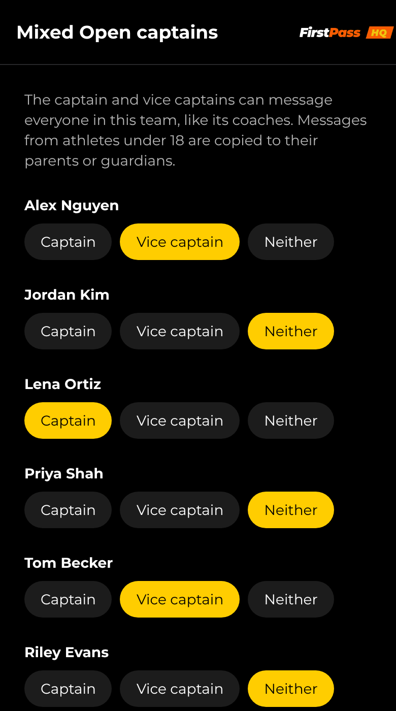

### Athletes' check-ins

The **Check-ins** card shows how many of your athletes have checked in today and how many are
flagged. If any are flagged, your to-do list says "Check in with N athletes". Athletes under 18
show, and count, only once a parent or guardian has given consent for their check-ins.

- **Day by day** lists today's (or yesterday's) check-ins for a squad or team: athletes to check
  in with first, with what scored low and any note, then those feeling good, then who hasn't
  checked in.
- **Trends** graphs the group's average sleep, soreness, stress and mood over 2 weeks, 4 weeks or
  3 months, with the number who checked in each day. The red line is 2, the score that flags an
  athlete.
- Tap an athlete to see their last four weeks.

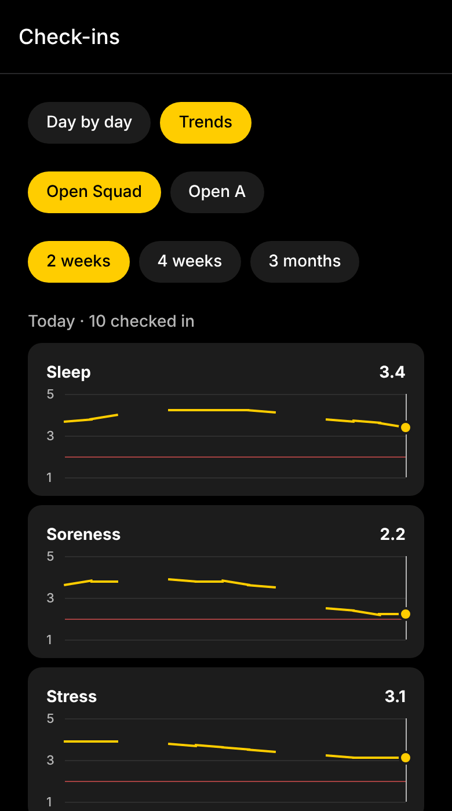

### Game goals

Game goals are on the page of each team you coach: tap it under **My squads and teams**. Squads
don't have PlayHQ games, so their pages don't show goals.
**Team goals** sits at the top, and under **People** each athlete shows their next game (within
7 days) and how many goals they've set.

- Tap an athlete, then their next game, and type under **Add a goal for the athlete**. Their goals
  and yours show together; you can change or remove goals set by a coach until the game starts,
  but not the athlete's own.
- After the game, open it from **Played games** to read how the athlete thinks each goal went, and
  tap **Comment on this goal** to reply. Any of the athlete's coaches can comment.
- A number next to an athlete counts reflections no coach has commented on yet, and your to-do list
  says "Comment on N goal reflections", which opens the team.

#### Team goals

At the top of a team's page, **Team goals** shows its next game (within 7 days) and its
last played game.

- Open the next game and add goals for the whole team under **Add a team goal**, up to 5, such as
  "win the third quarter". You can change or remove them until the game starts. Any coach of the
  team can. Until a team goal is set, "Set team goals for …" stays in your to-do list.
- The team's athletes and their parents or guardians see the team goals above each
  athlete's own goals.
- Everyone in the team can comment on a team goal, before or after the game, so every athlete has
  a say. Their comments show under each goal, and you can add your own with **Comment**. Coaches
  can **Remove** any comment on their team's goals; athletes can remove only their own.
- After the game, open the last game, pick **Achieved**, **Partly** or **Not yet** for each team
  goal, add a few words for the team and tap **Save review**. Athletes see your review.

### Match awards

Awards such as the coach's MVP can be voted on by coaches after every match. Each match your team
plays opens its own vote when it starts, in your to-do list and under **Awards**, for example
"Coach's MVP · Mixed Open A · Round 3 v Rockets". Some awards also have one **Preseason** vote,
which counts for a set share of the result.

### Injuries and clearances

**Injuries** lists your athletes' current injuries with their restrictions and expected return
date. Choose **Including cleared** to see past injuries too. An athlete under 18's injuries show
only once a parent or guardian has given consent for injuries; until then, an admin clears them.

When one of your athletes asks for clearance, it appears under **Waiting for your sign-off** and in
your to-do list. Open it, check the proof in the history (tap **View**), then:

- **Endorse clearance** to pass it to the committee, with an optional note such as "trained fully
  on Tuesday", or
- **Send back** with a note saying what's missing.

If an athlete has no coach, a club physio endorses instead. Admins can't endorse a clearance unless
they're also the athlete's coach or a physio; they accept it like the committee. You can't endorse a
clearance for your own child: another coach or a physio does it.

#### Viewing proof documents

**View** opens a document inside the app. A photo fills the screen: pinch to zoom in on the
details, drag to move around, and double-tap to zoom in or back out. A PDF shows its pages one
under the next, and you can pinch to zoom there too. There's no save or share button, and the
document isn't kept on your phone. Each time you open a document, your name, role and the time are
recorded and shown to the athlete, their parents or guardians and admins.

### Taking attendance

1. Tap **Attendance**, then **Take attendance**.
2. Choose the squad or team. You can also choose **Whole squad** for any current squad, or
   **Whole club** for club events, where every approved athlete is on the register.
3. Name the session. If a calendar event is on now (from an hour before it starts to 30 minutes
   after it ends), its name is filled in for you; other events from today are offered as chips.
4. Mark each athlete **Present** or **Absent**, or tap **Mark the rest present**.
5. Tap **Save attendance**.

If attendance was already taken for the same group in the last 3 hours, a warning shows who took
it, in case it's a duplicate. You can open that record, or carry on if it really is a different
session.

### Attendance records

- **Sessions** lists past sessions. Open one to see who was there, and **Change attendance** to
  correct it.
- **Athletes** shows each athlete's attendance over 4 weeks, 3 months or 12 months, with the last
  time they were there. Tap an athlete to see every session.

## 7. Managers

Managers look after the logistics of their squads and teams. As a manager you can:

- **Send messages** to the squads and teams you manage, and see read receipts, the same way as
  coaches (see [Sending messages](#sending-messages)).
- **Take attendance** for your groups, a whole squad or the whole club, and see and correct your
  own groups' sessions (see [Taking attendance](#taking-attendance)).

Managers don't see athletes' attendance histories, check-ins or injuries.

## 8. Committee

Committee members oversee the club's athletes without seeing anyone's private check-in answers.
Like coaches, they need a current Working With Children Check, recorded by an admin, unless an
admin exempts them with a reason. If a check an admin recorded expires, the committee role pauses
until the renewed one is recorded.

If you're the club's Child Safety Officer or Complaints Manager, your home screen also has
**Concerns** (see [The concerns register](#the-concerns-register)).

### Messages to the club

Committee members can send a message to everyone in the club. Open **Messages**, tap **New
message**, write it and tap **Send**. Guardians of athletes under 18 get a copy, and **Sent** shows
who has read it. Only admins can message a single role, such as all coaches. A committee member who
also coaches or manages a squad or team can choose **A squad or team** to message it instead.

### Check-in averages

**Check-ins** shows average scores for each squad, and for each team once its squad phase is
complete, plus how many checked in and how many are flagged. **Trends** graphs the
averages for one group or the whole club. Scores only show once at least 5 athletes in a group
have checked in, and a group's scores hide on any day it is within 4 check-ins of the club, its
squad or one of its teams, so subtracting one group from another can't point to one person. Individual answers are only for the athlete,
their guardians and their coaches.

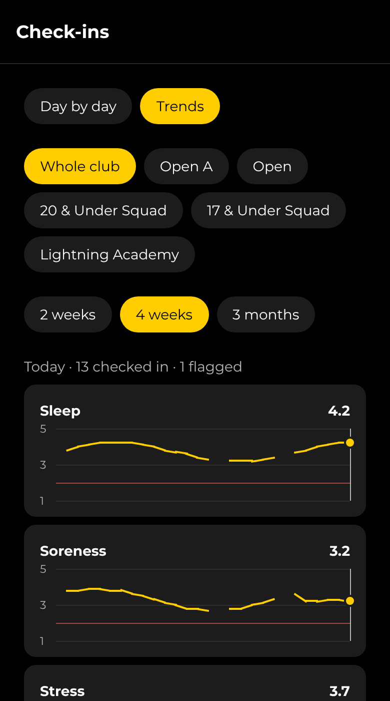

### Accepting clearances

The committee sees every athlete's injuries, except an athlete under 18 whose parents haven't yet
given consent for injuries (an admin clears those). When a coach or physio endorses a clearance, it
appears under **Waiting for your sign-off** and in the to-do list of every committee member except
the person who endorsed it and the athlete's own parents or guardians. Open it, check the proof, then:

- **Accept clearance** clears the athlete to train and play, or
- **Send back** with a note.

The committee can also send back a request that no coach or physio has looked at yet. Tap **View**
on a document to read it in the app (see [Viewing proof documents](#viewing-proof-documents)).
While a clearance is waiting for you to accept it, you also get **Share**, to save its documents to
the club's records, such as OneDrive. Share disappears once it's accepted or sent back, and nobody
else can save or share documents. Every share is recorded and shown to the athlete, their parents
or guardians and admins.

### Checking training certificates

When someone uploads an integrity training certificate, every committee member and admin gets a
**Check training certificates** to-do. Open **Integrity training** › **Check certificates** to see
each one with the member, the course, the day they completed it and who uploaded it. Tap the
📎 file to read the certificate in the app, then:

- **Approve** marks that training complete for the member, or
- **Send back** with a note saying what to fix, such as a cut-off name. The member sees the note
  and uploads a new certificate.

Nobody checks their own certificate or their own child's; those wait for someone else.

**Everyone's progress** lists each season's training with how many members are approved and how
many certificates are waiting. Open one to see every member who must complete it, filter to
**Still to do**, **Waiting** or **Approved**, and **Export CSV** for Sports Integrity Australia or
the club's records.

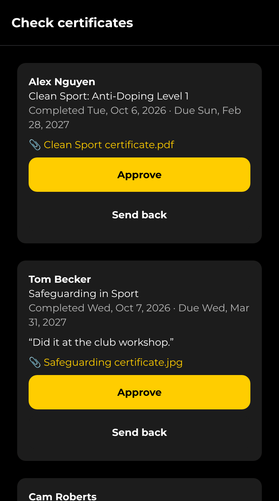
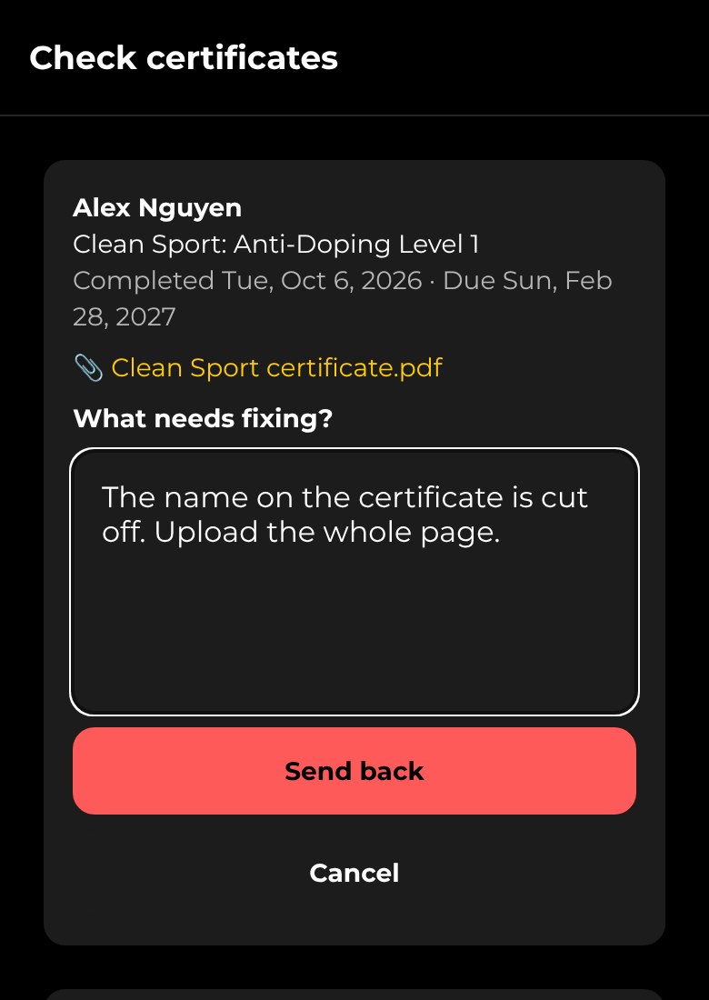
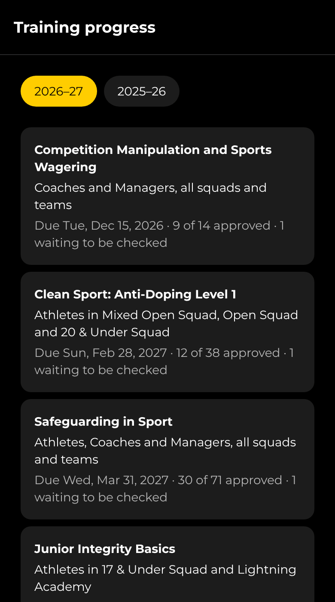
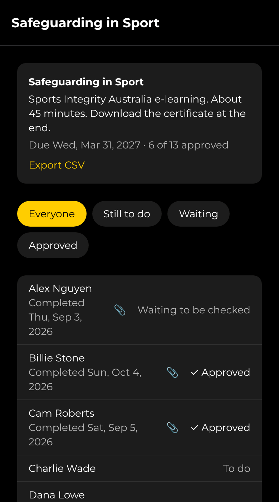

### Attendance

Committee members can take attendance for any whole squad or the whole club, and see every
session and every athlete's attendance (see [Taking attendance](#taking-attendance)).

### Committee calendar

Calendars an admin shares with the **Committee** appear only for committee members and admins.

## 9. Physios and guests

Physios and guests see the squads and teams and the club calendar. They don't vote in club awards,
so their home screen has no **Awards** card. Guests don't get messages. Physios have a **Messages**
card and get messages an admin sends to the Physio role, and messages sent to the squads and teams
they're in. They also get messages sent to everyone in the club when an admin turns on **Physios get
club messages** in [Club settings](#club-settings).

### Physios

Physios need a current Working With Children Check, recorded by an admin, before they're approved,
or a [volunteer exemption](#volunteer-exemptions) if they volunteer unpaid at their child's club or
are under 18. Like a coach's, the physio role pauses on the day the check expires and comes back when an admin
records the renewed one.

Some clubs have one physio, and some have a physio for each team. An admin can place a physio in
one or more squads or teams, where they show on the roster as **Physio**, and can mark one physio
as **Head Physio**. Which athletes a physio looks after:

- **Head Physio**: every athlete, whether or not the Head Physio is in a squad or team.
- **A physio in squads or teams**: the athletes in those squads and teams.
- **A physio in no squad or team**: every athlete, so a club with one physio doesn't need to place them.

- **Check-ins** shows the same squad, team and club averages the committee sees (see
  [Check-in averages](#check-in-averages)). Physios never see an individual athlete's answers.
- **Injuries** lists the injuries, restrictions and proof documents of the current athletes they
  look after (an athlete under 18 only once a parent or guardian has given consent). When an
  athlete asks for clearance, it appears under **Waiting for your sign-off** and in the physio's
  to-do list. Open it, check the proof, then **Endorse clearance** to pass it to the committee, or
  **Send back** with a note. A committee member other than the physio then accepts it. Physios
  also endorse clearances for athletes who have no coach. A physio who is also on the committee
  can accept clearances, but never one they endorsed.

### Guests

Guests, such as the club's partners and sponsors, can only look: squads and teams, and the club
calendar.

## 10. Admins

Admins can do everything above except endorse injury clearances (they accept them, like the
committee, and endorse only if they're also a coach or physio), plus run the club's set-up from **Administration** on the home
screen. Admins' to-do lists include join requests waiting for approval and clearances waiting for
sign-off, plus child-safety follow-ups: athletes under 18 with no guardian linked, Working With
Children Checks that are missing, expired or expire within 60 days, volunteer exemptions that end
within 60 days, and athletes turning 18 within 30 days. Tapping a child-safety to-do opens **Members**, where the people behind it are listed
first under **Needs checking**. On an installed app, admins also get a push notification for each
new join request.

Because admins can read every child's records, they need a current Working With Children Check,
or an exemption with a reason that another admin records, like committee members (see
[Approving members](#approving-members)).

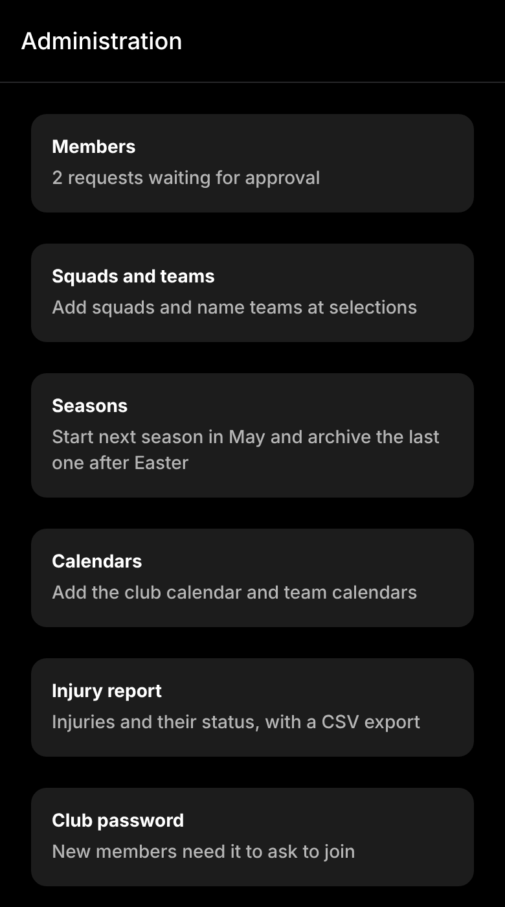

### Inviting members

**Administration > Invite members** shows the club's QR code, club code and invite link. Put the
QR code on a screen or a printed sign at training, or tap **Share invite** to send the link and
code by message or email (**Copy link** copies just the link). Scanning the code or opening the
link opens FirstPass HQ with your club picked, ready to sign in. People still ask to join, with the
[club password](#club-password) if you've set one, and you approve them as below. The password
isn't part of the invite, so share it separately.

### Approving members

**Members** lists everyone, grouped into **Waiting for approval**, **Members**, **Signed in, no
request yet** and **Not approved**. Search by name or email.

**Needs checking**, at the top, lists the members behind the child-safety to-dos on your home
screen, with the reason under each name: no Working With Children Check recorded, one that has
expired or expires within 60 days, a volunteer exemption waiting for the declaration, ending within
60 days or no longer applying, someone who is stood down, an athlete under 18 with no guardian
linked, an athlete with no date of birth, an athlete about to turn 18, a card never validated or
validated over a year ago, or a card not linked with the Screening Unit. They also show "Needs checking" in the main list. Open someone to fix it; once saved,
they drop off the list.

Open a request to see the person's sign-in email, PlayHQ email, the date of birth they gave and
what they asked for. An athlete under 18 also shows the guardian email they gave. In the
waiting list, "Says they're under 18" marks an athlete whose date of birth makes them a child.
Check them against PlayHQ, then:

1. Choose their **Role**.
2. Choose their **Squads** and, once teams are named, **Teams**. For coaches, choose **Head Coach**
   or **Assistant Coach** for each group. For athletes in a team, choose **Final team athlete** or
   **Training partner**. For physios, choose **Physio** or **Head Physio** under **Physio title**,
   and place them in the squads or teams they look after (or none, to look after every athlete).
3. For athletes, check their date of birth against PlayHQ or ID and enter it under **Date of
   birth** (DD/MM/YYYY). If it matches what they gave, tap **I've checked it: use** that date. If
   you enter a different date, the page notes the one they gave. The page shows who recorded the
   date and when. Anyone under 18 gets a **Parents and guardians** section, with the search
   started from the email the child gave: tap a guardian to link them (tap ✕ to unlink). Only
   verified guardians can be linked; unverified ones show "(not verified)".
4. For coaches, managers, physios, committee members and admins, enter their **Working With Children
   Check** card number and expiry date. Cards last three years, so a later expiry is refused. Once
   the card is saved, **Validation** records checking it: enter the **Name on the card**, choose
   how you checked it (**Checked online** on the Screening Unit's website, **Card sighted** or
   **Screening Unit letter**), switch on **Linked to the club with the Screening Unit** once the
   card is linked so the Unit tells the club of any change, and tap **Record validation**. The
   page shows who validated it, how and when. Validate every card at least once a year and again
   when it's renewed: a new card number or expiry needs a new validation. You can't validate your
   own card. A committee member or admin who doesn't need one, such as a
   treasurer who is never at training or games, can be marked **Exempt** instead: write why, and
   the app records who exempted them and when. Exemptions are for the committee and admin roles
   only; someone who also coaches, manages or is a physio still needs a check. You can't exempt yourself, so ask
   another admin.

   A coach, manager or physio who is a parent volunteering at their child's club, or is under 18,
   doesn't need a check in WA. Choose **Parent volunteer** (and their child, who must be an
   athlete under 18 they're linked to as a guardian) or **Under-18 volunteer** (which needs their
   date of birth) instead of **Has a check**. Once you save, they get a to-do to accept the
   volunteer declaration, and their role starts when they do. The page shows where it's up to and
   who recorded it. Choosing **Has a check** again ends the exemption; every exemption stays on
   their page and in the report.
5. Tap **Approve**.

The app won't approve or save:

- an athlete without a date of birth. Athletes approved before this was needed keep their access,
  show "No date of birth" under **Needs checking**, and need one the next time you save them;
- an athlete under 18 without at least one verified guardian;
- a coach, manager or physio without a current Working With Children Check or a volunteer
  exemption;
- a new committee member without a current Working With Children Check or an exemption. Committee
  members approved before checks were needed keep their access, and show under **Needs checking**
  until you record a check or exempt them;
- a new admin without a current Working With Children Check or an exemption. Admins approved
  before checks were needed keep their access and show under **Needs checking** in the same way.

Approval isn't the only time the check counts. A coach's, manager's or physio's role pauses on the
day their check expires, and so does a committee member's when a check you recorded for them
expires. They keep their squad and team places and see a note on their home screen; the role
comes back as soon as you record the renewed check. A volunteer exemption works the same way: the
role pauses when it ends by itself, and **Needs checking** lists them 60 days before. An admin's
role doesn't pause when their check expires, so the club can never be locked out of its own app;
they show under **Needs checking** and on every admin's to-do list until the renewed card is
recorded, and they can still be stood down.

**Verifying someone.** Guardians must be verified before they can be linked to a child. Get the
6-digit code from their home screen yourself, in person or over a channel you already trust, enter
it under **Their code** and tap **Check code**. Or, under **How you checked**, choose **Matched to
PlayHQ** (their PlayHQ email matches the parent on the registration) or **ID sighted**, write what
you checked under **What you checked**, and tap **Record check**. The member then shows as
"Verified", with how and, under **What was checked**, your note. You can't verify yourself.

**Linking guardians.** Linking or unlinking a guardian takes effect when you save. Add a **Reason for
the change** if there is one, such as a parenting order you've seen; only admins see it. When you
save, the child's guardians, and the child if they're 13 or over, get a message naming the
guardian and you, without the reason. **Guardian link history** on the child's page, and on the
guardian's, lists every link and unlink with who made it, when and why. If you're one of the
child's guardians, another admin has to change who their guardians are.

When an athlete turns 18 their guardians lose access to them that day (injuries, check-ins, goals,
certificates and the home screen list); the next time you save the athlete the links are removed.

To turn someone down, choose a reason (**PlayHQ email doesn't match**, **Not registered with the
club** or **Other**) and tap **Don't approve**. They see the reason and can request again.

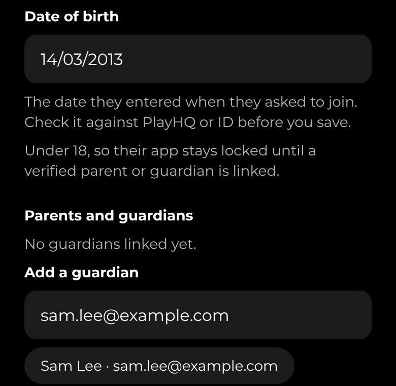

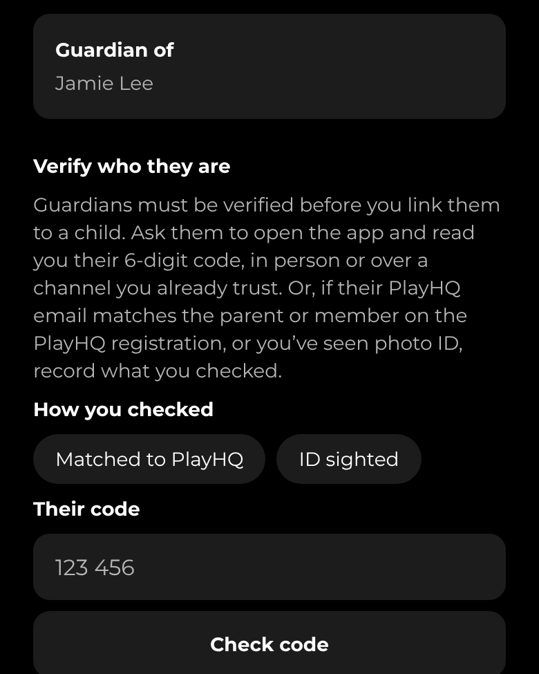

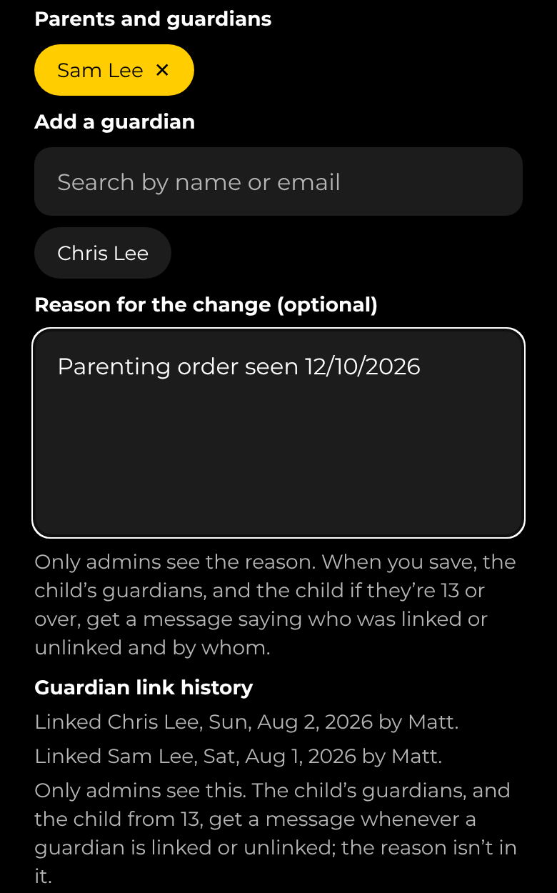

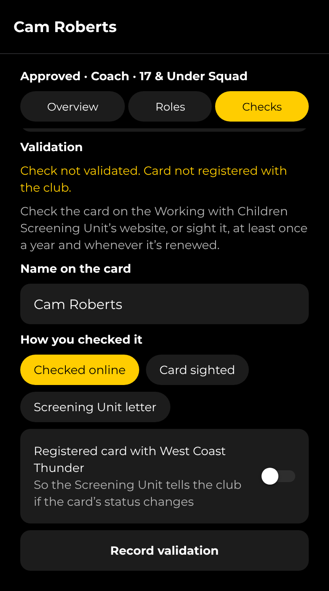

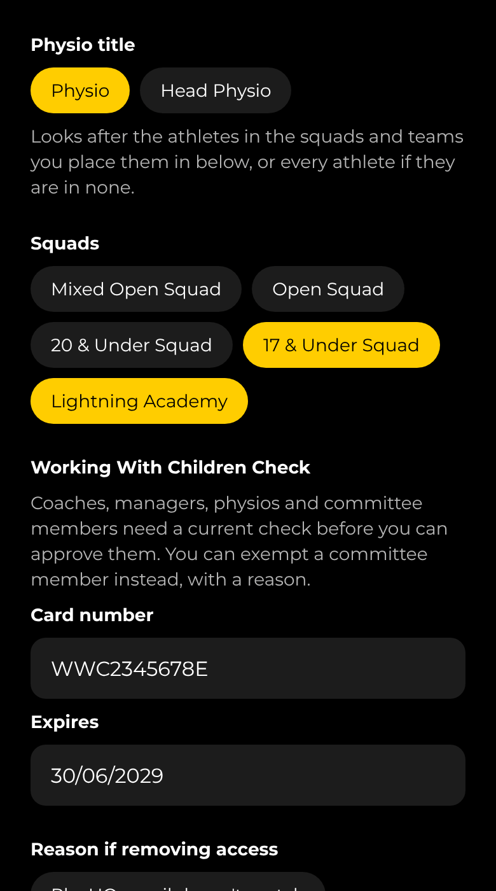

### Changing or removing members

Open any member to change their role, squads, teams or titles, then tap **Save changes**. A
committee member's or admin's page has a **Title** field (President, Secretary and so on), which
shows on their home screen and in the Members list. A physio's page has **Physio title**, where
you can make them the **Head Physio**; it shows as "Head Physio" on their home screen and in the
Members list. The card at the top shows their **Preferred
name** if they've set one.

**Other roles** adds roles on top of their main one, such as Coach for an athlete who also coaches
juniors, or Guardian for a coach whose child plays. The rules in
[Combining roles](#1-roles-at-a-glance) apply, and the page says what's wrong before you save. When
someone has more than one squad or team role, each squad shows **Role in** so you can pick which
role they're there as; its teams follow the squad. Coaches, managers and physios need a current
Working With Children Check whichever role it is, and that includes athletes under 18 who coach.

- **Remove access** stops someone using the app but keeps their account. Choose a reason first.
- **Stand down** is for when someone must be kept away from children straight away, for example
  when the Working with Children Screening Unit sends an interim negative notice or a negative
  notice, an interstate decision bars them, or an allegation is being looked into. Choose the
  reason (and write it down for **Other**), then tap **Stand down now**. Their coach, manager,
  physio, committee and admin roles stop at once, and they're taken out of the squads and teams
  they coach, manage or treat; their athlete and guardian roles carry on, so a parent still sees
  their own child. Their home screen says their role is paused and to talk to a club admin. Only
  admins see the reason. **Lift stand-down** ends it and puts back their places in this season's
  squads and teams. Every stand-down is kept on their page and in the Working With Children Checks
  report, with who started and lifted it, even if the member is later deleted. You can't stand
  yourself down.
- **Screening Unit notices** records every notice the Working with Children Screening Unit sends
  about a member: choose the kind (**Interim negative notice**, **Negative notice**, **Interstate
  decision**, **Card cancelled or suspended** or **Other notice**), the date it arrived and what
  the club did, then tap **Record notice**. Any kind but **Other notice** stands them down straight
  away if they hold a coach, manager, physio, committee or admin role. Tell the governing body in
  writing, then enter the date and tap **Governing body told**; until you do, it stays on your
  to-do list. Notices are kept on their page and in the Working With Children Checks report. You
  can't record a notice about yourself.
- **Delete member** permanently deletes their account, squad and team places, guardian links and
  message receipts. Messages they sent stay, and their injury records are kept for 12 months.

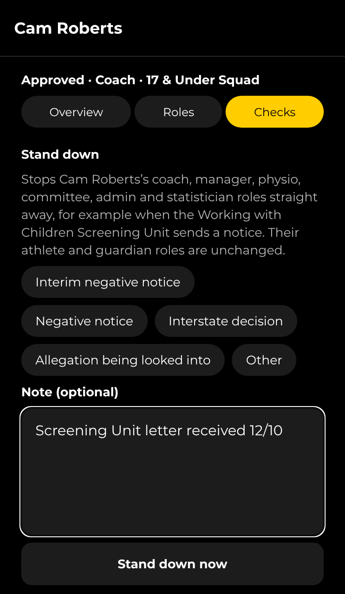
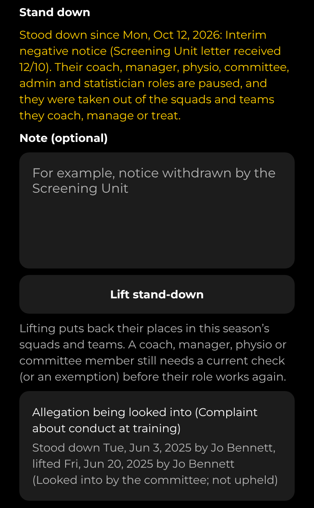

### Squads, teams and selections

**Starting setup.** A new club starts with no squads or teams. The first time an admin opens
**Squads and teams**, they choose a starting setup to match the club's competition:

- **AMMNA State Teams**: five squads (Mixed Open Squad, Open Squad, 20 & Under Squad, 17 & Under
  Squad, Lightning Academy) with squads on. Members join a squad and teams are named from it at
  selections.
- **WA Netball League**: four teams (Mens Team, Opens Team, 21 & Under Team, Futures Team) with
  squads off. Members join a team straight away.
- **Blank**: nothing is added. Add your own squads or teams below.

The squads or teams are added to this season, and squads are switched on or off in
[Club settings](#club-settings) to match. Rename, add or remove them afterwards as usual. A club
that chose Blank can still pick a setup with **Use a starting setup instead** until it adds its
first squad or team. Clubs that already had squads or teams don't see this choice.

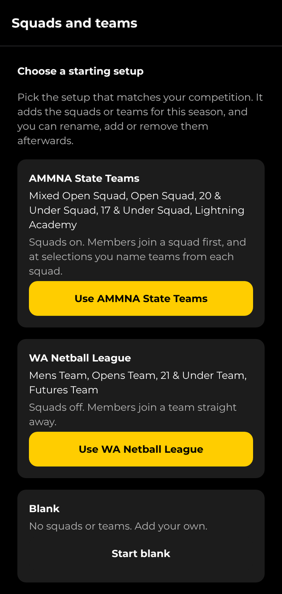

**Squads and teams** lists the current season's squads with the teams named from each. The note at
the top says whether the club uses squads and what that means.
If the club has switched squads off in [Club settings](#club-settings), it's called **Teams** and
works more simply:

- **Add a team**: give it a name. There are no squads to choose from.
- **Choose who is in a team** (tap it): every approved athlete, coach and manager is listed. Pick
  **Final team**, **Training partner** or **Not selected** for athletes, and **In this team** or
  **Not in this team** for coaches and managers. Guardians are added from their member page and
  stay when you save.
- On a member's page, **Teams** replaces **Squads**, and athletes are picked as a final team athlete
  or training partner for each team.
- There is no squad phase to mark complete: coaches look after their team's athletes from the start.

Switching squads off part way through a season moves nobody and deletes nothing: the squads you
already have, and the teams named from them, keep working until that season ends, and the next
season starts with teams only. If you don't want to wait, **End squads now instead** on the Teams
screen does it straight away after an **Are you sure?** step: every team leaves its squad and the
squads are removed from the season. Athletes who are only in a squad, not in a team, then drop off
coaches' lists and stop getting squad messages until you add them to a team. Nothing is deleted.
Switching squads on when you only have teams works the other way:
add squads as usual, and **Put in a squad** under a team puts it in a squad of the same season.
Everyone in the team joins the squad too and keeps their place in the team.

With squads on:

- **Add a squad or team**: choose Team or Squad, give it a name, and for a team pick the squad it's
  named from.
- **Name a team** (tap it): for each person in the squad, choose **Final team**, **Training partner**
  or **Not selected** for athletes, and **In this team** or **Not in this team** for coaches and
  managers. People not selected stay in the squad.
- **Rename** or **Remove** a squad or team. Removing it takes it off this season's lists, home
  screens and coaches' to-dos; its attendance and other records are kept and you can **Bring
  back** it later.
- **Mark squad phase complete** when a squad's teams are named. From then on, coaches only
  look after their own team's athletes, and clearances for athletes left only in the squad fall to
  admins. You can **Undo** it.

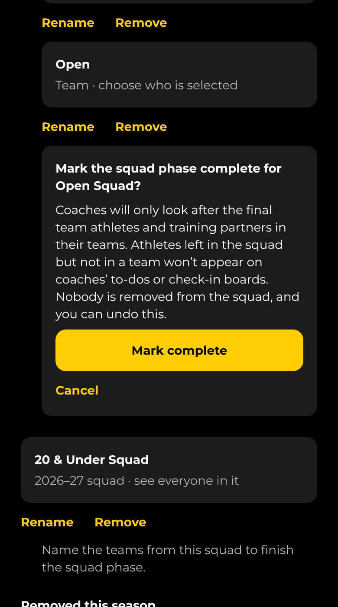

### Seasons

**Seasons** handles the change-over to a new season:

1. **Start the next season.** This creates empty squads with the same names, and their squad
   calendars, for the new season (for example 2027–28). Nobody is moved, and last season keeps
   running alongside.
2. **Place returning members.** Open each new squad and pick who's coming back from last season's
   squads. They keep their club role, and coaches keep their title. New people still send a join
   request and join the newest season's squads.
3. **Archive the old season once it has finished.** Its squads and teams leave everyone's home
   screen, calendars, messages and to-dos. Attendance, injuries and check-ins are kept, and you can
   bring the season back.

Nothing is deleted when a season is archived.

In a club without squads, starting a season copies last season's teams (and their calendars)
instead, and you place returning members in each team. Athletes keep being a final team athlete or
training partner, as they were last season. If the club has just switched squads off, the new
season starts with the teams that were named from last season's squads.

### Awards

**Awards** lists the club's awards by season. Tap **New award**. You can tap one of the club's
past awards under **Start from a past award** to fill in its settings, then enter the **Name** and
**Description** (what voters should think about).

The rest of the form is in sections. Each one shows a one-line summary of what it is set to; tap
it to open it and change the settings. A section opens by itself, with its summary in colour,
when something in it needs a look. If **Save award** is greyed out, the line above it says what's
still needed.

- **Season and closing date**: the season, and when **Voting closes**. Pick the day on the
  calendar, using the arrows to move to later months.
- **Voters**: **The whole club**, or **Chosen squads and teams**. For chosen groups, pick **One
  winner** or **A winner for each** squad or team. With a winner for each, members vote only in
  their own group. Then the **Roles that vote**. Athletes, coaches, managers and guardians vote in
  the squads and teams they're in. Committee and admins vote wherever they are. **Every member**
  opens it to everyone except physios and guests, who don't vote.
- **Nominees**: **Athletes** or **Coaches** in the voting groups, **Any member**, or **Names I
  list**, one per line, for people who aren't in the app, such as umpires.
- **Age restricted** (not for listed names): **Any age**, or **Set ages** to match the committee's
  definition of the award, such as Rising Star. Enter a **Minimum age**, a **Must be under** age,
  or both: minimum 16 and under 21 means nominees aged 16 to 20. Then choose when ages are
  measured: **The day voting closes**, or **A day I choose** such as 1 January. Only people with a
  date of birth can be voted for, so the award's page says in colour how many possible nominees
  have none: add it on their page in **Members**. The ages can't change once anyone has voted.
- **Ballot**: **One vote**, **3-2-1 votes** or **5-4-3-2-1 votes**. For awards with a winner for
  each group, **When people vote**: **Once, before it closes**, or **After every match**, using
  the PlayHQ fixtures. Match votes stay open for a set time after each match starts (see **How
  match awards find their games** below). Match awards can also have a **Preseason share of the
  result**: voters get one preseason ballot, and with 25% the result is 25% each nominee's share
  of the preseason points and 75% their share of the match points.

Open an award to see its standings for each squad or team, and how many people have voted in each
match or ballot. Once voting has closed, **Full results report** shows the full voting result as a
report you can save as a PDF (see [Reports](#reports)). Once anyone has voted, only the name, description, closing dates, match voting
window and listed names can change, and the award can't be removed.

**How match awards find their games.** When you import fixtures, each PlayHQ team is linked to
one squad or team in the app (step 3 under **Fixtures**). A match award only opens votes for the
games linked to the exact squads and teams it names. For example, if "West Coast Thunder Mixed" is
linked to **Mixed Open A**, an award for **Mixed Open Squad** gets no match votes for those games:
choose **Mixed Open A** in the award, or change the link under **Fixtures**. A team's games don't
count for its squad, or the other way round. The award form shows how many PlayHQ games each
chosen squad or team has, and warns in colour when it has none. Each award's page shows the next
match for each squad or team, or says that none are linked.

**Duplicate** on an award opens a new award with the same settings, ready for this season, so
you can run it again. Pick when voting closes, check the rest and tap **Save award**. It picks the
squads and teams with the same names in the chosen season. Teams are usually named after the
season starts, so it says when a team has no match yet: add it once the team is named.

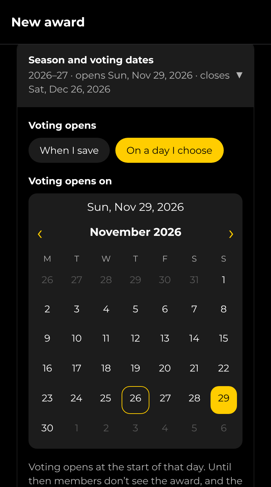

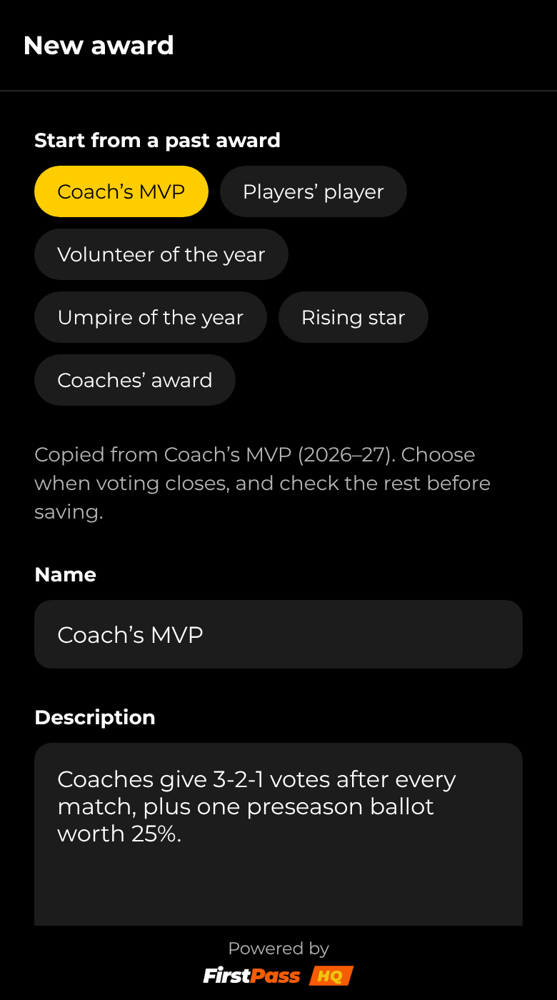

### Fixtures

**Fixtures** brings in match fixtures from PlayHQ:

1. On playhq.com, open the competition and copy its link, for example
   `https://www.playhq.com/netball-australia/org/…/australian-championships-summer-202526/ec69e46d`.
2. Paste it under **Add a PlayHQ competition** and tap **Look up**. A **PlayHQ check** shows how
   quickly PlayHQ answered, how many teams it found, and how many games the competition has in the
   last 12 months and scheduled in the next 12 months. Once you link teams it adds the same counts
   for our teams. A red note means PlayHQ has no games within 12 months of today, so check the link
   is for the right season.
3. Teams with "Thunder" in their name are listed. To find another, type part of its name under
   **Find a team**. Tap each of our teams and choose the squad or team it is. Choose the same
   squad or team your match awards name: match votes only open for games linked to exactly that
   squad or team (see **How match awards find their games** under **Awards**).
4. Tap **Import games**.

The games then show in each team's calendar, open match award votes and let athletes set game
goals. PlayHQ changes times and
courts as a competition goes on, so tap **Refresh from PlayHQ** to pick up changes, or
**Change teams** to link more teams. A refresh shows the PlayHQ check on that competition again, so
it is also the way to confirm PlayHQ is still working. **Coming up** lists the next matches.

If a look-up or refresh fails, the message says which part failed: PlayHQ itself, your connection,
an expired sign-in, or the club's PlayHQ service not being set up on the server. The details also
go to the app's log on your phone.

### Calendars

**Calendars** connects the club's Outlook calendars. In Outlook, publish the calendar and copy its
ICS link, then paste it under **Add a calendar**, give it a name and choose who it's shown to:
**Everyone**, the **Committee**, or one squad or team. Each calendar has a colour, used for its
events in the app. **Edit name or link** and **Delete** change or remove one.

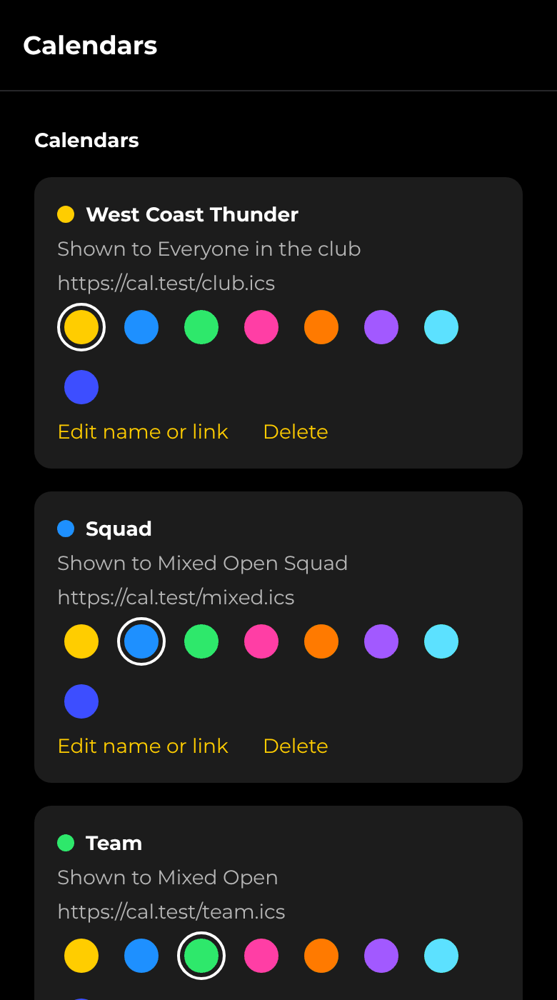

### Club captains

**Club captains** in Administration lists the athletes in the current season's squads and teams.
Tap the athletes who are club captains (yellow means chosen) and tap **Save club captains**. Club
captains can message everyone in the club until that season is archived; choose new ones each
season. If last season is still running alongside the new one, pick the season first. Athletes
under 18 are marked, and their parents or guardians get a copy of everything they send.

Admins can also choose any squad or team's captains and vice captains, the same way coaches do (see
[Choosing captains](#choosing-captains)).

### Messages to the club or a role

Admins can send a message to **Everyone**, to **A role** (such as all guardians or all coaches), or
to **A squad or team**. Admins can read every message and its read receipts.

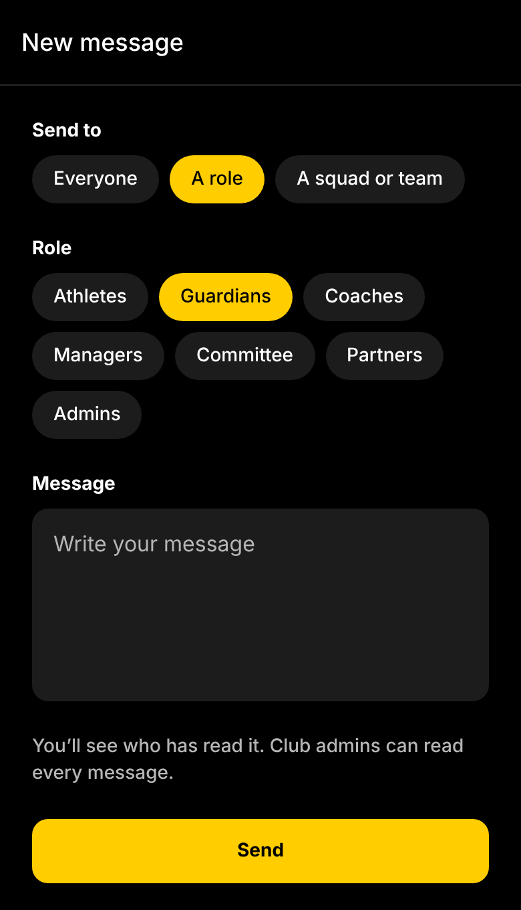

### Integrity training

**Integrity training** in Administration lists the courses members must complete each season, with
how many are approved. Tap **Add training** and fill in:

- **Course**, such as "Safeguarding in Sport", with optional **Details** and a **Course link**
  (for example Sports Integrity Australia's e-learning site).
- **Due by**: the day it must be done.
- **Who must complete it**: one or more of Athletes, Coaches, Managers, Physios, Committee, Admins
  and Guardians. Guests can't be asked.
- **All squads and teams**, or switch it off and choose squads and teams, such as the 17 & Under
  Squad and Lightning Academy for a junior course. A squad includes the teams named from it, and
  only members in those groups with a chosen role must complete it. Training for the whole club
  also reaches committee members and admins, who aren't in a squad or team.

Members see it in their to-do lists straight away. Open a course to see who has done it, and tap
**Change** to edit it. **Archive** takes it off everyone's to-do list but keeps its certificates;
**Remove** is only for training added by mistake, before anyone uploads a certificate.

Training is set per season because it must be done every year. When a new season starts, open
it in Integrity training and tap **Copy 2026–27 training** (last season's): each course is copied
with its due date a year on, and its squads and teams matched by name in the new season. Check
each copied course's squads and teams, then archive last season's courses once everyone is done.

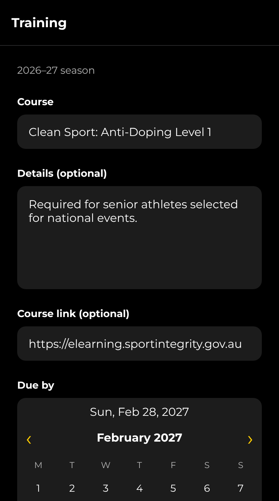
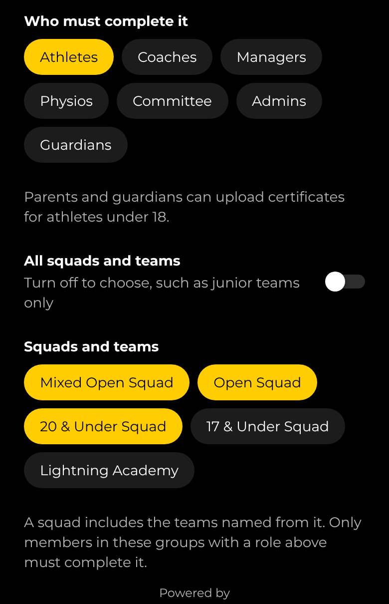

### Injury report

**Injury report** lists injuries reported or cleared in the last few months (3 by default), plus
every injury not yet cleared, with totals. **Export CSV** opens the share sheet so you can save it
to OneDrive or attach it to an email.

### Reports

**Reports** in Administration has governance and compliance reports. Each one shows on screen
with its totals, and **Export PDF** saves the same report as a PDF through the share sheet (on a
computer it downloads), ready for the committee, an audit or OneDrive. The PDF has the club's
name, the date it was made and page numbers, and anything that needs attention is in red.

- **Working With Children Checks**: printed across the page, with the WWC Registration Officer
  at the top. Every approved coach, manager, physio, committee member and admin with their name on the
  card, date of birth, roles, squads and teams, card number, expiry date, when and how the card was
  last validated and by whom, when it was linked with the Screening Unit, and status. Checks that
  are missing, have no expiry date, have expired, expire within 60 days, were never validated or
  were validated over a year ago, or aren't linked with the Screening Unit are listed first under
  **Needs attention**. Committee members and admins who are exempt are listed next, with the reason, who
  exempted them and when. **Exempt volunteers** lists every parent and under-18 volunteer exemption,
current ones first, with the child, who recorded it, when the declaration was accepted and where
it's up to, then ended ones with who ended them. **Screening Unit notices** lists every notice,
newest first, with what the club did and when the governing body was told. **Stand-downs** lists
everyone ever stood down, newest first, with the
  reason, who stood them down and lifted it, and when.
- **Under 18s and their guardians**: every approved athlete under 18 with their date of birth and
  age, squad or team, parents or guardians with their email addresses, and the consent given
  (check-ins, injuries, both or none). Athletes with no parent or guardian linked come first, and
  guardians who haven't been verified are marked. It prints across the page.
- **Integrity training** (when Integrity training is on): pick the season. **Still to finish**
  lists everyone with a course not yet approved, in red if a due date has passed, then each course
  lists who must complete it, where they're up to, when they completed it and who checked it.
- **Attendance** (when Attendance is on): pick the **Period** (last 4 weeks, last 3 months, this
  season, or **Choose dates** for a from and to date) and the **Squads and teams**: **All**,
  **Whole club events**, or any squads and teams. A squad includes the teams named from it. Each
  group lists its athletes with sessions present, absent and their attendance rate, followed by
  every session with who took it.
- **Award results** (when Awards are on): awards whose voting has closed. Open one for its full
  result: each squad or team's standings with points and how many 1st, 2nd and 3rd place votes
  (and so on) each nominee got, how many people voted, and for match awards the points from each
  match. Ballots stay secret: it never shows who voted for whom.

The PDFs hold members' personal details, such as dates of birth, check numbers and email
addresses, so keep them somewhere only the committee can reach.

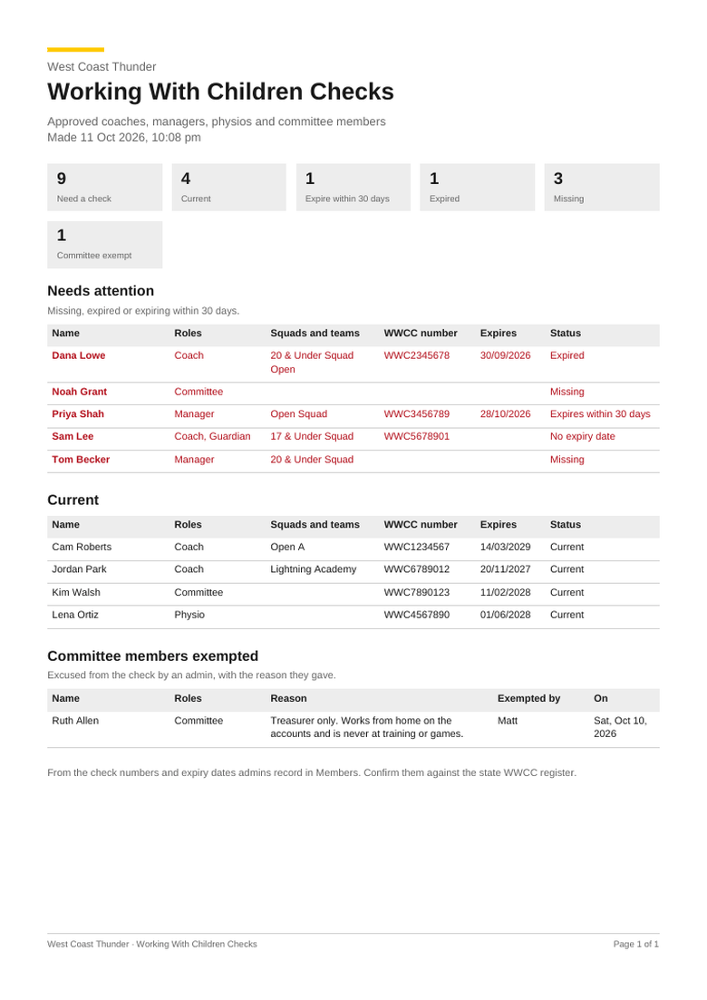
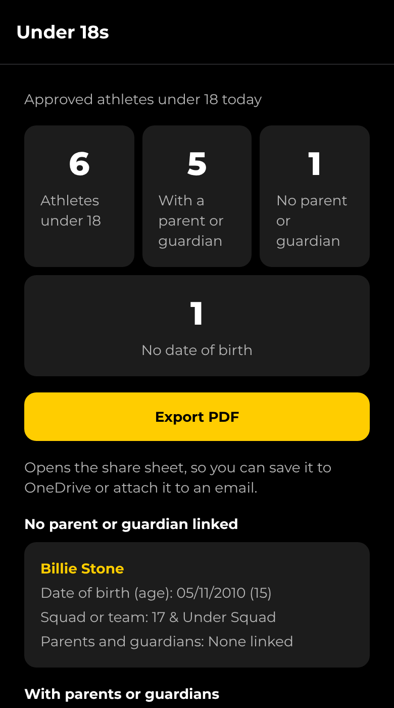
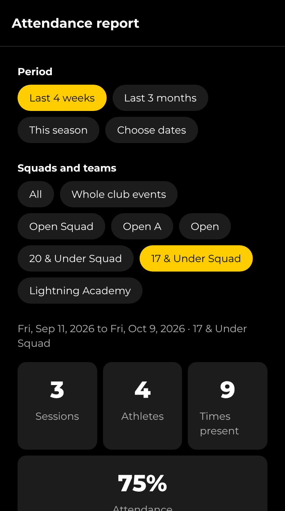
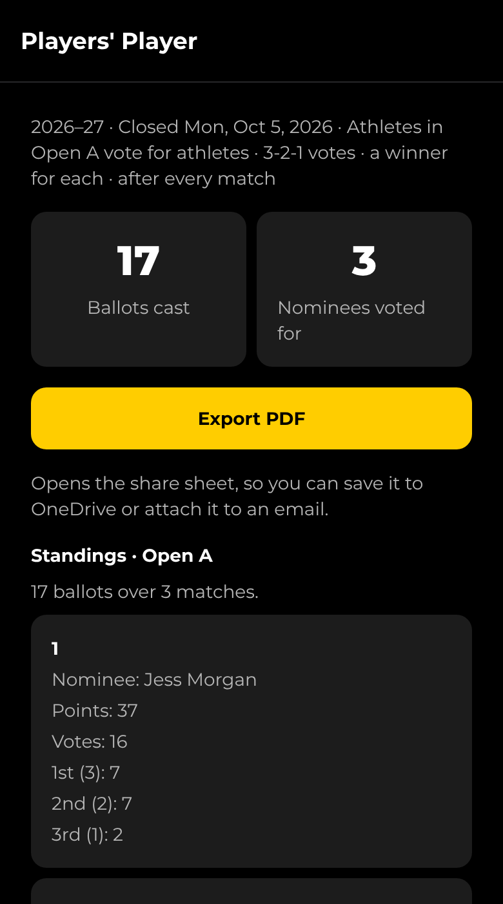

### Club settings

**Club settings** sets up the app for the club. Anything left empty uses the app's built-in
FirstPass look: the name "FirstPass HQ", the FirstPass 1P mark as the logo, and blaze orange
(`#F75C03`) on deep navy (`#0F172A`). West Coast Thunder's name, logo and yellow-on-black colours are saved here,
so leave them filled in.

- **Club name** is used in the app's wording and read out by screen readers for the logo. The **short name** (for example
  "Thunder") finds the club's teams when importing PlayHQ fixtures and names exported files.
- **Logo**: **Choose logo** to upload a square PNG or JPEG up to 2 MB. It shows on the home screen
  and the sign-in screen, and under the FirstPass 1P mark when the app opens. **Use the FirstPass
  mark** goes back to the built-in FirstPass 1P mark. "Powered by" and the FirstPass HQ logo always
  stay at the foot of every screen, and the 1P mark on the opening screen.
- **Colours**: type a colour code such as `#FFCD00` for the **background** and the **hero
  colour** (buttons, links and highlights), and choose **Light text** or **Dark text** to suit the
  background. Panels and the softer text for details are worked out from these (on the built-in deep navy
  they use the FirstPass brand guide's panel and text colours). The preview shows
  how they look together and warns when text or buttons would be hard to read. **Use the built-in
  colours** goes back to deep navy, white and blaze orange.
- **Features**: switch off any of Messages, Calendar, Daily check-ins, Injuries, Attendance,
  Awards, Game goals and Integrity training. A switched-off feature disappears from every member's home screen, to-do list and menus,
  and its Administration pages are hidden. Nothing is deleted, so switching it back on brings
  everything back.
- **Squads**: **Members join a squad first** is on unless the club switches it off. Switched off,
  members join a team straight away, admins add teams without squads and choose their athletes from
  the whole club, attendance takers can take attendance for any team, and each new season copies
  the teams. Squads the club already has stay until that season ends, and nobody is moved.
- **Physios get club messages**: when on, messages sent to everyone in the club also go to
  physios. Physios always get messages sent to the Physio role. It starts off.

Tap **Save club settings**. Members see the changes the next time they open the app. Someone
who has just installed the app sees the FirstPass look on the sign-in screen until they sign in.
The app's icon (the FirstPass 1P mark), its name under the icon (FirstPass HQ) and the splash screen are
part of the app build and don't change here.

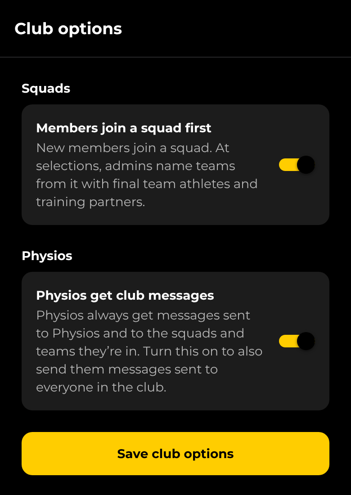

### Safeguarding contacts

**Administration > Safeguarding** names the club's **Child Safety Officer**, **Complaints
Manager** and **WWC Registration Officer**. Search for each by name. Both must be approved adults with a current Working With
Children Check (or an exemption that applies) and must be two different people, so a concern
about one can go to the other. You can't name yourself unless someone else is the other contact.
If a contact's check lapses or they're stood down, they stop being shown and stop seeing concerns
until you choose again.

The **WWC Registration Officer** is an admin or committee member with a current check who keeps
the club's Working With Children Check records, links members' cards to the club with the
Screening Unit and receives its notices. They're named on the Working With Children Checks report,
and your to-do list asks you to choose one until you do.

Add the sport's **governing body**: its name, phone or hotline, and complaints form link. Add the
club's **safeguarding policy** link too. Everyone sees these on **Raise a concern**. Links must
start with https://.

Under **Club policies**, add links to the club's **child safeguarding policy**, **privacy
policy** and **code of conduct**, hosted on your club's website, and the **policy version**. The
links show on Join, Your details and the parents' consent screen. Each parent's consent is
kept with the version in force when they gave it, so change the version when you change a policy.
Templates to adapt are in [docs/policies](policies/README.md).

**Photos of under 18s' injuries** is off by default, so injury proof for athletes under 18 is the
physio's or doctor's letter, as a PDF or a photo confirmed to show the letter. Turn it on only if
your club's policy allows photos of injuries; even then, only a verified parent or guardian can add
one, after confirming their consent, and athletes under 18 can never add one themselves.

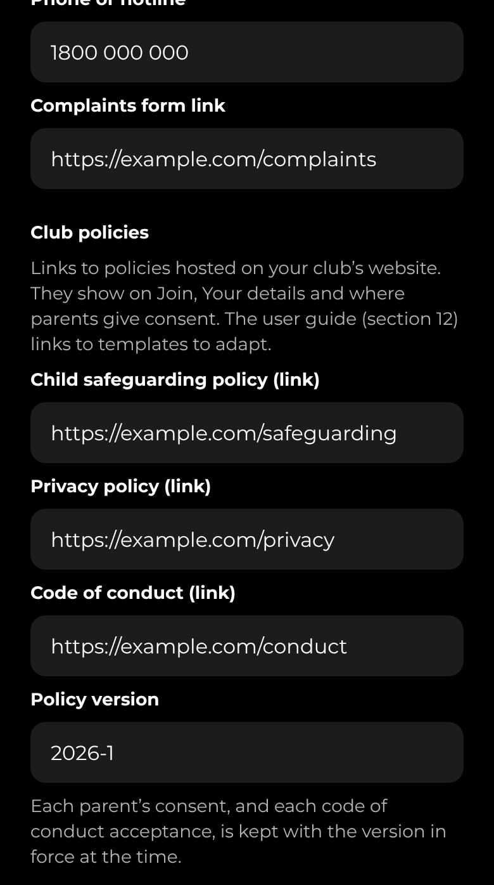

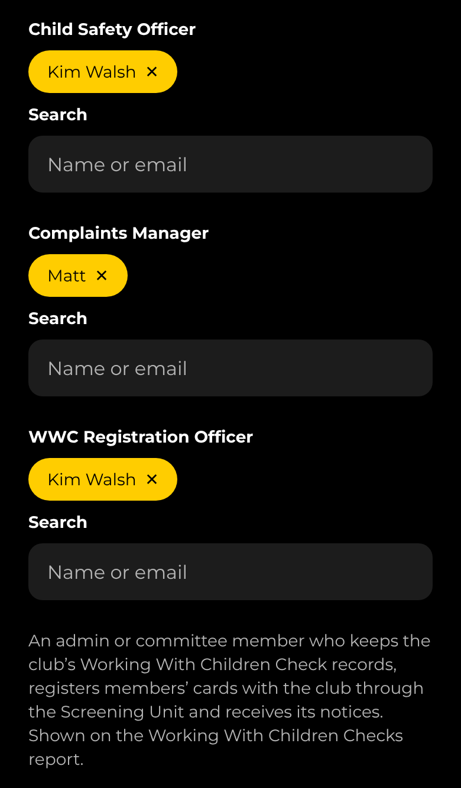

### The concerns register

The Child Safety Officer, the Complaints Manager and admins open **Concerns** from the home screen.
New concerns also appear in their to-do list until someone records something about them. Open
concerns are listed first, newest at the top. Nobody sees a concern about themselves.

Open a concern to see what was raised, by whom (unless they hid their name), how to contact them,
and where it was raised from. While a concern that may involve a child's safety hasn't been
referred, a red note at the top says to refer child abuse or a serious crime to Police and the
governing body straight away and not to resolve it within the club. Then record what you did:

- **Referred to** the governing body, or **Referred to Police**, with a note such as a reference
  number. Either sets the status to Referred.
- **Add note** for anything else: who you spoke to and what was decided.
- **Change status** to Being looked into, or **Closed** with a note saying why.
- **Who it's about**: name the member it's about. From then on they can't see it, even if they're
  an admin or handle concerns.

Every step is kept with who did it and when. **Export the register as a PDF** gives the whole
register with every step, for the committee, the governing body or an auditor.

### Club password

**Club password** sets a password new members must enter to ask to join. It stops strangers who
find the app from sending requests. Approved members never need it. For security it can't be shown
once saved, only replaced or removed, and anyone who gets it wrong five times in a row has to wait
15 minutes before trying again.

## 11. Who can see what

| Information             | Who can see it                                                                                                              |
| ----------------------- | --------------------------------------------------------------------------------------------------------------------------- |
| Your profile and squads | You, the people in your squads and teams (names and positions only), and admins.                                            |
| Preferred name and title | You and admins.                                                                                                            |
| Captains                | Club captains: every member. A squad or team's captains: the people in it, and admins.                                     |
| Date of birth, Working With Children Check and exemption | You and admins. Awards with an age limit use it to decide who can be voted for, without showing it.   |
| Date of birth given at Join, and a child's parent or guardian email | You and admins. Admins also see who recorded your checked date of birth and when. |
| How a member was verified | You and admins: the method, and what the admin checked. |
| Guardian link history   | Admins only: every link and unlink, by whom, when and the reason. The child's guardians, and the child from 13, get a message about each change, without the reason. |
| Stand-downs             | Admins only. The member sees that their role is paused, not the reason.                                                     |
| Screening Unit notices and card validations | Admins only.                                                                                            |
| Volunteer exemptions and declarations | The volunteer (their own) and admins.                                                                       |
| Concerns                | The Child Safety Officer, the Complaints Manager and admins, never the person a concern is about. Whoever raised it sees its status. A hidden name is never shown to them. |
| Safeguarding contacts   | Everyone signed in, including guests and people waiting for approval.                                                       |
| Messages                | The people they were sent to, the sender, and admins. Guardians of athletes under 18 get a copy of every message sent to their athlete, and of every message their athlete sends as a captain. Guests don't get messages; physios get messages sent to the Physio role and to their squads and teams, and whole-club messages only if an admin turns that on. |
| Read receipts           | The sender and admins.                                                                                                      |
| Daily check-in answers and notes | The athlete, their guardians and their coaches. For an athlete under 18, their coaches only once a parent or guardian consents. The committee, physios and admins see only group averages, hidden below 5 check-ins or when two groups differ by fewer than 5. |
| Injuries and documents  | For an athlete under 18 whose parents haven't given consent for injuries: only the athlete, their guardians and admins. Otherwise the athlete, their guardians, their coaches, the physios who look after them (the Head Physio, physios in their squad or team, and physios in no squad or team), the committee and admins. Managers don't see injuries. Only the committee member or admin accepting a clearance can share its documents, while it waits for them; everyone else views them in the app. |
| Who opened injury documents | The athlete, their guardians and admins: every view and share, by whom, their role and when, and each photo consent. |
| Consents for a child    | The athlete, their parents or guardians and admins, with every consent given and withdrawn. Only a verified parent or guardian can give or withdraw one. |
| Club policies           | Everyone signed in, including people asking to join.                                                                        |
| Game goals and reflections | The athlete, their guardians and their coaches. Only the athlete and their coaches set goals, and only the athlete reflects; guardians just read them. The committee, physios and admins don't see them. |
| Team goals              | The team's athletes, their guardians and its coaches. Only its coaches set and review them. Athletes and coaches in the team can comment; guardians read the comments. |
| Integrity training certificates | The member, their parents or guardians, the committee and admins. Coaches don't see them. Certificates can't be changed or removed once sent. |
| Attendance records      | Coaches, the committee and admins. Managers see their own groups' sessions. Athletes and guardians don't see attendance.    |
| Committee calendar      | Committee members and admins.                                                                                               |
| Award votes             | Only the voter sees their own ballot. Nobody, admins included, can see who someone voted for.                               |
| Award results           | Admins only: standings and how many people have voted, and once voting closes, how many votes each nominee got at each place. |
| Reports and their PDFs  | Admins only. A saved PDF is a copy outside the app, so whoever it's shared with can read it.                                |
| Match fixtures          | The members of each squad or team, and admins.                                                                              |
| Club name, colours and logo | Every signed-in member. The logo file is public so it can show before sign-in. Only admins can change them.            |
| Other clubs' members and records | Nobody in this club. Each club's members, messages, injuries and documents are kept in that club's own database, which other clubs can't reach. |

When someone leaves, injury records and proof documents are kept for 12 months, visible only to the
committee and admins, then deleted automatically.

## 12. Child safety and safeguarding

Children are the club's first responsibility. This section brings together everything the app does
to keep them safe, for parents, young people, coaches and volunteers, committees and boards, and
the sport's governing body. The details are in each role's section.

### Raising a concern

Anyone signed in can raise a concern, from the home screen, the check-in screen, any injury or any
message, and can hide their name (see [Raising a concern](#raising-a-concern)). It goes to the
club's Child Safety Officer, Complaints Manager and admins, never to the person it's about. Police
(000), Kids Helpline, the Safe Sport Hotline and the governing body's contacts are shown on the same
screen. Every concern and every step taken is kept in the [concerns
register](#the-concerns-register), which prints as a PDF.

### Who counts as a child

Everyone gives their date of birth when they ask to join. It's never taken on trust: an admin
checks it against PlayHQ or ID and records it, and the app keeps who recorded it and when. An
athlete can't be approved without a checked date of birth, so a missed field can never approve a
child as an adult. A child also gives a parent's or guardian's email, and while they wait they're
asked to have that parent or guardian join and shown who they can talk to. Athletes approved before
dates of birth were needed show under **Needs checking** until an admin adds one.

### Injury documents and photos

Netball's image rules ask for a parent's consent before a club keeps a photo of a child, and for
images to stay inside the club. So for athletes under 18:

- **Proof is the letter, not the injury.** The athlete or their guardian attaches the physio's or
  doctor's letter or report, as a PDF or a photo of the letter. Before a photo is sent, whoever adds
  it switches on **This is a photo of the letter or report, not of the injury**. That confirmation
  is kept with the photo, with their name and when, and shown under the document. A photo without
  it is refused, including one renamed to look like a PDF.
- **Photos of injuries only with consent.** If an admin allows them under Safeguarding, a verified
  parent or guardian can choose **The injury** and add one after switching on **I consent**. The
  consent is kept with the photo and shown with the document. Athletes under 18 can never add one.
- **Every view is recorded.** A document can only be opened after the app records who is opening
  it, their role and when. The athlete, their parents or guardians and admins see the list under
  each document.
- **Sharing is limited.** Only the committee member accepting a clearance can share its documents,
  while it's waiting for them, and each share is recorded in the same list.

Athletes who are 18 or over attach a PDF or a photo, and see who opened their documents too.

### For parents and guardians

- **You're verified before you're linked.** An admin checks you against the club's registration,
  by sighting ID, or with a code shown on your phone, before linking you to your child, and the
  app keeps how and what they checked.
- **You're told when another guardian is added or removed.** You get a message naming the guardian
  and the admin who made the change, and every link and unlink is kept. An admin who is also your
  child's parent can't change who your child's guardians are.
- **No child is approved without you.** Every athlete under 18 needs a date of birth checked by an
  admin and at least one verified guardian before an admin can approve them. Your child gives your
  email when they ask to join, so the admin knows who to look for.
- **You see what your child sees.** You get a copy of every message sent to your child, and of every
  message your child sends as a captain. You can read their daily check-ins and notes, their game
  goals and their injuries.
- **Nothing is shared without your consent.** Your child's check-ins and injuries are seen by
  their coaches, physios and the committee only after you consent in the app (see [Giving
  consent](#giving-consent)). You can withdraw it at any time, and every change is kept.
- **Your access ends at 18.** Guardian access ends on your child's 18th birthday.
- **Injury photos need your consent.** Injury proof for under 18s is the letter or report, as a PDF
  or a photo confirmed to show the letter. Only if the club allows it can you, as a verified
  guardian, add a photo of your child's injury, and only after confirming your consent, which is
  kept with the photo.
- **You see who opened your child's injury documents**, with their role and when, and every share.

### For children and young people

- **Nobody can message you privately.** There are no direct messages and no replies. Messages go to
  whole squads, teams or roles, and your parents or guardians get a copy.
- **You're told who sees what you write**: on the check-in, on injury reports, on game goals and
  when you join. Your coaches see your check-ins and injuries once a parent or guardian agrees.
- **You're told who your guardians are.** From 13, you get the same message as your parents when a
  parent or guardian is added or removed.
- **Your parent or guardian joins too.** When you ask to join, you give your date of birth and a
  parent's or guardian's email. While you wait, the app shows who you can talk to if anything
  worries you.
- **You can tell someone safely.** The check-in screen has a link to raise a concern, and you can
  hide your name. Kids Helpline (1800 55 1800) is free, any time.
- **No photos of your injuries.** Attach your physio's or doctor's letter instead, as a PDF or a
  photo of the letter. You can see everyone who has opened it.

### For coaches, managers, physios and volunteers

- **A check before you start.** Coaches, managers, physios, committee members and admins need a current
  Working With Children Check before they're approved. An admin validates the card, online or by
  sighting it, at least once a year and whenever it's renewed, and links it to the club with the
  Screening Unit, so the club hears if anything changes.
- **Parent and under-18 volunteers.** In WA a parent volunteering at their child's club, or a
  volunteer under 18, is exempt instead and accepts a declaration in the app (see [Volunteer
  exemptions](#volunteer-exemptions)). The exemption ends by itself when the child or volunteer
  turns 18.
- **Your role pauses the day your check expires**, and comes back when an admin records the renewed
  check. Admins are reminded 60 days ahead.

### For committees, boards and admins

- **Stand-downs.** An admin can stand someone down straight away, for example on an interim
  negative notice from the Working with Children Screening Unit. Their coach, manager, physio,
  committee and admin roles stop and they leave the squads and teams they lead. Every stand-down is
  kept (see [Changing or removing members](#changing-or-removing-members)).
- **Admins are screened too.** Admins can read every child's records, so they need a current
  check, or an exemption with a reason that another admin records; nobody exempts themselves. An
  admin's role doesn't pause when the check expires, so the club can't be locked out of its own
  app, but it stays on every admin's to-do list until renewed, and an admin can be stood down.
- **Safeguarding contacts.** Name a Child Safety Officer and a Complaints Manager, two different
  adults with a current check, and add the governing body's contacts and the club's policy (see
  [Safeguarding contacts](#safeguarding-contacts)). Name a WWC Registration Officer to keep the
  club's check records.
- **Screening Unit notices.** Record every notice on the member's page. An interim negative
  notice, negative notice, interstate decision or cancelled card stands them down at once, and
  stays on your to-do list until you record telling the governing body in writing.
- **Guardian changes leave a trail.** Every guardian link and unlink is kept with who made it,
  when and why, and the family is told. An admin can't change their own child's guardians.
- **Policies and consent.** Link the club's safeguarding policy, privacy policy and code of
  conduct under Safeguarding; templates are in [docs/policies](policies/README.md). The under 18s
  report shows which children still need a parent's consent.
- **Images of children.** Photos of under 18s' injuries are off unless you turn them on under
  Safeguarding, and then need a verified guardian's consent. Only the committee member accepting a
  clearance can share its documents, while it waits for them.
- **Your to-do list does the chasing**: new concerns, missing or expiring checks, volunteer
  exemptions ending, declarations not yet accepted, cards to validate or link with the Screening
  Unit, notices to report to the governing body, no WWC Registration Officer, athletes with no date
  of birth, athletes under 18 without a guardian and athletes turning 18.
- **Reports for your records.** The Working With Children Checks report follows the Screening
  Unit's record layout: every check with the name on the card, date of birth, card number, expiry
  and validation, plus every exemption, notice and stand-down. The under 18s report lists every child and their guardians. The concerns register
  lists every concern and what was done. Each saves as a PDF.

### For the governing body and auditors

- **Two-deep messaging is enforced by the app**, not just by policy: no direct messages or replies,
  guardians copied on everything to and from a child, and admins can see every message.
- **Records are kept with who did what and when**: how each guardian was verified and what was
  checked, every guardian link and unlink with the admin and the reason, who recorded each date of birth, checks and
  who validated each card and how, Screening Unit notices and when the governing body was told,
  exemptions and the declarations accepted,
  stand-downs, every concern with each referral, note and status, every view and share of an
  injury document, and every parent's consent with the policy version they agreed to. A document can't be opened without the view being recorded first.
- **Child abuse and serious crimes go out, not in.** The register prompts the club to refer them to
  Police and the governing body straight away, and records that it did.
- **Each club's data is kept apart**, in that club's own database.

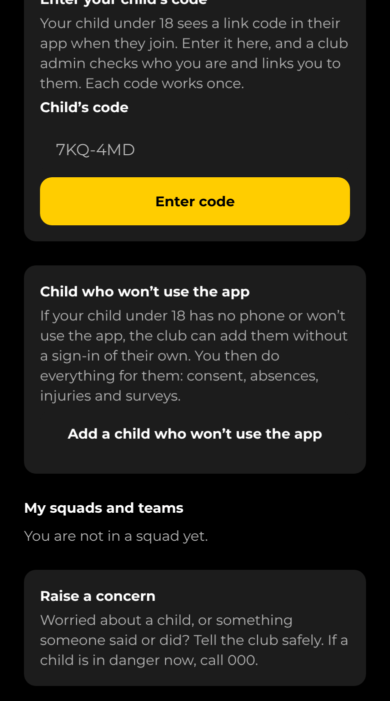

## 13. Keeping this guide up to date

This guide lives in the app's repository at `docs/user-guide.md`, with its screenshots in
`docs/user-guide/`. Any change that adds, removes or changes something a member can see or do must
update the matching section, the tables in sections 1 and 11, and any screenshot that no longer
matches, in the same pull request. A change that touches children's safety also updates section 12.

Screenshots are taken from the web build with sample data (no real club data), at a 390 × 844
phone screen at 2× scale. The tooling (`shoot.mjs`, `serve.py` and the fixtures, including
`user-guide.mjs` for screens only this guide uses) is kept in the project's shared files under
`thunder/screenshots/`.
