# West Coast Thunder app: user guide

This guide explains what the club's FirstPass HQ app does and how to use it, role by role, and how
statisticians and coaches use FirstPass Vantage and FirstPass Vision on game day (section 14).
Every screen shown is from the apps themselves, filled with made-up sample people.

**Printing:** open this file in any Markdown viewer (GitHub, VS Code, Typora) and print to PDF.
Each role starts on a new page when the viewer supports page breaks.

<!-- Maintainers: this guide must match the app. See "Keeping this guide up to date" at the end. -->

**Child safety comes first.** Anyone signed in can **Raise a concern** from the top of every tab, and the
club's Child Safety Officer and Complaints Manager act on it. If a child is in danger now, call
000. [Section 12](#12-child-safety-and-safeguarding) explains every protection the app gives
children, for parents, committees, boards and the sport's governing body.

## Contents

1. [Roles at a glance](#1-roles-at-a-glance)
2. [Getting started](#2-getting-started)
3. [Things everyone can do](#3-things-everyone-can-do)
4. [Athletes](#4-athletes)
5. [Parents and guardians](#5-parents-and-guardians)
6. [Coaches](#6-coaches)
7. [Managers](#7-managers)
8. [Committee](#8-committee)
9. [Physios, statisticians, guests and temporary helpers](#9-physios-statisticians-guests-and-temporary-helpers)
10. [Admins](#10-admins)
11. [Who can see what](#11-who-can-see-what)
12. [Child safety and safeguarding](#12-child-safety-and-safeguarding)
13. [Your club's data](#13-your-clubs-data)
14. [Game day: FirstPass Vantage and Vision](#14-game-day-firstpass-vantage-and-vision)
15. [Not in the app yet](#15-not-in-the-app-yet)
16. [Keeping this guide up to date](#16-keeping-this-guide-up-to-date)

## 1. Roles at a glance

Everyone in the app has a main **club role**, and some people have **other roles** as well, such as
a coach who is also a parent. Coaches, managers, physios, athletes and guardians also belong to one or more
**squads** or **teams** for the current season. Someone with more than one role can do everything
each of their roles can.

| Role          | Who it's for                                                                                         |
| ------------- | ---------------------------------------------------------------------------------------------------- |
| **Athlete**   | Registered players aged 13 and over (nobody under 13 signs in to the app this year). Some are club captains, or captains or vice captains of a team. They see their own attendance and can report an absence. An athlete under 18 can't use the app until a verified parent or guardian is linked to them: until then they see only a link code to share with one (see [Ask to join the club](#ask-to-join-the-club)). A child with no phone, or who won't use the app, can be added by an admin with no sign-in of their own, at any age under 18, and their parent or guardian does everything for them (see [A child who won't use the app](#a-child-who-wont-use-the-app)). |
| **Guardian**  | Parents and guardians of athletes under 18. They ask to be linked to their child by entering the link code from their child's app, or ask the club to add a child who won't use the app (later children from **Add another child** in the Family tab), and follow their children into and out of their squads and teams. They see their child's attendance and can report an absence for them, and see what has changed around their child. If the club asks, they accept the club's code of conduct for their child each season. |
| **Coach**     | Head coaches and assistant coaches. Both have the same permissions, except that a head coach sets Season KPIs for the group's assistant coaches; otherwise the title only shows who is who. The app gives each coach a title from their team, or their squad until they're in a team, such as "Head Coach, Open A". Need a current Working With Children Check; the role pauses while it's expired, and they add the renewed card from Today for an admin to check (see [Sending in your own check](#sending-in-your-own-check)). Someone who has applied for one, new or a renewal, can work while it's assessed (see [Checks applied for](#checks-applied-for)). A parent volunteering at their child's club, a volunteer under 18, or a short-term visitor or national event helper from outside WA has an exemption instead (see [Volunteer exemptions](#volunteer-exemptions)). |
| **Manager**   | Squad and team managers. The app gives each manager a title from their team, or their squad until they're in a team, such as "Manager, 17 & Under". Need a current Working With Children Check; the role pauses while it's expired, and they add the renewed card from Today for an admin to check (see [Sending in your own check](#sending-in-your-own-check)). Someone who has applied for one, new or a renewal, can work while it's assessed (see [Checks applied for](#checks-applied-for)). A parent volunteering at their child's club, a volunteer under 18, or a short-term visitor or national event helper from outside WA has an exemption instead (see [Volunteer exemptions](#volunteer-exemptions)). |
| **Committee** | Club committee members. Each can add a title, such as President or Secretary, shown with their role. Only committee members and admins can add their own title. Need a current Working With Children Check, or an application being assessed, unless an admin exempts them with a reason (not if they also coach, manage or physio); the role pauses if a recorded check expires or was recorded without an expiry date, and they add the renewed card from Today for an admin to check. Committee members approved before checks were needed keep the role without one only until the club's **committee checks date**. Those with a current check, an application in force or a volunteer exemption also read most of the club's governance reports. |
| **Physio**    | The club's physiotherapists. A physio can be placed in squads or teams to look after their athletes, and one can be the **Head Physio**, who looks after every athlete. Need a current Working With Children Check; the role pauses while it's expired, and they add the renewed card from Today for an admin to check (see [Sending in your own check](#sending-in-your-own-check)). Someone who has applied for one, new or a renewal, can work while it's assessed (see [Checks applied for](#checks-applied-for)). A parent volunteering at their child's club, a volunteer under 18, or a short-term visitor or national event helper from outside WA has an exemption instead (see [Volunteer exemptions](#volunteer-exemptions)). |
| **Guest**     | Anyone else the club lets in, such as partners and sponsors. Guests must be 18 or over. They see the club calendar and any calendar an admin shares with guests, keep their own tasks and can raise a concern. They aren't in squads or teams, get no messages, don't vote and aren't asked for a Working With Children Check or the code of conduct. A guest can add a check if they have one, which is optional, and a guest with a current check can be named Child Safety Officer or Complaints Manager. |
| **Statistician** | The people who record live game stats on a tablet in FirstPass Vantage, which coaches watch live in FirstPass Vision. Statisticians see every game the club records; a game's coaches and managers see their own squad's or team's, and a squad's coaches and managers also see the games of its teams. Any member can hold it alongside another role, such as a manager or an athlete who isn't playing. Need a current Working With Children Check, an application being assessed, or a volunteer exemption such as a parent at their child's games, unless an admin exempts them with a reason, such as only recording opens games; the role pauses if a recorded check expires. Statisticians approved before checks were needed keep the role without one only until the club's **statistician checks date**. The role pauses while a member is stood down. |
| **Studio** | The people who run the club's live streams in FirstPass Studio, which shows the club's live game stats on screen. Studio signs in to the club with this person's own Google account and reads only the stats the club records for its PlayHQ games, live and finished, and the line-ups for them; it can't change anything. Someone whose only role is Studio, such as a streamer from outside the club, isn't a club member: they see none of the club's features, members or messages. A member can also hold it alongside their own roles. No Working With Children Check is needed, because a Studio operator isn't with the team and never sees contact details, injuries or anything else sensitive. The role pauses while a member is stood down (see [Studio](#studio)). |
| **Temporary helper** | Someone helping for a day or a short time, such as at a carnival, clinic or tournament, paid or unpaid. Not necessarily a member of the club: this is only a role so the app can onboard them. The app screens them: a Working With Children Check or an exemption covering every day they help, and the club's code of conduct and safeguarding policy accepted. They see none of the club's features or messages, and their time ends by itself after their last day (see [Temporary helpers](#temporary-helpers)). |
| **Admin**     | The people who run the app. Admin is granted by another admin, never requested; only a new club's first admin is made with a one-time setup code from FirstPass (see [Setting up a new club](#setting-up-a-new-club)). Admins can add a title too. Need a current Working With Children Check, or an application being assessed, unless another admin exempts them. An expired check doesn't pause the admin role, so the club is never locked out, but it stays on the admins' to-do list until it's renewed, and 30 days after it expired (or after the club's committee checks date, if none is recorded) the admin stops seeing under 18s' injuries until a check, an application or a parent volunteer exemption is recorded. Admins set how long the club keeps records, and are warned when the nightly removal of old records stops. |

**Safeguarding contacts.** An admin names members as the club's **Child Safety Officer** and
its **Complaints Manager** (a larger club can name up to 5 people in each, and nobody can hold
both). Any approved adult with a current check can be named, guests included, but not temporary
helpers. They're not separate roles: each keeps their own role and also
sees and acts on the concerns members raise. Their **Today** leads with a **Safeguarding** panel:
red, orange and green counts for the register, and new concerns marked **Urgent** (see [The
concerns register](#the-concerns-register)).
Each sees their post as a title under their roles on Today, as does the **WWC
Registration Officer**.
The Child Safety Officer also sees every athlete's wellbeing flags: the day and lowest score of
each low check-in, never the answers or notes (see [Wellbeing flags](#wellbeing-flags)), and,
when the club turns on Training load flags, training load patterns for children (see [Training load
patterns](#training-load-patterns)).
While nobody named in a post can act (none named, or every one's check has lapsed or they're stood
down), each admin with a current check acts in it, with the post's full powers, and is shown as
**Child Safety Officer (acting)**, **Complaints Manager (acting)** or **WWC Registration Officer
(acting)** until someone is named (see [Acting in an empty post](#acting-in-an-empty-post)).
A concern with nothing recorded for too long is chased as Important, then Urgent, and then goes
along the club's escalation chain to another post, a named adult or the admins, so any adult with a
current check may be asked to handle one concern (see [Concern clocks and
escalation](#concern-clocks-and-escalation)).

**Squads and teams.** Each season, members join a **squad** (at West Coast Thunder: Mixed Open
Squad, Open Squad, 20 & Under Squad, 17 & Under Squad, Lightning Academy). At selections, admins name
**teams** from a squad and pick each team's final team athletes and training partners. People selected for a team stay
in their squad as well. An athlete is in one squad and one team at a time in a season; coaches,
managers and physios can be in more than one team. A club that doesn't use squads can switch them off in
[Club options](#club-options): members then join a **team** straight away, as a final team athlete
or training partner, and the app talks about teams wherever it would say squad.

**Combining roles.** An admin adds other roles from the member's page. Some roles can't go
together:

- **Guests** and **temporary helpers** can't have any other role.
- **Admins** can also be a coach, manager, physio, committee member or guardian, but not an athlete.
- **Athletes** can't also be a manager or a physio. An athlete can coach, but not the squad they
  play in, a team named from it, or the squad a team they play in belongs to. Anyone but a guest or temporary helper can also be a statistician, including an athlete 18 or over helping at a game they aren't playing in, or hold Studio.
- **Athletes under 18** can only add Coach. Parents and guardians must be 18 or over, by their date
  of birth or, when none is recorded, by whether an admin marked them under 18.
- **Who is under 18** is decided by the date of birth an admin checks against PlayHQ or ID. An
  athlete can't be approved without one.
- Nobody endorses or accepts an injury clearance for themselves or their own child, and whoever
  endorsed a clearance can't also accept it.

Today lists every role someone holds under their name, such as "Coach, Guardian", and the tabs
show what each of those roles would show on its own. Someone who looks after more than one thing,
such as a coach who is also a parent, has a **Team** and **Family** switch at the top of their
fourth tab (see [The tabs](#the-tabs)).

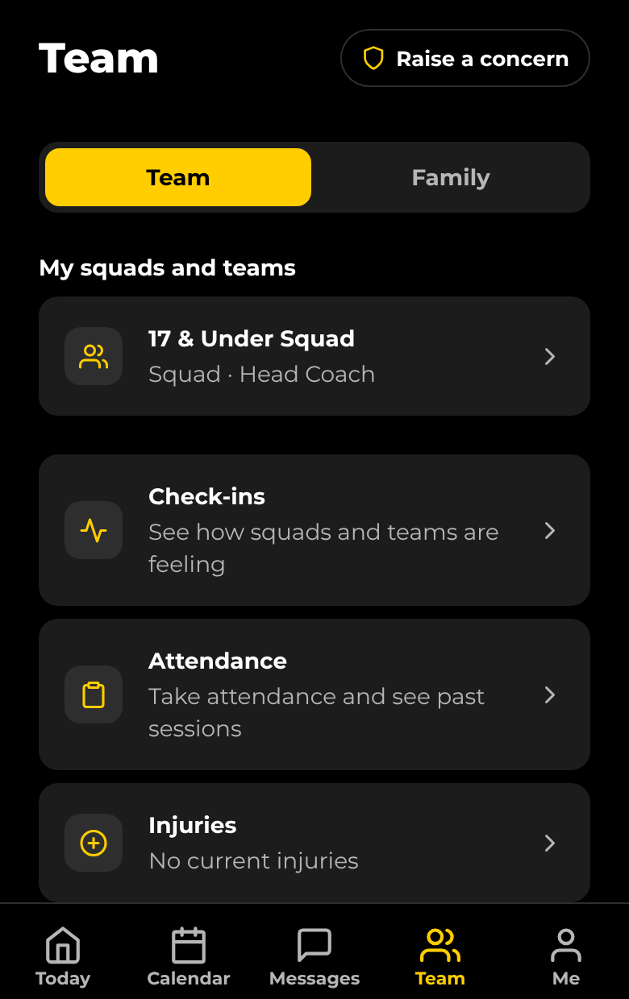

**Captains.** Admins choose **club captains** from the season's athletes, and admins or a team's
coaches choose its **captains** and **vice captains**. Squads don't have captains. Captains stay
athletes; captaincy only adds the right to send messages and polls. Club captains can message the
whole club, and captains and vice captains can message and send polls to their own team. Captaincy
shows as a title under the athlete's role on Today, like "Captain, Open A". It
ends when the season is archived, or when the athlete moves to another team.

The tabs each role has along the bottom of the app (see [The tabs](#the-tabs)):

| Role | Tabs |
| ---- | ---- |
| Athlete | Today, Calendar, Messages, Team, Me |
| Guardian | Today, Calendar, Messages, Family, Me |
| Coach, manager, physio | Today, Calendar, Messages, Team, Me |
| Committee, admin | Today, Calendar, Messages, Club, Me |
| Statistician with no other role | Today, Calendar, Messages, Me |
| Guest | Today, Calendar, Me |
| Temporary helper, Studio with no other role, anyone waiting to join, and an athlete under 18 waiting for a parent or guardian | One screen, no tabs |

Someone with more than one role has the tabs of each: a coach who is also a parent has Team and
Family, and swaps between them with the switch at the top of that tab. A role that is paused
gives no tab. Calendar and Messages go when the club switches those features off.

What each role can see and do:

| Feature                                | Athlete |     Guardian    |    Coach     |  Manager   |   Committee   |     Physio    |  Guest  |     Admin     |
| -------------------------------------- | :-----: | :-------------: | :----------: | :--------: | :-----------: | :-----------: | :-----: | :-----------: |
| To-do list and calendar                |    ✓    |        ✓        |      ✓       |     ✓      |       ✓       |       ✓       |    ✓    |       ✓       |
| Your own personal tasks                |    ✓    |        ✓        |      ✓       |     ✓      |       ✓       |       ✓       |    ✓    |       ✓       |
| To-do notifications on your phone      |    ✓    |        ✓        |      ✓       |     ✓      |       ✓       |       ✓       |    ✓    |       ✓       |
| My squads and teams                    |    ✓    |        ✓        |      ✓       |     ✓      |  If in one    |       ✓       | Heading only |   If in one   |
| Read and archive messages, mark read or unread |    ✓    |        ✓        |      ✓       |     ✓      |       ✓       |       ✓*      |         |       ✓       |
| Send messages                          | Captains† |                 |  Own groups  | Own groups |   Whole club  |               |         |     Anyone    |
| Chat groups (when switched on)         | Captains‖ |                 |      ✓‖      |     ✓‖     |  If added‖    |      ✓‖       |         | ✓, sets up groups‖ |
| Block and unblock someone in chat groups | Captains‖ |                 |      ✓‖      |     ✓‖     |  If added‖    |      ✓‖       |         |       ✓‖      |
| Follow up blocks in chat groups        |         |                 |              |            |               |               |         | ✓, and the safeguarding officers‖ |
| Answer a message's question            |    ✓    | Own, and for their athlete |      ✓       |     ✓      |       ✓       |       ✓       |         |       ✓       |
| See who answered a message's question  | Captains, their own† |   Their athlete's   |  Own groups  | Own groups | Their own |               |         |   Their own   |
| Answer a request to read a member's messages (for a concern) |         |                 |              |            |               |               |         |  If not involved‡‡ |
| Answer surveys                         |    ✓    | Own; see their athlete's |      ✓       |     ✓      |       ✓       |       ✓       |         |       ✓       |
| Team totals of a shared poll           |    ✓    | Their athlete's |      ✓       |     ✓      |  If sent one  |  If sent one  |         |  If sent one  |
| Send surveys and polls, see results    | Captains' polls† |                 |  Own groups  | Own groups |    Anyone     |               |         |    Anyone     |
| Daily check-in                         |    ✓    |                 |              |            |               |               |         |               |
| Log training sessions (minutes, effort) |    ✓    |                 |              |            |               |               |         |               |
| Game goals and reflections             |   Own   |  See athlete's  | Own athletes |            |               |               |         |               |
| An athlete's stats from a recorded game |         |                 | Own athletes, with Net Points |            |               |               |         |               |
| Team goals for a game                  | See, comment |       See       | Set, review, comment |            |               |               |         |      See      |
| Check-ins of others                    |         | Their athlete's | Own athletes |            | Averages only | Averages only |         | Averages only |
| Training sessions of others            |         | Their athlete's | Own athletes |            |               |               |         |               |
| Training load flags (when turned on)   | Own, gently | When a coach has talked with their athlete | Own athletes: flags, numbers, mark talked |            |               |               |         | Choose the flags |
| Report an injury                       |   Own   | Their athlete's |              |            |               |               |         |               |
| Log an injury when it happens          |         |                 | Own athletes | Own athletes |             |  Own athletes‡ |         |               |
| Add physio updates                     |   Own   | Their athlete's |              |            |               |  Own athletes‡ |         |               |
| See injuries                           |   Own   | Their athlete's | Own athletes |            |     All¶      |  Own athletes‡ |         |      All      |
| Sign off injury clearances             |         |                 | Endorse, not concussions◊ |            | Accept, send back¶ |   Endorse‡    |         | Accept, send back |
| See who opened injury documents        |   Own   | Their athlete's |              |            |               |               |         |       ✓       |
| Medical and emergency details          | Own; keep if 18 or over | Keep their athlete's | Own athletes‖ | Own athletes‖ |               | Own athletes‡‖ |         |               |
| Check medical details once a year      | Own, if 18 or over | Their athlete's |              |            | See who has (report), if checked |               |         | See who has (report) |
| Consent for a child's check-ins, injuries and stats on live streams |         |        ✓        |              |            |               |               |         |  See status   |
| Accept the code of conduct each season (if the club asks) | Own§ | Own, and their athlete's | Own | Own | Own | Own | | Own, see who has |
| Send in your own Working With Children Check |         |                 |     Own      |    Own     | Own, unless exempt |      Own      |         | Own, unless exempt; check and accept others' |
| Take attendance                        |         |                 |      ✓       |     ✓      |       ✓       |               |         |       ✓       |
| See athletes' attendance history       |         |                 |      ✓       |            |       ✓       |               |         |       ✓       |
| Review reported absences               | Report own | Report their athlete's | Own groups | Own groups |   See all    |               |         |    See all    |
| Session plans                          | Read shared |  Read their athlete's shared | Add, share, read shared |            |               |               |         | Add, read all, report |
| Vote in club awards                    |    ✓    |                 |      ✓       |     ✓      |       ✓       |               |         |       ✓       |
| Set up awards and see results          |         |                 |              |            | See results once closed (report), if checked |               |         |       ✓       |
| Season KPIs (when turned on)           |   Own   |  See athlete's  | Own; set for own athletes, and assistants if head coach | Own | Set for coaches and managers |  |  | Set for coaches and managers, read athletes', set review dates |
| Complete integrity training            |   Own   | Own, and their athlete's |     Own      |    Own     |      Own      |      Own      |         |      Own      |
| Check training certificates            |         |                 |              |            |       ✓       |               |         |       ✓       |
| Set integrity training                 |         |                 |              |            |               |               |         |       ✓       |
| Governance reports as PDFs             |         |                 |              |            | Checks, medical details checks, training, attendance and award results, if checked; concerns register, if an officer |               |         |       ✓       |
| Import fixtures from PlayHQ            |         |                 |              |            |               |               |         |       ✓       |
| Preferred name                         |    ✓    |        ✓        |      ✓       |     ✓      |       ✓       |       ✓       |    ✓    |       ✓       |
| Title, such as President               |         |                 |              |            |       ✓       |               |         |       ✓       |
| Team title, set by the app             |         |                 |      ✓       |     ✓      |               |               |         |               |
| Club brand, features, options and record keeping |         |                 |              |            |               |               |         |       ✓       |
| Manage absence reasons                 |         |                 |              |            |               |               |         |       ✓       |
| Invite members (QR code and link)      |         |                 |              |            |               |               |         |       ✓       |
| Policy and conflict registers (when turned on) |  |                 | Declare conflicts; review policies they own | Review policies they own | Read both; declare conflicts; review policies they own | Review policies they own |  | Read and change both; record any review |
| Selection assessments (when turned on) | In a round: see the criteria, the dates the club shares, and feedback the head coach shares with them (no replies) | See them for their child under 18, with the same feedback | On a round's panel: read the panel's observations and add their own, never about their own child; write and sign their own summary of each athlete, and see the other selectors' signed summaries once theirs is signed; see the round's dates, with to-dos as they come close; see each athlete's own stats from games played in the round. The head coach can reopen a signed summary, and writes and shares feedback for each athlete |  |  |  | On a panel if an admin adds them, with a current check | Set criteria and recommendations, open rounds, choose panels, set the round's dates and mark them done, see who has signed their summaries and reopen one, see who was given feedback and when (never the words), build the audit report; read assessments and summaries only if on the panel |
| The admin's areas of the Club tab (members, safeguarding set-up, seasons, club set-up) and its search |         |                 |              |            |               |               |         |       ✓       |

‡‡ The Child Safety Officer or the Complaints Manager (or an admin acting in the post while nobody
named can act) asks; an admin who isn't the one asking, the
member it's about or the person the concern is about answers. Admins don't otherwise read
messages they didn't send or get (see [Reading a member's messages for a concern](#reading-a-members-messages-for-a-concern)).

† Athletes who are captains: club captains can message the whole club, and team captains and
vice captains their own team. Captains and vice captains can also send polls with choices to their
own team. Messages and polls from captains under 18 are copied to
their parents or guardians.

‖ Chat groups, when an admin switches them on: every squad's and team's coaches and managers, its
coaches and physios (with any Head Physio), each team's coaches and captains, and all managers get
groups automatically, and admins set up others for roles, squads and teams, or named people. Adults
in a group talk back and forth. Members under 18 post only in their own squad's or team's groups
while a coach is in them, and read admins' groups; their parents or guardians get a copy of every
post. The group's coaches can hide a post. Anyone in a group can block someone whose posts they
don't want to see, except that an adult can't block a member under 18; admins, the Child Safety
Officer and the Complaints Manager are told and follow it up (see [Chat groups](#chat-groups) and
[Blocks in chat groups](#blocks-in-chat-groups)).

\* Physios get messages sent to the Physio role and to the squads and teams they're in. They get
messages sent to everyone in the club only when an admin turns on **Physios get club messages** in
Club options.

§ Athletes under 18 don't accept it themselves: a verified parent or guardian accepts it for
them. Guests and temporary helpers aren't asked (temporary helpers
accept it when they join).

‡ A physio placed in squads or teams looks after the athletes in them. Only the Head Physio looks
after every athlete. A physio who isn't in any squad or team sees no athletes until an admin places
them or makes them Head Physio.

¶ Except athletes under 18 whose parents haven't given consent for injuries, whom only admins see.
Committee members see an under 18's injuries, and accept or send back their clearances, only with a
current Working With Children Check or a parent volunteer exemption. A club can choose which committee
members see injuries under **Injuries are seen by** in Safeguarding settings; the rest see none and
sign off none.

‖ For an athlete under 18, only once a parent or guardian has given consent for injuries and
health information. Each time a coach, manager or physio opens them it's recorded, and the athlete
(18 or over) or their parents see who did. Admins and the committee don't see them.

◊ Only a physio endorses a suspected concussion's clearance, and only a physio endorses any
clearance when an admin turns on **Only physios endorse clearances** in Safeguarding settings.

"Own groups" and "own athletes" mean the squads and teams you're listed in as a coach or manager.
Club awards are voted on by the roles, squads and teams each award names, so not every award is
open to everyone. Parents and guardians don't vote, unless they also hold another role, such as
coach, and then they vote in that role.

Integrity training applies to the roles, squads and teams an admin chooses for each course, so not
everyone has training to complete. A course limited to particular squads or teams never reaches
committee members, who aren't in a squad or team as committee; only courses for every group do.

Statisticians have no column of their own: on its own the role gives what every member has, plus
every match the club imports from PlayHQ in their calendar and messages to the Statistician role
(see [Statisticians](#statisticians)).

Studio has no column either. Studio on its own shows none of these but a preferred name: the app
is one screen, with no tabs, that says what the role is for, with **Raise a concern** and the Your details, Switch club and
Delete account links. Added to another role, it changes nothing in HQ (see [Studio](#studio)).

Temporary helpers see none of these but a preferred name. They aren't necessarily club members,
and they use the app only to complete onboarding: it is one screen, with no tabs, showing only the steps to be
cleared to help, **Raise a concern**, and the Your details, Switch club and Delete account links
(see [Temporary helpers](#temporary-helpers)).

Athletes under 18 waiting for a parent or guardian see none of these either. Until an admin links
a verified parent or guardian to them, the app is one screen showing only their **link code** to share
with a parent or guardian, the people who can help, **Raise a concern**, and the Sign out, Switch
club and Delete account links (see [Ask to join the club](#ask-to-join-the-club)).

Admins can turn off Messages, Calendar, Daily check-ins, Injuries, Attendance, Session plans,
Surveys, Captains' polls, Awards, Live streams, Game goals and Integrity training for the whole club in **Club features**, and turn on Chat groups, which start off. A feature that's off disappears for every role.
A feature that's on can also be on for **pilot teams only**, to try it with one squad or team
first: it then shows for the people in the pilot squads and teams (and the teams of a pilot squad),
the parents and guardians of their athletes, admins and committee, and for nobody else (see
[Club features](#club-features)).
**Season KPIs**, **Training load flags**, **Policy and conflict registers** and **Selection
assessments** work the other way: they're off unless an admin turns them on. Training load flags give coaches prompts to talk with an
athlete from the sessions they log (see [Training load](#training-load)). Season KPIs are for a club that sets its coaches,
managers and athletes measures for the season (see [Season KPIs](#season-kpis)); the registers keep the club's policies with their owners and review
dates, and each season's conflict-of-interest declarations (see [Policy and conflict
registers](#policy-and-conflict-registers)); selection assessments let a round's selectors build
up each athlete's assessment over a selection phase (see [Selection
assessments](#selection-assessments)).

## 2. Getting started

### Install the app

The club sends a link to install the app. On iPhone it comes through TestFlight. On Android the
club either adds your Google account to its test group in the Google Play Store, and sends a
link where you tap **Become a tester** and then install from the Play Store, or sends a link to
install the app directly. Use the Google account that's signed in to the Play Store on your
phone. The app is called FirstPass HQ, made by FirstPass. Its icon is the FirstPass 1P HQ mark on deep navy, and it opens on
the same mark. The first time, before it knows which club you're in, it asks for your club and then
shows the sign-in screen.
Once you pick your club and sign in it switches to West Coast Thunder's logo and colours and
remembers them. From then on, each time the app opens, the 1P HQ mark appears in the middle, then
rises to make room for the Thunder logo beneath it.

Inside the app the look is the club's own. The FirstPass HQ name and mark show on the app's icon
and the opening screen, and on Find your club before a club is picked, and nowhere else.

HQ also works on an iPad or an Android tablet, installed the same way. See [Using HQ on a
tablet](#using-hq-on-a-tablet).

#### Which version you have

The opening screen shows the app's version and build in small print at the foot, such as
**Version 1.0.0 (23) · Build 755**, and so do Find your club, the sign-in screen and the foot of
the **Me** tab (or of your one screen, if you have no tabs yet). When the club has sent a fix over the air since you installed,
a second line names it, such as **Update 1a2b3c4d · 20 Nov 2026**. If something goes wrong, or the
club asks which version you're testing, read these lines out or send a screenshot of them.

- **Version 1.0.0 (23)** is the version in the app store and, in brackets, the store build.
- **Build 755** is the build of the club's app code. It matches the "build 755" on the guides and
  PDFs made from the same code.
- **Update** appears only while an over-the-air update is running, with when it was made.

### Find your club

FirstPass HQ is one app for several clubs, and each club keeps its own members and records
separate from every other club. So the first time it opens, the app asks for your **club code**.
West Coast Thunder's is `THUNDER`. Type it in, check the club's name that appears, and tap
**Continue to West Coast Thunder**. If the club gives you a QR code, scan it with your phone's
camera instead, or open the club's invite link: either one opens the app with the club already
picked. The app remembers your club after that. If the app is already set up for a club and you open
another club's link, it asks **Switch to (that club)?** first; tap **Stay with** your club if you
didn't expect it. A link for a club the app doesn't know shows **Club not found**.

Builds made for app store review and for testers also know the code `DEMO`, the **Perth Pumpkins**, a made-up demo club. It holds sample people
only, kept apart from every real club, for app store reviewers and testers trying the app in
different roles. It's the one club that signs in with an email and password, which the club
gives each tester; every other club uses the buttons below. If you're joining a real club, use
its own code.

### Signing in

There are no passwords to remember: you sign in with an account you already have. The same
buttons are used whether you're new or coming back. (The demo club above is the one exception.)

- **On Android**, tap the white **Continue with Google** button, with Google's coloured **G**,
  and choose your Google account.
- **On iPhone or iPad**, you can also tap **Continue with Apple**, above the Google button, and
  confirm with Face ID, Touch ID or your passcode. Apple asks whether to share your email or
  **Hide My Email**. Either works.

**Use the same one every time.** If you sign in with Google on one phone and with Apple's
**Hide My Email** on another, the club sees two different people and you'd have to ask to join
twice. A member who joined with Apple can't sign in on an Android phone, so pick Google if you
might use one.

If you choose **Hide My Email**, the club sees a private Apple address instead of yours. That's
fine: the club matches you by your name and date of birth. You can also add your PlayHQ email on
the join form if you like (see [Ask to join the club](#ask-to-join-the-club)). The first time you
sign in with Apple, the app keeps the name Apple shares and fills it in on the join form for you.

If you picked the wrong club, tap **Change club** under the buttons.

The picture shows the Android screen; on iPhone, Apple's white **Continue with Apple** button sits
above **Continue with Google**. The two buttons match: both white, the same size, each with its
company's logo beside the words.

### Belonging to more than one club

If you're in two clubs that both use FirstPass HQ, tap **Switch club** in the **Me** tab (at the
foot of the screen while you're waiting to join) and enter the other club's code. You ask to join each club separately, and each club only
sees what you do in that club. After that, **Switch club** lists **Your clubs**: tap one to go
straight back to it. The app stays signed in to each club, so switching doesn't need another
sign-in.

Each club in the list shows its logo beside its name, so you can pick the right one at a glance.
The logo is the one the club's admin set in **Club brand**, as the app last saw it when you
were in that club, so it shows even without a connection. A club you haven't signed in to on this
phone yet, or one with no logo, shows its initials in a circle instead (such as **PP** for the
Perth Pumpkins).

### Ask to join the club

The first time you sign in, the app opens on one screen that asks you to request to join. Until
you're approved the app is this one screen; the tabs come once you're in. Tap **Request to join**
and fill in:

- **Your name** is filled in from your Google account, or from the name Apple shared the first
  time you signed in with Apple; change it if it isn't the name the club knows.
- **Date of birth** (DD/MM/YYYY): everyone gives it, and it decides whether the club's rules for
  under 18s apply. For athletes, an admin checks it against PlayHQ or ID before approving them.
  You need to be 13 or over to join (see [Under 13](#under-13) below).
- **PlayHQ email**: only if you registered with PlayHQ using a different email to the account
  you signed in with. If you signed in with Apple and chose **Hide My Email**, it's optional: the
  form says adding it helps an admin confirm who you are, and without it they use your name and
  date of birth. Parents and guardians must enter the email they used to register their
  athlete, so the club can confirm who they are. An admin must verify a guardian before approving
  them or linking them to a child.
- **I am a**: the role that best describes you.
- **Squad**: athletes, coaches, managers and physios pick their squad. In a club without squads
  this is **Team**. Parents and guardians don't pick one: they follow their children into their
  squads and teams.
- **Will your child use the app?**: parents and guardians only. Choose **Yes, they'll ask to
  join** or **No, they won't use the app**. With No, you give your child's name, date of birth and
  squad or team instead of a link code (see [A child who won't use the app](#a-child-who-wont-use-the-app)).
- **Your child's link code**: parents and guardians whose child will use the app. Your child under
  18 sees a 6-letter code, such as 7KQ-4MD, in their app once they've asked to join. Enter it here,
  or leave it blank and enter it from the waiting screen later.
- **Club password**: if the club has set one, ask a club admin for it. Five wrong tries in a row
  lock you out of asking for 15 minutes.

The club's policies are linked above **Send request**: by joining you agree to them. If you choose
**Athlete**, a note explains what the club keeps about athletes under 18 and who sees it.

Someone helping for a day or a short time, paid or unpaid, who isn't necessarily a club
member, chooses **Temporary helper** and also gives what they'll help with, their first and last
day, and how they're screened to work with children (see [Temporary helpers](#temporary-helpers)).

Someone who runs the club's live streams in FirstPass Studio, and isn't otherwise a member,
chooses **Studio**. A note explains that it only lets Studio read the club's game stats, and that
they won't see the club's members, squads, calendar or messages (see [Studio](#studio)).

An athlete under 18 also gives a **Parent or guardian's email**: the email their parent or guardian
will sign in with. A parent or guardian needs to join the club in the app too. Once the child has
sent their request, the app gives them a link code to share with that parent or guardian, and the
app stays locked for the child until an admin links a verified parent or guardian to them.

Tap **Send request**. A parent or guardian who entered a code that didn't work is told so: the
request is still sent, and they can enter the code again from the waiting screen.

#### Under 13

FirstPass HQ is for members aged 13 and over this year. If the date of birth makes you under 13
today, whatever role you choose, the request isn't sent and the form says: "FirstPass HQ is for
members aged 13 and over. If you're a parent or guardian, enter your own date of birth." Nothing
you typed is saved by the club. You can join from your 13th birthday.

- **A parent or guardian who typed their child's date of birth**: everything else you typed stays
  on the form. Change the date to your own and tap **Send request** again.
- **A child under 13**: tap **Not joining? Delete account** under the message to remove the
  sign-in you just made (see [Deleting your account](#deleting-your-account)). Until then it's an
  empty account that sees nothing.

The club checks too, on the same day: the club's, which starts at midnight in the club's time
zone (see [Club options](#club-options)). So on your 13th birthday you can join from midnight,
club time.

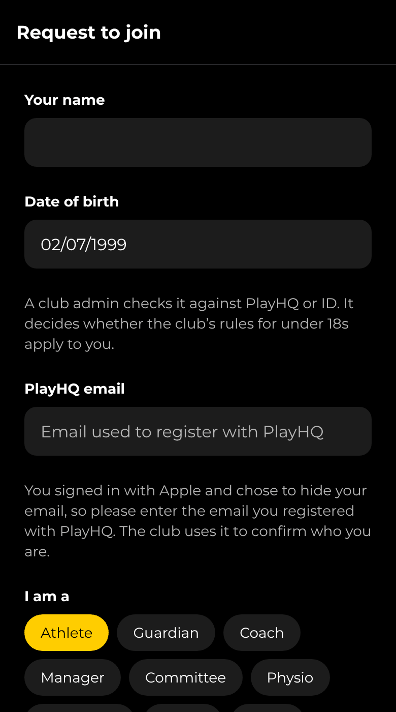
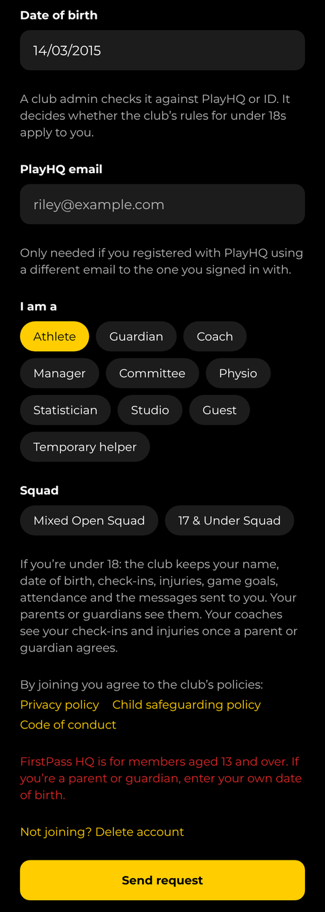

#### Setting up a new club

A brand-new club has no admin to approve anyone, so FirstPass gives the person setting the club
up a one-time **setup code**. While the club has no admin and a code is waiting, **Request to
join** shows **Setting up this club?** under your name. Enter your name and the 12-character code,
such as 7KQ4-MD2P-XY9Z, and tap **Become the club's admin**. You go back as an
approved admin, with the admin's areas in the **Club** tab, and approve everyone else from **People > Members** there, including
other admins.

The code works once, lasts 7 days unless FirstPass says otherwise, and stops working the moment
the club has an admin. After that the box is gone and nobody can become an admin with a code:
admin is only ever granted by an admin. Five wrong codes in an hour and the app asks you to wait
before trying again. If your code has run out, ask FirstPass for a new one. Everyone else ignores
the box and asks to join as usual.

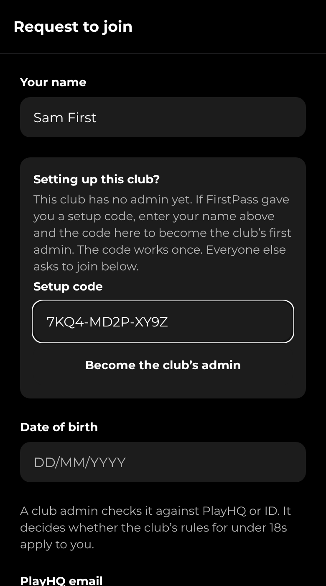

### Wait for approval

An admin checks your request against the club's PlayHQ registrations, sets your role and adds you
to your squad. Pull down on the waiting screen to check again, or tap **Edit request** to change
what you sent.

If the admin can't match you to a registration, they may ask you for the **6-digit code** shown on
your waiting screen. The code proves who you are, so the admin needs to get it from you in person or
over a channel they already trust. Only ever give it to a club admin, and never share it with
anyone else.

**Athletes under 18: your link code.** An athlete under 18 also sees **Waiting for your parent or
guardian**, with their **link code**, such as 7KQ-4MD, and the people they can talk to if anything
worries them: the club's Child Safety Officer and Complaints Manager, the governing body and
helplines. Tap **Share code** to send your parent or guardian a message with the code and how to
use it, or **Copy code**. They sign in, ask to join as a parent or guardian and enter it. Each code
works once, for 7 days; **Make a new code** gives you a new one and stops the old one working, and
a new code is made by itself when the old one runs out. Once a parent or guardian has entered it,
the card says so. Only share it with your parent or guardian.

Until an admin approves you and links a verified parent or guardian to you, the app is locked: it
shows only your link code, the people who can help, **Raise a concern**, and **Sign out**, **Switch
club** and **Delete account**. That stays true after an admin approves you, and again later if your
last verified parent or guardian leaves the club or is unlinked: you get a new code to share. It
opens as soon as a verified parent or guardian is linked, or on your 18th birthday.

**Parents and guardians: your child's code.** While you wait, the waiting screen has **Enter your
child's code**. Type the code from your child's app and tap **Enter code**. The card then lists
each child whose code you've entered, until an admin links you. After five wrong codes in an hour,
you have to wait before trying again. An admin verifies who you are, checks you're the child's
parent or guardian and approves you once your child is approved, and approving you links you to
the child whose code you entered.

If your request isn't approved, the screen says why and you can tap **Request again** after
fixing your details.

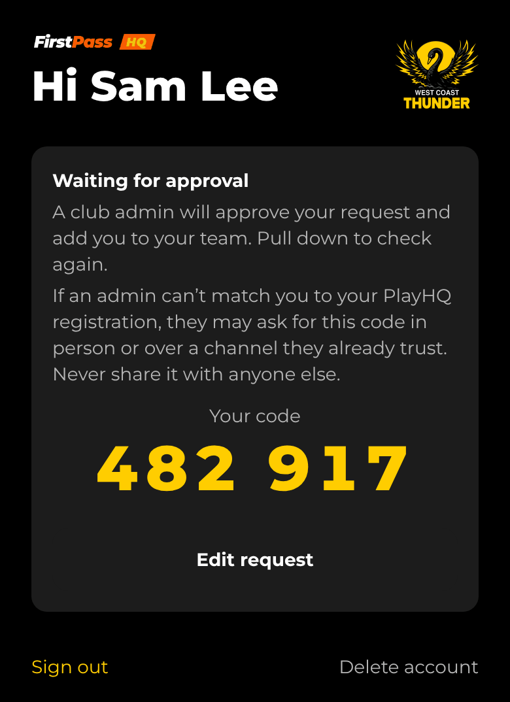

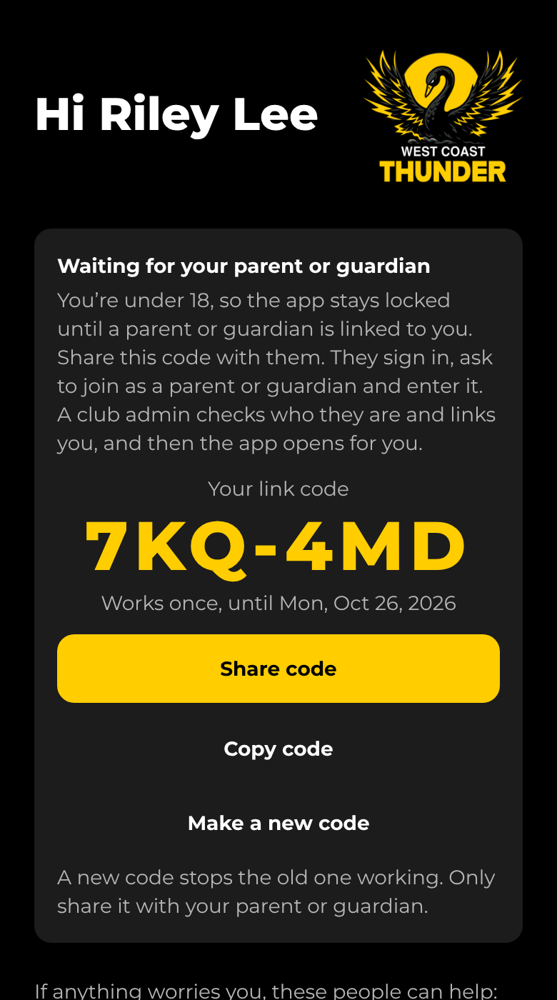
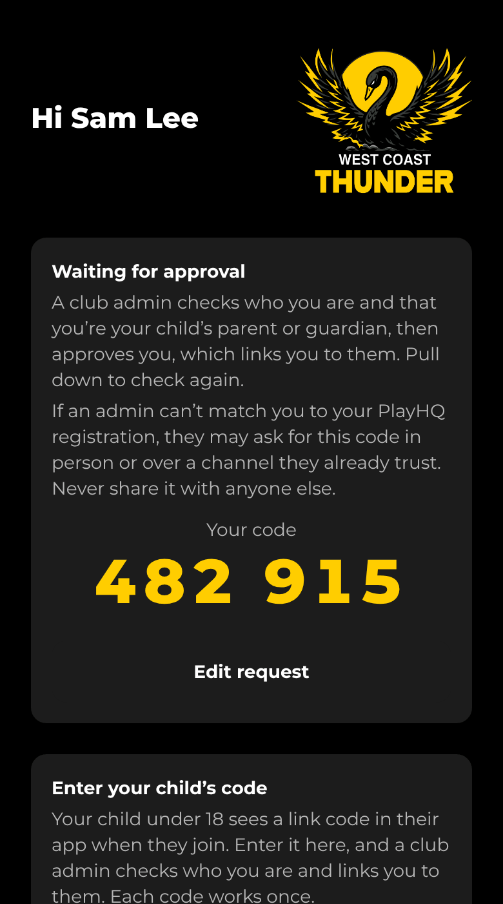

## 3. Things everyone can do

### The tabs

Once you're approved, the app has a row of tabs along the bottom (down the left side on a tablet).
Everyone has **Today** and **Me**. The others depend on your role and what the club has switched
on:

| Tab | What's in it | Who has it |
| --- | --- | --- |
| **Today** | What's next on your calendar and what needs you | Everyone |
| **Calendar** | Your calendars (see [Calendar](#calendar)) | Everyone, when the club uses the calendar |
| **Messages** | Your inbox, what you've sent and your chat groups, with the number of unread messages on the tab | Everyone who gets messages (not guests), when the club uses messages |
| **Team** | Your squads and teams, and the work of looking after them | Athletes, coaches, managers and physios |
| **Family** | Your children, with the number of changes since you last looked on the tab | Parents and guardians |
| **Club** | Running the club, in areas, with the number of things waiting for you on the tab | Committee members and admins |
| **Me** | Your own things, safety and your account | Everyone |

Team, Family and Club share the fourth place in the row. If you have more than one, such as a
coach who is also a parent, the tab opens the one for your main role, and a switch at its top
(such as **Team** and **Family**) swaps between them. The app remembers the one you used last.

- **Raise a concern** is at the top right of every tab, for anyone signed in (see [Raising a
  concern](#raising-a-concern)).
- Opening something from a tab, such as a message, an event or an injury, covers the tabs until
  you go back.
- Pull down on any tab and most lists to refresh them.
- People with one job to do have one screen and no tabs: someone waiting to join, an athlete
  under 18 waiting for a parent or guardian, a temporary helper, and someone whose only role is
  Studio. That screen has **Raise a concern** and the Sign out, Switch club and Delete account
  links at its foot, with Your details for everyone but the athlete under 18.

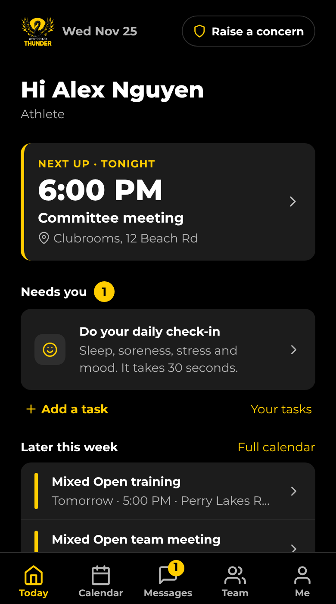
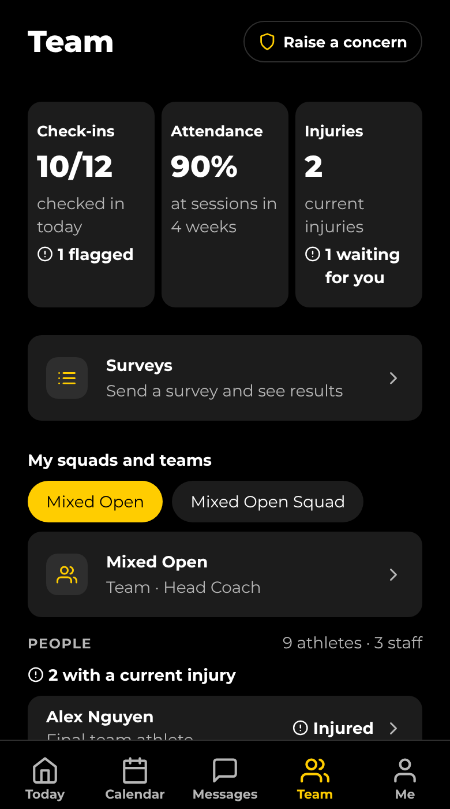
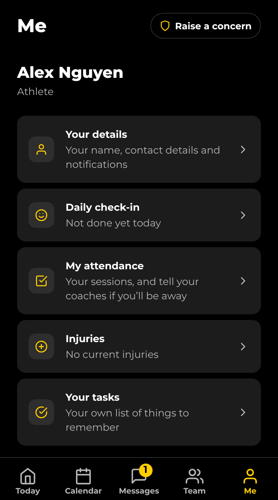

#### Today

Today is where the app opens. It answers two questions: what's next, and what needs you. From
the top:

- **The club's logo, the date and Raise a concern.**
- **Hi, and your name**, with your roles and any titles under it (see [Your preferred
  name](#your-preferred-name)).
- **Anything that can't wait.** A notice when one of your roles is paused or about to pause, with
  **Add your card**; **Confirm who you are**, with your 6-digit code, for a parent or guardian not
  yet verified; and, for the people who handle concerns, the **Safeguarding** panel: the concerns
  register's three counts, then every piece of safeguarding work that is waiting, most pressing
  first (a new concern, a concern with nothing recorded for too long, a request to read messages,
  a block in a chat group, athletes flagged again and again, a child's training load). It shows
  counts and references only, never what a concern says. Tap its heading for the register, or a
  line for that piece of work. With nothing waiting it says so in one line. This work isn't
  repeated under **Needs you** (see [The concerns register](#the-concerns-register)).
- **Next up**: the next event on your calendars that hasn't finished, with when it is (Now, Today,
  Tonight, Tomorrow, or its day), its start time, name and place. Tap it to open the event. With
  nothing ahead it says "Nothing on the calendar yet." It shows when the club uses the calendar.
  Under it are the one or two things you're most likely to do about that session: **Can't make
  it** for an athlete, **(your child's name) can't make it** for a parent or guardian, and, on the
  day, **Take attendance** for its coaches and managers. They're the same shortcuts as on the
  session's page (see [A session's page](#a-sessions-page)), which also has its plan and check-ins.
- **Needs you**: your to-do list, with how many things are on it. These are things you need to
  do, such as your daily check-in, the code of conduct to accept, an
  award vote, integrity training due, goals to set or reflect on for a game, an injury past its
  expected return date, an injury a coach, manager or physio logged for you or your child, a KPI review to confirm or, for coaches, physios and the committee, an
  injury clearance to sign off, and, for coaches and managers, new or changed absences to review.
  Tap an item to go straight to it: a to-do about a member opens that member's page at the job
  (see [Admins](#10-admins)). Each item disappears once it's done. When there's nothing,
  it says "You're set for today. Nothing needs you right now." Your own [personal
  tasks](#your-own-tasks) are in the same list, marked **Personal**.
  Anything overdue has a **red circle with !**, a red **Overdue** label and a red bar down its
  left edge, and moves to the top of the list. Anything due today or in the next 3 days has an
  **amber triangle with !**, an amber **Due soon** label and an amber bar, and comes next. This
  covers every to-do with a due date: your own tasks, integrity training, KPI reviews you write, game
  goals (due on game day) and an injury past its expected return date. For admins, Working With
  Children Checks work the same way (see [Admins](#10-admins)).
  A list of six or more with warnings in it is split in two: **Now**, for anything urgent, overdue
  or due soon, and **When you can**, for the rest.
  A new concern is more urgent than anything else: for the Child Safety Officer, the Complaints
  Manager and admins, **Look at N new concerns** has the red circle, a red **Urgent** label and the
  red bar, and always sits at the very top, above anything overdue (see [The concerns
  register](#the-concerns-register)).
- **+ Add a task** and **Your tasks**, under the list (see [Your own tasks](#your-own-tasks)).
- **Later this week**: up to four more events from the next 7 days. When the week has nothing
  else, **Coming up** shows the next two instead. Tap **Full calendar** to see them all.

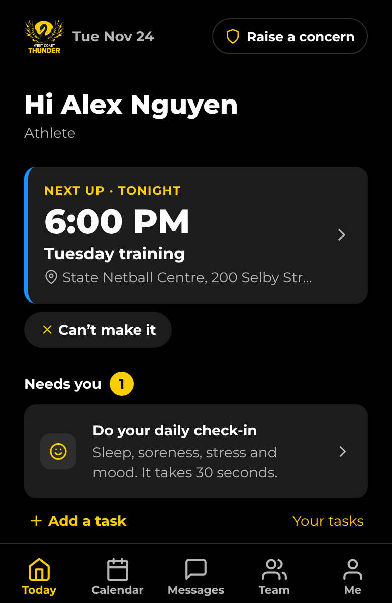
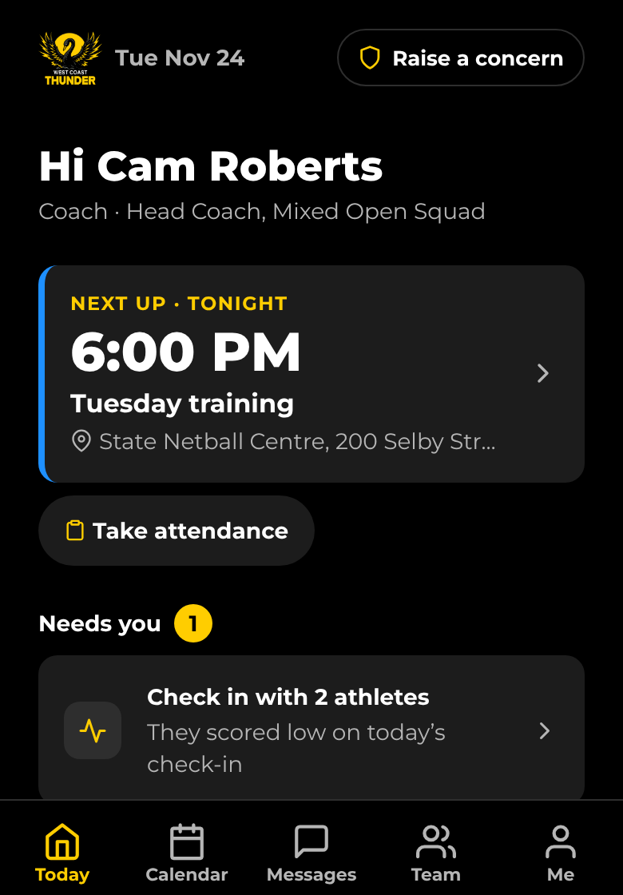
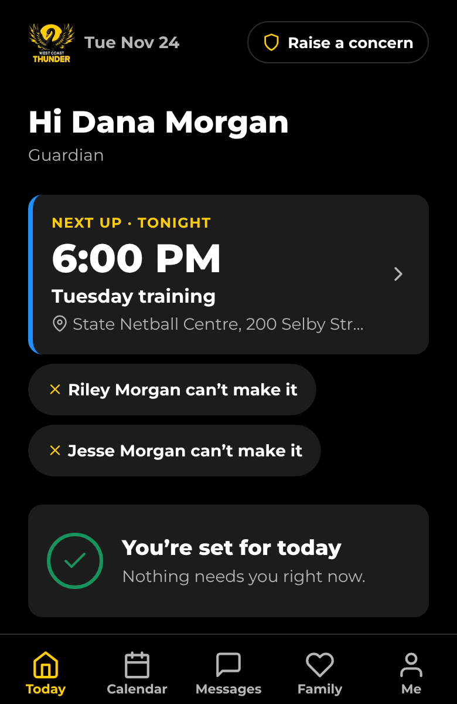

While a selection round is running, **Selection assessments** (for the round's panel) or
**Selection** (for an athlete in the round and their parents) also sits on Today, just above
Needs you.

#### Team, Family and Club

Each holds the cards for that part of what you do. A number in the club's colour on a card means
something new or waiting for you. Under a card's name, one short line says where things stand,
such as "9 of 12 checked in today" or "At 11 of 12 sessions in 4 weeks". A line in bold with a
**!** in a circle beside it needs you, and a green tick means done. Neither uses the club's
colour, which is kept for buttons, links and the tab you're on, so what needs you looks the same
in every club and is never mistaken for a link.

- **Team** starts with **My squads and teams** (**My teams** in a club without squads): tap one
  to see who's in it. A team's page also has its [game goals](#game-goals) for its athletes and
  coaches. Coaches, managers and physios then have **Check-ins**, **Attendance**, **Injuries**,
  **Session plans**, **Surveys** (to send one and see results) and **Season KPIs** (for the people
  they set them for). Athletes have **Session plans** here once a coach has shared one, and
  captains have **Surveys** to send a poll. Coaches read their athletes' check-ins from
  **Check-ins**, and physios see the club's averages there. While you're on a selection round's
  panel, **Selection assessments** is here as well as on Today.
- **Family** starts with one card for each of your children. The card says where things stand
  for that child (consent, a current injury, medical details to add or check, changes since you
  last looked) and opens the child's own page, which has **Attendance**, **Game goals**,
  **Check-ins**, **Injuries**, **Consent**, **Medical and emergency**, **What's changed** and
  **Who has viewed their records** for that child, always in that order. Under the children come
  **Injuries**, plus **Session plans**, **Season KPIs** and **Selection** when there's something
  in them, then **My squads and teams**, and **Add another child** at the end (see
  [Parents and guardians](#5-parents-and-guardians)).
- **Club** groups what you look after into up to five areas, each a row that names what's inside
  and opens where it is when you tap it (tap again to close it):
  **People** (**Check-ins** (the club's averages), **Attendance**, **Injuries** and **Surveys**),
  **Safety and conduct** (**Concerns**, for the people who handle them, and **Integrity
  training**), **Season** (**Session plans** once one is shared with you, **Season KPIs**, and
  **Selection assessments** while you're on a round's panel) and **Reports and registers**
  (**Reports**, for committee members with a current check, and **Registers**). Admins have more
  in each area, and a fifth, **Club setup** (see [The Club tab for admins](#the-club-tab-for-admins)).
  An area shows only what you have: one with a single thing in it shows that thing in its place,
  and if you have five things or fewer they're simply listed, with no areas. A number on an
  area's row counts what's waiting for you inside it, and whatever is waiting shows under the row
  without opening it; the **Club** tab's button carries the total. Committee members and admins
  see **My squads and teams** only when they're in a squad or team, for example as a coach too,
  and then it's in their Team tab.

#### Me

Me holds your own things, whatever your role:

- **Your name and roles**, then **Your details** (see [Your preferred name](#your-preferred-name)).
- **Your own cards**: **Daily check-in**, **My attendance** and **Injuries** for athletes,
  **Surveys** when you have one to answer or have answered one, **Awards** while an award vote is
  open to you, your own **Integrity training** and **Season KPIs**, and **Selection** while your
  squad or team is in a selection round.
- **Your tasks** (see [Your own tasks](#your-own-tasks)).
- **Safety**: **Raise a concern**, then the club's safeguarding contacts and the helplines.
- **Account**: **Switch club**, **Sign out** and **Delete account**.

Someone with no fourth tab, such as a guest, finds **My squads and teams** here too.

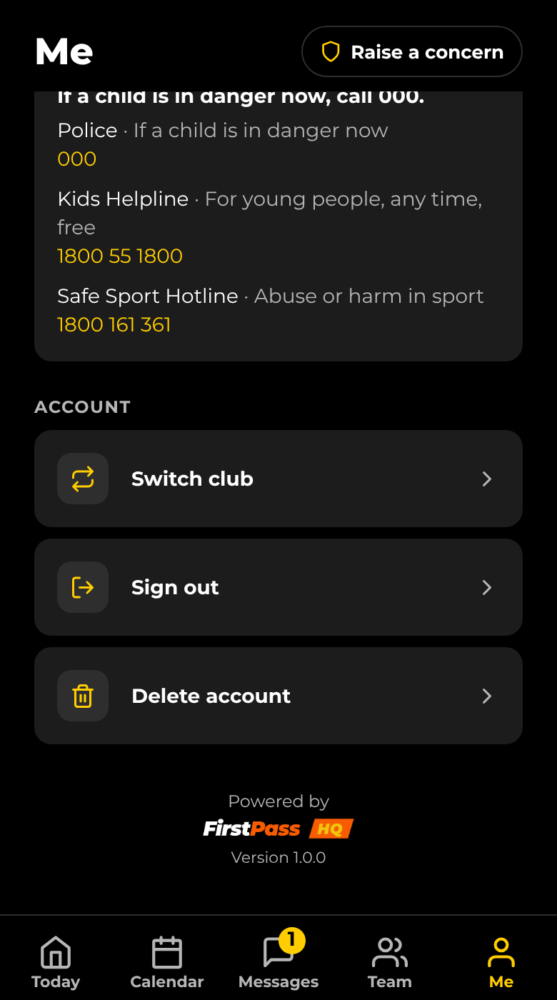

### Using HQ on a tablet

HQ runs on iPads and Android tablets as a full tablet app, so a coach can take attendance or
look over a squad on a bigger screen at training. Everything works the same as on a phone; screens
just use the extra room so there's less scrolling:

- **The tabs** run down the left side instead of along the bottom.
- **Upright**, Today is one column, as on a phone, and the cards in Team, Family, Club and Me sit
  two a row.
- **On its side**, Today puts Next up and the rest of the week on the left and Needs you on the
  right, and the cards in Team, Family, Club and Me sit three a row.
- **Lists of cards** sit two or three a row: injuries, past attendance sessions and athletes'
  attendance, a squad or team's people and its games.
- **Taking attendance**, the register shows two or three athletes a row, each with Present and
  Absent, so a whole squad fits on the screen.
- **Forms and messages** stay a comfortable reading width in the middle of the screen.

The layout follows the window, not the device: turn the tablet and it changes straight away. On an
iPad sharing the screen with another app, a narrow window gets the phone layout. Phones always stay
upright.

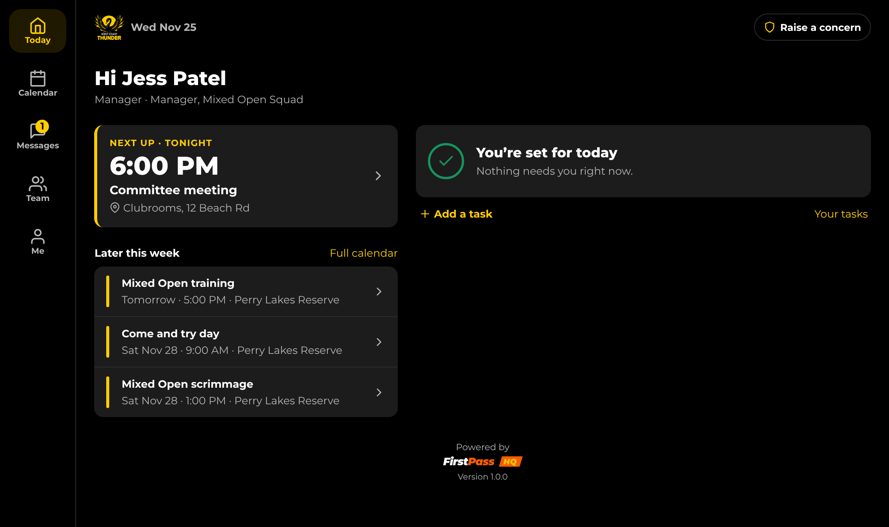
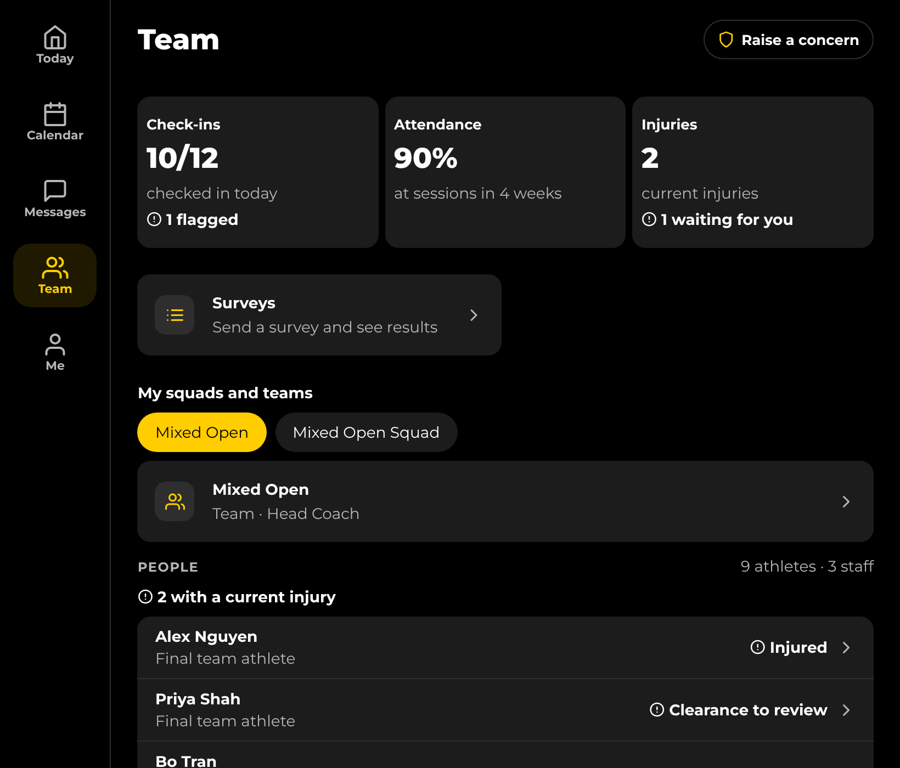

### Your own tasks

You can add your own tasks to your to-do list, such as "Wash my training kit" or "Book a physio
follow-up". They sit under what the club needs from you, marked **Personal**, soonest due first.
A task that's overdue or due within 3 days gets the red or amber warning and moves up the list
with the club's items (see [Today](#today)).

- **Add one**: tap **+ Add a task** under your to-do list on Today and say what it is. To give
  it a due date, tap a day in the week (the arrows move a week at a time); leave it for no due
  date, or tap **Remove due date** to take one off. Then tap **Add task**.
- **Tick it off**: tap the circle next to it. It leaves your list, and **Undo** puts it back if
  you tapped by mistake.
- **Change it or mark it done**: tap the task, change it and tap **Save**, or tap **Mark as done**
  when you've finished it. The note under the button says it: marking it done there deletes the
  task, so it won't come back.
- **See them all**: tap **Your tasks**, on Today or in the Me tab, for everything still to do and the last 30 you ticked off.
  Tap a ticked-off task's circle to put it back on your list, or **Delete done tasks** (then
  **Delete them**) to clear them. **Add a task** is at the top of this screen too.

Only you can see your tasks. Your coaches, parents or guardians, the committee and the club's
admins can't, and a task can't be shared, assigned or sent to anyone. Members under 18 can add
tasks too, with the same privacy. You can have up to 100 tasks still to do. They're kept until you
mark them done from the task, clear your done tasks, or delete your account.

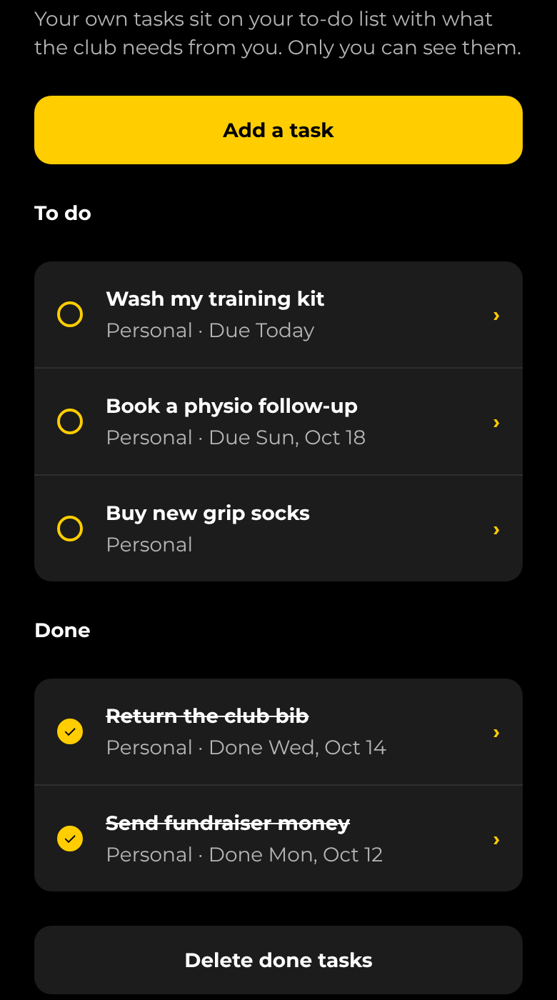
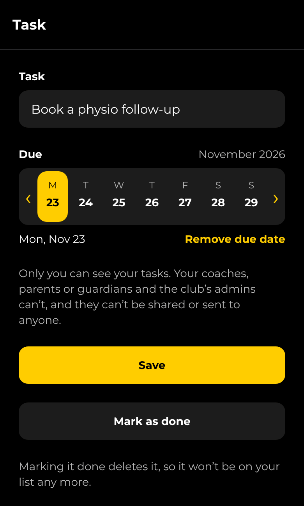

### Your preferred name

Today greets you by name. To be called something else, such as a nickname, tap **Your
details** in the **Me** tab, enter your **Preferred name** and tap **Save**. Leave it
blank to go back to your full name. Admins still see your full name, with your preferred name on
your member page, and can search for you by either.

Committee members and admins also see a **Title** field, for a position such as President,
Secretary or Treasurer. It shows under your name with your role, like "Committee · President".
Nobody else can set a title.

Coaches and managers get a title from the app instead, shown on **Your details** and under your
name, like "Coach · Head Coach, Open A" or "Manager · Manager, 17 & Under". It names the teams you
coach or manage. Until you're in a team, it names your squad. If you coach more than one team, it
lists them all, like "Assistant Coach, Open A and Open". Only an admin can change whether you're a
head or assistant coach.

Other titles show on their own line under your roles on Today, so a statistician who is
the club's Child Safety Officer sees "Statistician" and, beneath it, "Child Safety Officer":

- **Captaincy**: "Club Captain", "Captain, Open A" or "Vice Captain, 20 & Under", for the current
  season's teams you play in. It goes when the season is archived or you move teams.
- **Safeguarding posts**: "Child Safety Officer", "Complaints Manager" or "WWC Registration
  Officer", when an admin names you in **Club > Safety and conduct > Safeguarding**. A post you hold but
  can't act in right now (your check has lapsed, or you're stood down) isn't shown. An admin
  acting in a post nobody named can act in sees it with "(acting)", such as "Child Safety Officer
  (acting)".

Titles come from what admins and coaches set, so there's nothing to fill in.

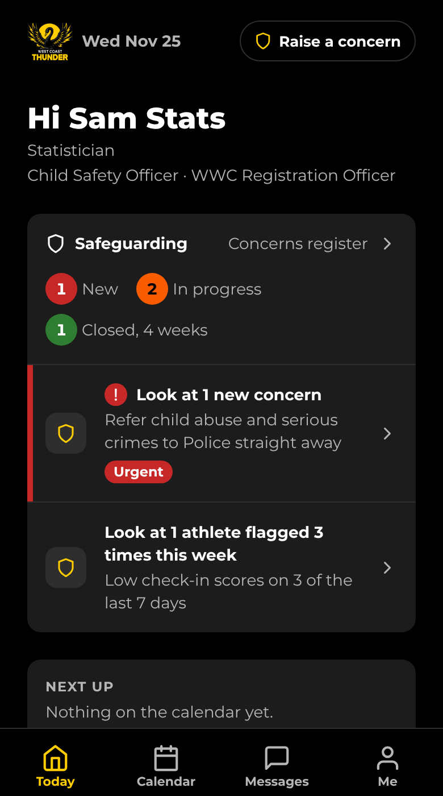

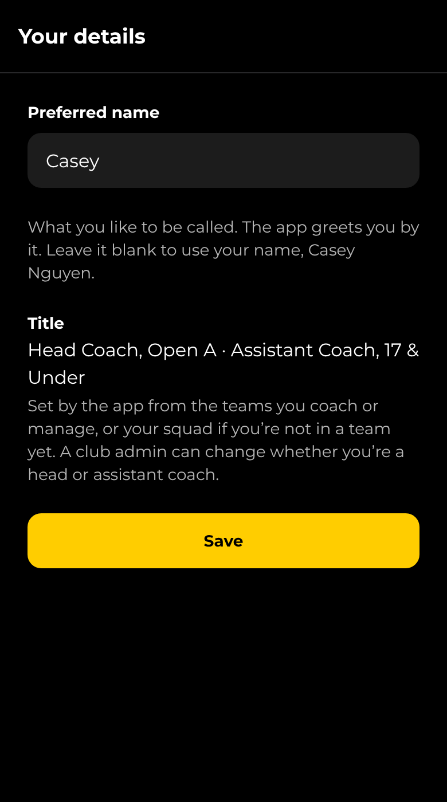

### To-do notifications

On an installed app, your phone gets a notification when something new appears on your
[to-do list](#today), such as a clearance to sign off, a survey to answer, an award vote opening, training
to complete or, for athletes, the day's check-in. Tap the notification to go straight to it. The
first time, your phone asks whether the app may send notifications: tap **Allow**.

- Notifications aren't sent between 8 pm and 7 am, club time. Anything still on your list at 7 am arrives
  then, with several to-dos in one notification.
- Each to-do is sent once. Daily items, such as the check-in, come once a day while they're
  still to do; admins' child-safety and records follow-ups come once a month. A new concern or
  a newly reported absence sends again even if the earlier one is still on your list.
- Your own [personal tasks](#your-own-tasks) stay on Today and aren't sent.
- A session plan shared with you for the first time sends its own notification (see [Session
  plans from your coaches](#session-plans-from-your-coaches)). It keeps the same quiet hours: a
  plan shared between 8 pm and 7 am is there to read straight away, and its notification arrives
  at 7 am, with several plans in one notification.
- Notifications can show on a locked phone, so they never include injury details or reviewers'
  notes. Open the app to see those.
- If you belong to more than one club, tapping a notification opens the club it came from.

To stop them, tap **Your details** in the **Me** tab and turn off **To-do
notifications**. It saves straight away and only changes your own notifications. If your phone is
blocking notifications from the app, Your details says so and **Open phone settings** takes you
there to allow them.

### Messages

Messages from your coaches, managers, captains, the committee and the club arrive in
**Messages**. Unread messages have a dot in the club's colour, and the **Messages** tab shows how many
are new. Opening a message marks it as read, and the
sender can see that you've read it.

- **Mark all read** at the top of your inbox clears every dot at once. The senders still see those
  messages as not read, because you didn't open them.
- **Mark as unread** at the bottom of an open message puts it back in your inbox with its dot, to
  come back to later. The sender still sees that you read it.

**Inbox**, **Archived** and, if you send messages, **Sent** sit at the top. To tidy your inbox,
swipe a message to the left to archive it (or open it and tap **Archive**). It moves to
**Archived**, loses its dot, and **Undo** appears for a moment in case you didn't mean it. In
**Archived**, swipe a message to the left (or open it and tap **Move to inbox**) to bring it back.
Archiving only moves your own copy: the sender doesn't see it as read, and nobody else's copy
changes, so a parent's copy of a message to their child stays in the parent's inbox. Messages can't
be deleted, and messages you sent can't be archived. A question in an archived message can still
be answered. Screen readers offer **Archive** and **Move to inbox** from each message's actions.

**Report this message** on any message raises a concern
about it, and the concern keeps a copy of the message (see [Raising a concern](#raising-a-concern)).

Some messages ask a question, such as "Extra session Friday?", with answers to pick from, such as
**Yes**, **No** and **Not sure**. The inbox says **Question: tap to answer**. Open the message and
tap one answer. You answer once and can't change it, and there's nothing to type. Whoever sent it
and the squad or team's coaches and managers see what you picked; other members never do.
If the sender shares the totals, you see how many picked each answer, never who. If you're under 18,
a parent or guardian can answer for you, and the message then says who answered.

Who a message went to is shown under the sender's name, for example "To Mixed Open Squad",
"To Physios" or "To Everyone in the club". Messages from **Club safeguarding** tell a family about a change, such
as a parent or guardian linked to or unlinked from a child.

Guests and temporary helpers don't get messages. Physios get messages sent to the Physio role and to the squads and teams
they're in, and messages sent to everyone in the club only when an admin turns that on.

If the club removes old records, the text of a message older than the club's keep period for
messages (a longer one when a child sent or received it) is replaced with "This message was removed after the club's keep period." Who sent it, who it went to
and who read it stay (see [Record keeping](#record-keeping)).

Only the people a message went to and its sender can read it. Admins can't read messages they
didn't send or get. If a concern needs it, the Child Safety Officer or Complaints Manager can ask an
admin to let them read one person's messages for 24 hours (see [Reading a member's messages for a
concern](#reading-a-members-messages-for-a-concern)). Nobody is told when that happens.

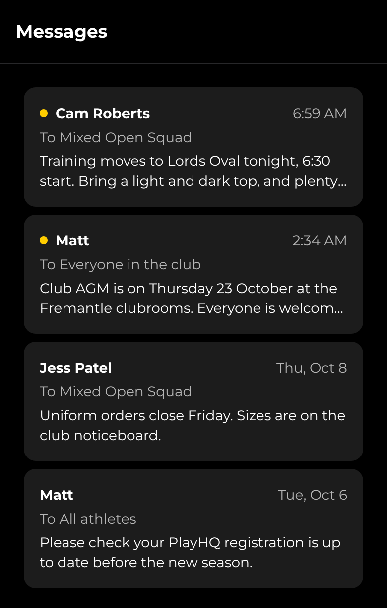
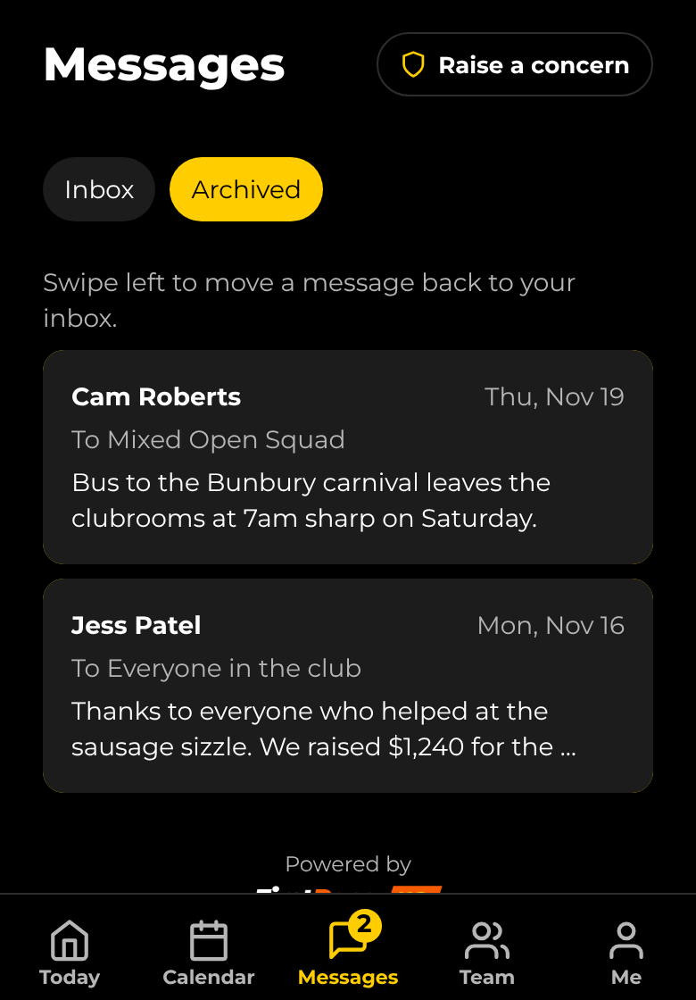
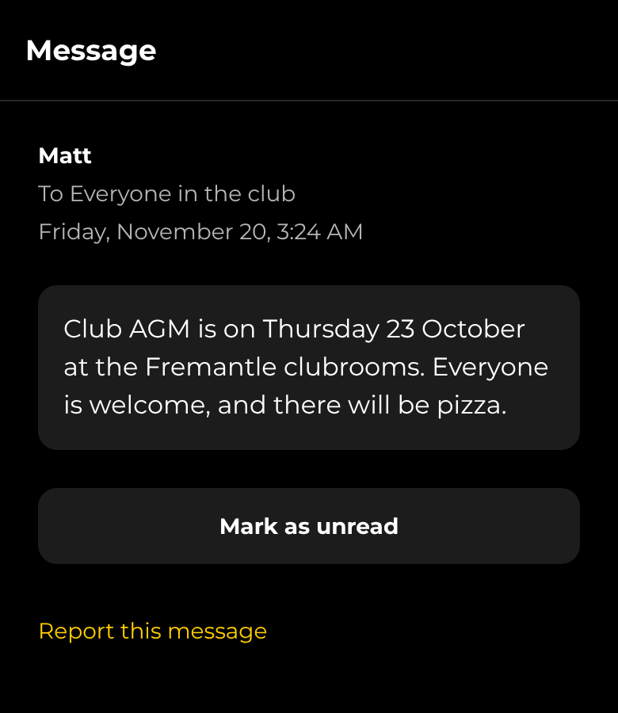

### Chat groups

When an admin switches on **Chat groups**, a **Groups** tab sits beside Inbox, Sent and Archived in
Messages, with the number of unread posts. Each group lists its latest post. A group works like a
messaging app: it opens at the newest post and marks its posts read, your own posts sit on the
right and everyone else's on the left with their name, and the box to write in stays at the
bottom. Scroll up for older posts; they load as you go, back to **Start of the group**. New posts
show while you have the group open. Type in **Write a message** and tap **Post**: everyone in the
group sees it. Tap a post to open it on its own, where **Report this message** raises a concern
about it and, for your own posts, you see who has read it (the count also shows under the post).

You're put in groups automatically:

- **Coaches and managers** of each squad and team you coach or manage.
- **Coaches and captains** of each team you coach, captain or vice captain.
- **Coaches and physios** of each squad and team you coach or look after as its physio, with every
  **Head Physio**. It shows once the squad or team has a physio, or the club has a Head Physio.
- **All managers**, for everyone managing a current squad or team.

Admins can set up other groups too, such as a selectors' group or one for a squad's athletes. You
come and go with your squads and teams: when you join one, you see what's posted from then on, and
when you leave, you keep what was posted while you were in it, read only. Coaches and managers are
in their groups only while they hold a current check (or an exemption or application) and aren't
stood down, as for their other messages.

**Members under 18** post only in their own squad's or team's automatic groups, such as their
team's coaches and captains, and only while one of its coaches is in the group. In groups an admin
set up, they read only. Their parents or guardians get a copy of every post in their groups, their
own posts included, in their inbox. Under 18s don't see the list of who else is in a group. A
member under 18 with no verified parent or guardian linked has their groups hidden, and can't
post, until one is. Posts still reach them meanwhile, and when a parent or guardian is linked they
get a copy of every group post the child was sent or wrote, so nothing went unseen.

**The group's coaches can hide a post**: swipe it left and tap **Hide**. It then disappears for
everyone else in the group, and from the copies their parents got. Only the post's author, the
group's coaches and the author's own parents still see it, greyed out with "Hidden by" and the
coach's name. Swipe a hidden post and tap **Show** to put it back for everyone. Nothing is deleted:
the text is kept like every message, for the Child Safety Officer or Complaints Manager if a concern
needs it. In a group an admin set up, its coaches and admins can hide posts.

**Blocking someone.** If you don't want to see someone's posts, open one of their posts and tap
**Block** with their name, then **Block** again. Their posts then disappear from all your groups,
with the last post and unread count. It only changes what you see: they aren't told, they still see
your posts, everyone else still sees theirs, and nothing is deleted. Club messages from them still
reach your Inbox. **Your club's admins, Child Safety Officer and Complaints Manager are told** that
you blocked them, so someone can check you're OK; they see who blocked whom and in which group, never
the posts. To unblock, open one of their posts and tap **Unblock**, or open **About this group ›
Blocked people** and tap **Unblock** beside their name.

- A member under 18 can block anyone, adults included.
- An adult can't block a member under 18, because what a child writes must stay in front of the
  adults in their group. If a child's posts worry you, ask the group's coach to hide the post, or
  raise a concern.
- Blocking never hides a parent's or guardian's copy of a post to or from their child: parents
  always see everything in their child's groups.
- If someone is bothering you, report the post too (**Report this message**), so the Child Safety
  Officer can look into it.

**About this group** at the top lists who is in it (not for members under 18) and holds **Hide
this group**, which moves it to **Hidden groups** at the end of the list.
New posts still reach you, already marked read, and nobody sees that you hid it; your read receipt
is only set when you open the group. **Show in my groups** brings it back.

Posts are messages: they can't be deleted, they're kept for the club's keep period for messages,
and the Child Safety Officer or Complaints Manager can read them under an approved request, like
any other message. They don't show in your Inbox or Sent, and **Mark all read** in the Inbox
leaves them alone.

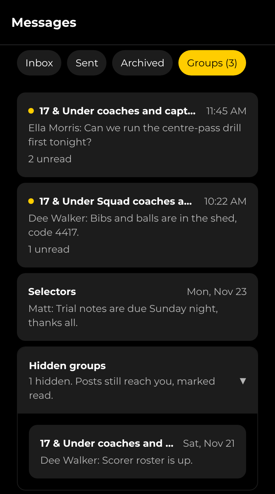
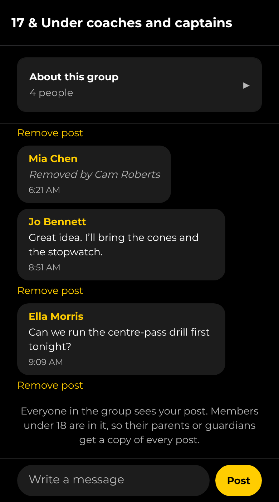
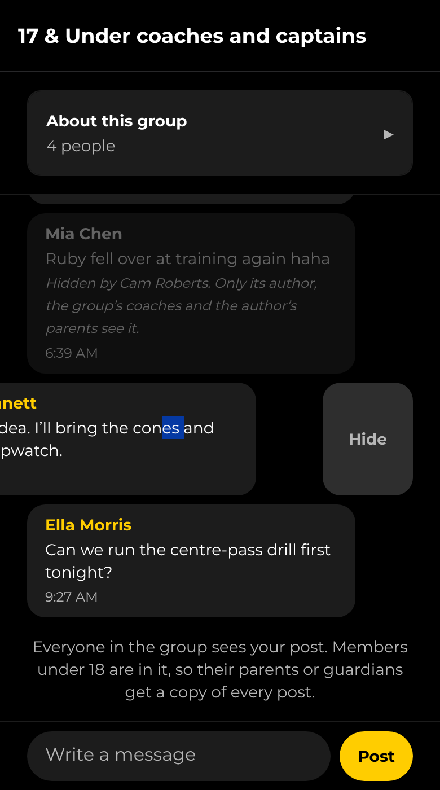
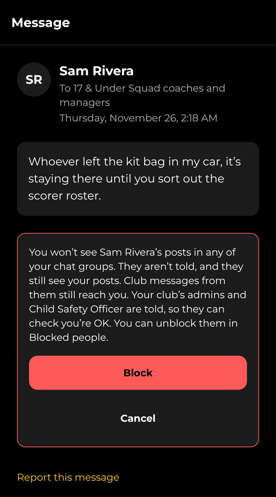
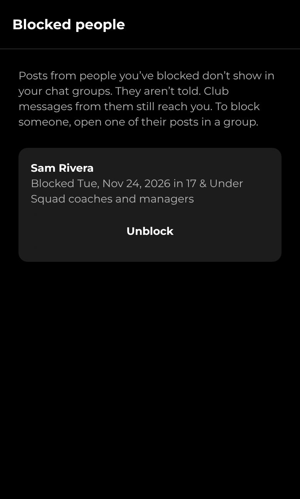

### Surveys

The committee and admins send surveys to everyone, a role, or a squad or team. Coaches and
managers send surveys and quick polls to their own squads and teams, and captains and vice captains
send polls to their own team, for example to find a night everyone is free. A survey you need
to answer shows in your to-do list until you answer it or it closes, and the **Surveys** card in
the **Me** tab counts how many are waiting.

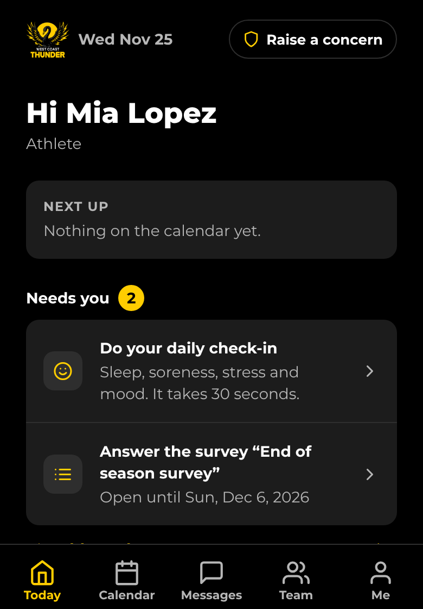

Each survey says at the top how your answers are kept:

- **Anonymous**: nobody can see who gave which answers, not whoever sent it and not admins. The app
  records only that you've answered, so you aren't reminded again, and never which answers were
  yours. Once sent, even you can't see them again.
- **Named**: your name goes with your answers, and you can read them back after you send them.
- **Name optional**: you choose **Give my name** or **Don't give my name** before you send.

Answer each question and tap **Send answers**. Questions marked (optional) can be skipped. You
can't change your answers once they're sent, and you can answer each survey once. The survey says
who sees answers, and it's never other members:

- a survey from the committee or an admin: whoever sent it, the committee and admins;
- a survey from a coach or manager: whoever sent it, plus admins for anything longer than a quick
  poll or with a written answer, and the committee too if the coach shared it;
- a poll from a captain: the captain who sent it and the team's coaches and managers.

A survey marked **Everyone must answer** says so at the top and in your to-do list. A coach,
manager or captain can also share a poll's totals with the squad or team. Then everyone it went to,
and their parents or guardians, sees **Results for the team** on the survey once results show: how
many picked each choice and the average rating. It never shows names, written answers or who has
answered.

Athletes under 18 see a reminder on anonymous and name-optional surveys: nobody can reply to
something written without a name, so if something is worrying them they should tell a coach or
parent, or use **Raise a concern**.

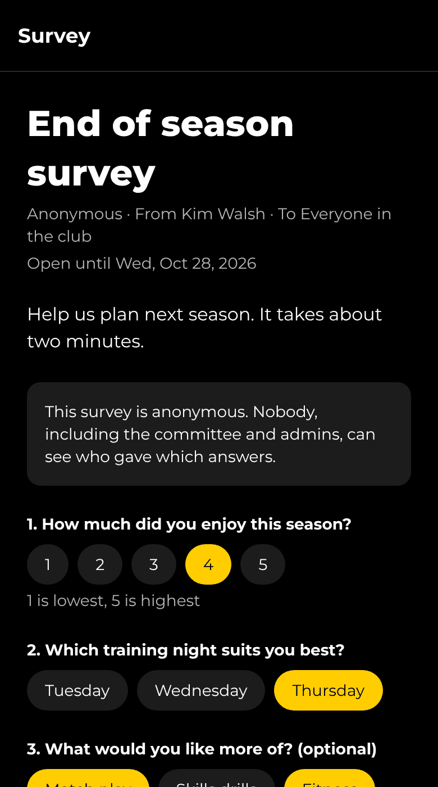 

Guests and temporary helpers don't get surveys. Physios get surveys sent to the Physio role and to
the squads and teams they're in, and surveys sent to everyone only when Physios get club messages
is on.

### Calendar

The calendar shows events from the club's Outlook calendars. Each calendar is shared on a need to
know basis: you see the ones an admin has shared with everyone in the club, with one of your roles
(such as **Physios** or **Guests**), with a safeguarding post you hold (such as **Child Safety
Officers**), or with one of your squads or teams. Admins see every calendar. A role whose check
has lapsed or that is paused doesn't count, and nor does a post you can't act in.

- **List** shows a week strip and the events after it, grouped by day. Use the arrows to move
  between weeks, and **Load more** at the bottom to see further ahead. The list starts today, or at
  the week you move to.
- **Month** shows a month grid with that month's events below it. Dots under a day are events,
  coloured by calendar. Tap a day to see only its events, and tap it again (or **Show all of** the
  month) to see the whole month. Days from the months either side are greyed out.
- Switching from **Month** to **List** keeps the month you were looking at: the list starts at the
  1st of that month (or today, for this month).
- You can look back 12 months (to the start of that month) and ahead 12 months. The arrow fades
  out when you reach either end.
- The chips (**All**, **Club**, and each of your squads and teams and every other calendar
  shared with you, by name, with something on in that period) filter which calendars are shown.
  **Club** is the calendars shared with everyone.

Your teams' matches from PlayHQ appear in the calendar too, for example "Mixed Open A v Rockets"
with the venue and court. A match with no time yet, which includes most byes, shows as an all-day
event. Match times follow PlayHQ, so a changed time shows once an admin refreshes the fixtures.

Tap an event to see when and where it is. Tap the location to open it in maps, or **Copy** to copy
the address.

#### A session's page

Under when and where it is, a training session, game or club event shows what you can do about
it. You see only what applies to you, so most members see one or two cards and some see none:

| Card | Who sees it | What it does |
| --- | --- | --- |
| **Can't make it** | Athletes in the session's squad or team, until the session ends. For a session on a calendar shared with everyone in the club or with **Athletes**, every athlete. | Opens **Report an absence** with the session's day already chosen (see [Your attendance and absences](#your-attendance-and-absences)). |
| **(Your child's name) can't make it** | Parents and guardians, one card for each child, when you're in the session's squad or team, or the session is on a calendar shared with everyone or with **Athletes**. | The same, for that child (see [Your child's attendance](#your-childs-attendance)). |
| **Take attendance** | The squad's or team's coaches and managers, and admins, on the day of the session and for 7 days after. For a session on a calendar shared with everyone or with **Athletes** and no squad or team of its own, everyone who takes attendance. | Opens the register with the squad or team (or **Whole club**) chosen and the session's name filled in (see [Taking attendance](#taking-attendance)). |
| **Session plan** | Anyone who can already read a plan written for that squad or team on that day: the coach who wrote it and everyone it's shared with. | Opens the plan. |
| **Add a session plan** | The squad's or team's coaches, and admins, while there's no plan for it that they can read. | Starts a plan with the squad or team, name, day, times and place filled in from the session (see [Session plans](#session-plans)). |
| **Check-ins** | The squad's or team's coaches, on the day. | Says how many athletes have checked in today and how many are flagged, and opens that squad's or team's check-ins (see [Athletes' check-ins](#athletes-check-ins)). |

The cards are shortcuts and nothing more: each opens a screen you could already reach from your
tabs, and that screen's own rules decide what you see and can save. So a card never shows you
anything new, and a card is missing while the club has its feature switched off (Attendance,
Session plans or Daily check-ins). **Can't make it** and **Take attendance** are also under
**Next up** on Today. An event on a calendar shared only with other roles or a safeguarding
post, such as a committee meeting, isn't a session athletes attend, so it has no cards.

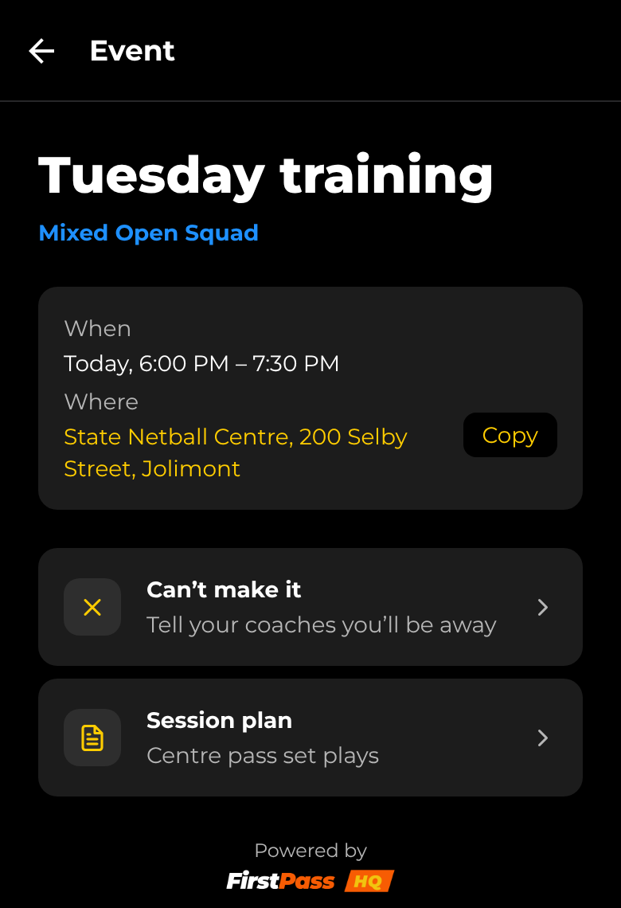
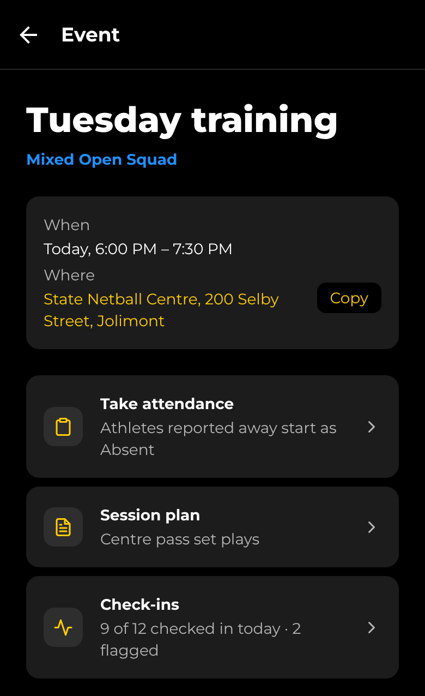
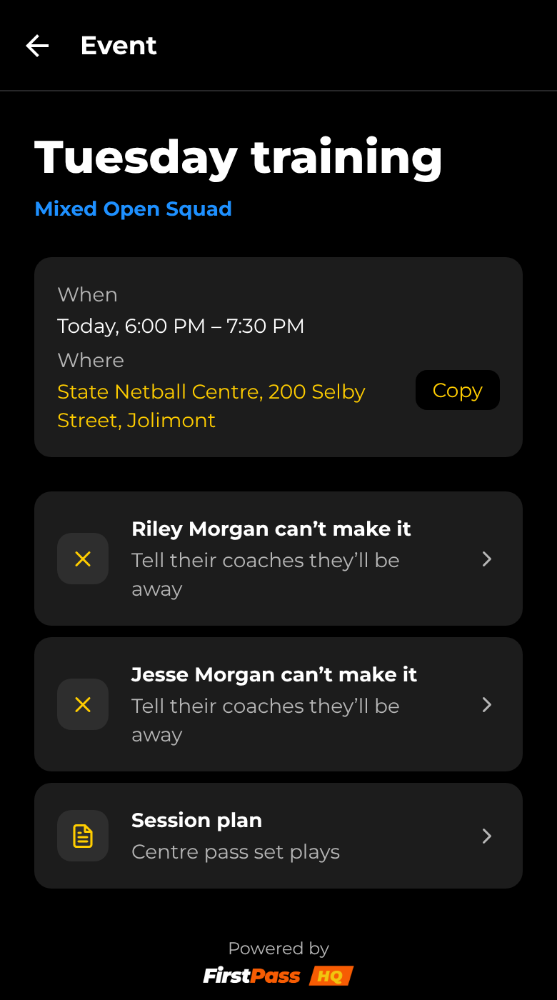
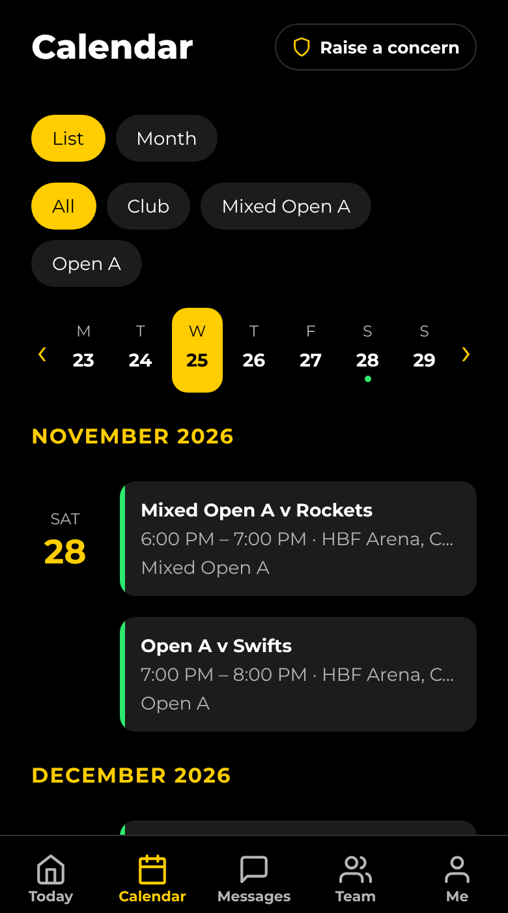
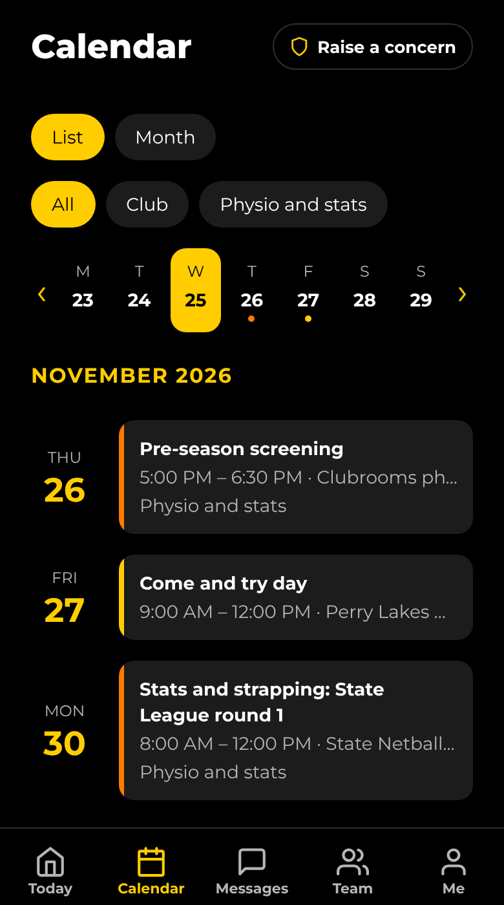

### Squads and teams

Tap a squad or team under **My squads and teams** to see everyone in it, with their position:
Head Coach, Assistant Coach, Manager, Physio, Athlete, Final team athlete or Training partner. Captains,
vice captains and club captains are marked next to their position. When Game goals is switched on,
a team's page also shows its [game goals](#game-goals) for its athletes and coaches. In a club
without squads the list is called **My teams**.

### Club awards

If the club has turned on awards, when it runs an award vote that includes you, it appears in your to-do list and on the
**Awards** card. Who can vote depends on the award: for example, every member votes for Volunteer
of the year, and athletes vote for their own team's Players' player. When an award has a winner for
each squad or team, you only see and vote for members of your own squad or team, even if it is open to
every member; committee members and admins vote in every squad's and team's part of such an award when it names them. Club-wide awards are open to everyone, or to the roles the club chose. Parents and
guardians, physios, statisticians, guests and temporary helpers don't vote, because they needn't be
club members. Someone with one of those roles who is also an athlete, coach, manager, committee
member or admin votes in that role.

1. Tap the vote. It shows the award, what to think about, and when voting closes.
2. Tap who you're voting for. For a 3-2-1 vote, tap three people in order: first place gets 3
   votes, second 2 and third 1. Tap someone again to take them off.
3. Tap **Vote**.

You can't vote for yourself. You can change your vote until it closes: open it again, change your
picks and tap **Change my vote**. Votes are secret. Nobody, admins included, can see who you voted
for, and only admins see the results.

Match awards, such as a coach's MVP, open for voting when each match starts and stay open for
the time the club set for that award (two days unless the club changed it), never past the
award's closing date. Each vote shows when it closes.

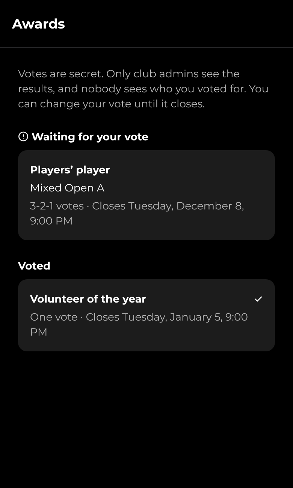

### Integrity training

If the club has turned on integrity training, each season it lists the integrity training its members must complete, such as Sports
Integrity Australia's Safeguarding in Sport or anti-doping courses, with a due date. Training is
set for roles (for example athletes and coaches), across the whole club or only some squads and
teams, so junior and senior athletes can have different courses.

Training you still need to complete shows in your to-do list on Today with its due date, and on the
**Integrity training** card. If you have more than two courses outstanding, the to-do list shows
them as one item with the soonest due date that says whose they are, such as "Complete 3
integrity training courses for you and Jordan"; open it to see each course. To complete it:

1. Tap **Open the course** and do the course on the provider's website. Download or photograph
   the certificate of completion at the end.
2. In the app, tap the to-do item or **Add a certificate** on the Integrity training screen.
3. Under **Certificate achieved**, tick each course the certificate shows you completed (or, for a
   parent uploading for their child, that the child completed). If one
   PDF holds several certificates or badges, tick them all and attach it once: each ticked course
   is checked with that file.
4. Choose the day you completed it, attach the certificate (a PDF or photo, up to 10 MB), add a
   note if you like and tap **Send for checking**.

The training then shows **Waiting to be checked** until a committee member or admin approves it
(**✓ Approved**). If they send it back, you'll see their note and the to-do comes back so you can
upload a new certificate. Certificates can't be removed once they're sent, so the club keeps a
record. Overdue training says **Overdue since** its due date.

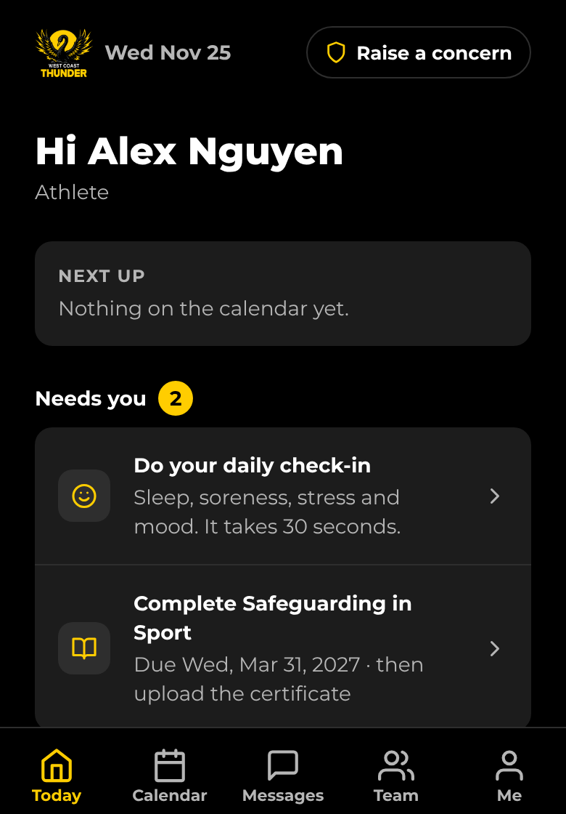

### The code of conduct

If the club asks members to accept its code of conduct in the app, every member accepts it once a
season. Clubs that already have members sign it another way, such as in their PlayHQ registration,
can leave this off. When it's on, your to-do list says **Accept the code of conduct** until you have. Open it, tap **Read the code of conduct**,
then tap **I agree** to accept the words shown:

> I've read the club's code of conduct and I'll follow it at training, at games and online.

The club keeps your name, the date, the words and the policy version as its record, and keeps it
if you later delete your account. Each season's
acceptance is listed under **Accepted** on the same screen. When the club starts a new season, the
to-do comes back.

Athletes under 18 with a parent or guardian linked don't accept it themselves: a verified parent or
guardian goes through it with them and accepts it for them (see [The code of conduct for your
child](#the-code-of-conduct-for-your-child)). Until an admin has verified one of their parents or
guardians, nobody can accept it for them: the athlete's code of conduct screen and the admin's
list both say **Waiting for verification**. Guests aren't asked, and temporary helpers accept it
when they join.

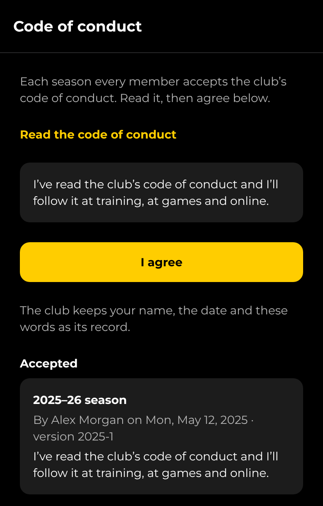

### Season KPIs

When the club turns on **Season KPIs**, coaches, managers and athletes can be given measures of
what they're working to achieve by the end of the season. They're different from game goals, which
are about one game. Each belongs to one person in one squad or team for that season.

**A development plan for assistant coaches.** Season KPIs are how a head coach works with each
assistant coach on their coaching development: the head coach sets their KPIs or OKRs for the
season, they record progress, and the two talk through each review. The committee and admins see
every assistant coach's plan, its progress and its reviews, can add to it, and admins can save them
all as a PDF for the board.

- **Who sets them.** The committee and admins set them for the coaches and managers of any squad
  or team. A head coach sets them for the assistant coaches of their squad or team. The coaches of a
  squad or team set them for its athletes.
- **KPI or OKR.** Whoever sets one chooses each time. A **KPI** is one measure with a target, such as
  "Squad attendance of 85%". An **OKR** is an objective, such as "Become a reliable goal shooter",
  with up to 5 **key results** that show it's been achieved. Each measure is either **a number**
  with a target and an optional unit and starting point (marked **Lower is better** for something
  like turnovers), or **done or not done**. A person can have up to 10 KPIs and OKRs in a squad or
  team.
- **Progress.** The person and whoever can set their KPIs both record where each measure is up to
  during the season: a number, or **Mark as done**. A bar shows how close it is to the target, and
  the last update shows who made it and when.
- **Results.** At the end of the season, whoever sets the KPIs records each one's **Result**:
  **Met**, **Partly met** or **Not met**, with an optional note. The person can't record their own
  result.
- **Reviews.** An admin sets the season's review dates, such as a mid-season and an
  end-of-season review (see [Season KPI reviews](#season-kpi-reviews)). From a week before each
  date, whoever set a person's KPIs has **Write …'s KPI review** on their to-do list until they
  write it. Each reviewer writes their own note (a head coach and the committee can both review an
  assistant coach), and the person sees every note. The person then has **Confirm your KPI review was
  done** on theirs, and taps **Confirm this review was done** once they've talked it through. If a
  note is changed afterwards, they confirm that one again. The person can also add **Your own view** at each review; whoever sets their KPIs
  can remove it if it shouldn't be there.
- **Past seasons.** When an admin archives a season, its KPIs, results and reviews stay, under
  **Past seasons**, and can be read but not changed. KPIs don't carry over to the next season.

Open **Season KPIs**: it's in **Me** for your own, in **Team** for the people you set them for, in
**Family** for your children's and in **Club** for the committee. **Yours** lists your own KPIs in each squad or team you're
in; below are the people you set KPIs for, by squad or team, with how many results and reviews are
in.

Who sees them: an athlete's KPIs are seen by the athlete, their coaches, their parents or
guardians if they're under 18, and admins. Teammates never see each other's, and the committee
doesn't see athletes'. A coach's or manager's KPIs are seen by them, the committee and admins, and
an assistant coach's by their head coach too. Athletes and parents never see coaches' or
managers'.

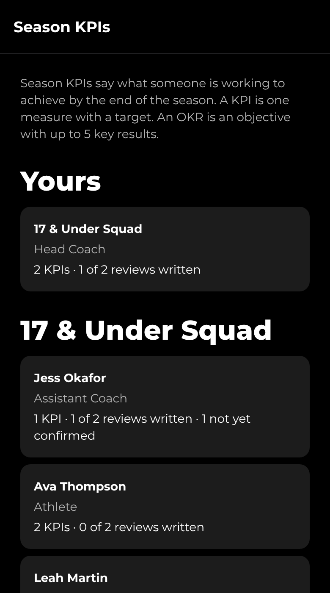

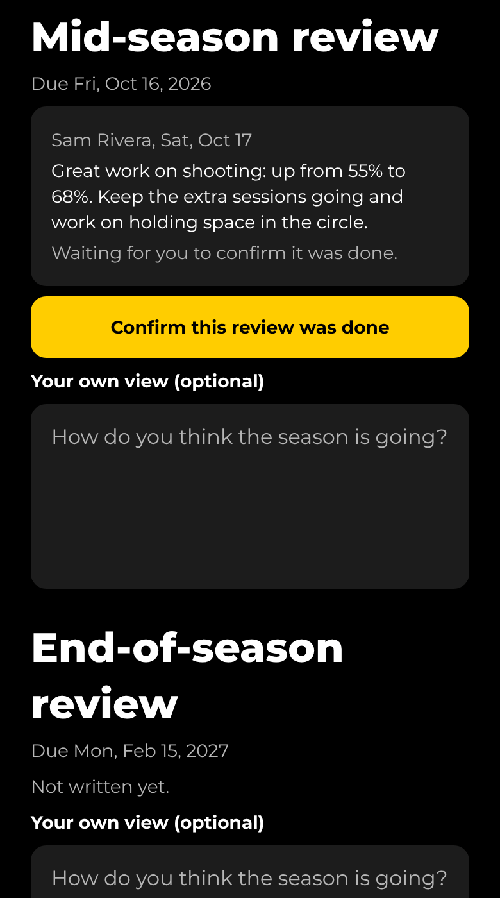

### Raising a concern

**Raise a concern** is at the top of every tab, under **Safety** in the **Me** tab, and on the one
screen people see before they're approved. It's for anyone signed in: athletes, parents,
coaches, guests and people still waiting for approval. Use it for anything that worries you about a
child or about how someone at the club behaves. You don't need to be sure. The same link is on the
daily check-in screen, on every injury and, as **Report this message**, on every message, so the
concern notes where it came from. When you report a message, the screen shows the message you're
reporting, and the concern keeps its own copy of it: what it said, who sent it and when. The people
who look into it can read the message even if it's later removed under the club's keep periods.
Only a message you received or sent can be reported this way.

The screen starts with who to talk to: the club's **Child Safety Officer** and **Complaints
Manager** (every one, if the club has named more than one), the sport's governing body if the club has added it, and services anyone can call
(Police on 000, Kids Helpline and the Safe Sport Hotline). Tap a number to call it.

Then say what happened, and optionally who it's about. Under **Who is it about?** start typing a
name and tap a coach, manager, physio, committee member, admin or temporary helper to add them: they
appear straight away in the box under the search, with a ✕ to take them off. You can name up to 10
people. The list never shows athletes or parents, so nobody can browse the club's children here;
describe anyone else under **Anyone else, in your words**. Then say when it happened and whether a
child's safety is involved. Choose **Show my name** or
**Don't show my name**. If you hide your name, the people who look into it won't see who you are,
so they can't ask you more; the app still keeps it with your account so you can follow it. If you
show your name, say whether they can contact you and how. Tap **Send to the club**.

The Child Safety Officers, the Complaints Managers and admins see it straight away, but nobody
you named ever does, even if they're one of them. Your list shows the names you gave, never names
added later by the people looking into it. **Concerns you've raised** on the same screen
shows each one, its reference (such as C-0007) and where it's up to: Received, Referred, Being
looked into or Closed. Quote the reference if you talk to the club about it.

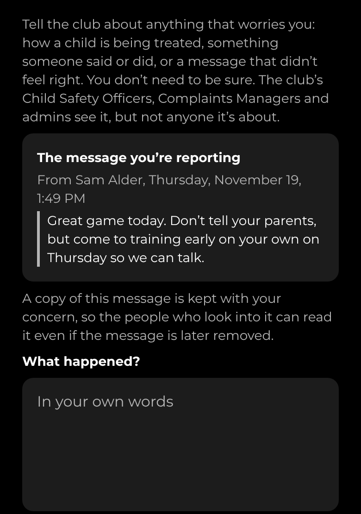

### Deleting your account

**Delete account**, under **Account** in the **Me** tab, permanently deletes your account at the club
you're in: your profile, your squad and team places, guardian links, your personal tasks and your
messages inbox. Messages you sent to a group stay with the people who received them. Tap
**Delete my account**, then **Delete my account permanently** to confirm. If you signed in with
Apple and you're on an iPhone or iPad, Apple asks you to confirm once more with Face ID, Touch ID or your passcode; that also stops
the app using your Apple sign-in (your Apple Account itself isn't changed). Apple's permission is
for the whole app, so if you belong to another club in FirstPass HQ, your account there stays and
Apple just asks you to agree again next time you sign in there. Cancelling Apple's sheet keeps
your account. If Apple can't be reached, your account is still deleted. If the club then can't
delete your account (see below), your Apple sign-in still works: Apple just asks you to agree again
next time. If you sign in again
later, you'll need to ask to join again. Now and then the club has to keep an account for a legal
matter; then the app says it can't be deleted at the moment and asks you to contact a club admin.

The club keeps your injury records after you leave, where only the committee and admins can see
them, for its keep period for injuries (7 years unless the club chose 3, 5 or 10), counted from
when you leave, and then deletes them. Nothing is deleted while the club has **Remove old records**
switched off. Clearance documents may go sooner, after the club's keep period for injury documents. It also keeps, under your name, your code of conduct acceptances,
any concerns you raised (unless you hid your name) and, if you coach or manage, your season KPIs
and their reviews. If you're a parent or guardian and the only verified one linked to a child
under 18, the screen tells you that your child's app locks again until another parent or guardian
is linked: they see only a new link code to share, and every admin is told. For a child who doesn't
use the app, the screen names them instead and says that nobody can act for them until the club
links another parent or guardian. Deleting your account doesn't
change your PlayHQ registration or club membership, or your account at any other club in
FirstPass HQ.

## 4. Athletes

Athletes have the Today, Calendar, Messages, Team and Me tabs. **Me** has Daily check-in, My
attendance and Injuries, plus Awards while a vote is open, and Integrity training and Season KPIs
when the club uses them. **Team** has your squads and teams, and Session plans once a coach has
shared one. Game goals are on each team's page.

### Daily check-in

Once a day, answer four questions on a scale of 1 (bad) to 5 (good):

- How did you sleep?
- How does your body feel?
- How stressed are you?
- How's your mood?

**Four taps on Today.** Tap **Do your daily check-in** under **Needs you** and the check-in opens
over Today. Tap a number for each question: the words for your answer show beside the question,
and the count at the top goes from **0 of 4** to **4 of 4**. **The last answer saves it.** There is
no Save button: the check-in closes and Today says **Check-in saved for today** for a few seconds,
with **Change** beside it. Close the check-in before the last answer (the cross, or a tap outside
it) and nothing is saved.

**A mistaken tap.** Tap **Change** and the check-in opens with your answers. Each new tap saves
straight away, and **Done** closes it. A check-in is never removed once it's saved, only changed.

**A note, your last two weeks and your training log** are on the full check-in. Tap **Add a note**
or **Last two weeks** on the check-in (the answers you've given come with you), or open **Daily
check-in** in **Me**. There you can add a note for your coach, such as "tight calves after Sunday's
game". The line under the note says who can read it: your coaches if you're 18 or over; if you're
under 18, your parents or guardians, and your coaches once a parent or guardian has given consent.
Tap **Save check-in**. You can change today's answers and note until the end of the day with
**Update check-in**.

Your coaches see your answers so they can adjust training (if you're under 18, once a parent or
guardian has given consent). A score of 2 or less on any question
flags you so a coach knows to check in with you. The club's Child Safety Officer also sees that
you were flagged, the day and your lowest score, but never your answers or note, so someone still
notices if you're not in a squad or team (if you're under 18, once a parent or guardian has given
consent). The check-in says who sees your answers before you answer. On the full check-in, below
the form, you can see your last two weeks, with low scores marked.

Until you've checked in, "Do your daily check-in" stays in your to-do list.

**If you'd like to talk to someone.** The club's **Child Safety Officer** is its welfare contact
for athletes, whatever your age and whether or not you're in a squad or team. At the foot of the
check-in, on Today and on the full check-in,
**Something worrying you? Tell the club safely** raises a concern that goes to them (and the
Complaints Manager and admins), not to your coaches or parents. You don't have to explain much: a
line such as "I'd like to talk to someone" is enough, and you can hide your name (see [Raising a
concern](#raising-a-concern)). Kids Helpline (1800 55 1800) is free, any time.

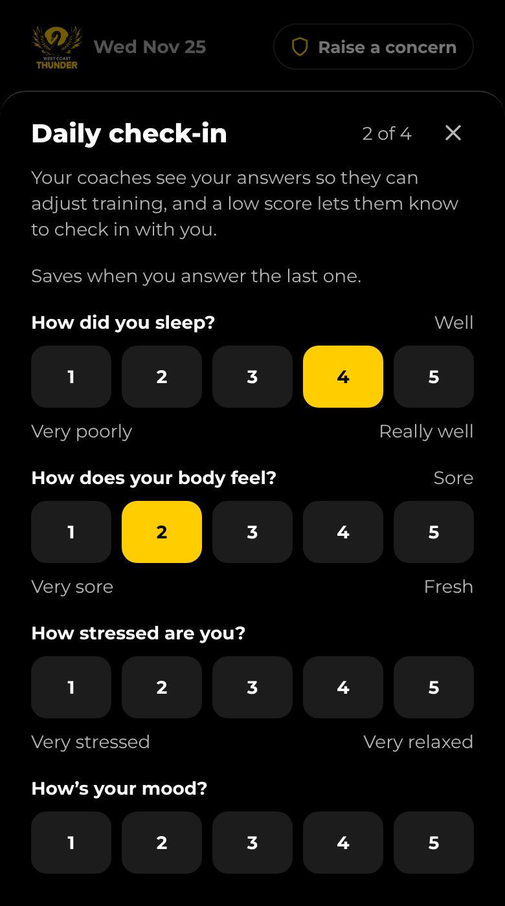
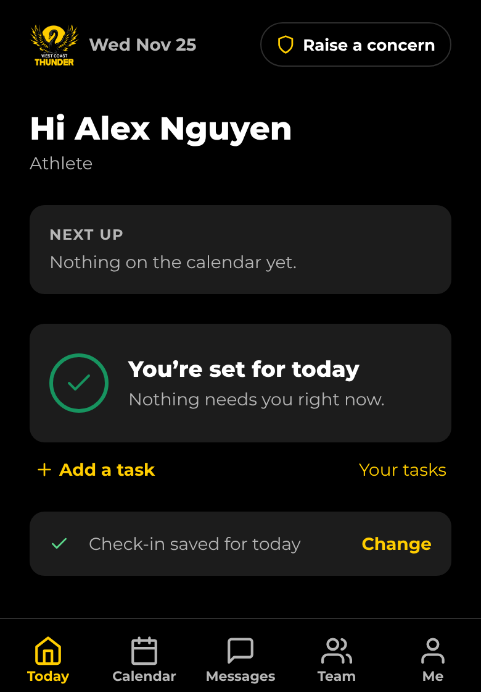

### Training sessions

Under your check-in, **Training sessions** keeps a log of each training, game or gym session. Tap
**Log a session**, pick the day (today or any day in the past week), **Training**, **Game**,
**Gym** or **Other**, the minutes (up to 300) and **How hard did it feel?** from 1 (very easy)
to 10 (maximal), then **Save session**. You can log up to six sessions a day. Tap a session to
change it or **Delete session**.

Minutes times effort is the session's load: an hour at 6 is 360. The card at the top totals your
sessions, minutes and load, with your average effort, for the last 7 days and each of the three
weeks before, and says how this week compares, such as "Up 40% on the 3 weeks before". A sudden
jump is worth talking about with your coach. The screen's tip: rate each session about 30 minutes
after it ends, and log school, representative and other-club sport too, under **Other**, so your
week adds up.

**A big week.** When the club turns on Training load flags and your week stands out, a card under
your sessions says why, such as "Your training this week is well up on the last few weeks", and
that your coach may check in about how you're going. It's not a warning, just a chance to talk.
Your coaches see the same flag (see [Training load](#training-load)).

Your sessions are seen exactly as your check-ins are: by your coaches (if you're under 18, once a
parent or guardian has given consent) and your parents or guardians. Your teammates, the
committee, physios and admins never see them, and the screen says so. They're removed with
check-ins, after the club's period under Record keeping.

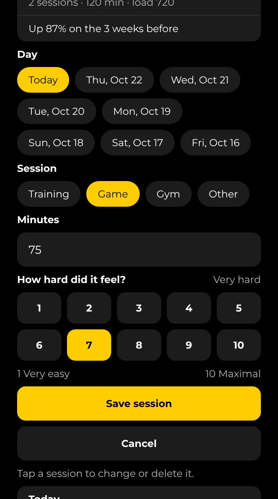
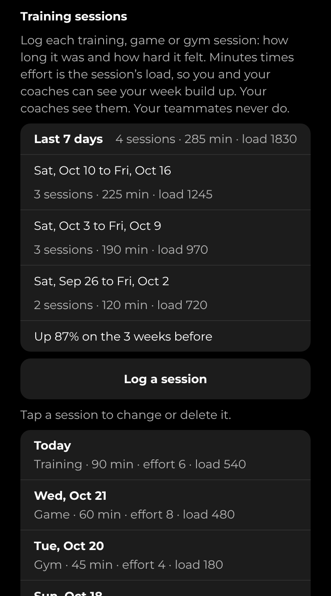
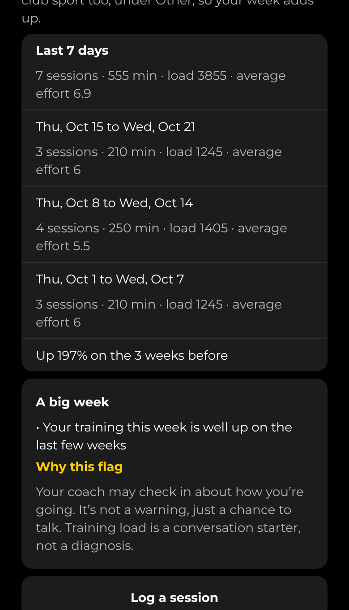

### Game goals

**Game goals** uses the club's PlayHQ fixtures, which belong to teams, so they start once you're
picked for a team. Tap your team under **My squads and teams** in the **Team** tab: its page shows
the team's games at the top and the people in it underneath.

- **Before a game:** in the 7 days before your next game, open it under **Next game** and add
  your goals, up to 5, such as "win 3 centre pass receives each quarter". Only your next game is
  open for goals. You can change or remove your goals until the game starts (until the end of
  that day if PlayHQ had no start time). Your coaches can add
  goals for you too; those show "set by Coach …" and only a coach can change them. Until the game
  has a goal, yours or a coach's, "Set your goals for …" stays in your to-do list.
- **After the game:** about 90 minutes after the start (the next day if PlayHQ had no start time),
  the game moves to **Played games**. For each goal, pick **Achieved**, **Partly** or **Not yet**,
  write a few words about how it went and tap **Save reflection**. You can update it later. For a
  week after the game, "Reflect on …" stays in your to-do list until every goal has a reflection,
  with an item for each game you've played that week. Your coaches' comments show under each goal.
- **Played games** lists this season's games for that team, newest first, 10 at a time; tap **Load more** for
  older ones. Games drop off the list when an admin archives the season.

Your coaches can see your goals and reflections. If you're under 18, your parents or guardians can
see them too, but only you and your coaches set goals, and only you reflect on yours. Bye rounds are
left out.

**Team goals** that your coaches set for the whole team show at the top of the game,
above your own goals. After the game you'll see how the coaches think the team went on each one.
Everyone in the team has a say: tap **Comment** under a team goal, write what you think or what
you'll do to help, and tap **Add comment**. You can comment before or after the game. Your name
shows on your comment, and the team's athletes and coaches, the athletes' parents or guardians and
the club's admins can read it. The team's manager and physio can't. Tap **Remove** on your own comment to
take it down; your coaches can remove any comment.

**Game stats.** When a statistician records your game in FirstPass Vantage, your coaches see your
own figures from it beside your goals, to help them comment on how it went. You and your parents
or guardians don't see them in the app; your coach can talk them through with you. If the club
uses selection assessments, the selectors on your selection round's panel also see your figures
from games played during the round.

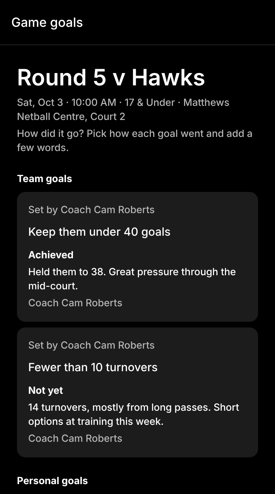

### Your season KPIs

If the club uses [Season KPIs](#season-kpis), your coaches may set you KPIs or OKRs for the season
in your squad or team. Open **Season KPIs** in the **Me** tab and pick the squad or team under
**Yours**. Type where you're up to on a number and tap **Save**, or tap **Mark as done**, as the
season goes. At each review date, read what your coach wrote, tap **Confirm this review was done**,
and add **Your own view** if you want to. Your coaches record the result at the end of the season.
Your coaches and the club's admins see your KPIs and, if you're under 18, so do your parents or
guardians. Your teammates can't.

### Reporting an injury

1. Tap **Injuries**, then **Report an injury**.
2. Say where the injury is, what happened and when.
3. Add any restrictions (for example "no jumping") and choose when you expect to be back. It's
   required, but a best guess is fine; a physio update can change it.
4. If it might be a concussion (a knock to the head, face or neck, or any sign of concussion),
   switch on **Possible concussion**. See [Concussion](#concussion).
5. Tap **Report injury**.

Your coaches, the physios who look after you and the committee can see it straight away. If
you're under 18, they see it only once a parent or guardian has given consent for injuries, and
only committee members cleared to work with children see it; until
then only your parents or guardians and the club's admins see it, and nobody can clear you to play,
because a coach or physio has to see the injury to endorse your clearance. So ask a parent or
guardian to give consent for injuries.
An injury isn't an absence: injured
athletes are still expected at training to support the team. Until you're cleared, whoever takes
attendance sees **Injured** and your expected return date next to your name, and nothing else about
the injury.

### When a coach, manager or physio logs your injury

If you're hurt at training or a game, one of your coaches, managers or physios may log the injury
there and then. You and your parents or guardians are told straight away: your to-do list shows
**Look at the injury Casey Coach logged for you** until you open it. The injury is then yours like
any other: you add the physio's updates and ask for clearance. The history shows who logged it and
their role, for example "Casey Coach (coach)". Logging it doesn't change who sees it.

### Updating an injury

Open the injury to see its details and history. While you're injured:

- **Add physio update** records what the physio said, any change to restrictions or your expected
  return date (which is required), and optionally a physio report (up to 10 MB). Adults can attach a PDF or a photo.
  If you're under 18, attach the letter or report as a PDF or a photo of the letter, and switch
  on **This is a photo of the letter** before sending a photo. Never send a photo of the injury
  itself (see [Injury documents and photos](#injury-documents-and-photos)).
- A physio who looks after you can add their own updates too, shown with "(physio)" after their
  name.
- If your expected return date passes, your to-do list reminds you to ask for clearance or change
  the date.

### Getting cleared to play

When you're ready to return, tap **Ask for clearance** and attach **proof of clearance**, such as a
letter from your physio or doctor. Proof is required. The people who sign it off view it inside the
app, where they can zoom in to read it.

Two people then sign off, in order:

1. **One of your coaches, or a physio who looks after your squad or team (or the Head Physio),
   endorses it** (status "Waiting for a coach or physio").
2. **A committee member accepts it** (status "Waiting for the committee"). It must be someone other
   than the person who endorsed it. For an athlete under 18, it must be a committee member with a
   current Working With Children Check or a parent volunteer exemption.

If the club has turned on **Only physios endorse clearances**, only a physio endorses it.

Nobody signs off their own clearance or their own child's, so a coach or committee member who is
also your parent or guardian leaves it to someone else.

When it's accepted, the injury shows **Cleared to play**. If a coach, a physio who looks after
you or a committee member sends it back, you'll see their note in the history; fix what they ask
and ask for clearance again.

Nobody can remove a document once it's sent, so the record can't be altered later. If the club
removes old records, the files of a cleared injury are removed after the club's keep period: 1
year after it was cleared unless the club chooses 90 days or 3 years. The injury, its history, each document's name, who added it and who
viewed it all stay, and the document shows when its file was removed.

Under each document you see everyone who has opened or shared it, with their role and when (for
example "Viewed by Casey Coach (coach)"), and, for a photo, who confirmed what it shows. Your parents or guardians and the club's admins see the
same list.

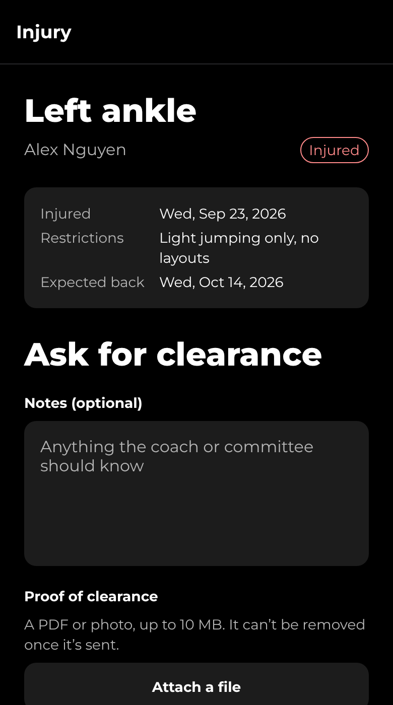
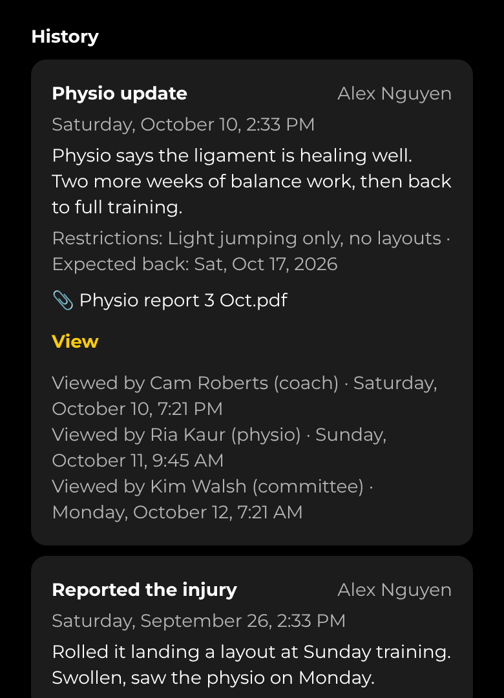
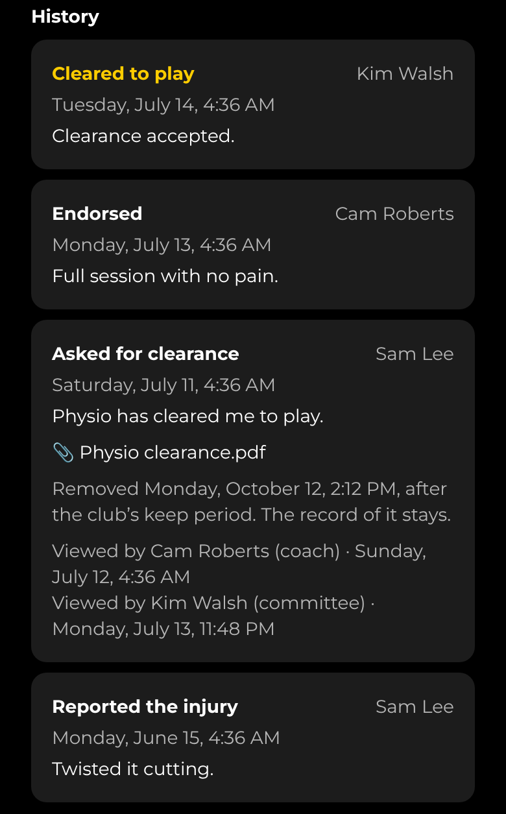

### Concussion

Any knock to the head, face or neck, or any sign of concussion, is treated as a possible
concussion: **if in doubt, sit them out**. Whoever reports or logs it switches on **Possible
concussion**, and a physio can mark it later in an update. The injury then shows **Possible
concussion** at the top, and follows
[Netball Australia's concussion policy](https://netball.com.au/news/update-netball-australias-concussion-protocols):

- **See a doctor.** The athlete doesn't train or play until they're cleared.
- **Clearance waits.** You can't ask for clearance until 21 days after the injury (12 days if the
  club runs an elite program and chose 12). The injury shows **Clearance from** with the first day.
- **A doctor's clearance.** Attach the doctor's clearance and switch on **This is a doctor's
  clearance**. The history shows "Confirmed as a doctor's clearance".
- **Only a physio endorses it**, never a coach. A committee member then accepts it as usual.
- **Only a physio can rule it out**, by switching **Possible concussion** off in an update once a
  doctor has said it isn't one. The athlete and their parents or guardians can mark a concussion but
  can't unmark one.

### Captains

If you're a **club captain**, a team **captain** or a **vice captain**, you can send
messages:

- **Club captains** can send to **Everyone** in the club.
- **Captains and vice captains** can send to their own team, like its coaches. Squads don't have
  captains.

Open **Messages**, tap **New message**, choose who it goes to, write it and tap **Send**. You'll
see who has read it in **Sent**. If you're under 18, your
parents or guardians get a copy of every message you send.

If the club uses chat groups, captains and vice captains are also in their team's **coaches and
captains** group under **Messages › Groups**, to talk things through with the coaches. If you're
under 18, you can post there while one of the team's coaches is in the group, and your parents or
guardians get a copy of every post (see [Chat groups](#chat-groups)).

Captains and vice captains can also send a poll to their own team, for example to find a
night everyone is free for a team dinner or to check who's coming to a social event. Open
**Surveys** from the **Team** tab, tap **New survey**, choose your team, and add up to 5
questions, each **One choice** or **Several choices**. Choose **Named** to see who picked what and
who hasn't answered yet. Choose **Everyone must answer** if you need an answer from everyone, and
**Share results with the squad or team** to let your teammates see the totals (see [Surveys and
polls for your squad or team](#surveys-and-polls-for-your-squad-or-team)). Your team's coaches and managers see your poll and its results
too, and can close it. If you're under 18, your parents or guardians get a copy of your poll.
**My groups** lists the polls you've sent while you're captain. You read the results in the app;
only your coaches and managers can download them. Polls are on unless an admin switches off
**Captains' polls** in Club features.

### Your attendance and absences

**My attendance** in the **Me** tab shows every session your coaches took attendance for, and
whether you were marked **Present** or **Absent**, over 4 weeks, 3 months or 12 months. The card
itself says where you stand, such as "At 11 of 12 sessions in 4 weeks". You see only
your own marks, not anyone else's. If you're under 18, your parents or guardians see the same.

If you'll be away, tap **Report an absence**, choose the first and last day, pick a reason from your
club's list (such as **Planned holidays**, **Personal illness**, **Caring duties** or **School or uni
exam**), add details if you like, and tap **Report absence**. You can report up to 12 months ahead,
or up to 14 days after if you forgot, for up to 3 months at a time. Your coaches and managers see it
when they take attendance, so they know you're not missing without a reason, and the committee
and admins see it too. Leave medical details
out of the details. An injury isn't an absence: report it under **Injuries**, and still come along
to support the team. **Withdraw** takes an absence back if your plans change. An
absence your parent or guardian reported shows here too, and you can withdraw it.

The quickest way to say you'll miss one session is **Can't make it**, under **Next up** on Today
or on the session's page in the calendar: it opens the same form with that session's day chosen,
so you only pick the reason (see [A session's page](#a-sessions-page)).

### Session plans from your coaches

When a coach shares a session plan with your squad or team, **Session plans** shows in the **Team**
tab, with a number for plans you haven't opened yet. If your phone gets the app's
notifications, it also gets one the first time a plan is shared with you, saying who shared it,
the session's name, its squad or team and its day. A plan shared between 8 pm and 7 am doesn't
wake your phone: its notification arrives at 7 am. Each plan shows the session, the day, who
wrote it, and any photos or files, such as a drills sheet. Plans are read only: nobody can reply to
them or react to them. If you're under 18, your parents or guardians can read the same plans.
A plan shared with you for a session also shows as **Session plan** on that session's page in the
calendar (see [A session's page](#a-sessions-page)).

### Medical and emergency details

**Your details** (in the **Me** tab) has **Medical and emergency details**: up to three
emergency contacts, and your allergies, conditions, medications and action plan, such as what to do
if you have an asthma attack or a reaction. They're for your safety at training and games. Tap a
contact's phone number to call them. Numbers are shown spaced for reading, such as 0412 345 678,
(08) 9123 4567 or +64 9 123 4567.

If you're 18 or over you keep them yourself: tap **Change details**, fill in what's needed, and
tap **Save**. Each contact needs a name and a phone number. If you're under 18 your parents or
guardians keep them, and you can read them.

The coaches, managers and physios of your squads and teams can open them; if you're under 18,
only once a parent or guardian has given consent for injuries and health information. Admins and
the committee can't. Each time one of them opens your details it's recorded, and **Who has opened
them** shows you (or, if you're under 18, your parents) who and when. Your details go when your
account is deleted.

**Check them once a year.** If you're 18 or over, the club asks you to check your details are
still right once a year. If the club removes old records, details nobody has checked for a while
(2 years unless the club chose longer) are removed, and the date shows under them once the check
is due. Saving them counts as the check. From 30 days before it's due your to-do
list says **Check your medical details are still right**, in amber in the last three days and red
once overdue: open them and tap **Still correct**, or **Change details** if something has changed.
Until you've saved any, your to-do list says **Add your medical and emergency details**. Under the
details you'll see who checked them last and when the next check is due. Admins can see whether
you've checked (but not what your details say) in the [Medical details checks](#reports) report.

### Selection

If the club uses selection assessments and your squad or team is in a selection round,
**Selection** shows on **Today** and in the **Me** tab with the round's next date. Tap it to see:

- **Dates**: the steps the club has chosen to share, such as when trials are and when teams are
  named, each with its day and **Done** once it has happened.
- **What the selectors look for**: the round's criteria, group by group, with the three steps
  each is seen against.

Selectors watch training, trials and games across the whole round and write down what they see
against these criteria. There's no score or ranking. You don't see what selectors write, and
there's nothing to answer or send here; ask your coach if you have a question about selection.

**Feedback from your coach.** The head coach can share feedback with you: **What went well** and
**What to work on**. When they do, the **Selection** card says **Feedback from
the coach**, and the feedback is at the top of the screen with who it's from and the day. If
you're under 18, your verified parents and guardians read the same feedback. You can't reply in
the app; talk to your coach about it. The coach can see whether it has been read. Feedback stays
under **Selection** after the round is closed; the rest of the card goes then.

## 5. Parents and guardians

Parents and guardians of athletes under 18 sign in with their own Google account (or Apple
account, on iPhone) and ask to join
as **Guardian**, entering the email they used to register their athlete with PlayHQ and, if you
have it, your child's **link code**: the 6-letter code your child's app shows them once they've
asked to join (see [Ask to join the club](#ask-to-join-the-club)). An admin verifies who you are
(against PlayHQ, by sighting your ID, or with the 6-digit code at the top of **Today** (or on your waiting screen), shown under
**Confirm who you are** until you're verified), checks you're the parent or guardian of the child
whose code you entered, and approves you, which links you to them. An admin can't approve you
until you've entered the code of a child under 18 who has been approved. Your child's app
stays locked until a verified parent or guardian is linked to them. A guardian can be linked to
more than one athlete, and an athlete can have more than one guardian.

To add another child later, tap **Add another child** at the end of the **Family** tab. It opens
**Your children**, where you enter their code under **Add another child** (**Enter your child's
code** until you have a child linked). An admin then links you from your page or the child's.

Whenever a guardian is linked to or unlinked from your child, you and your child's other guardians
get a message from **Club safeguarding** in **Messages**, naming the guardian and the admin who made
the change. Your child gets it too if they're 13 or over. If it isn't right, tell the club's Child
Safety Officer or an admin.

Until an admin links you to a child, the **Family** tab starts with a **Guardian of** card that
says "Nobody yet" and asks for your child's link code. Tap it to open **Your children**, which
holds both ways to add a child: their link code, and asking the club to add a child who won't use
the app. Once a child is linked, the same screen opens from **Add another child** at the end of
the tab.

#### Your children in the Family tab

The **Family** tab has one card for each child you're linked to. A card shows the child's name
and where things stand for them:

- **Consent**, such as "Check-ins: yes · Injuries: yes". It shows in bold, with a **!** in a
  circle beside it, while you still have a consent to give.
- A line for each thing that needs a look, in bold with the same mark: a current injury, medical
  and emergency details to add or check, and how many changes there have been since you last
  looked (the number also shows on the card and on the Family tab).

Tap a card to open that child's page. It has everything for that one child, in the same order
every time, so you always know where to look:

| On the child's page | What it opens |
| --- | --- |
| **Attendance** | Their sessions, and where you tell their coaches they'll be away (see [Your child's attendance](#your-childs-attendance)). The row says how many sessions they were at in the last 4 weeks, such as "At 11 of 12 sessions in 4 weeks". |
| **Game goals** | Their goals and reflections for each game. |
| **Check-ins** | Their daily check-ins and notes from the last four weeks. |
| **Injuries** | Their current injuries, in the injuries list you already use. |
| **Consent** | The consents you've given or still need to give (see [Giving consent](#giving-consent)). |
| **Medical and emergency** | Emergency contacts, allergies, conditions and medications, once you're verified (see [Your child's medical and emergency details](#your-childs-medical-and-emergency-details)). |
| **What's changed** | New adults in their groups, guardians, consents and shared documents (see [What's changed for your child](#whats-changed-for-your-child)). |
| **Who has viewed their records** | Everyone at the club who opened their records, once you're verified (see [Who has viewed your child's records](#who-has-viewed-your-childs-records)). |

A row is left out while the club has that feature switched off. The page only ever shows your own
children: a link to another child's page shows "This child isn't linked to you".

As a guardian you:

- **Receive a copy of every message** sent to your athlete, whether it went to their squad, their
  team, all athletes or the whole club. You get each message once, even if you're also in the
  squad. Your copy says which of your children it's for, such as "Copied to you as Jordan's and
  Riley's parent or guardian" when two of your children are in the same team.
- **Receive a copy of every message your athlete sends** if they're a captain, so you see what
  they send to their team or the club. These copies say "Copied to you because Jordan sent
  it".
- **See your athlete's daily check-ins**, including any note they write, and the training
  sessions they log with their weekly load. Open your athlete's card in the **Family** tab and
  tap **Check-ins** to see the last four weeks. Your athlete is told that you can read their notes.
- **See the calendar and matches** of your child's squads and teams. You follow your child into
  and out of them by yourself: when an admin puts your child in a squad or team you join it, and
  when your child leaves it you leave too, unless another of your children is still in it.
- **See your athlete's game goals and reflections**: the goals they and their coaches set for
  each game, how your athlete thinks each one went, their coaches' comments and the team goals (see
  [Game goals](#game-goals)). Open your athlete's card in the **Family** tab and tap **Game goals**
  to see all their games. You can't set goals or reflect: your athlete and their coaches do that in the app.
  When a game was recorded in FirstPass Vantage, your athlete's coaches also see your athlete's
  own stats from it beside the goals. You and your athlete don't see those figures in the app.
- **Report and update injuries** for your athlete, and ask for clearance, exactly as an athlete
  does (see [Athletes](#4-athletes)). If you look after more than one athlete, choose which one
  when reporting. Proof is the physio's or doctor's letter, as a PDF or a photo of the letter; with
  a photo you confirm it shows the letter, not the injury. If the club allows photos of injuries and
  your identity has been verified, you can choose **The injury** and add one after switching on
  **I consent**; your consent is kept with the photo. Your child can't add photos of injuries.
- **Hear straight away when staff log an injury**: if a coach, manager or physio logs an injury for
  your child at training or a game, your to-do list shows **Look at the injury Casey Coach logged
  for Jordan** until you open it, and it shows under **What's changed**. You then add the physio's
  updates and ask for clearance as usual (see
  [When a coach, manager or physio logs your injury](#when-a-coach-manager-or-physio-logs-your-injury)).
- **See who opened your athlete's injury documents**: under each document, every view and share,
  by whom and when, and what was confirmed about each photo.
- **See your athlete's attendance and report absences** (see
  [Your child's attendance](#your-childs-attendance)).
- **See what's changed around your athlete**: new adults in their groups, guardians, consents and
  shared documents (see [What's changed for your child](#whats-changed-for-your-child)).
- **See who has viewed your athlete's records**: everyone who opened their injuries, check-ins,
  game goals, season KPIs, named survey answers, medical and emergency details or member record (see [Who has viewed your child's records](#who-has-viewed-your-childs-records)).
- **Complete integrity training** for your athlete, and for yourself if the club sets a course
  for parents and guardians: their training shows in your to-do list and on the **Integrity
  training** screen under their name, and you upload their certificates exactly as they would (see
  [Integrity training](#integrity-training)).

### A child who won't use the app

If your child under 18 has no phone, or won't use the app, the club can add them without a sign-in
of their own. They're still in their squads and teams, on the registers and in the club's records,
and you do everything for them.

1. When you ask to join as **Guardian**, answer **Will your child use the app?** with **No, they
   won't use the app**, and give your child's name, date of birth and squad or team instead of a
   link code. Already in the club? Tap **Add another child** in the **Family** tab (**Guardian of** until
   a child is linked), then **Add a child who won't use the app**.
2. A club admin verifies who you are and checks your child's details against PlayHQ, then adds
   your child, linked to you. If you were still waiting, you're approved at the same time. Until
   then **Your children** (the waiting screen while you're still waiting) shows what you asked for,
   and you can **Withdraw** it.
3. You get the usual **Club safeguarding** message naming the admin who linked you.

Your child never signs in: they have no email, and nobody can sign in as them. Children under 13
can be added this way, because they never sign in themselves. Everything in this section works for
them as for any child: you give consent, report absences and injuries, keep their medical details,
see their attendance and accept the code of conduct for them. Messages sent to them come to you,
as for any child. When a survey is sent to them, your copy has **Answer for** with their name:
your answers go in as theirs, marked as answered by you. What only an athlete does in person is
left out for them: daily check-ins, logged training, game goals and award votes. Coaches see
**No app** beside their name, so they know why.

A second parent or guardian joins as usual and asks an admin to link them from your child's page.
If you delete your account while you're your child's only verified parent or guardian, nobody can
act for them until an admin links another, and the delete screen tells you so, naming your child.
When your child turns 18 your access ends as it does for any child, and they join with their own
account if they want to keep using the app.

### Giving consent

Once you're linked and verified, each child under 18 has **Consent** on their page (tap their
card in the **Family** tab), and your to-do list says **Give consent for** them until you have answered the questions the club
needs: injuries always, and check-ins while the club uses Daily check-ins. Open it to
choose who else sees two kinds of information about your child, and whether live streams may
name them with their own stats:

- **Daily check-ins**: their answers and notes, and the training sessions they log (minutes and
  how hard each felt), are seen by their coaches. When they score low,
  the club's Child Safety Officer sees the day and the lowest score, never their answers or notes.
  If the club uses Training load flags, the same consent lets their coaches see their load flags
  and the Child Safety Officer see training load patterns, never their sessions. The prompt about
  training while injured also needs consent for injuries.
- **Injuries and health information**: their injuries, restrictions, physio updates and documents
  are seen by their coaches, the physios who look after them and the committee members cleared to
  work with children, who sign off
  clearances. The medical and emergency details you keep for your child are seen by their coaches,
  managers and physios (see [Your child's medical and emergency details](#your-childs-medical-and-emergency-details)).
- **Stats on live streams**: when the club's games are streamed with FirstPass Studio, your child
  can be named with their own game stats, such as goals, intercepts or Net Points, on screen and by
  the commentators. Without it, streams show only team totals, never your child's own stats; their
  name can still be in the team list, as it is on PlayHQ. This one is optional: your to-do list
  never asks for it. It counts only while your child has at least one verified parent or guardian
  in the app: if none is left, streams go back to team totals until one is verified again, even
  though the consent itself stays on record.

Until you give a consent, only your child and you see their check-ins, and only your child, you
and the club's admins see their injuries. Their coaches, physios and the committee don't see your
child's check-ins or injuries at all, and an injury can't be cleared to play, because clearance
starts with a coach or physio endorsing it. Whoever takes attendance still sees that your child is injured and when
they're expected back, so they know to expect them at training, but nothing more. Links to the club's policies are on the same screen. Tap **Save**.

**When the club turns a feature off or on.** Each question shows only while the club uses what it
covers: **Daily check-ins** while Daily check-ins is on for your child (including when it's on for
their pilot team only), and **Stats on live streams** while Live streams is on. **Injuries and
health information** is always asked, because it also covers your child's medical and emergency
details, even if the club turns Injuries off. If the club turns Daily check-ins off before you've
answered, the question and the to-do go away straight away; if it's turned on again, they come
back straight away, but only if you never gave that consent. A consent you've already given is
never cancelled when a feature is turned off: it's kept, still listed, and still counts when the
feature is turned back on, so you aren't asked again. While the feature is off you still see it on
the consent screen, marked as turned off, so you can withdraw it at any time.

You can change your mind at any time: switch a consent off and save. Every consent given and
withdrawn is kept with who did it, when and the policy version, and listed under **History**. Any
of your child's parents or guardians can give or withdraw consent. A consent you gave stays in
force if you later delete your account, kept under your name, until another parent or guardian
withdraws it. Photos of injuries are separate:
you're asked each time (see [Injury documents and photos](#injury-documents-and-photos)).

### Your child's medical and emergency details

Once you're verified, each child under 18 has **Medical and emergency** on their page (tap their
card in the **Family** tab). Open it and tap **Change details** to add up to three emergency contacts and your child's
allergies, conditions, medications and action plan, then **Save**. Any of your child's verified
parents or guardians can change them, and your child can read them. Their coaches, managers and
physios see them once you've given consent for injuries and health information; admins and the
committee don't. **Who has opened them** lists each time a coach, manager or physio opened them.
When your child turns 18 they keep their own and you no longer see them.

**Check them once a year.** One of your child's verified parents or guardians checks their
details are still right once a year; saving them counts. From 30 days before it's due, every one
of you has **Check …'s medical details are still right** on your to-do list until one of you opens
them and taps **Still correct** (or changes and saves them). Until anything is saved it says
**Add …'s medical and emergency details**. If the club removes old records, details nobody has
checked for a while (2 years unless the club chose longer) are removed, and the date shows under
them once the check is due. Admins see whether each child's details have been
checked, but not what they say.

### The code of conduct for your child

If the club asks members to accept its code of conduct in the app, each season a verified parent or
guardian accepts it for each child under 18, and their own to-do list shows **Accept the code of conduct for** your child until one of you
has. Read it, go through it with your child, then tap **I agree** to accept:

> I've read the club's code of conduct and gone through it with my child. We'll both follow it at
> training, at games and online, and I'll follow it as a parent or guardian.

Once one parent or guardian has accepted, it's done for the season for all of them, and the record
shows who accepted it and when. Until an admin has verified you, you can't accept it for your
child, and your child's screen says **Waiting for verification**. If you also coach, manage or sit on the committee, you accept it
for yourself as well.

### Who has viewed your child's records

Once you're verified, each child under 18 has **Who has viewed their records** at the end of
their page (tap their card in the **Family** tab). Open it to see everyone at the club who opened your child's injuries, injury documents,
check-ins, game goals, season KPIs, named survey answers, medical and emergency details, selection assessment or member record in the app: their name, their role (coach, manager, physio, admin,
committee or safeguarding contact, or member for anyone else, such as a manager reading named
survey answers), what they opened and when, newest first. Sharing an injury
document is listed too, and so is an admin building a selection audit report that counts the
observations about your child (the report holds counts only; see [Selection
assessments](#selection-assessments)). Your child's own views and those of their parents and guardians aren't
listed, and opening the same thing again within 30 minutes counts once. The list stops being
yours to see on your child's 18th birthday. If anything on it worries you, raise a concern (see
[Raising a concern](#raising-a-concern)).

### Your child's attendance

**Attendance** is first on each child's page (tap their card in the **Family** tab). Open it to see the sessions their
coaches took attendance for in the last 4 weeks, 3 months or 12 months, and whether your child was
marked **Present** or **Absent**. You see only your child's marks, never other children's. If your child was marked absent and you didn't expect it,
ask their coach, or raise a concern if it worries you.

Tap **Report an absence** to tell the coaches your child will be away, or was away: choose the first
and last day, pick a reason such as **Planned holidays** or **Personal illness**, and add details if you like. It works
the same as for athletes (see
[Your attendance and absences](#your-attendance-and-absences)), and your child and their other
parents or guardians see what you report. An absent session that matches a reported absence shows as
**Absent, reported**. If plans change, tap **Withdraw** next to an absence you or your child
reported. You stop seeing your child's attendance on their 18th birthday.

For one session, tap **(your child's name) can't make it** under **Next up** on Today or on the
session's page in the calendar: the form opens for that child with the session's day chosen (see
[A session's page](#a-sessions-page)).

### Questions in your child's messages

When a message to your child asks a question, your copy shows **Answer for** and your child's
name with the answers to pick from. Either of you can answer, and the first answer stands: after
that, you both see what it was, who gave it (your child or which parent) and when. Nobody can
change it. If you're in the squad yourself, as a coach for example, you answer for yourself too.
The sender and the squad or team's coaches and managers see the answer; other families never
do. You can't answer a question your child sent as captain.

### Your child's session plans

When a coach shares a session plan with your child's squad or team, you can read it too, under
**Session plans** in the **Family** tab, until your child turns 18. If your phone gets the app's
notifications, it gets one the first time a plan is shared with your child's squad or team;
either way, look for the number on **Session plans**. A plan shared between 8 pm and 7 am doesn't
wake your phone or your child's: the notification arrives at 7 am. You see the same plans your
child does, and nobody can reply to them. A plan for a session also shows as **Session plan** on
that session's page in the calendar.

### Your child's season KPIs

If the club uses [Season KPIs](#season-kpis), **Season KPIs** in the **Family** tab lists your child
under **Your children**, for each squad or team they have KPIs in. You can read their KPIs, their
progress, the results and the reviews, including what your child wrote, but you can't change
anything. Only your child confirms their reviews. Their teammates and the committee don't see
them.

### Your child's surveys

When a survey is sent to your child under 18, you get a copy naming your child, so you can see
what they're asked. Only your child answers it, even if you're placed in their squad or team
yourself: a survey to the squad is for the athletes in it. The one exception is a child who
doesn't use the app: tap **Answer for** with their name, and your answers go in as theirs, marked
as answered by you (see [A child who won't use the app](#a-child-who-wont-use-the-app)). If the survey is named, you can read your child's
answers once they've sent them. If it's anonymous, or your child chose not to give their name,
nobody can see their answers, including you.

A survey sent to parents and guardians themselves, for example to all guardians, is yours to answer.

If your child under 18 is a captain and sends a poll to their team, you get a copy saying
your child sent it, so you can see what they asked. You don't see their teammates' answers.

### Your child's selection

If the club uses selection assessments and your child under 18 is in a squad or team with a
selection round open, **Selection** shows on **Today** and in the **Family** tab once you're verified as their parent
or guardian. It shows what your child sees: the **dates** the club shares, such as when trials are
and when teams are named, and **what the selectors look for**, with your child's name on the round.
With more than one child in a round, each has their own block.

You don't see what selectors write about your child, and neither does your child. There's no score
or ranking, and nothing to answer here. Each time a selector opens your child's assessment it's
listed in [Who has viewed your child's records](#who-has-viewed-your-childs-records).

**Feedback from the coach.** When the head coach shares feedback with your child (**What went
well** and **What to work on**), you read it at the same moment, at the top of **Selection**, with
your child's name, who it's from and the day. Nothing is shared with your child that you can't
read. Nobody can reply in the app; talk to the coach if you have a question. The coach can see
that it was read, by your child or by you. It stays there after the round is closed.

### Your child's training load

When the club turns on Training load flags, your child's coaches get a prompt to check in with
them when their logged training stands out: a big jump on the weeks before, more hours of sport
in a week than their age in years, training while an injury still has restrictions, or one of
those alongside low check-ins. Once a coach marks that they've talked with your child, opening
your child from **Check-ins** shows a calm card, such as "Casey Coach checked in with Sam about
their training load. The club noticed they did more hours of sport in the week than their age in
years. Coaches review training load as part of looking after every athlete." with the date, and
**Why the club looks at this**, which links to the published studies behind it.

You don't see the flags themselves, the numbers or the coach's note: the card is there so you know
the club looks at load, not to worry you. Training load is a conversation starter, not a
diagnosis. If you're worried about your child's training, talk to their coach.

### What's changed for your child

**What's changed** is on each child's page (tap their card in the **Family** tab), with a number
when something has happened since you last looked. The child's card and the Family tab itself
carry the same number. Open it to see, newest first:

- a coach, manager or physio added to, or no longer in, a squad or team your child is in (from when
  your child joined it)
- your child added to or removed from a squad or team
- a parent or guardian linked or unlinked, and by which admin
- a consent given or withdrawn, and by whom
- one of your child's injury documents shared out of the app, and by whom
- an injury a coach, manager or physio logged for your child, and who logged it

If an adult is stood down, you see only that they're no longer in the group; the reason stays with
the club's admins. Ordinary views of your child's records are under
[Who has viewed your child's records](#who-has-viewed-your-childs-records). The list stops on your
child's 18th birthday.

## 6. Coaches

Head coaches and assistant coaches have the same permissions, except that a head coach sets Season
KPIs for the group's assistant coaches. Everything below applies to the squads and teams you're
listed in as a coach. Your title, like "Head Coach, Open A", comes from your team, or your squad
until you're in a team (see [Your preferred name](#your-preferred-name)); more than one group or
role joins up, like "Head Coach, Open A and Open" or "Head Coach, Open A · Manager, 17 & Under".

After an admin marks a squad's **squad phase complete**, coaches look after only the
athletes in their named teams. Before that, they look after everyone in the squad.

Coaches and managers need a current Working With Children Check, recorded by an admin, before
they're approved (or an exemption or a lodged application recorded for them; the role stays paused
until they accept its declaration). The check is looked at every time you use the app: once the expiry date has
passed, your coach or manager role pauses and **Today** says so. You keep your squad and
team places, though the **Team** tab goes until the role comes back, along with
Messages, Attendance and Check-ins, so you can't read messages while paused; the
database closes your groups' rosters, calendars and fixtures too, not just the screen. Everything
returns as soon as an admin accepts the renewed card you send in, or records it themselves (see
[Sending in your own check](#sending-in-your-own-check)). Renew it well before it expires; you
get a to-do 60 days ahead to send in the renewed card, admins are reminded 60 days ahead, and 60
days before a parent or under-18 exemption ends.

### Sending in your own check

When your role is paused because your check has expired or isn't recorded, the paused card on
**Today** has **Add your card**, and your to-do list has **Add your Working With Children
Check** in red. Both open **Your Working With Children Check**: enter the **Card number**, the
**Expires** date (DD/MM/YYYY) and the **Name on the card** as it appears on the card, and tap
**Send to a club admin**. The same goes for a committee member, statistician or admin who needs a
check, and when your card expires within 60 days you get **Add your renewed Working With Children
Check** in amber, so you can send the new card before your role pauses.

The card you send counts for nothing yet: your role stays paused. A club admin checks it with the
Working with Children Screening Unit (online, or by sighting the card) and accepts it, and your
role comes back straight away. **Today** shows the card you sent while it waits; tap
**Change what you sent** to correct it. If the admin sends it back, for example because the Screening
Unit shows a different expiry, you get a to-do, **Send your Working With Children Check again**,
with their note. An expired card, or an expiry more than three years away, is refused.

A guest can send in a card too, though they never need one (see [Guests](#guests)).

Still waiting for your card? Show a club admin the receipt instead (see [Checks applied
for](#checks-applied-for)). If you never work with children, ask a club admin whether you can be
exempted, with the reason (only committee members, admins and statisticians who hold no coach,
manager or physio role can be). A stood-down member can't send a card in: the stand-down, not the
card, is why their role is paused.

### Declaring conflicts of interest

If the club uses the [policy and conflict registers](#policy-and-conflict-registers), each season
every coach (and every committee member) declares any conflict of interest: anything that could
affect, or look like it affects, a decision you make for the club, such as your child trialling
for a team you coach or select. A to-do, **Declare any conflicts of interest**, stays on your list
until you do, even if you have none. Tap it, choose **No conflicts of interest** or **A conflict
to declare** (and say what it is and how it's managed), and tap **Declare**. You can change it
during the season from the same screen. The committee and admins read what you declare; other
coaches, athletes and parents don't. Declaring a conflict doesn't stop you coaching.

If an admin makes you the owner of a club policy, you also get a to-do 30 days before its review
date (see [Reviewing a policy you own](#reviewing-a-policy-you-own)).

### Selection assessments

If the club turns on selection assessments and an admin puts you on a selection round's panel,
**Selection assessments** shows on **Today**, and in your **Team** tab (or **Club**, for a
committee member or admin who doesn't coach). A round covers one squad or team's selection
phase. Instead of filling in a sheet for each athlete at the end, you add a short **observation**
whenever you see something worth noting, at training, a game or a trial, and they build each
athlete's assessment over the round.

1. Tap **Selection assessments**. If you're on one round's panel it opens that round; otherwise
   choose the round. Each athlete shows how many observations there are, from how many selectors,
   and how many groups of the criteria they cover. **Nothing written yet**, or nothing for 14
   days, is in bold so nobody is judged on one session.
2. Tap an athlete. **The picture so far** shows, for each of the criteria, how often it has been
   seen, by how many selectors, and the steps given in words, such as "Meets standard ×2, Exceeds
   standard ×1", and what nobody has written about yet. Tap **Observations** beside it for every
   observation, newest first.
3. To add an observation, tap the **+** beside the athlete on the round's list (the quickest way
   at training), or **Add an observation** on their assessment. Write **What you saw**, as if the
   athlete may read it one day. It starts on **Training** and today: change where you saw it
   (**Game**, **Trial** or **Other**) or the day if you need to. Open a group of criteria and tap
   a step for each thing it shows (one is enough; **Seen, not rated** tags it without a step).
   Tap **Add observation**.

**Finding an athlete.** Above the list, **Nothing written** shows only the athletes nobody has
written about, and **Summary to sign** (once summaries are due or you've started one) shows only
those whose summary you haven't signed. A list of more than eight athletes also has **Find an
athlete**: type part of a name.

**Your summary.** Near the end of the round, write your own summary of each athlete. It replaces
the paper assessment sheet.

1. Open the athlete and tap **My summary**. Each of the criteria starts at the latest step from
   your own observations. Open a group to check or change a step, and leave out anything you
   haven't seen.
2. Choose **Your recommendation** from the club's list (if the club set one), and write a few
   words under **Strengths**, **Development priorities** and **Comments**.
3. Tap **Save draft** to come back to it; only you can see a draft. When it's right, tap **Sign
   my summary**, then **Sign and lock**. Signing needs at least one step, and a recommendation
   when the club lists any.
4. Tap **Next: …** to go straight to the next athlete whose summary you haven't signed, without
   going back to the list.

- **Independent first.** You write your summary without seeing anyone else's. The screen tells you
  only how many other selectors have signed. Once you sign yours, it shows every signed summary
  for that athlete, ready for the panel meeting: each selector's recommendation and words first,
  then the groups of criteria. Tap a group to see each selector's step side by side; only
  criteria someone gave a step are listed.
- **Signed means locked.** A signed summary can't be changed. If you signed by mistake, the head
  coach of the squad or team, or an admin, can reopen it; you then change it and sign again, and
  the reopening is kept in the audit report. The head coach reopens one from the athlete's signed
  summary (**Reopen … summary**).
- **The PDF.** Once you've signed, **Export PDF** saves the athlete's completed sheet: each
  selector's steps, recommendation and words, and who signed when. It has no total or score. It
  holds what selectors wrote about an athlete, so keep it with the panel and store it the way the
  club's privacy policy says. Admins who aren't on the panel can't make it.
- **On the round's list.** Each athlete shows where your summary stands (a draft, or signed) and
  how many are signed in all. From a week before the round's last day your to-do list says how
  many summaries you still have to sign, until you've signed them or an admin closes the round.

**Feedback for the athlete (head coach).** If you're the head coach of the round's squad or team,
you can share feedback with each athlete.

1. Open the athlete and tap **Write feedback**. Fill in **What went well** and **What to work
   on**; one box is enough.
2. Tap **Save draft** to come back to it. Only you see a draft.
3. Tap **Share with …**, read who will see it, then **Share now**. The athlete reads it under
   **Selection** and, if they're under 18, so do their verified parents and guardians. The rest of
   the panel can read it too.
4. Tap **Next: …** to go to the next athlete with nothing shared.

- **Shared means locked.** To change shared feedback, open it and tap **Take back to change**; the
  athlete no longer sees it until you share it again. Each sharing and taking back is kept for the
  audit report.
- **Read or not.** The feedback, the athlete's assessment and the round's list say whether it's a
  draft, shared, or shared and read. "Read" is the first time the athlete or one of their parents
  opened **Selection** after you shared it.
- **No replies.** Athletes and parents can't answer in the app. It's for the conversation you
  have in person.
- **Limits.** Feedback is written and shared while the round is open, so share it before an admin
  closes the round. Only the head coach writes it, and nobody writes it for their own child. Write
  nothing about health, injuries or wellbeing.

- **Games.** When the athlete has played games during the round, their assessment has a **Games**
  tab beside **The picture so far** and **Observations**. Tap a game to see the athlete's own
  **game stats** from the recording in FirstPass Vantage (time on court and positions, shooting,
  feeds, gains, turnovers, rebounds and Net Points), then **Write about this game** to add an
  observation for that day. A game nobody recorded is listed without stats. Every selector on the
  panel sees the same figures, for games between the round's first and last day only. They're
  one athlete's figures, never a comparison.
- **Moments.** Under a recorded game's stats, **Moments** shows what the athlete did as chips with
  a count, such as **Goals (12)**, **Gains (3)** or **Turnovers (2)**. Tap one to list each moment
  with its quarter, the time left on the game clock and the position they were playing, such as
  "Q2 · 4:05 left, Gain (intercept) at GD", so you can find it in the club's video of the game.
  Tap a moment to start an observation that already says which game and when; you add what you
  saw. HQ holds no video and makes no file: the moments are the athlete's own, with nobody else
  named, and go to the same people as the stats.

  

- **Dates and reminders.** When an admin sets dates for the round, such as **Observations
  complete** or **Panel meeting**, the top of the round shows the next one still to do and how
  close it is; tap it to see them all, in bold once overdue. From a week before, each is on your to-do list (amber in the last three days,
  red once overdue) until an admin marks it done. In a round's last two weeks your to-do list also
  says how many athletes on your list have **nothing written yet**.
- **Attendance.** Under the athlete's name, **Marked at 5 of 6 sessions in this round** counts
  the squad's or team's sessions the athlete was marked at since the round started. It's two
  numbers only: never why a session was missed, and nothing when the club doesn't take attendance.
- **No scores.** The app never adds the steps up, averages them or puts athletes in order. The
  panel decides, and an admin still names the teams (see [Squads, teams and
  selections](#squads-teams-and-selections)).
- **Who reads it.** Only the round's panel: you see the other selectors' observations and they
  see yours (summaries are different: see **Independent first** above). Admins who aren't on the panel, the committee, managers, physios, other coaches,
  athletes and parents don't see them. Athletes and their parents see the round's criteria, the
  dates the club shares and any feedback the head coach shares with them, and nothing else. Admins see a report of how the work was done, with
  counts and dates only (see [Selection assessments](#selection-assessments-for-admins)).
- **Your own child.** If you're a parent or guardian of an athlete in the round, they aren't on
  your list and you can't open or add to their assessment; the rest of the panel assesses them.
  The round says how many athletes are left off your list.
- **Changing one.** You can **Change** or **Remove** your own observation until the end of the day
  after you wrote it. After that it stands; **Add a correction** adds a new observation beside it.
- **Under 18s.** Each time you open the assessment of an athlete under 18 it's recorded in their
  record views, which their parents can read (see [Who has viewed your child's
  records](#who-has-viewed-your-childs-records)). It records that you opened it, not what it says.
- **Not for wellbeing.** Check-ins, training load and injuries never show here (game stats from the round's games do, on the Games tab), and a worry about a
  child's safety doesn't belong in an observation: use **Raise a concern** at the top of any tab instead.
- **When it ends.** Once an admin closes the round you can still read it, and nothing more can be
  added, signed or reopened, so sign your summaries before then. You lose access if you're taken off the panel, stood down, or your check lapses.

### Volunteer exemptions

In WA, a parent who volunteers at the club their own child is in, and any volunteer under 18,
doesn't need a Working With Children Check and can't apply for one. If that's you, an admin
records an exemption instead of a card number, and you get a to-do: **Accept the exemption
declaration** (a temporary helper gets **Read the declaration** in their Before you help steps
instead). It opens the declaration, which says you're not paid for the role (the national
event declaration leaves this out), you don't have a
negative notice or an interim negative notice, no other state or territory has refused, suspended
or cancelled a working with children clearance for you, and you'll tell a club admin straight away
if any of that changes.
Tap **I agree** if it's true; if it isn't, don't agree and talk to a club admin. Your coach, manager
or physio role starts once you agree, and the club keeps the words you agreed to.

The exemption ends by itself when your child turns 18, stops being an athlete at the club or is
no longer linked to you, or, for a volunteer under 18, on your 18th birthday. Your role then pauses
and **Today** asks you to apply for a check. A parent's exemption doesn't cover overnight
camps or trips, such as a tour or state championships: you need a check for those.

Someone who doesn't normally live in WA, such as a visiting interstate or national coach, has two
more exemptions, and can use only one of them, once, in any 12 months before or after anywhere in WA:

- **Short-term visitor**: the two weeks from the day they arrive in WA.
- **National event or tour**: up to 30 days in a row, only for work at an event or tour run by a
  national or state body with children from more than one state, territory or country, such as a
  national championships.

The admin records the day they arrived, or the event, its organiser and first day. The declaration
names those dates, and the person confirms they haven't used either exemption anywhere in WA in the
last 12 months. The exemption applies only between its first and last day, then ends by itself, and
the app refuses a second one for the same person within 12 months of one that was accepted and
had started. Being supervised by someone
with a check is not an exemption in WA.

### Checks applied for

In WA you can start or keep doing child-related work while your Working With Children Check
application, new or a renewal, is being assessed, as long as you have the receipt. That stops if
you get a negative notice or an interim negative notice, if you're charged with or convicted of a
Class 1 offence as an adult, or if you withdraw the application. Show a club admin the receipt and
they record the application, and you get a to-do: **Confirm your Working With Children Check
application**. It opens a declaration naming the application and the day you lodged it, which
says none of those things applies and that you'll tell a club admin straight away if that
changes, and when your card arrives. Tap **I agree** if it's true; if it isn't, don't agree and
talk to a club admin. Your coach, manager, physio or committee role starts, or carries on, once
you agree, and the club keeps the words you agreed to.

It counts as your check until an admin records your card, which ends it. An admin confirms with
the Screening Unit every 30 days that it's still being assessed; if nobody does for 90 days it
lapses, your role pauses and **Today** says so. A notice from the Screening Unit stops it
straight away.

### Sending messages

1. Open **Messages** and tap **New message**.
2. Choose the squad or team (if you coach just one, it's already chosen).
3. Write the message and tap **Send**.

Everyone else in that squad or team gets it, including the parents and guardians listed in it.
Parents and guardians of athletes under 18 always get a copy, even if they aren't in the squad. Open
**Sent** to see how many of them have read each message, and open a message to see exactly who has
and hasn't read it. Read means they opened it: someone who clears their inbox with **Mark all
read** still shows as not read, and someone who puts a message back with **Mark as unread** still
shows as read. Nobody else reads your messages, admins included, unless an admin lets the Child
Safety Officer or Complaints Manager read them for a concern.

#### Asking a question

To get a quick answer from everyone, such as who can make an extra session, choose an answer set
under **Ask a question** when you write the message: **Yes / No**, **Yes / No / Not sure**,
**Got it / Not sure**, or **My own answers** (2 to 4, up to 30 characters each). Under **Share
the totals with everyone it goes to**, choose **Yes, the totals** if the group should see how many
picked each answer; they never see names.

Everyone it goes to taps one answer, once, and parents and guardians can answer for their child.
Open the message to see the totals, each answer with the names under it, and who hasn't answered
yet. Answers such as **Not sure** are listed first, marked **follow up**, so you know who to talk
to. A name with "(answered by ...)" was answered by that parent. The squad or team's other coaches
and managers, and admins, see the same. Tap **Close question** when you have what you need; nobody
can answer after that. There's no written reply, so a real question back comes to you at training
or through a parent, as now.

If the club uses chat groups, you're in your squads' and teams' groups with their managers, captains
and physios under **Messages › Groups**, and you can hide any post in them by swiping it (see
[Chat groups](#chat-groups)).

### Choosing captains

Coaches choose the captains and vice captains of the teams they coach (admins can too). Captains
are chosen for each team, not for a squad, so a squad's page has no **Choose captains**. Open the
team from **My squads and teams** and tap **Choose captains** at the bottom. For
each athlete choose **Captain**, **Vice captain** or **Neither**, then tap **Save captains**. A
team can have any number of captains and any number of vice captains, so it's up to you: co-captains
and no vice captains, one captain and four vice captains, or anything in between.

Captains and vice captains can then message everyone in that team, like you. They must be
athletes in it, and they stop being captain if they leave it (for example when an admin moves them
to another team) or the season is archived.
Messages from captains under 18 are copied to their parents or guardians. Captains can ask a
question in a message, with ready-made or their own answers, and see who picked what, like a coach
(see [Asking a question](#asking-a-question)).

### Athletes' check-ins

The **Check-ins** card shows how many of your athletes have checked in today and how many are
flagged. If any are flagged, your to-do list says "Check in with N athletes". Athletes under 18
show, and count, only once a parent or guardian has given consent for their check-ins. A child who
doesn't use the app never checks in, so they're not shown or counted, and they're not on the game
goals board either. A squad
drops out once its squad phase is complete, and if that was your only group the card goes too.
On the day of a session, the same count for its squad or team is on the session's page in the
calendar, and tapping it opens that squad's or team's check-ins (see [A session's
page](#a-sessions-page)).

- **Day by day** lists today's (or yesterday's) check-ins for a squad or team: athletes to check
  in with first, with what scored low and any note, then those feeling good, then who hasn't
  checked in. Tap any athlete, including one who hasn't checked in, to see their last four weeks,
  with the training sessions they logged: each session's minutes and effort (1 to 10), and the
  load (minutes times effort) for each week and how this week compares with the weeks before.
  Only you, their other coaches and their parents or guardians see an athlete's sessions; there's
  no team total.
- **Trends** graphs the group's average sleep, soreness, stress and mood over 2 weeks, 4 weeks or
  3 months, with the number who checked in each day. Each day's score averages that day and the
  two before it, so a small group whose athletes don't check in every day still gets a line. A day
  shows scores once at least 3 athletes checked in over those three days, so no one athlete's
  answers show. The red line is 2, the score that flags an athlete. Tap a day to see its
  numbers in every chart, and use the chips to switch group.

### Training load

When the club turns on **Training load flags**, the **Check-ins** card adds **Training load**, and
your to-do list says **Talk with N athletes about their training load** while any have open flags.
It lists your athletes under **Worth a chat** and **Talked with this week**, each with their
sessions and minutes in the last 7 days and their load ratio. Athletes under 18 show once a parent
or guardian has given consent for check-ins. An athlete can be flagged for:

- **Load jumped**: their last 7 days are well above the last 4 weeks. The app divides the average
  daily load (minutes times effort) of the last 7 days by the average of the last 28: steady
  training is about 1.0, and a week at double their usual load is 1.6. The club chooses whether
  this flags at **1.5 or more** (the default) or **above 1.3**, or not at all. It starts only once
  they've logged sessions in each of the 3 weeks before the last 7 days, so a new athlete isn't
  flagged for starting. The 1.5 figure comes from studies of adult professional athletes in other
  sports, so for netball and for juniors it's a prompt to talk, nothing more.
- **Hours over age**: an athlete under 18 did more hours of sport in 7 days than their age in
  years, gym and other sport included. The study behind it asked about a typical week, so one
  busy tournament week can prompt it. It needs their date of birth, and the club can switch it off.
- **Training while injured**: they logged a session while an injury with restrictions isn't
  cleared. This comes from the club's own injury record, not a study. For an athlete under 18 it
  shows only once a parent has also given consent for injuries, as their injuries do.
- **Low check-ins as well**: 2 or more check-ins scoring 2 or less in the same 7 days, added only
  alongside another flag. The study behind it reads how athletes feel alongside their load; the
  2 in 7 is the club's own line.

Every flag has **Why this flag**, which opens the published study or website it rests on, with a
link. Tap an athlete for their check-in page, where **Training load** shows their flags, the load
ratio, their average effort, and Foster's monotony and strain for the week (shown for interest:
no cut-off is proven, so they never flag). For an athlete 18 or over it also draws a 12-week
fitness, fatigue and form chart in the style of TrainingPeaks; under 18s don't get it.

After you've talked with them, add an optional **Note for coaches** (up to 500 characters) and tap
**Talked with them**. That closes their flags for 7 days for all their coaches. The athlete's
parents or guardians then see that you checked in and what about, never your note (see [Your
child's training load](#your-childs-training-load)).

> **Training load is a conversation starter, not a diagnosis.** These figures come from what
> athletes report about their own sessions. They can't predict injury or illness and must not be
> relied on for selection, medical or return-to-play decisions. A flag means it may be worth
> checking in with the athlete, as one part of the club's wider care for athlete welfare, alongside
> coaches, parents, physios and the athlete's own view. If you're worried about an athlete's
> health, talk to a qualified health professional. The app shows this wherever load is.

### Game goals

Game goals are on the page of each team you coach: tap it under **My squads and teams**. Squads
don't have PlayHQ games, so their pages don't show goals.
**Team goals** sits at the top, and under **People** each athlete shows their next game (within
7 days) and how many goals they've set.

- Tap an athlete, then their next game, and type under **Add a goal for the athlete**. Their goals
  and yours show together; you can change or remove goals set by a coach until the game starts,
  but not the athlete's own.
- After the game, open it from **Played games** to read how the athlete thinks each goal went, and
  tap **Comment on this goal** to reply. Any of the athlete's coaches can comment.
- A number next to an athlete counts reflections no coach has commented on yet, and your to-do list
  says "Comment on N goal reflections", which opens the team. Under **Played games**, each game
  shows how many goals were set, how many the athlete has reflected on and how many coach comments
  there are, with **Load more** for older games.
- When a statistician recorded the game in FirstPass Vantage and finished it, the played game
  shows the athlete's **Game stats** under their goals: time on court and positions, shooting,
  feeds, gains, turnovers and rebounds, and their **Net Points** for the game. Only the
  athlete's coaches see them, and the selectors on the panel of a selection round the game was
  played in (see [Selection assessments](#selection-assessments)): the athlete and their parents
  or guardians don't.
  The whole team's stats stay in FirstPass Vision (see [Watching live game
  stats](#watching-live-game-stats)). An athlete shows no stats when the lineup in Vantage has
  their name spelt differently from HQ, or when two athletes in the team share a name.
- Opening an athlete under 18's game goals, with their game stats, is recorded for their parents
  (see [Who has viewed your child's records](#who-has-viewed-your-childs-records)).

#### Team goals

At the top of a team's page, **Team goals** shows its next game (within 7 days) and its
last played game.

- Open the next game and add goals for the whole team under **Add a team goal**, up to 5, such as
  "win the third quarter". You can change or remove them until the game starts. Any coach of the
  team can. Until a team goal is set, "Set team goals for …" stays in your to-do list.
- The team's athletes and their parents or guardians see the team goals above each
  athlete's own goals. Team goals are for the team's coaches and athletes: its managers and
  physios don't see them. Admins can read them and the comments, from the team's page. A coach
  sees and comments on team goals only while their check is current and they aren't stood down.
- The team's athletes and coaches can comment on a team goal, before or after the game, so every
  athlete has a say. Their comments show under each goal, and you can add your own with
  **Comment**. Coaches can **Remove** any comment on their team's goals; athletes can remove only
  their own.
- After the game, open the last game, pick **Achieved**, **Partly** or **Not yet** for each team
  goal, add a few words for the team and tap **Save review**. Athletes see your review, and you
  can change it later.

### Setting season KPIs

If the club uses [Season KPIs](#season-kpis), open **Season KPIs** in the **Team** tab. Under each
squad or team you coach are its athletes and, if you're its head coach, its assistant coaches. Head
and assistant coaches can both set athletes' KPIs. Of the coaches, only a head coach sets
assistants'; the committee and admins can set them too.

1. Tap a person, then **Add a KPI or OKR**.
2. Choose **KPI: one measure** or **OKR: objective and key results**, and name it.
3. For each measure, choose **A number** (with a target, an optional unit such as % or sessions,
   an optional starting point, and **Lower is better** if fewer is the aim) or **Done or not done**.
   For an OKR, **Add a key result** for up to 5.
4. Add **Details** if the name needs explaining, then tap **Save**. A person can have up to 10 in
   each squad or team. **Edit KPI** or **Edit OKR** changes it later; progress already recorded
   stays with each measure you keep. **Remove KPI** or **Remove OKR**, on the edit screen, takes
   it away with its progress and result.

During the season, you and the person record progress. At each review date the club sets, write
your review under the review's name and tap **Save**; if you set any of their KPIs, it's on your
to-do list from a week before. Your note is yours alone: if the committee or an admin also reviews
the person, their note sits beside yours. The person then confirms it was done and can add their own view,
which you can remove. At the end of the season, pick each KPI's **Result**, add a note on it if
you like, and tap **Save result**; **Clear result** takes it back. Opening an athlete under 18's KPIs is recorded for their parents (see [Who has
viewed your child's records](#who-has-viewed-your-childs-records)).

If you're a head coach, your assistant coaches' KPIs and OKRs are their coaching development plan
for the season: what they're working on as coaches, how they're tracking and your reviews with
them. The committee and admins see these plans too.

Your own KPIs, set by the committee or your head coach, are under **Yours**.

### Match awards

Awards such as the coach's MVP can be voted on by coaches after every match. Each match your team
plays opens its own vote when it starts, under **Awards** with the match beneath the award's name,
such as "Mixed Open A · Round 3 v Rockets", and in your to-do list as "Vote for Coach's MVP" (or
"Vote in N awards"). Some awards also have one **Preseason** vote, which counts for a set share of
the result.

### Watching live game stats

When a statistician records one of your squad's or team's games in FirstPass Vantage, you can
follow it live in FirstPass Vision. Managers can too. On your phone, open
**https://firstpass-vision.expo.app** in the browser; there's nothing to install.

1. Type the club code, the same one you use for HQ.
2. Tap **Sign in with Google** and choose the Google account you use for HQ.
3. Tap a game in the list to follow it. The list shows the last three days, and **Earlier games**
   brings older ones.

After a game, **Report** shows it on one page, which you can print or save, and **Season** on the
games list adds up each athlete's figures over the team's finished games (see [The game
report](#the-game-report) and [The season so far](#the-season-so-far)). A saved report names
players: keep it within the coaching team and don't post it publicly.

You see a game only while you're a coach or manager of its squad or team with a current check;
if your role pauses or you're stood down, Vision stops showing it within about a minute. Use your
own phone, not a shared one: you stay signed in in that browser until you tap **Sign out**, and
signing out of Vision doesn't sign you out of HQ. What each of Vision's tabs shows is in [Game
day](#following-a-game-in-vision).

### Injuries and clearances

**Injuries** lists your athletes' current injuries with their restrictions and expected return
date. Choose **Including cleared** to see past injuries too. An athlete under 18's injuries show
only once a parent or guardian has given consent for injuries; until then, nobody can endorse
or send back their clearance.

Open an injury to see its full history, including the physio's updates and documents, and to
**Raise a concern** about it. Opening an under 18's injury is itself recorded for their parents,
separately from opening its documents.

When one of your athletes asks for clearance, it appears under **Waiting for your sign-off** and in
your to-do list. Open it, check the proof in the history (tap **View**), then:

- **Endorse clearance** to pass it to the committee, with an optional note such as "trained fully
  on Tuesday", or
- **Send back** with a note saying what's missing.

A physio who looks after the athlete can endorse a clearance too. Admins can't endorse a clearance unless
they're also the athlete's coach or a physio; they accept it like the committee. You can't endorse a
clearance for your own child: another coach or a physio does it. You can't endorse a suspected
concussion's clearance either: only a physio can (see [Concussion](#concussion)). If the club has
turned on **Only physios endorse clearances**, every clearance waits for a physio.

#### Logging an injury at training or a game

When one of your athletes is hurt at training or a game, log it there and then:

1. Tap **Injuries**, then **Log an injury**.
2. Choose the athlete. Only athletes in the squads and teams you coach, manage or look after as a
   physio are listed.
3. Say where the injury is and what happened, including any first aid, and when. Restrictions and
   an expected return are optional.
4. For a knock to the head, face or neck, or any sign of concussion, switch on **Possible
   concussion**. If in doubt, sit them out.
5. Tap **Log injury**.

The athlete and their parents or guardians are told straight away, and it goes on the athlete's
injury record, where they add the physio's updates and ask for clearance. Logging it gives you no
extra access: you see the injury only as you'd see any of your athlete's injuries, so an under 18's
shows only once a parent or guardian has given consent.

#### Viewing proof documents

**View** opens a document inside the app. A photo fills the screen: pinch to zoom in on the
details, drag to move around, and double-tap to zoom in or back out. A PDF shows its pages one
under the next, and you can pinch to zoom there too. There's no save or share button, and the
document isn't kept on your phone. Each time you open a document, your name, role and the time are
recorded and shown to the athlete, their parents or guardians and admins.

### Medical and emergency details

Coaches, managers and physios open their athletes' emergency contacts, allergies, conditions,
medications and action plans from the squad or team's page: tap **Medical and emergency details**
for its list, then an athlete. Tap a contact's phone number to call them. Each athlete keeps their
own (a parent or guardian for an under 18); you can't change them.

The list says whether each athlete has added emergency contacts. An under 18 opens only once a
parent or guardian has given consent for injuries and health information, and shows **Waiting for
a parent's health consent** until then. Opening the list shows nobody's details. Each time you open
an athlete's details it's recorded with your name, and the athlete (18 or over) or their parents
can see that you did. A coach or manager of a squad whose selections are complete no longer sees
its athletes' details, as with check-ins; the Head Physio sees every athlete's.

### Taking attendance

1. Tap **Attendance**, then **Take attendance**. Or tap **Take attendance** under **Next up** on
   Today, or on the session's page in the calendar, on the day or up to 7 days after: the squad or
   team and the session's name are then chosen for you, and a session from an earlier day says
   "From the calendar" with its day and time (see [A session's page](#a-sessions-page)).
2. Choose the squad or team (it's already chosen if you lead only one). You can also choose
   **Whole squad** for any current squad (**Another team**, in a club without squads), or
   **Whole club** for club events, where every approved athlete is on the register.
3. Name the session. If a calendar event is on now (from an hour before it starts to 30 minutes
   after it ends), its name is filled in for you; other events from today are offered as chips.
   You can change the name after it's filled in.
4. Mark each athlete **Present** or **Absent**, or tap **Mark the rest present**; everyone must be
   marked before you can save a new session (when correcting one later, athletes can stay **Not
   marked**). Athletes whose
   absence was reported for that day show **Away** under their name, with the reason and any
   details, and start already marked **Absent**: a line above the register says how many were
   filled in for you. Tap **Present** for anyone who came after all; **Mark the rest present**
   leaves them Absent. Injured athletes show **Injured** and when they're expected back, and nothing else about the
   injury, even while the club has Injuries switched off. Injured athletes are still expected to come and support the team, so mark them like
   anyone else. A child who doesn't use the app shows **No app** beside their name: mark them like
   anyone else; their parent sees the marks (see [A child who won't use the app](#a-child-who-wont-use-the-app)).
5. Tap **Save attendance**.

If attendance was already taken for the same group within 3 hours of the session's time, a warning
shows who took it, in case it's a duplicate. You can open that record, or carry on if it really is a different
session.

### Attendance records

- **Sessions** lists past sessions (managers, who have no **Athletes** tab, find the list under the
  absence cards). Open one to see who was there, and **Change attendance** to
  correct it; athletes who joined the group since show as **Not marked**.
- **Athletes** shows each athlete's attendance over 4 weeks, 3 months or 12 months, with the last
  time they were there. Tap an athlete to see every session.
- **New or changed absences**, under the **Take attendance** button, lists the absences reported
  or withdrawn for athletes in the squads and teams you coach or manage since you last tapped
  **Mark as reviewed** (the last 7 days, the first time), each marked **New** or **Withdrawn**,
  with the days, reason, details, who told the club and when. Tap **Mark as reviewed** once you've
  read them; opening the screen doesn't clear them. Until then, your to-do list on **Today**
  says **Review N new or changed absences**, and tapping it opens this screen. Absences you
  reported or withdrew yourself aren't included, and nor are absences that ended more than two
  weeks ago.
- **Away in the next 4 weeks** lists the absences athletes or their parents have
  reported for the squads and teams you coach or manage (everyone's, for the committee and admins),
  with the reason, such as **Planned holidays** or **Personal illness**, and any details. Absences
  reported before reasons were added show only their details.

### Surveys and polls for your squad or team

Coaches and managers can send a survey, or a one-question poll such as "Can you come to an extra
session on Friday?", to the squads and teams they coach or manage. Open **Surveys** from the **Team**
tab and tap **New survey**. It works the same way as for the committee (see [Surveys for the
club](#surveys-for-the-club)), except that **Send to** only offers your own groups; if you lead
just one, it's picked for you. A **Named** survey with one **One choice** question makes a quick
poll, and shows who hasn't answered yet.

Under **Who else sees it**, choose:

- **Just me**: only for a quick poll, up to 5 questions with choices or ratings and no written
  answers. It stays in the team.
- **Admins**: needed for anything longer, or with a written answer, so the club knows what members
  are asked. Admins see the results; anonymous answers stay anonymous.
- **Admins and committee**: for example, a survey about the season the committee should read.

You can't change this once it's sent.

Under **Answering**, choose **Optional** or **Everyone must answer**. When everyone must answer,
named results wait until everyone has answered; otherwise they show once 3 people have answered.
Anonymous and name-optional results still wait until the survey closes, or until everyone has
answered. Whatever you choose, results show when it closes, and you can close it early and accept
the answers you have.

Under **Share results with the squad or team**, choose **Yes, the totals** to let everyone it went
to see how many picked each choice and the average rating, once results show. They never see
names, written answers or who has answered. Captains have the same two choices for their polls.

 

**My groups** lists your own surveys and the polls your captains send, with who else sees each one. You see the results of the
surveys you sent, while you still coach or manage that squad or team with a current check,
including after the season ends. You don't see other coaches' surveys. You also see your squad or
team's captains' polls and their results, and can tap **Close it now** on one. The same rules keep
anonymous answers anonymous, and opening named answers from an athlete under 18 is recorded in
their record views. You can download your surveys' and your captains' polls' results as a PDF
summary or an Excel spreadsheet (see [Surveys for the club](#surveys-for-the-club)).

### Session plans

Keep a plan for each session, before or after it, so the club has a record of what was coached.
Head coaches and assistant coaches can both add plans, for the squads and teams they coach. Adding
a plan, being shared one and being told about one all need a current check or exemption.

1. Tap **Session plans** in the **Team** tab, then **Add a session plan**. Or open the session in
   the calendar and tap **Add a session plan**: the squad or team, name, day, times and place are
   filled in from the session, so you can go straight to step 4 (see [A session's
   page](#a-sessions-page)).
2. Choose the squad or team.
3. To save typing, tap a session under **Fill in from the calendar**: it fills in the name, day,
   times and place from your squad or team's calendar and the club's (the 8 sessions closest to
   today, within two weeks either side). The plan keeps what was filled in: if the calendar changes
   later, the plan doesn't, so change it yourself if you need to. You can also type everything in:
   **Today**, **Yesterday** and **Tomorrow** pick the day, and the start and finish times and the
   place are optional.
4. Write the plan under **Plan**, and add up to 5 photos or files, 10 MB each: **Choose photos**
   from your phone's photos, **Take a photo** (for example of a whiteboard), or **Attach a PDF or
   Word document**. Take photos of the plan, not of athletes; **Leave out** drops a photo or file
   before you save. A plan needs writing or at least one photo or file.
5. Choose who to share it with: **The other coaches of this squad or team** (ticked to start),
   **Its athletes** (parents and guardians of athletes under 18 see it too), and any **Coaches of
   other squads and teams** by name.
6. Tap **Save session plan**.

**Session plans** has two tabs: **My plans**, the plans you added, and **Shared with me**, plans
other coaches and admins shared with you, marked **New** until you open them. When a plan is first
shared with someone, their phone gets a notification saying who shared it, the session's name, its
squad or team and its day, if it gets the app's notifications; tapping it opens the plan. That
goes for the coaches, athletes and parents you share it with, and everyone sees the plan marked
**New**. Notifications aren't sent between 8 pm and 7 am, so you can share a plan late without
waking anyone: the plan is shared straight away, and its notification goes out at 7 am to everyone
it's still shared with then. Changing a plan sends nothing to anyone already told; anyone you
share it with for the first time is told then. A plan shared with nobody says "Not shared. Only you
and the club's admins can see it".

Open a plan to read it and its photos and files. Photos and PDFs open in the app; Word documents
open in your phone's viewer. On your own plans, while your check or exemption is current, **Change this plan** lets you edit
anything, share it differently or remove a photo or file; the plan then shows when it was last changed and by
whom. **Use again for another session**, on your own plans and on plans shared with you, starts a
new plan copied from this one, files included, for today, in a squad or team you coach. You can't
delete a plan: ask an admin if one was added by mistake.

## 7. Managers

Managers look after the logistics of their squads and teams. The app titles you from your team, or
your squad until you're in a team, like "Manager, 17 & Under", and **Today** shows your role
and title together, like "Manager · Manager, 17 & Under". As a manager you can:

- **Send messages** to the squads and teams you manage, and see read receipts, the same way as
  coaches (see [Sending messages](#sending-messages)). Physios placed in your group get them too,
  and if you're also on the committee you choose between **Everyone** and **A squad or team**.
- **Send surveys and polls** to the squads and teams you manage, and see their results (see
  [Surveys and polls for your squad or team](#surveys-and-polls-for-your-squad-or-team)).
- **Take attendance** for your groups, a whole squad or the whole club, and see and correct your
  own groups' sessions, every whole-club session and any session you took yourself (see
  [Taking attendance](#taking-attendance)). With a manager role but no squad or team yet, you can
  still take whole-squad and whole-club attendance.
- **Open your athletes' medical and emergency details** from the squad or team's page, each view
  recorded (see [Medical and emergency details](#medical-and-emergency-details-1)).
- **Work on your season KPIs**, if the club uses them: the committee and admins set them, and you
  record your progress, add a note on the result and confirm your reviews (see
  [Season KPIs](#season-kpis)). The card shows once you're in a current squad or team.
- **Follow your groups' games live** in FirstPass Vision, in your phone's browser, the same way as
  coaches (see [Watching live game stats](#watching-live-game-stats)).
- **Vote in club awards** that name managers, or every member, as voters, and be nominated in
  awards open to any member (see [Club awards](#club-awards)).
- **Log an injury** when one of your athletes is hurt at training or a game: the **Injuries** card
  reads "Log an injury at training or a game". The athlete and their parents or guardians are told
  straight away and keep the record from there (see
  [Logging an injury at training or a game](#logging-an-injury-at-training-or-a-game)). You don't
  see injury records, including the ones you log.

Managers see the absences reported for their groups, on the register and under **Away in the next 4
weeks**. Like coaches, they get a **To do** item when an absence is reported or withdrawn for one
of their groups, and clear it with **Mark as reviewed** under **New or changed absences** (see
[Attendance records](#attendance-records)). The register also shows who took each session, each
absence's reason, and **Injured, back** with the date for an injured athlete, whatever the consent
choices, and nothing else about the injury. Managers don't see athletes' attendance histories,
check-ins, injury records, game goals, team goals or session plans.

While your check has expired, or an exemption has ended or hasn't been accepted yet, **Today**
says **Manager (paused)** and Messages and the **Team** tab, with Attendance and My squads and teams, are
hidden: you can't read or send messages, take attendance or open your groups until an admin accepts
the renewed card you send in, or records it (see [Sending in your own check](#sending-in-your-own-check)), and the database closes those too, not just the screen. A stand-down removes
your squad and team places for the season; lifting it puts them back.

## 8. Committee

Committee members oversee the club's athletes without seeing anyone's private check-in answers.
Like coaches, they need a current Working With Children Check, recorded by an admin, unless an
admin exempts them with a reason. A committee member who also coaches, manages or is a physio
can't be exempted. If a check an admin recorded expires, or was recorded without an expiry date,
the committee role pauses until the renewed one is recorded. Add the renewed card from **Today**
for an admin to check (see [Sending in your own check](#sending-in-your-own-check)); the
card about the committee checks date has **Add your card** too.

Committee members approved before checks were needed keep their role without one until the
club's **committee checks date**, set under Safeguarding as **Committee checks required from** (90
days after the rule started, unless an admin brought it forward). Until then **Today**
says when the role will pause, and admins' to-do list already counts them as missing a check. From
that day, a committee member with no check and no exemption has their committee role paused until
an admin records a check or exempts them.

When you ask to join, choose **Committee**; no squad, team or card number is asked for. Add your
title later under **Your details** (such as President, Secretary or Treasurer), or an admin adds
it on your member page. **Today** lists every role you hold under your name, then your title, then
any coach or manager title, such as "Coach, Committee · President · Head Coach, Open A". While the
committee role is paused it reads "Committee (paused)" without the title (the title is
kept), and the Messages, Check-ins, Injuries, Attendance, Season KPIs, certificate-checking and
Reports cards, the committee calendar and club-wide messaging go until an admin records a check or an
exemption. The code of conduct, your own integrity training, award votes, personal tasks and
**Raise a concern** stay.

Any committee member with a current check (or a volunteer exemption, not an exemption with a
reason) can be named by an admin as the club's Child Safety Officer, Complaints Manager or WWC
Registration Officer. If you're the Child Safety Officer or Complaints Manager, **Today** leads with
the **Safeguarding** panel and your **Club** tab, if you have one, has **Concerns** (see [The
concerns register](#the-concerns-register)), with red, orange and
green counts for new, in progress and recently closed concerns: the register, each
concern's notes and steps (**Referred to** the governing body or Police, **Being looked into**,
**Closed** with a note), and **Export the register as a PDF**. A concern about a child shows the
child's verified parents and guardians, with their email. A concern about you is never shown
to you. Whichever post you hold shows as a title under your roles on **Today**. While nobody
named in a post can act, the club's admins act in it, shown as "(acting)" (see [Acting in an empty
post](#acting-in-an-empty-post)). The Child Safety Officer also has **Wellbeing flags** (see [Wellbeing
flags](#wellbeing-flags)). If your check lapses, Concerns, wellbeing flags and their to-dos go
until a renewed check is recorded.

Your **Club** tab groups what you look after into areas (see [Team, Family and
Club](#team-family-and-club)): **People** holds **Check-ins**, **Attendance**, **Injuries** and
**Surveys**; **Integrity training** and **Reports** follow, each inside its own area once there's
more than one thing in it (**Reports and registers** when the club uses the registers). Tap an
area to open it where it is. With five things or fewer, the tab simply lists them. The search and
the areas for running the club are for admins only.

### Messages to the club

Committee members can send a message to everyone in the club (every member except guests,
temporary helpers and, unless the club turns on **Physios get club messages**, physios). Open
**Messages**, tap **New message**, write it (up to 4,000 characters) and tap **Send**. Guardians
of athletes under 18 get a copy, and **Sent** shows who has read it. Only admins can message a
single role, such as all coaches. A committee member who also coaches or manages a squad or team,
or captains a team, can choose **A squad or team** to message it instead.

### Surveys for the club

Committee members and admins make surveys and read their results. Coaches' and managers' quick
polls and captains' polls stay with the team, so they don't show here. Admins also see every
coach or manager survey that's longer than 5 questions or has a written answer, and the committee
sees the ones a coach shares with them. Open **Surveys** from the
**Club** tab and tap **New survey**.

1. Give it a title, and an introduction if you like.
2. Choose how answers are kept: **Anonymous**, **Named** or **Name optional**. This can't be
   changed once it's sent.
3. Choose who gets it: **Everyone**, **A role** (such as all coaches or all guardians) or **A
   squad or team**. Parents and guardians of athletes under 18 get a copy of their child's survey,
   but only the child answers.
4. Choose the day it opens and the day it closes. It closes at the end of that day.
5. For a **Named** survey, choose when results show: **From 3 answers**, once **20%**, **50%** or
   **80%** have answered, or **Everyone must answer**. For an anonymous or name-optional survey,
   choose **Optional** or **Everyone must answer** under **Answering**. Results always show when
   it closes.
6. Add questions. Each is **One choice**, **Several choices**, **Rating** (1 to 5 or 1 to 10) or
   **Written answer**, and can be **Must answer** or **Can skip**. Up to 30 questions.
7. Tap **Send survey**. Questions can't be changed once it's sent, so everyone answers the same
   survey.

  

**Club surveys** lists the committee's and admins' surveys and the coach and manager surveys you
can see, with who it went to, when it opens or closes, and how many have answered. Open one and tap
**See results**. The person who made a survey, or an admin, can tap **Close it now** to stop more
answers. While results are waiting, the results page shows how many have answered and a **Close
now and see results** button, so a survey that won't reach its target, such as one everyone must
answer, can be closed and its answers accepted as they are.

Results show how many picked each choice or rating, the average rating, and every written answer.

- **Named surveys** show each person's answers with their name once the survey reaches its target:
  3 answers, the percentage you chose, or everyone when everyone must answer. Until then you see
  how many have answered, the percentage, and who hasn't answered yet, so you can remind them.
- **Anonymous and name-optional surveys** show results only once the survey has closed, or once
  everyone has answered, **and** at least 3 people have answered. That way nobody can work out who said what by watching the results
  change as each person answers, or by sending a survey to one or two people. Written answers are
  listed in alphabetical order, not the order they came in, and you see how many have answered but
  never who. In a name-optional survey, answers given with a name show it.

  

When you open results that name an athlete under 18, the app records it in that child's record
views, which their parents or guardians can see. Opening an anonymous survey's results is never
recorded against anyone, because nothing in it says who answered.

Once results show, two buttons at the bottom download them:

- **Download PDF summary**: the title, who it went to and when, how many answered, each question's
  counts and percentages, average ratings, every written answer, and for a named survey who hasn't
  answered.
- **Download spreadsheet**: an Excel file with a **Summary** tab, an **All answers** tab with one
  row for each set of answers, a tab for each question, and for a named survey a **Not answered
  yet** tab. Anonymous answers have no names or times, and are listed in order of their answers,
  not the order they came in. Answers given with a name show it.

On a phone, each opens the share sheet so you can save or send the file. Files with members' names
leave the app, so keep them safe and delete them when you're done. Every download that names an
athlete under 18 is recorded in their record views, even straight after you viewed the results.

### Check-in averages

**Check-ins** shows average scores for each squad, and for each team once its squad phase is
complete, plus how many checked in and how many are flagged. **Trends** graphs the
averages for one group or the whole club, each day averaging that day and the two before it.
Scores only show once at least 3 athletes in a group have checked in (over the three days, in
Trends), and the overview never says who checked in, so the scores can't point to one person.
Athletes under 18 count only once a parent or guardian has given consent for their check-ins.
Individual answers are only for the athlete, their guardians and their coaches.

### Accepting clearances

Your club may choose which committee members see injuries, under **Injuries are seen by** in
Safeguarding settings (see [Safeguarding contacts](#safeguarding-contacts)). If it has and you
aren't one of them, you have no **Injuries** card or screen, no clearance to-dos, and can't accept,
send back or share a clearance. Everything below is for committee members who see injuries, which is
the whole committee unless the club has chosen.

The committee sees every athlete's injuries, except an athlete under 18 whose parents haven't yet
given consent for injuries (admins can see those, but nobody can endorse or accept a clearance
until a parent gives consent). An under 18's injuries, and accepting or sending back their
clearances, are only for committee members cleared to work with children: a current Working With
Children Check, or a parent volunteer exemption. A committee member with any other exemption, or
with no check yet before the club's **Committee checks required from** date, sees adults' injuries
only. Admins see every injury, unless their own check has been missing or expired for over 30
days (see [Approving members](#approving-members)): then they see adults' injuries only. Athletes who have left the club stay listed under **Including
cleared** for 12 months. When a coach or physio endorses a clearance, it appears under **Waiting
for your sign-off** and in the to-do list of every committee member who sees injuries and every admin, except the person
who endorsed it and the athlete's own parents or guardians. The to-do turns amber **Important**
once a clearance has waited 3 days since its last update, and red **Urgent** after 7 (the club can
change both under [Concern clocks and escalation](#concern-clocks-and-escalation)). Open it, check
the proof, then:

- **Accept clearance** clears the athlete to train and play, or
- **Send back** with a note.

The committee can also send back a request that no coach or physio has looked at yet, and a
committee member may send back a request about their own child (only accepting needs someone
else). Nobody can send back an under 18's clearance before a parent or guardian has given consent
for injuries. Tap **View**
on a document to read it in the app (see [Viewing proof documents](#viewing-proof-documents)).
While a clearance is waiting for the committee, every committee member or admin who could accept
it also gets **Share**, to save its documents to the club's records, such as OneDrive (on the web,
Share opens the document in a new tab). Share disappears once it's accepted or sent back, and
nobody else can save or share documents. Every share is recorded and shown to the athlete, their
parents or guardians and admins.

### Checking training certificates

When someone uploads an integrity training certificate, every committee member and admin who can
check it gets a **Check training certificates** to-do (if the club uses Integrity training). Open **Integrity training** › **Check certificates** to see
each one with the member, the course, the day they completed it and who uploaded it. Tap the
📎 file to read the certificate in the app, then:

- **Approve** marks that training complete for the member, or
- **Send back** with a note saying what to fix, such as a cut-off name. The member sees the note
  and uploads a new certificate.

Nobody checks their own certificate or their own child's; those wait for someone else.

**Everyone's progress** lists one season's training (with season chips once there are two), with
how many members are approved and how many certificates are waiting. Open one to see every member
who must complete it, filter to **Still to do**, **Waiting** or **Approved**, and **Export CSV**
for Sports Integrity Australia or the club's records.

### Attendance

Committee members can take attendance for any whole squad or the whole club (or any team, in a
club without squads), and see every session, every athlete's attendance and everyone's reported
absences under **Away in the next 4 weeks** (see [Taking attendance](#taking-attendance)). You
can change a whole-club session anyone took, or a session you took yourself, but not another
person's squad session. Reviewing new absences stays with the group's coaches and managers.

### Season KPIs for coaches and managers

If the club uses [Season KPIs](#season-kpis), the committee sets the KPIs and OKRs for every squad
and team's coaches and managers. Open **Season KPIs** in the **Club** tab: each squad or team lists
its coaches and managers. Tap one to add a KPI or OKR, follow their progress, write their reviews
and record the results, the same way coaches do for athletes (see [Setting season
KPIs](#setting-season-kpis)); never for yourself. That includes each assistant coach's development
plan set by their head coach: you see its KPIs, progress and reviews, and can add to, change or
remove them. A to-do such as **Write Alex's KPI review** comes for each person whose KPIs you set.
Your review note is separate from the head coach's; the person sees both.
You don't see athletes' KPIs. Admins can save every coach's and
manager's KPIs as a PDF for the board (see [Reports](#reports)).

### Reports for the committee

A committee member with a current check, a check application in force or a volunteer exemption has
**Reports** in the **Club** tab. It opens the same reports admins use (see [Reports](#reports)), to
read and save as PDFs for a committee or board meeting:

- **Working With Children Checks**, with exemptions, check applications (never the receipts),
  Screening Unit notices and stand-downs
- **Medical details checks** (who has checked, never the details themselves)
- **Integrity training**, **Attendance** and **Award results**, when those features are on

They're read only: nothing in them changes a member, a check or a setting, and admins still make
every change. **Under 18s and their guardians**, **Injuries**, **Session plans** and **Season KPIs**
stay with admins. The reports name children and hold adults' dates of birth and
card numbers, so a committee member exempted with a reason (such as a treasurer who never works
with children), one still to get a check before the committee checks date, and one whose role is
paused or stood down sees no Reports card. The reports give names, not email addresses.

### The registers

If the club turns on the policy and conflict registers, committee members have **Registers** in
the **Club** tab. **Policies** lists each club policy with its owner, version and next review date,
soonest first, marked **Overdue for review** or **Review due within 30 days**, with **Open** for
its link. **Conflicts of interest** shows this season's declarations from the committee and
coaches: who declared a conflict and what it is, who declared none, and who still has to declare.
Earlier seasons are kept and chosen at the top. Both are read only for the committee; admins make
the changes (see [Policy and conflict registers](#policy-and-conflict-registers)). Like coaches,
you declare your own conflicts of interest each season from your to-do list (see [Declaring
conflicts of interest](#declaring-conflicts-of-interest)). A paused committee member has no
Registers card.

### Reviewing a policy you own

An admin can make any adult club official (a committee member, coach, manager, physio,
statistician or admin) the **owner** of a policy. Thirty days before its review date, the owner
gets a to-do, **Review the** (policy's name), which turns amber in the last three days and red once
it's overdue. Read the policy, update it if needed, then tap the to-do (or **Record a review** on
the policy), check the version and link, choose when it's next reviewed (a year ahead is
suggested) and tap **Record review**. The register shows when and by whom it was last reviewed,
and the to-do goes.

### Committee calendar

Calendars an admin shares with the **Committee** appear only for committee members (and anyone
else the admin shared them with) and admins, with their own colour and filter in the calendar. A
paused committee member doesn't see them.

## 9. Physios, statisticians, guests and temporary helpers

Physios see the squads and teams they're placed in and the club calendar; guests see the club
calendar. Either also sees any calendar an admin shares with their role (see
[Calendars](#calendars)). Neither votes in club awards, so they have no **Awards** card. Guests don't get messages and have no Messages tab. Physios have the **Messages**
tab and get messages an admin sends to the Physio role, and messages sent to the squads and teams
they're in. They also get messages sent to everyone in the club when an admin turns on **Physios get
club messages** in [Club options](#club-options).

### Physios

Physios need a current Working With Children Check, recorded by an admin, before they're approved,
or a [volunteer exemption](#volunteer-exemptions) if they volunteer unpaid at their child's club or
are under 18. Like a coach's, the physio role pauses once the check's expiry date has passed and comes back when an admin
accepts the renewed card you send in, or records it (see [Sending in your own check](#sending-in-your-own-check)).

Some clubs have one physio, and some have a physio for each team. An admin can place a physio in
one or more squads or teams, where they show on the roster as **Physio**, and can mark one physio
as **Head Physio**. Which athletes a physio looks after:

- **Head Physio**: every athlete, whether or not the Head Physio is in a squad or team.
- **A physio in squads or teams**: the athletes in those squads and teams. Unlike a coach, a physio
  in a squad keeps looking after all its athletes, in its teams or not, after the squad's phase is
  complete; a physio moved into a team looks after that team's athletes.
- **A physio in no squad or team**: no athletes, and the **Team** tab says "You are not in a
  squad yet." A club with one physio should mark them **Head Physio**; otherwise place them in
  the squads and teams they look after.

Physios open the medical and emergency details of the athletes in their squads and teams the same
way as coaches (see [Medical and emergency details](#medical-and-emergency-details-1)).

While the physio role is paused **Today** reads "Physio (paused)" and a **Physio paused** card
says what to do. Messages a physio gets are labelled "To Physios", "To" and the squad or team's name (such as "To Mixed Open Squad") or "To
Everyone in the club". On a roster the Head Physio shows as **Physio**; "Head Physio" appears on
their own **Today** and the Members list.

- **Check-ins** shows the same squad, team and club averages the committee sees, for every
  squad and team in the club whatever the physio is placed in (see
  [Check-in averages](#check-in-averages)). Physios never see an individual athlete's answers.
- **Injuries** lists, under **Injured athletes**, the injuries, restrictions and proof documents
  of the current athletes they look after (an athlete under 18 only once a parent or guardian has
  given consent); the card reads "N current injuries · N waiting for you".
- **Add physio update** on an injury of an athlete you look after records your notes, restrictions,
  expected return date and a report (a PDF or photo for adults; for an under 18, the letter or
  report, never a photo of the injury). It shows in the history as "Your name (physio)". The athlete
  and their parents or guardians can still add updates, but only they ask for clearance. You can
  mark a **Possible concussion** in an update, and you're the only one who can switch it off once a
  doctor has ruled it out (see [Concussion](#concussion)).
- **Log an injury** for an athlete you look after when it happens (see
  [Logging an injury at training or a game](#logging-an-injury-at-training-or-a-game)).
- When an athlete asks for clearance, it appears under **Waiting for your sign-off** and as
  a to-do such as **Review Jordan's clearance** in the physio's to-do list. Open it, check the proof, then **Endorse clearance** to pass it to the committee, or
  **Send back** with a note. A committee member other than the physio then accepts it. A physio
  endorses for the athletes they look after whether or not the athlete has a coach, so once a squad's
  phase is complete the squad's physio (or the Head Physio) is the only one who can endorse for an
  athlete not picked for a team. Only a physio endorses a suspected concussion's clearance, and
  then only with a doctor's clearance attached; if the club turns on **Only physios endorse
  clearances**, every clearance waits for a physio. A physio who is also on the committee
  can accept clearances, but never one they endorsed.

### Guests

Guests, such as the club's partners and sponsors, can only look at the club calendar and any
calendar an admin shares with **Guests**. The Guest
role is for adults: an admin can't approve a guest under 18, because guests get none of the
protections the app gives children. They are
never in a squad or team, so **My squads and teams** in their **Me** tab always says "You are
not in a squad yet." Their to-do list holds only their own tasks, and Your details is a
preferred name and an optional check. Guests can't be stood down and need no Working With
Children Check.

**A guest in a safeguarding post.** Guest is a level of access in the app, not a statement about
club membership, so the club's Child Safety Officer or Complaints Manager can be a guest, such as
an independent person from outside the club. They need a current Working With Children Check,
like anyone in the post. Most guests have none and don't need one: **Your details** shows
**Working With Children Check (optional)**, which says "Guests don't need one", and opens the same
screen as [Sending in your own check](#sending-in-your-own-check) for a guest who has a card. It
never shows on **Today** or their to-do list, even when a card they sent is sent back or nears
its expiry. An admin can also record a guest's card on their member page, under **Working With
Children Check**, which for a guest reads "Guests don't need a check. Record one only if they'll
be a Child Safety Officer or Complaints Manager". Once a card is accepted or recorded, the guest is
offered in [Safeguarding contacts](#safeguarding-contacts). Named, they see the concerns register,
their post's title and any calendar shared with their post, and lose them if the check lapses, as
anyone in the post does. A guest can't be the WWC Registration Officer, who must be an admin or
committee member.

**A guest as an independent selector.** If the club uses [selection
assessments](#selection-assessments), an admin can put a guest with a current check on a selection
round's panel, such as a selector from outside the club. They get **Selection assessments** on
**Today** for that round, and nothing else changes. A guest with no other role in the club
is shown to admins as **Independent** on the round's panel and in its audit report (see [Selection
assessments for admins](#selection-assessments-for-admins) for the steps).

### Statisticians

Statisticians record live game stats on a tablet in FirstPass Vantage, and the game's coaches
watch them live in FirstPass Vision. This section covers what the role means in FirstPass HQ; how
to record a game in Vantage is in [Game day](#14-game-day-firstpass-vantage-and-vision).

- **Who.** Anyone but a guest or temporary helper can be a statistician. Choose **Statistician**
  when you ask to join, or an admin adds it to another role from your member page, such as a
  manager or an athlete 18 or over helping at a game they aren't playing in.
- **What you see in HQ.** Everything in [Things everyone can do](#3-things-everyone-can-do), plus
  every match the club imports from PlayHQ in your calendar, because you may record any of the
  club's games. You get messages sent to the whole club and to the Statistician role. Being a
  statistician doesn't put you in a squad or team, so on its own it shows you no check-ins,
  injuries, attendance, game goals or session plans.
- **Games and stats.** Statisticians see every game the club records, in Vantage. A game's
  coaches and managers see their own squad's or team's games, including the games of the teams in
  a squad they coach or manage, and open one in FirstPass Vision (in a phone's browser at
  https://firstpass-vision.expo.app, see [Watching live game stats](#watching-live-game-stats)) by
  tapping it, with no pair code, even days after full time. The six-digit pair code is only for a
  second statistician shadowing or helping with a game in Vantage. Athletes, guardians, physios
  and the committee don't see games; after a finished game an athlete's coaches see that
  athlete's own figures beside their game goals (see [Who can see what](#11-who-can-see-what)).
  That is why the lineup should hold each athlete's name as HQ has it.
- **A helper.** A game can have a second statistician as its **helper**. The statistician
  recording the game turns the helper on for that game (it is off unless they do) and gives the
  helper the game's pair code. The helper does two jobs only, so the recorder can keep their eyes
  on the play: substitutions as they happen, and corrections to what was recorded. They can't
  record play, the clock or the quarters. Their changes count at once in the stats the coaches
  see, and the tablet recording the game shows a note for each one. A game has one helper at a
  time: a new helper joining takes over, and turning the helper off, full time or a stand-down
  stops them. Only statisticians and admins can help. Helping comes with a FirstPass Vantage
  update that isn't out yet; until then HQ is ready for it but Vantage can't use it.
- **Checks.** Statisticians often sit courtside at junior games, so the role needs a current
  Working With Children Check, an application being assessed (see [Checks applied
  for](#checks-applied-for)), or a volunteer exemption, such as a parent recording their child's
  games. If you only record opens games, or code from video and never work with children, an admin
  can exempt you with the reason instead. A new statistician isn't approved without one of these.
  Statisticians approved before checks were needed keep the role until the club's **Statistician
  checks required from** date (90 days after the rule came in, unless an admin brings it forward);
  until then **Today** says when it will pause. From that day, or the day after a recorded
  check expires, the statistician role pauses, in HQ and in Vantage, until an admin records a
  check, an application or an exemption.
- **Awards.** Statisticians don't vote in club awards, unless they also hold a role that votes.
- **Stand-downs.** An admin can stand a statistician down like a coach or manager. The role stops
  at once, in HQ and in Vantage, and comes back only when the stand-down is lifted. That includes a
  game they're recording, helping with or shadowing: from that moment the tablet can't save another stat, a
  break snapshot or a change to the game, such as full time, and Vantage says "Only statisticians
  and admins can record games". The stats saved before the stand-down stay with the game, and an
  admin can finish it. The same happens if an admin removes the role or a recorded check expires
  during a game.

### Studio

FirstPass Studio makes the graphics for live streams of games. It can show the stats the club
records in FirstPass Vantage, such as the score, shooting and Net Points, as they happen. Because
those stats are about athletes, many of them under 18, Studio reads them only by signing in to
the club, and only as someone the club has given the **Studio** role.

- **Who.** Usually the person who runs the club's streams. Choose **Studio** when you ask to
  join, or an admin adds it to another role from your member page. Someone whose only role is
  Studio isn't a club member.
- **Signing in.** In Studio, choose the club and sign in with the Google account the club approved.
  A stream showing games of several clubs signs in to each of them. It's on the **FirstPass HQ**
  card of Studio's Devices tab.
- **What Studio reads.** The club's games that have a PlayHQ game and are live or finished: each
  game's setup and the stats recorded for it, live as each one is entered, with a helper's
  substitutions and corrections, and the athletes of the
  game's squad or team, with whether each may be named with their own stats. An athlete under 18
  is named with their own stats only when a parent or guardian has given consent for **Stats on
  live streams** and the athlete still has at least one verified parent or guardian (see [Giving
  consent](#giving-consent)); otherwise Studio shows team totals.
- **What it never reads.** Practice games and games without a PlayHQ game, games still being set
  up, a shadow statistician's stats, pair codes, who recorded or followed a game, and anything else
  in HQ: members' details, guardians, injuries, check-ins, attendance or messages. Studio can't
  change anything.
- **What you see in HQ.** Studio on its own shows only a card saying what the role is for, and
  **Raise a concern**. You get no messages or surveys, aren't in squads or teams, aren't nominated
  for awards and aren't asked to accept the code of conduct.
- **Checks.** No Working With Children Check is needed: a Studio operator isn't with the team, and
  the role never reads sensitive information.
- **Stand-downs.** An admin can stand a Studio operator down. Studio stops reading the club's stats
  at once, and HQ says the role is paused, until the stand-down is lifted. Removing
  the role cuts Studio off the same way.

### Temporary helpers

In WA there's no exemption for helping for only a few hours or a day, and being supervised by
someone with a check doesn't count, so everyone who works with children at the club needs a
Working With Children Check or an exemption. **Temporary helper** is for people helping for a
day or a short time, paid or unpaid, such as a bench helper at a carnival or a visiting coach at
a clinic. A paid helper needs a Working With Children Check or the national event exemption; the
parent, under-18 and short-term visitor exemptions are for people who aren't paid.

**A temporary helper isn't necessarily a member of the club.** It's only a role, and the app is
only their onboarding process: the club uses it to check they're cleared to work with children,
record the policies they've accepted, and keep that record for governance and reporting. The
helper gets nothing else from the app. They don't see squads and teams (beyond their names on
the join form), the calendar, awards, training, check-ins or messages, and can't be sent
messages. The short-term visitor and national event exemptions can each be used once in any 12
months (see [Volunteer exemptions](#volunteer-exemptions)). Joining this way doesn't make them a
member, and doesn't replace the club's own membership or registration process.

1. Sign in, tap **Request to join** and choose **Temporary helper**. Say **What you'll help
   with**, your **First day** and **Last day** (up to 12 months), and how you're screened: **I have
   a WA Working With Children Check** (with the card number), **I'm visiting WA from interstate or
   overseas**, **I'm in WA for a national event or tour**, **I'm a parent of an athlete at the
   club**, **I'm under 18**, or **I don't have a check yet**.
2. The app then shows one screen, **Before you help**, with each step and where it's up to:
   - **Your details**, which you can edit until you're approved.
   - **Who you are**: an admin may ask for the code shown.
   - **Working With Children Check**: an admin checks your card online, or records your exemption,
     and you tap **Read the declaration** and **I agree** (see [Volunteer
     exemptions](#volunteer-exemptions)).
   - **Club policies**: read the club's code of conduct and child safeguarding policy, and tap
     **I agree**. The club keeps the words you agreed to and the policy version.
   - **Approved by a club admin**.
3. Once approved, that screen says what you're helping with and when. After your last day it
   says your time has finished; ask an admin to change your dates if you help again. Your account
   stays until an admin removes it, and you can still be named in a concern.

**Raise a concern** is on that screen the whole time.

## 10. Admins

Admins can do everything above except endorse injury clearances (they accept them, like the
committee, and endorse only if they're also a coach or physio), read athletes' check-in answers or
set their game goals (unless they also coach them), plus run the club from the **Club** tab (see
[The Club tab for admins](#the-club-tab-for-admins)), where **Members** shows how many join
requests are waiting. Admins' to-do lists include join requests waiting for approval and clearances waiting for
sign-off, plus child-safety follow-ups: new concerns (marked **Urgent** and always first), athletes with no date of birth, athletes under 18
locked out because no verified parent or guardian is linked, Working With Children Checks to sort out, volunteer exemptions that end within
60 days, athletes turning 18 within 30 days, Screening Unit notices still to report to the
governing body, no WWC Registration Officer, Child Safety Officer or Complaints Manager, and a
clearance nobody can endorse. Every card problem shares one to-do, **Sort out Working With Children
Checks**, which counts each person once and says underneath how many are missing or expired,
expiring within 60 days, waiting to be validated and waiting to be registered with the club. It
is marked like an overdue to-do: red (**Missing**) and at the top of the list when anyone's check
is missing or expired, otherwise amber (**Expiring**, **Validate** or **Register**).

Tapping a to-do about members takes you to the job, not the whole member list. When it's about one
person, such as one join request or one athlete with no date of birth, their page opens straight
away with a **To do** card at the top saying what to do, scrolled to the part you need: the date of
birth, the Working With Children Check, Screening Unit notices, parents and guardians, the physio
title or **Delete member**. A join request opens on its summary: the checks, then **Approve** (see
[Approving members](#approving-members)).
When it's about several people, it opens a list of just them, with why each is there; tap one to
open their page the same way, and come back for the next. **Show all members** opens the full
list. If someone has already dealt with it, the list says **All done**, and a page opened from an
old to-do says **Done** (for example "Already approved") instead of asking again, or that the
member isn't in the club any more.

**Nobody can endorse Jordan's clearance** (or **Nobody can endorse
2 clearances**) is amber, marked **Stuck**: the athlete has asked to be cleared, but their squad's
phase is complete so its coaches no longer look after them, and the club has no Head Physio and no
physio in their squad or team. Make a physio Head Physio, or place a physio in the athlete's squad
or team, and it goes: tapping it lists the club's physios, opening each at the physio title. Nobody's access changes on its own. While **Remove old records** is off, the list also shows **Old
records are kept forever**, which opens Record keeping so you can switch it on (see [Record
keeping](#record-keeping)), and **Members have had no team or role for 2 years** when anyone
has (see [Approving members](#approving-members)). On an installed app, admins also get a push notification for each
new join request, unless they have turned off [to-do notifications](#to-do-notifications).

Because admins can read every child's records, they need a current Working With Children Check,
or an exemption with a reason that another admin records, like committee members (see
[Approving members](#approving-members)).

### The Club tab for admins

An admin's **Club** tab holds everything for running the club, in five areas. Each area is a row
that names the first few things inside and counts the rest; tap it to open it where it is, and
tap it again to close it.

| Area | What's inside |
| --- | --- |
| **People** | **Members**, **Check-ins**, **Attendance**, **Injuries**, **Surveys**, **Squads and teams** (**Teams** in a club without squads), **Invite members** and **Club captains** |
| **Safety and conduct** | **Concerns**, **Safeguarding**, **Code of conduct**, **Integrity training** (certificates to check and everyone's progress) and **Integrity training courses** (the courses each role must complete) |
| **Season** | **Selection assessments** (while you're on a round's panel), **Session plans**, **Season KPIs**, **Seasons**, **Fixtures**, **Games**, **Selection rounds and criteria**, **Awards** and **Season KPI reviews** |
| **Reports and registers** | **Reports** and **Registers** |
| **Club setup** | **Club features**, **Club options**, **Club brand**, **Calendars**, **Chat groups**, **Absence reasons**, **Record keeping** and **Club password** |

Anything that belongs to a feature the club has switched off isn't listed, and an area left with
one thing in it shows that thing in its place (with the registers off, **Reports** sits in the
tab on its own). This guide names a screen by where it is, such as **Club > People > Members**.

- **What's waiting.** A number on an area's row counts what's waiting inside it: join requests
  (Members), new concerns, certificates to check, injuries waiting for you, new session plans and
  surveys to answer. Whatever is waiting shows under the row without opening the area, with its
  line in bold and a **!** in a circle, so one tap opens it. The **Club** tab's button carries the
  total.
- **Search.** **Find a member or a setting**, at the top, searches both as you type. A setting is
  found by its name or by what it does, from the start of any word: "time zone" finds **Club
  options**, "logo" finds **Club brand**, "escalation" finds **Safeguarding**. A member is found by name, preferred name, sign-in
  email or PlayHQ email, once you've typed two letters; tap one to open their page. It lists six
  members and says how many more match. Tap the **×** to clear the search and get the areas back.
  The search only looks through what's in your own Club tab, and only admins have it: nobody else
  can search the club's members.
- **Everything, A to Z**, at the foot, lists every admin screen alphabetically on one page.

### Inviting members

**Club > People > Invite members** shows the club's QR code, club code and invite link. Put the
QR code on a screen or a printed sign at training, or tap **Share invite** to send the link and
code by message or email (**Copy link** copies just the link). Scanning the code or opening the
link opens FirstPass HQ with your club picked, ready to sign in. People still ask to join, with the
[club password](#club-password) if you've set one, and you approve them as below. The password
isn't part of the invite, so share it separately.

### Approving members

**Members** lists everyone, grouped into **Waiting for approval**, **Parents asking to be linked**,
**Members**, **No team or role for 2 years**, **Signed in, no request yet** and **Not approved**.
Search by name or email. A member who signed in with Apple and chose **Hide My Email** shows a
private address ending in `privaterelay.appleid.com`: match them by name and date of birth, or by
their PlayHQ email if they gave one. **Parents asking to be linked** lists approved parents and guardians who
entered another child's link code, such as for a younger brother or sister: open them to link them.

**No team or role for 2 years** lists members who may have left the club: they have no place in
this season's squads and teams, aren't a guardian of anyone who has, hold no club-wide role
(admin, committee, temporary helper or Head Physio), and haven't signed in or changed groups for 2 years.
Each shows when they were last active. Open them and tap **Delete member** if they've left; the
app never deletes them by itself. Once **Remove old records** is on, join requests are removed 90
days after they're turned down or if nobody answers them for 90 days, people who signed in but
never asked to join after 90 days, and temporary helpers a year after their last day.

**Needs checking**, at the top, lists the members behind the child-safety to-dos on
**Today**, with the reason under each name: no Working With Children Check recorded, one that has
expired or expires within 60 days, a volunteer exemption waiting for the declaration, ending within
60 days or no longer applying, a check application waiting for the declaration, due to be
confirmed, lapsed or stopped by a notice (a visitor or national event exemption is short by design, so it only
shows once it has ended; a temporary helper shows only between their first and last day), someone who is stood down, an athlete under 18 locked out
because no verified parent or guardian is linked ("Locked: no verified parent or guardian
linked"), an athlete with no date of birth, an athlete about to turn 18, a card never validated or
validated over a year ago, or a card not registered with the club. They also show "Needs checking" in the main list. Open someone to fix it; once saved,
they drop off the list.

In the waiting list, "Says they're under 18" marks an athlete whose date of birth makes them a
child, and each request says who entered whose link code: "Sam Lee entered their code" under a
child, "Entered Riley Lee's code" under a parent, or that nobody has yet.

**A request on one screen.** Open a request and it shows as one decision, in the order you make
it:

- **What they asked for**, at the top: "Asked to join as an athlete · 17 & Under Squad", and the
  day they asked.
- **Checks.** What has to be right before you approve them, each with a mark. A green tick is
  done. A bold line with a **!** in a circle has to be sorted out first, and **Approve** isn't
  offered until it is. An **i** is something to check yourself or to know. The checks are:
  - **Who they are.** Whether they're verified, how and when. A parent or guardian has to be
    verified first: type the 6-digit code from their app into **Their code** and tap **Check
    code**, right there (see **Verifying someone** below for the other ways). For anyone else,
    check them against PlayHQ.
  - **Date of birth**, for an athlete or a guest: the date they gave and their age, to check
    against PlayHQ or ID. Approving records it as the checked date, with your name. With no date,
    add it in the full record first.
  - **Under 18.** For an athlete under 18, that their app stays locked until a verified parent or
    guardian is linked, and where that is up to: which parents have entered their code, that
    nobody has yet (with the guardian email they gave), or that a verified parent is linked. You
    can approve a child before a parent is linked; they stay locked until one is.
  - **Under 13.** Nobody under 13 can be approved, so the request has no **Approve**. Tap **Don't
    approve**.
  - **Their child**, for a parent or guardian: the approved child whose code they entered
    ("Approving links them"), or that their child is still waiting and is approved first, or that
    they haven't entered a code yet.
  - **Working With Children Check**, for a coach, manager, physio, statistician, committee member
    or admin: the card on record and when it expires, or an exemption. With none, record their
    card, an application or an exemption in the full record first.
- **What approving gives them**: their role, the squad or team they asked for (a coach starts as
  **Head Coach** there), their preferred name, sign-in email and PlayHQ email.
- **Approve**, with their name, such as **Approve Robin**. It saves exactly what the full record
  would: their checked date of birth, role and squad. No check is skipped: anything the club's
  rules still refuse shows in red and nothing is saved.
- **Don't approve** shows the reasons. Choose one, which the member sees, and tap **Don't
  approve** again.
- **Full record** opens the member's whole page, for anything else: another role, a different
  squad or team, a different date of birth, linking a parent by hand, a Working With Children
  Check or exemption, recording that you sighted ID, or deleting the request. **Back to the
  request's summary**, at the top of the full record, returns with what you changed. When a check
  is in the way, the button reads **Open the full record**.

A temporary helper's request opens on the full record, because they're set up there in steps
(step 5 below).

Nobody under 13 can be approved this year, whatever role they asked for. The app turns away a
date of birth under 13 when someone asks to join, but if either the date they gave or the date
you check makes them under 13 today, the request's summary has no **Approve**, and in the full
record **Approve** says "They're under 13. FirstPass HQ is for members aged 13 and over, so
decline their request." Decline it (choose **Other** as the reason)
and let their family know. Members approved before this rule keep their approval. From their 13th
birthday they can ask again.

In the full record, which also shows the person's sign-in email, PlayHQ email, the date of birth
they gave, the guardian email an athlete under 18 gave and what they asked for:

1. Choose their **Role**.
2. Choose their **Squads** and, once teams are named, **Teams**. An athlete is in one squad and
   one team a season: picking another squad or team for an athlete moves them out of the one they
   were in (and out of the old squad's teams). Coaches, managers and physios can be in several.
   For coaches, choose **Head Coach** or **Assistant Coach** for each group. For athletes in a team, choose **Final team athlete** or
   **Training partner**. For physios, choose **Physio** or **Head Physio** under **Physio title**,
   and place them in the squads or teams they look after. Only the Head Physio looks after every
   athlete; a physio in no squad or team sees no athletes.
3. For athletes and guests, check their date of birth against PlayHQ or ID. **Date of birth** starts with the
   date they entered when they asked to join, marked as theirs and not yet checked; it's saved as
   the checked date, with your name, only when you save their page. If PlayHQ or ID shows a
   different date, type the right one (DD/MM/YYYY) and the page notes the one they gave. If you
   clear the field, **Use the date they entered** puts theirs back. The page shows who recorded the
   date and when. A guest has to be 18 or over, and the page says so under a date that makes them
   younger. An athlete under 18 gets a **Parents and guardians** section. You can approve a child
   before a parent or guardian is linked: their app stays locked, showing only their link code,
   until a verified one is, and the section says **Locked** while it is. Each parent or guardian
   who entered the child's code is listed there: tap **Link them** once they're approved and
   verified, or **Not their parent** to turn the request down. A parent still waiting for approval
   is linked when you approve them. You can also link a parent or guardian by hand, with the
   search started from the email the child gave: tap a guardian to link them (tap ✕ to unlink).
   Each match shows their email, to tell apart two parents with the same name. Only verified
   guardians can be linked; unverified ones show "(not verified)".
4. For coaches, managers, physios, temporary helpers, committee members and admins, enter their **Working With Children
   Check** card number and expiry date. Cards last three years, so a later expiry is refused. Once
   the card is saved, **Validation** records checking it: enter the **Name on the card**, choose
   how you checked it (**Checked online** on the Screening Unit's website, **Card sighted** or
   **Screening Unit letter**), switch on **Registered card with** your club once you've
   registered the card with the club through the Screening Unit, so the Unit tells the club if the
   card's status changes, and tap **Record validation**. The
   page shows who validated it, how and when. Validate every card at least once a year and again
   when it's renewed: a new card number or expiry needs a new validation. You can't validate your
   own card. A committee member or admin who doesn't need one, such as a
   treasurer who is never at training or games, can be marked **Exempt** instead: write why, and
   the app records who exempted them and when. Exemptions are for the committee and admin roles
   only; someone who also coaches, manages or is a physio still needs a check. You can't exempt yourself, so ask
   another admin.

   A coach, manager or physio who is a parent volunteering at their child's club, or is under 18,
   doesn't need a check in WA. Choose **Parent volunteer** (and their child, who must be an
   athlete under 18 they're linked to as a guardian) or **Under-18 volunteer** (which needs their
   date of birth) instead of **Has a check**. A parent's exemption doesn't cover overnight camps or
   trips, and the app doesn't mark events as overnight, so a parent volunteer going on a tour or
   state championships needs a check: record it before they go. A temporary helper can't be linked as a guardian, so
   for them you search for and name their child from the club's athletes under 18 instead. Once you save, they get a to-do to accept the
   exemption declaration (a temporary helper sees **Read the declaration** in their steps), and
   their role starts when they do. The page shows where it's up to and
   who recorded it. Choosing **Has a check** again ends the exemption; every exemption stays on
   their page and in the report.

   For someone who doesn't normally live in WA, choose **Short-term visitor** and enter the **Day
   they arrived in WA**, or **National event or tour** and enter its **First day**, the **Event or
   tour** and who it's **Organised by**. The exemption covers two weeks from their arrival, or 30
   days in a row from the event's first day, and ends by itself. The app refuses a visitor or
   national event exemption for someone who has used either one in the 12 months before or after,
   counting from when they accepted it and it started; one replaced before its first day doesn't
   count. **Read the rules at the source** links to the Working with Children (Screening) Act, the
   Screening Unit's guide to who needs a check, and its fact sheets on national events and tours,
   parent volunteers, who can't use an exemption, and sport and recreation, and to its page on
   applying, and working while an application is assessed.

   Someone who has applied for a check, new or a renewal, and has the receipt, can start or keep
   working while it's assessed. Under **Check applied for**, tap **Record an application**, enter
   the **Application number** and the **Day it was lodged** from the receipt (within the last 90
   days), choose **New check** or **Renewal**, tap **Attach the receipt** (a PDF or photo, kept
   where only admins can open it) and tap **Save application**. They get a to-do to accept a
   declaration that they've had no negative or interim negative notice, aren't charged with or
   convicted of a Class 1 offence as an adult and haven't withdrawn it, and their role starts when
   they do. It then counts as their check: you can approve them, and they can be a safeguarding
   contact. Every 30 days you get a to-do to look it up (**Check its status online** opens the
   Screening Unit's online services, which need the application number and family name) and tap
   **Still being assessed**. If nobody does for 90 days it lapses and their role pauses until
   someone does. Recording their card ends it by itself; if it's withdrawn or refused, tap **It's
   ended**, choose why and add what happened. A Screening Unit notice stops it, and you can't
   record an application lodged before the notice. **Open the receipt** shows it in the app. You
   can't record or confirm your own; ask another admin. Ended applications stay listed under
   **Earlier** and in the report.
5. For a **Temporary helper**, check **What they'll help with** and their **First day** and
   **Last day**. The page shows what they said about their check, the card number they gave and
   when they accepted the club's policies. Tap **Save for now** to record their card or exemption
   while you wait for them to accept it.
6. Tap **Approve**.

The app won't approve or save:

- an athlete without a date of birth. Athletes approved before this was needed keep their access,
  show "No date of birth" under **Needs checking**, and need one the next time you save them;
- a guest without a date of birth, or under 18: approve them as an athlete with a parent or
  guardian linked instead;
- a new parent or guardian who isn't verified, or who hasn't entered the link code of an approved
  child under 18 (approve the child first). Parents and guardians approved before link codes keep
  their approval;
- a coach, manager or physio without a current Working With Children Check, a check application
  that hasn't ended, lapsed or been stopped, or a volunteer exemption. One still waiting for their
  declaration lets you approve them, but their role waits for them to accept it;
- a new committee member without a current Working With Children Check, an application like that,
  or an exemption. Committee
  members approved before checks were needed keep their access until the club's committee checks
  date (see [Safeguarding contacts](#safeguarding-contacts)), and show under **Needs checking**
  until you record a check or exempt them;
- a new admin without a current Working With Children Check, an application like that, or an
  exemption. Admins approved
  before checks were needed keep their access and show under **Needs checking** in the same way;
- a new statistician without a current Working With Children Check, an application like that, a
  volunteer exemption, or an exemption with a reason, such as one who only records opens games.
  Statisticians approved before checks were needed keep the role until the club's statistician
  checks date, and show under **Needs checking** until you record a check or exempt them;
- a temporary helper without their task and dates, whose last day has passed, who hasn't
  accepted the club's policies, or whose card doesn't last to their last day and who has no
  exemption they've accepted covering every day they help. Changing an approved helper's dates
  is refused too if their check or exemption doesn't cover the new ones.

Approval isn't the only time the check counts. A coach's, manager's or physio's role pauses the day
after their check expires, and so does a committee member's when a check you recorded for them
expires. They keep their squad and team places and see a note on **Today**; the role
comes back as soon as you record the renewed check. A volunteer exemption works the same way: the
role pauses when it ends by itself, and **Needs checking** lists them 60 days before. So does a
check application: the role pauses if it lapses or a notice stops it. An admin's
role doesn't pause when their check expires, so the club can never be locked out of its own app;
they show under **Needs checking** and on every admin's to-do list until the renewed card is
recorded, and they can still be stood down. But 30 days after their card expired, or 30 days after
the club's committee checks date if they have none, they stop seeing under 18s' injuries and
accepting their clearances, and **Today** says so. Everything else an admin does still
works. A current check, an application in force or a parent volunteer exemption brings it back; an
exemption with a reason doesn't. A statistician's role pauses the same way as a committee
member's: the day after a recorded check expires, or from the club's statistician checks date.

**Verifying someone.** Guardians must be verified before they can be approved or linked to a child. Get the
6-digit code from their app yourself (it shows while they wait for approval, and for a
guardian until they're verified), in person or over a channel you already trust, enter
it under **Their code** and tap **Check code**. Or, under **How you checked**, choose **Matched to
PlayHQ** (their PlayHQ email matches the parent on the registration) or **ID sighted**, write what
you checked under **What you checked**, and tap **Record check**. The member then shows as
"Verified", with how and, under **What was checked**, your note. You can't verify yourself, change your own date of birth or card details, or exempt yourself; ask another admin. An admin can't approve a member who hasn't given their name.

**Cards members send in.** A coach, manager, physio, committee member, statistician or admin who
needs a check can send in their own card from **Today** (see [Sending in your own
check](#sending-in-your-own-check)). Your to-do list shows **Check N Working With Children Checks
members sent in**, which opens just those members, and **Needs checking** marks them "Sent in a
card to check". On the member's page, **Card they sent in** shows the card number, expiry, name on
the card and when they sent it. Check it with the Screening Unit, correct the **Name on the card**
if needed, choose how you checked it, switch on **Registered card with** your club if you have,
and tap **Accept and validate**. That records the card and your validation together, so their
paused role comes back only once you've checked it. Or tap **Send it back** with a note saying
what to fix; they see the note and a to-do to send it again. You can't accept or send back your
own card: another admin does. A card you record by hand closes the one they sent.

**Linking guardians.** Linking or unlinking a guardian takes effect when you save. Add a **Reason for
the change** if there is one, such as a parenting order you've seen; only admins see it. When you
save, the child's guardians, and the child if they're 13 or over, get a message naming the
guardian and you, without the reason. **Guardian link history** on the child's page, and on the
guardian's, lists every link and unlink with who made it, when and why. If you're one of the
child's guardians, or you entered the child's code yourself, another admin has to change who their
guardians are or answer your request.

A parent or guardian's page lists their children under **Guardian of**, each with their date of
birth and squads and teams, and under **Children whose code they entered** each child waiting to be
linked, with **Link them** (once the parent is approved and verified) and **Not their parent**.

**When a child is locked again.** If a child's last verified parent or guardian is unlinked, loses
their access or deletes their account, the child's app locks again and they get a new link code.
Every admin gets a **Club safeguarding** message naming the child and the parent who was the last,
and the child shows under **Needs checking** until another verified parent or guardian is linked.

**Who has viewed their records.** An approved athlete under 18's page has **Who has viewed their
records**: everyone other than the athlete and their guardians who opened their injuries, injury
documents, check-ins, game goals, season KPIs, named survey answers or member record, with their role and when, newest first. Opening
a child's member page is itself recorded, so your own views are listed too. The child's verified
parents and guardians see the same list from their **Family** tab.

When an athlete turns 18 their guardians lose access to them that day (injuries, check-ins, goals,
certificates and the cards in their Family tab); the next time you save the athlete the links are removed.

To turn someone down, choose a reason (**PlayHQ email doesn't match**, **Not registered with the
club** or **Other**) and tap **Don't approve**. They see the reason and can request again.

### Adding a child who won't use the app

A child under 18 with no phone, or who won't use the app, can be added with no sign-in of their own.
Their parent or guardian does everything for them (see
[A child who won't use the app](#a-child-who-wont-use-the-app)). Only you can add one, and only for
a parent who is verified.

1. A parent asks, when they join or from **Add another child** in their **Family** tab, with the child's name, date of birth and
   squad or team. In **Members** they show under **Waiting for approval** or **Parents asking to be
   linked**, with "Asked to add Sam Small, who won't use the app".
2. Open the parent's page and verify who they are, as for any parent.
3. Under **Children who won't use the app**, tap **Check and add** beside the child. Check their
   name and date of birth against PlayHQ, and that this parent is their parent or guardian. Choose
   their squads and teams (a team's squad is added with it), then tap **Add child**. Or tap **Turn
   down** if PlayHQ doesn't match.
4. The child is approved as an athlete and linked to the parent, and a parent still waiting is
   approved with them. The parent follows the child into their squads and teams.

You can also tap **Add a child who won't sign in** on any verified parent's page, with no request.
A child added this way can be under 13, has no email and can't sign in, and can only ever be an
athlete. Their page says so under **Sign-in email**, and **Members** and registers show **No app**
beside their name. Add a second parent from the child's page, as for any child. You can't add your
own child: another admin does.

### Changing or removing members

Open any member to change their role, squads, teams or titles, then tap **Save changes**. A
committee member's or admin's page has a **Title** field (President, Secretary and so on), which
shows on their **Today** and in the Members list. Other members don't have this field. A coach's
or manager's title is set by the app from their teams, or their squad until they're in a team, and
shows under their squads and teams as "Their title in the app"; choose **Head Coach** or
**Assistant Coach** for each group under **Head or assistant coach in**. A physio's page has **Physio title**, where
you can make them the **Head Physio**; it shows as "Head Physio" on their **Today** and in the
Members list. The card at the top shows their **Preferred
name** if they've set one.

**Other roles** adds roles on top of their main one, such as Coach for an athlete who also coaches
juniors, or Guardian for a coach whose child plays. The rules in
[Combining roles](#1-roles-at-a-glance) apply, and the page says what's wrong before you save. When
someone has more than one squad or team role, each squad shows **Role in** so you can pick which
role they're there as; its teams follow the squad. Coaches, managers and physios need a current
Working With Children Check whichever role it is, and that includes athletes under 18 who coach.

A parent or guardian is in each team their child under 18 plays in, without being in its squad.
That place comes with their child: saving their page keeps it, even if you leave the team out, and
it goes when their child leaves the team. For a coach whose child plays in a team, choosing them as
that team's coach makes them its coach instead. Saving a member's page changes only the squads and
teams you changed, so their parents' **What's changed** lists only real moves.

- **Remove access** stops someone using the app but keeps their account. Choose a reason first.
- **Stand down** is for when someone must be kept away from children straight away, for example
  when the Working with Children Screening Unit sends an interim negative notice or a negative
  notice, an interstate decision bars them, or an allegation is being looked into. Choose the
  reason (and write it down for **Other**), then tap **Stand down now**. Their coach, manager,
  physio, committee, admin, statistician and temporary helper roles stop at once, and they're taken out of the squads and teams
  they coach, manage or treat. They also stop seeing what they made in those roles: attendance
  they took, their session plans and the messages they sent, with who read them. Plans they shared
  stay with the squad or team. Messages they got as a coach, manager, physio, committee member or
  admin go from their inbox too. Their athlete and guardian roles carry on, so a parent still sees
  their own child, whole-club messages and the messages that reached them as a parent or athlete. **Today** says their role is paused and to talk to a club admin. Only
  admins see the reason. **Lift stand-down** ends it and puts back their places in this season's
  squads and teams. Every stand-down is kept on their page and in the Working With Children Checks
  report, with who started and lifted it, even if the member is later deleted. You can't stand
  yourself down.
- **Screening Unit notices** records every notice the Working with Children Screening Unit sends
  about a member: choose the kind (**Interim negative notice**, **Negative notice**, **Interstate
  decision**, **Card cancelled or suspended** or **Other notice**), the date it arrived and what
  the club did, then tap **Record notice**. Any kind but **Other notice** stands them down straight
  away if they hold a coach, manager, physio, committee or admin role. Tell the governing body in
  writing, then enter the date and tap **Governing body told**; until you do, it stays on your
  to-do list. Notices are kept on their page and in the Working With Children Checks report. You
  can't record a notice about yourself.
- **Delete member** permanently deletes their account, details, squad and team places and guardian
  links. The club's safeguarding records about them stay, under the name they had: their
  attendance, training certificates, message receipts, consents, code of conduct acceptances,
  policy acknowledgements, exemptions (ended on the day), stand-downs, Screening Unit notices, and
  who viewed their records. Each goes when its own keep period ends (see [Record
  keeping](#record-keeping)). Messages they sent stay, and their injury records are kept for the
  club's period for cleared injuries, counted from when they left. You can't delete a member a
  concern names: the app says so, and their account and records stay while the concern names
  them. The member is only told to contact an admin. In the attendance report and a message's read receipts they show with "(deleted)" after
  their name.

### Squads, teams and selections

**Starting setup.** A new club starts with no squads or teams. The first time an admin opens
**Squads and teams**, they choose a starting setup to match the club's competition:

- **AMMNA State Teams**: four squads (Mixed Open Squad, Open Squad, 20 & Under Squad and 17 & Under
  Squad) with squads on. Members join a squad and teams are named from it at
  selections.
- **WA Netball League**: four teams (Mens Team, Opens Team, 21 & Under Team, Futures Team) with
  squads off. Members join a team straight away.
- **Blank**: nothing is added. Add your own squads or teams below.

The squads or teams are added to this season, and squads are switched on or off in
[Club options](#club-options) to match. Rename, add or remove them afterwards as usual. A club
that chose Blank can still pick a setup with **Use a starting setup instead** until it adds its
first squad or team. Clubs that already had squads or teams don't see this choice.

**Squads and teams** lists the current season's squads with the teams named from each. The note at
the top says whether the club uses squads and what that means.
If the club has switched squads off in [Club options](#club-options), it's called **Teams** and
works more simply:

- **Add a team**: give it a name. There are no squads to choose from.
- **Choose who is in a team** (tap it): every approved athlete, coach and manager is listed. Pick
  **Final team**, **Training partner** or **Not selected** for athletes, and **In this team** or
  **Not in this team** for coaches and managers. For a coach in the team, choose **Head Coach** or
  **Assistant Coach**. An athlete is in one team at a time: one already in another team shows
  "In Open B now.", and selecting them shows "Moves here from Open B when you save." Saving moves
  them, and any captaincy they had there ends. Coaches can be in more than one team. The parents and guardians of an athlete under 18 follow them into and out of
  the team by themselves.
- On a member's page, **Teams** replaces **Squads**, and athletes are picked as a final team athlete
  or training partner for each team.
- There is no squad phase to mark complete: coaches look after their team's athletes from the start.

Switching squads off part way through a season moves nobody and deletes nothing: the squads you
already have, and the teams named from them, keep working until that season ends, and the next
season starts with teams only. If you don't want to wait, **End squads now instead** on the Teams
screen does it straight away after an **Are you sure?** step: every team leaves its squad and the
squads are removed from the season. Athletes who are only in a squad, not in a team, then drop off
coaches' lists and stop getting squad messages until you add them to a team. Nothing is deleted.
Switching squads on when you only have teams works the other way:
add squads as usual, and **Put in a squad** under a team puts it in a squad of the same season.
Everyone in the team joins the squad too and keeps their place in the team.

With squads on:

- **Add a squad or team**: choose Team or Squad, give it a name, and for a team pick the squad it's
  named from.
- **Name a team** (tap it): for each person in the squad, choose **Final team**, **Training partner**
  or **Not selected** for athletes, and **In this team** or **Not in this team** for coaches and
  managers and physios. For a coach in the team, choose **Head Coach** or **Assistant Coach**; they
  start with the one they have in the squad. An athlete is in one team at a time: one already in
  another of the season's teams shows "In Open B now.", and selecting them shows "Moves here from
  Open B when you save." Saving moves them, and any captaincy they had in the other team ends, so
  each team ends up with its own athletes. A coach can be in as many of the squad's teams as the
  club likes: "Also coaches Open B." shows the others. People not selected stay in the squad, and so do the
  athletes, coaches and managers selected. A physio selected for a team moves out of the squad
  into it (a physio left in the squad looks after the athletes in all its teams); they can be in
  several of the squad's teams, and other squads and teams they're in are untouched. Once they're
  selected for none of the squad's teams they go back into the squad. The parents and guardians of
  an athlete under 18 follow them into and out of their squads and teams by themselves, joining a
  squad or team when the athlete is put in it and leaving when the athlete does (unless another of
  their children is in it), so they see its calendar, matches and people. You don't place parents
  and guardians yourself.
- **Rename** or **Remove** a squad or team. Removing it takes it off this season's lists, members'
  tabs and coaches' to-dos; its attendance and other records are kept and you can **Bring
  back** it later.
- **Mark squad phase complete** when a squad's teams are named. From then on, coaches only
  look after their own team's athletes. Physios are unchanged: one left in the squad still looks
  after everyone in it. So only the squad's physio or the Head Physio can endorse the clearance of an
  athlete left only in the squad; admins can't. If neither exists, every admin's to-do list shows
  **Nobody can endorse Jordan's clearance** until you make a physio Head Physio or place one in the
  squad. You can **Undo** it.

### Seasons

**Seasons** handles the change-over to a new season:

1. **Start the next season.** This creates empty squads with the same names, and their squad
   calendars, for the new season (for example 2027–28). Nobody is moved, and last season keeps
   running alongside.
2. **Place returning members.** Open each new squad and pick who's coming back from last season's
   squads. They keep their club role, and coaches keep their title. New people still send a join
   request and join the newest season's squads.
3. **Archive the old season once it has finished.** The app allows this only once the next season
   has been started. Its squads and teams leave everyone's
   tabs, calendars, messages and to-dos. Attendance, injuries and check-ins are kept, and you can
   bring the season back.

Nothing is deleted when a season is archived.

In a club without squads, starting a season copies last season's teams (and their calendars)
instead, and you place returning members in each team. Athletes keep being a final team athlete or
training partner, as they were last season. If the club has just switched squads off, the new
season starts with the teams that were named from last season's squads.

### Awards

**Awards** lists the club's awards by season. Tap **New award**. You can tap one of the club's
past awards under **Start from a past award** to fill in its settings, then enter the **Name** and
**Description** (what voters should think about).

The rest of the form is in sections. Each one shows a one-line summary of what it is set to; tap
it to open it and change the settings. A section opens by itself, with its summary in colour,
when something in it needs a look. If **Save award** is greyed out, the line above it says what's
still needed.

- **Season and closing date**: the season, and when **Voting closes**. Pick the day on the
  calendar, using the arrows to move to later months.
- **Voters**: **The whole club**, or **Chosen squads and teams**. For chosen groups, pick **One
  winner** or **A winner for each** squad or team. With a winner for each, members vote only in
  their own group, and **Any member** nominees mean the members of that squad or team. Then the **Roles that vote**. Athletes, coaches and managers vote in
  the squads and teams they're in. Committee and admins vote wherever they are. Parents and
  guardians, physios, statisticians, guests and temporary helpers don't vote, unless they also hold
  one of those roles. **Every member** opens it to every athlete, coach, manager, committee member
  and admin (for a winner-for-each award, to the members of that squad or team).
- **Nominees**: **Athletes** or **Coaches** in the voting groups, **Any member**, or **Names I
  list**, one per line, for people who aren't in the app, such as umpires.
- **Age restricted** (not for listed names): **Any age**, or **Set ages** to match the committee's
  definition of the award, such as Rising Star. Enter a **Minimum age**, a **Must be under** age,
  or both: minimum 16 and under 21 means nominees aged 16 to 20. Then choose when ages are
  measured: **The day voting closes**, or **A day I choose** such as 1 January. Only people with a
  date of birth can be voted for, so the award's page says in colour how many possible nominees
  have none: add it on their page in **Members**. The ages can't change once anyone has voted.
- **Ballot**: **One vote**, **3-2-1 votes** or **5-4-3-2-1 votes**. For awards with a winner for
  each group, **When people vote**: **Once, before it closes**, or **After every match**, using
  the PlayHQ fixtures. Match votes stay open for a set time after each match starts (see **How
  match awards find their games** below). Match awards can also have a **Preseason share of the
  result**: voters get one preseason ballot, and with 25% the result is 25% each nominee's share
  of the preseason points and 75% their share of the match points.

Open an award to see its standings for each squad or team, and how many people have voted in each
match or ballot. Once voting has closed, **Full results report** shows the full voting result as a
report you can save as a PDF (see [Reports](#reports)). Once anyone has voted, only the name, description, closing dates, match voting
window and listed names can change, and the award can't be removed.

**How match awards find their games.** When you import fixtures, each PlayHQ team is linked to
one squad or team in the app (step 3 under **Fixtures**). A match award only opens votes for the
games linked to the exact squads and teams it names. For example, if "West Coast Thunder Mixed" is
linked to **Mixed Open A**, an award for **Mixed Open Squad** gets no match votes for those games:
choose **Mixed Open A** in the award, or change the link under **Fixtures**. A team's games don't
count for its squad, or the other way round. The award form shows how many PlayHQ games each
chosen squad or team has, and warns in colour when it has none. Each award's page shows the next
match for each squad or team, or says that none are linked.

**Duplicate** on an award opens a new award with the same settings, ready for this season, so
you can run it again. Pick when voting closes, check the rest and tap **Save award**. It picks the
squads and teams with the same names in the chosen season. Teams are usually named after the
season starts, so it says when a team has no match yet: add it once the team is named.

### Fixtures

**Fixtures** brings in match fixtures from PlayHQ:

1. On playhq.com, open the competition and copy its link, for example
   `https://www.playhq.com/netball-australia/org/…/australian-championships-summer-202526/ec69e46d`.
2. Paste it under **Add a PlayHQ competition** and tap **Look up**. A **PlayHQ check** shows how
   quickly PlayHQ answered, how many teams it found, and how many games the competition has in the
   last 12 months and scheduled in the next 12 months. Once you link teams it adds the same counts
   for our teams. A red note means PlayHQ has no games within 12 months of today, so check the link
   is for the right season.
3. Teams with "Thunder" in their name are listed. To find another, type part of its name under
   **Find a team**. Tap each of our teams and choose the squad or team it is. Choose the same
   squad or team your match awards name: match votes only open for games linked to exactly that
   squad or team (see **How match awards find their games** under **Awards**).
4. Tap **Import games**.

The games then show in each team's calendar, open match award votes and let athletes set game
goals. PlayHQ changes times and
courts as a competition goes on, so tap **Refresh from PlayHQ** to pick up changes, or
**Change teams** to link more teams. A refresh shows the PlayHQ check on that competition again, so
it is also the way to confirm PlayHQ is still working. **Coming up** lists the next matches.

If a look-up or refresh fails, the message says which part failed: PlayHQ itself, your connection,
an expired sign-in, or the club's PlayHQ service not being set up on the server. The details also
go to the app's log on your phone.

### Games

**Games** lists the games your statisticians have recorded in FirstPass Vantage, newest first, 50
at a time, with **Show earlier games** for older ones. Each game shows the two teams, the round,
the squad or team it was recorded for, when it was started, whether it is **Finished**, **Being
recorded** or **Set up, not started**, who recorded it and how many events it holds. A game
started without a PlayHQ fixture says **Not from the fixture list**; coaches see an athlete's stats
beside their game goals only for games started from a fixture and finished. Use the list to check that each game was
recorded and finished. It shows no stats and no athletes: a team's stats stay with its coaches in
FirstPass Vision, and each athlete's own figures show to their coaches on their game goals.

### Calendars

**Calendars** connects the club's Outlook calendars. In Outlook, publish the calendar and copy its
ICS link, then paste it under **Add a calendar**, give it a name and choose **Who sees it**.
Calendars are need to know: a new calendar is shown to nobody but admins until you choose, and the
app won't save one shown to nobody. Choose either:

- **Everyone in the club**: every approved member, guests included, but not temporary helpers.
  The other choices are hidden while it's ticked.
- Or any mix of **Roles** (Committee, Coaches, Managers, Physios, Statisticians, Athletes, Parents
  and guardians, Guests), **Safeguarding posts** (Child Safety Officers, Complaints Managers, WWC
  Registration Officers) and **Squads and teams**. A member sees the calendar if they match any one
  choice, while that role or post is usable: a coach whose check lapsed, or a Child Safety Officer
  who can't act, doesn't see it.

When different people need different events, split them into separate Outlook calendars, such as
a physio calendar for physios and statisticians, and a safeguarding calendar for the safeguarding
posts, and add each one here. Admins always see every calendar. Each card says who it's shown to,
such as "Shown to Physios, Statisticians and Open Squad". Each calendar has a colour, used for its
events in the app: until you pick one it's yellow for everyone, pink for the committee alone, blue
for squads only and green for teams only. **Change name, link or who sees it** and **Delete** change
or remove one. Calendars added before this choice existed keep who they were shown to: everyone,
the committee, or their squad or team. A calendar shown to a squad or team is also shown to the
squad or team of the same name when you start the next season.

Outlook gives two links for a published calendar: an HTML link, for viewing it in a browser, and an
ICS link, ending in **.ics**, for apps. Use the ICS link. The app downloads a new or changed link
before saving it and refuses one that isn't a calendar it can read, saying why: Outlook's HTML link,
a web page, a link that answers with an error, or one it can't reach. Spaces or line breaks a paste
slips into the link are taken out. If members' **Calendar** shows "Couldn't load" with a calendar's
name, copy that calendar's ICS link from Outlook again and save it here.

### Absence reasons

**Absence reasons** (when Attendance is on) is the list athletes and parents choose from when they
report an absence. It starts with **Planned holidays**, **Personal illness**, **Caring duties**,
**Planned event**, **National team**, **Volunteering**, **West Coast Fever** (Western Australia's
Super Netball team; switch it off if it isn't yours), **Representative or elite program**, **School or uni exam**,
**Work commitment** and **Other**. Switch off any your club doesn't use, and add your own under **Add
a reason**. Reasons can't be deleted, so an absence reported with a reason you later switch off keeps
it. If every reason is off, members report absences without one. The **Attendance** report counts
absences by these reasons (see [Reports](#reports)). Injuries aren't an absence reason: injured
athletes are still expected at training, and their injury is recorded under **Injuries**.

### Club captains

**Club > People > Club captains** (when Messages is on) lists the athletes in the current season's squads and teams.
Tap the athletes who are club captains (yellow means chosen) and tap **Save club captains**. Club
captains can message everyone in the club until that season is archived; choose new ones each
season. If last season is still running alongside the new one, pick the season first. Athletes
under 18 are marked, and their parents or guardians get a copy of everything they send.

Admins can also choose any team's captains and vice captains, the same way coaches do (see
[Choosing captains](#choosing-captains)).

### Chat groups for admins

Switch on **Chat groups** in [Club features](#club-settings) (it starts off). Every squad and team
then gets its automatic groups (see [Chat groups](#chat-groups)), and **Club › Club setup › Chat
groups** lists the groups admins set up.

Tap **New group** (it's also at the top of **Messages › Groups** for admins), give it a name, and
choose who is in it. Everything you choose adds together:

- **Club roles** (optional): everyone in the club with a role, such as all admins or the whole
  committee.
- **Club posts** (optional): the **Child Safety Officer**, **Complaints Manager**, **WWC
  Registration Officer** or **Head Physio**. A post brings in whoever holds it now, or the admins
  acting in it while nobody named can act, and follows changes to who holds it.
- **Squads and teams** (optional): everyone in them, or only the **roles** you then tick in them
  (athletes, coaches, managers or physios). Physios here means the physios placed in that squad
  or team; add the Head Physio as a club post.
- **People** by name, on top of the rest. You're added to start with, so you can post; take
  yourself off if you're only setting it up for others.

For example, "Coaches in Open Squad, all admins and the Child Safety Officer" is the squad's
coaches with every admin and the Child Safety Officer. Coaches and managers count while their
Working with Children Check is cleared.

The screen says how many people that is now. If any of them are under 18, a warning says how
many, and **Save** asks once more (**Save with under 18s in it**) before setting it up. Who is in it is worked out
each time someone posts, so it follows squad, team and post changes. The group shows in its members'
**Messages › Groups** straight away; posting starts once someone besides you is in it. Guests and temporary helpers are
never in a group, and nor is anyone stood down. Members under 18 read an admin's group but can't post
in it, and their parents or guardians get a copy of every post.

You see each group's members and how many posts it has, never the posts, unless you're in it.
**Close the group** keeps every post but stops new ones; **Open the group again** undoes it.
Groups are never deleted.

### Messages to the club or a role

Admins can send a message to **Everyone**, to **A role** (such as all guardians or all coaches), or
to **A squad or team**. Admins see read receipts and answers for the messages they send. They
don't read other people's messages: when a concern needs it, they answer the Child Safety
Officer's or Complaints Manager's request instead (see [Reading a member's messages for a
concern](#reading-a-members-messages-for-a-concern)).

### Integrity training

**Club > Safety and conduct > Integrity training courses** lists the courses members must complete each season, with
how many are approved. Tap **Add training** and fill in:

- **Course**, such as "Safeguarding in Sport", with optional **Details** and a **Course link**
  (for example Sports Integrity Australia's e-learning site).
- **Due by**: the day it must be done.
- **Who must complete it**: one or more of Athletes, Coaches, Managers, Physios, Committee, Admins
  and Guardians. Guests can't be asked.
- **All squads and teams**, or switch it off and choose squads and teams, such as the 17 & Under
  Squad and Lightning Academy for a junior course. A squad includes the teams named from it, and only the athletes, coaches, managers and physios
  placed in those groups with a chosen role must complete it. A course for guardians, the
  committee or admins needs **All squads and teams**: training for the whole club reaches everyone
  with a chosen role, including committee members and admins, who aren't in a squad or team.

Members see it in their to-do lists straight away. Open a course to see who has done it, and tap **Change** to edit it. On that screen, **Archive**
takes it off everyone's to-do list but keeps its certificates, and you can bring it back later;
**Remove** is only for training added by mistake, before anyone uploads a certificate.

**Add the safeguarding induction** adds Sport Integrity Australia's free **Child Safeguarding in
Sport Induction** to the season in one tap, for coaches, managers, physios and the committee across
the whole club, due in 3 months, with its course link. Open it afterwards to change who does it or
when. The button goes while the season has the course, and comes back if that course is archived.

Training is set per season because it must be done every year. When a new season starts, open it in Integrity training and tap **Copy 2026–27 training** (last
season's). The button shows while last season has a course this season doesn't have yet. Each
such course is copied with its due date a year on, and its squads and teams matched by name (a
squad to a squad, a team to a team) in the new season; archived courses aren't copied. Check each
copied course's squads and teams, then archive last season's courses once everyone is done.

### Season KPI reviews

When Season KPIs are on, **Club > Season > Season KPI reviews** sets when each season's KPIs are
reviewed. Pick the season, tap **Add a review date**, name it (such as "Mid-season review") and
pick the date. Tap one to change it. A date can be removed only while nobody has written or confirmed a review for it. From a week before each date, whoever set a person's KPIs gets a to-do to write their
review, and the person then confirms it was done.

Admins set KPIs for coaches and managers the same way the committee does (see [Season KPIs for
coaches and managers](#season-kpis-for-coaches-and-managers)), and can read athletes' KPIs once their coaches have set some; only their coaches change
them. Opening an under 18's KPIs is recorded for their parents.

### Injury report

**Injuries** under [Reports](#reports) (when Injuries is on) opens the **Injury report**. It lists injuries reported or cleared in the last few months (3 by default), plus
every injury not yet cleared, with totals. **Export PDF** saves it as a PDF, like the other
[Reports](#reports): injuries not yet cleared first, then those cleared, with each one's
restrictions, expected return and who endorsed and cleared it. Medical documents aren't included.
**Export CSV** saves the same list for a spreadsheet, with each athlete's email address, when they
left, when the injury was cleared and how many updates and documents it has. Both open the share sheet so you can save to
OneDrive or attach to an email.

### Session plans for admins

Admins can add a session plan for any squad or team, for example for a conditioning session the
club's strength and conditioning partner runs. It works like a coach's plan (see
[Session plans](#session-plans)), with a **Run by** field for whoever ran the session. The plan
shows that an admin added it. Admins can open every plan, from the
[Session plans report](#reports), and **Delete this plan** removes a plan and its photos and files
for everyone, for example one added by mistake. It can't be undone.

### Reports

**Reports**, in the Club tab's **Reports and registers** area, has governance and compliance reports. Committee members with a
current check, a check application in force or a volunteer exemption read the Working With
Children Checks, Medical details checks, Integrity training, Attendance and Award results reports
too, from **Reports** in their **Club** tab, read only (see [Reports for the
committee](#reports-for-the-committee)). Each one shows on screen with its totals, and **Export PDF** saves the same report as a PDF through the share sheet (on a
computer it downloads), ready for the committee, an audit or OneDrive. The PDF has the club's
name, the date it was made and page numbers, and anything that needs attention is in red.

- **Working With Children Checks**: printed across the page, with the WWC Registration Officer
  at the top. Every approved coach, manager, physio, statistician, temporary helper (while helping), committee member and admin with their name on the
  card, date of birth, roles, squads and teams, card number, expiry date, when and how the card was
  last validated and by whom, when it was registered with the club, and status. Checks that
  are missing, have no expiry date, have expired, expire within 60 days, were never validated or
  were validated over a year ago, or aren't registered with the club are listed first under
  **Needs attention**, then the rest under **Current**. Committee members, admins and statisticians exempted with a reason are listed next, under **Exempted with a reason**, with the reason, who
  exempted them and when. **Exempt from a check** lists every exemption of an approved member, and every ended one,
current ones first, with the child, or the event, organiser and dates, who recorded it, when the declaration was accepted and where
it's up to, then ended ones with who ended them. An exemption only counts in place of a check while it
applies: until the declaration is accepted, after the child turns 18 or is unlinked, or outside its dates, the
person is counted and listed as needing a check. **Checks applied for** lists every lodged
application, open ones first, then ones that ended in the last year, with the number, new or
renewal, the day it was lodged, who recorded it, when the declaration was accepted, who last
confirmed it's still being assessed, and where it's up to or how it ended. Like an exemption, an
application only counts in place of a check while it's in force; the totals count those as
**Check applied for**. **Temporary helpers** lists everyone approved
as one, newest first, with what they helped with, their dates, the card or exemption that covered
them, when they accepted the club's policies, and whether they're upcoming, helping now, finished
or stood down. **Screening Unit notices** lists every notice,
newest first, with what the club did and when the governing body was told. **Stand-downs** lists
everyone ever stood down, newest first, with the
  reason, who stood them down and lifted it, and when.
- **Under 18s and their guardians**: every approved athlete under 18 with their date of birth and
  age, squad or team, parents or guardians with their email addresses, the consent given
  (check-ins, injuries, both or none), when this season's code of conduct was accepted and by whom,
  and how many times other people viewed their records in the
  last 12 months, and by how many people. Athletes with no parent or guardian linked come first, and
  guardians who haven't been verified are marked. It prints across the page.
- **Integrity training** (when Integrity training is on): pick the season; archived courses aren't
  included. **Still to finish**
  lists everyone with a course not yet approved, in red if a due date has passed, then each course
  lists who must complete it, where they're up to, when they completed it and who checked it.
- **Medical details checks**: every approved athlete and where their yearly medical details
  check is up to, printed across the page. Pick **Squads and teams** to see only those athletes (a
  squad includes the teams named from it); the PDF says which you chose. Athletes 18 or over check their own, and a verified parent
  or guardian checks an under 18's. **Overdue** (more than a year since they were last saved or
  confirmed) and **Nothing saved** come first, in red, then **Due within 30 days** and **Up to
  date**, each with their squads and teams, who keeps the details, whether emergency contacts are
  saved, when they were last checked and by whom, and when the next check is due. The totals give
  the share checked in the last year. Under 18s with no verified parent or guardian are in red,
  because nobody can check theirs until one is verified. It never shows the medical details
  themselves.
- **Injuries** (when Injuries is on): opens the [Injury report](#injury-report).
- **Attendance** (when Attendance is on): pick the **Period** (last 4 weeks, last 3 months, this
  season, or **Choose dates** for a from and to date) and the **Squads and teams**: **All**,
  **Whole club events**, or any squads and teams. A squad includes the teams named from it. Each
  group lists its athletes with sessions present, absent and their attendance rate, followed by
  every session with who took it. **Reported absences by reason** then counts the absences
  athletes or their parents reported in the period by reason (**Planned holidays**, **Personal illness** and
  so on): how many, for how many athletes, and the days away inside the period. For chosen squads and
  teams it counts the athletes marked on their registers in the period. It shows reasons only, never the details
  people typed.
- **Session plans** (when Session plans are on): pick the **Period** (last 3 months to start, last
  4 weeks, this season or **Choose dates**) and the **Squads and teams**. **By squad or team** shows
  how many plans each has, on how many days, and its latest session, with groups that have none in
  red. **Every plan** lists each plan by day with its squad or team, session, who added it and
  their position (head coach, assistant coach, coach or admin), who ran it, whether it holds writing or
  files (empty plans in red), and when it was added and last changed. The plans themselves aren't
  in the report: tap one under **Open a plan** to read it. Plans aren't matched against the calendar.
- **Season KPIs** (when Season KPIs are on): pick the season. Each squad and team lists its coaches
  and managers with each KPI or OKR, who set it, where each measure is up to against its target, the
  result and each review (written, confirmed or overdue). Anyone with no KPIs, or a review overdue,
  is in red. Coaches and managers who had KPIs and have since deleted their account stay on it, with the day
  they left. It prints across the page. Athletes' KPIs aren't in it.
- **Award results** (when Awards are on): awards whose voting has closed. Open one for its full
  result: each squad or team's standings with points and how many 1st, 2nd and 3rd place votes
  (and so on) each nominee got, how many ballots were cast, and for match awards the points from
  each match and how many people voted in it. Ballots stay secret: it never shows who voted for whom.

The PDFs hold members' personal details, such as dates of birth, check numbers and email
addresses, so keep them somewhere only the committee can reach.

### Club settings

The club's settings are on four pages in **Club > Club setup**, each with its own **Save**:

- [Club brand](#club-brand): the club's name, logo and colours.
- [Club features](#club-features): which features are on, who sees each one, and the training
  load flags.
- [Club options](#club-options): whether members join a squad first, whether physios get club
  messages, and the club's time zone.
- [Record keeping](#record-keeping): how long the club keeps records, and removing old ones.

Saving one page leaves the others exactly as they were. Members see the changes the next time
they open the app.

#### Club brand

**Club brand** sets how the app looks for the club. Anything left empty uses the app's built-in
FirstPass look: the name "FirstPass HQ", the FirstPass 1P mark as the logo, and blaze orange
(`#F75C03`) on deep navy (`#0F172A`). West Coast Thunder's name, logo and yellow-on-black colours are saved here,
so leave them filled in.

- **Club name** is used in the app's wording and read out by screen readers for the logo. The **short name** (for example
  "Thunder") finds the club's teams when importing PlayHQ fixtures and names exported files.
- **Logo**: **Choose logo** to upload a square PNG or JPEG up to 2 MB. It shows at the top of Today
  and on the sign-in screen, and under the FirstPass 1P mark when the app opens. **Use the FirstPass
  mark** goes back to the built-in FirstPass 1P mark. The 1P mark always stays on the app's icon
  and the opening screen, whatever the club's look.
- **Colours**: type a colour code such as `#FFCD00` for the **background** and the **hero
  colour** (buttons, links and highlights), and choose **Light text** or **Dark text** to suit the
  background. Panels and the softer text for details are worked out from these (on the built-in deep navy
  they use the FirstPass brand guide's panel and text colours). The preview shows
  how they look together and warns when text or buttons would be hard to read. **Use the built-in
  colours** goes back to deep navy, white and blaze orange.

Tap **Save club brand**. Someone who has just installed the app sees the FirstPass look on the
sign-in screen until they sign in. The app's icon (the FirstPass 1P HQ mark), its name under the
icon (FirstPass HQ) and the splash screen are part of the app build and don't change here.

#### Club features

**Club features** switches features on and off for the whole club, or for pilot teams only.

- **Features**: switch off any of Messages, Calendar, Daily check-ins, Injuries, Attendance,
  Session plans, Surveys, Captains' polls, Awards, Live streams, Game goals, Integrity training,
  Season KPIs and the policy and conflict registers (see below). **Chat groups** start off; switching
  them off hides Groups and stops new posts, and keeps every post (parents' copies stay in their
  inbox). Switching
  off **Captains' polls** stops captains sending new polls and leaves the rest of Surveys on; polls
  already sent stay readable. A switched-off feature disappears from every member's tabs, to-do list and menus,
  and its pages in the Club tab are hidden. Nothing is deleted, so switching it back on brings
  everything back.
- **Switching off pauses work under way.** Anything part-way through stays exactly where it was
  and carries on from there when the feature is switched back on. For **Injuries**, every injury,
  update, document and clearance is kept; while it's off nobody can see, report or sign off an
  injury, a clearance waiting for sign-off just waits, and nobody gets injury to-dos. Registers
  still show **Injured** and the expected return for athletes with an open injury, so whoever takes
  attendance knows. When you switch Injuries off, before you save, the screen says how many
  injuries are open and how many clearances are waiting. The club's **Record keeping** periods
  keep running while a feature is off.
- **Parents' consent follows the switches.** Parents of athletes under 18 are asked for check-in
  consent only while **Daily check-ins** is on for their child, and see the stream stats question
  only while **Live streams** is on. Switching one off removes an unanswered question and its
  to-do straight away; switching it on asks straight away, but only parents who never gave that
  consent. Consents already given are kept and still count. Consent for injuries and health
  information is always asked, because it covers medical and emergency details too. The screen
  says this under Daily check-ins and Live streams when you switch them off. See [Giving
  consent](#giving-consent).
- **Live streams**: on unless you turn it off. It's for clubs that stream games with FirstPass
  Studio: while it's on, parents of athletes under 18 can choose whether streams name their child
  with their own stats. It never adds a to-do.
- **Who sees it**: under each feature that's on, choose **Everyone** (the default) or **Pilot
  teams only**. A pilot-only feature shows just for the members of the squads and teams under
  **Pilot squads and teams**, whatever their role there (coaches, managers, physios, athletes), the
  parents and guardians of those athletes, and every admin and committee member, so they can help.
  For everyone else it's as if it were switched off: it isn't in their tabs, menus or to-do
  list, and the app refuses it for them. Use it to start small and turn features on one team at a
  time, then switch a feature to **Everyone** when the club is ready. A feature that's switched off
  is off for everyone, pilot or not.
- **Pilot squads and teams**: tap the squads and teams trying the pilot features. A squad brings
  its teams with it. Until you pick one, pilot-only features show only for admins and committee,
  and the screen says so. Ending the pilot (no squads or teams, every feature back to
  **Everyone**) changes nothing else: nobody is moved and no records are touched. Something sent
  to the whole club, such as a message or survey, still reaches people outside the pilot, but they
  can't open it while the feature is pilot-only, so keep pilot sends to the pilot teams.
- **Season KPIs**: off unless you turn it on. It adds **Season KPIs** to the Club, Team, Me and Family tabs of the
  committee, coaches, managers, athletes and parents, **Season KPI reviews** to the admin's Season area and
  the **Season KPIs** report (see [Season KPIs](#season-kpis)).
- **Training load flags**: off unless you turn it on, and only while Daily check-ins is on. It
  gives coaches prompts to talk with an athlete from the sessions they log (see [Training
  load](#training-load)), parents a calm card once a coach has checked in, and the Child Safety
  Officer patterns for under 18s (see [Training load patterns](#training-load-patterns)). Once it's
  on, **Training load flags**, below **Save club features**, lets you choose when a rise in load flags:
  **1.5 or more** (the default, Gabbett 2016's "danger zone"), **above 1.3** (above the 0.8 to 1.3
  "sweet spot") or **Off**, and whether to flag **Hours over age (under 18s)** (on to start,
  Jayanthi et al. 2015). Only values from published studies are offered, and **Sources** links
  them. Tap **Save training load flags**.
- **Policy and conflict registers**: off unless you turn it on. It adds **Registers** to the **Club**
  tab for the committee and admins, policy review to-dos for policy owners, and a to-do each
  season for the committee and coaches to declare conflicts of interest (see [Policy and conflict
  registers](#policy-and-conflict-registers)).
- **Selection assessments**: off unless you turn it on. It adds **Selection rounds and criteria** to
  the admin's Season area, and **Selection assessments** to **Today** for anyone you put on a selection round's panel (see
  [Selection assessments](#selection-assessments-for-admins)). Like other features it can be on
  for pilot squads and teams only.

Tap **Save club features**.

#### Club options

**Club options** holds the settings that shape how the club runs.

- **Squads**: **Members join a squad first** is on unless the club switches it off. Switched off,
  members join a team straight away, admins add teams without squads and choose their athletes from
  the whole club, attendance takers can take attendance for any team, and each new season copies
  the teams. Squads the club already has stay until that season ends, and nobody is moved.
- **Physios get club messages**: when on, messages sent to everyone in the club also go to
  physios. Physios always get messages sent to the Physio role. It starts off.
- **Time zone**: where the club is. The club's day starts at midnight there, and it decides
  "today" everywhere in the app, for every member wherever their phone is: the day a check-in or
  training session is for, due dates and reminders, when Working With Children Checks, volunteer
  exemptions and policy reviews run out, birthdays (turning 13 and 18), the 8 pm to 7 am quiet
  hours for notifications, the dates a message access request covers and the dates printed on
  notices. A new club starts in **Perth**; choose another city from the list, such as Adelaide,
  Brisbane, Sydney, Melbourne or Hobart. Daylight saving is handled for you. The line under the
  list shows the city chosen and today's date there.

Tap **Save club options**.

### Policy and conflict registers

Turned on in [Club features](#club-features), **Registers** in the **Club** tab holds two
governance registers for the committee, the board and an audit. Admins change both; the committee
reads them.

**Policies.** Tap **Add a policy** and give its name (such as Child Safeguarding Policy), its
**owner** (search for any adult club official: a committee member, coach, manager, physio,
statistician or admin), its version, a link to the document on the club's website or shared drive
(the app doesn't store the file), its **next review** date (within 5 years) and any notes, then
**Add policy**. **Change** a policy to update any of these, or **Remove** it. The owner gets a
to-do 30 days before the review date and records the review (see [Reviewing a policy you
own](#reviewing-a-policy-you-own)); admins can record a review for any policy. A policy with no
owner gets no to-do, so give every policy one.

**Conflicts of interest.** Each season, every committee member and coach (including coaches in a
squad or team who don't hold the club Coach role) is asked to declare. The app has no selector
role: selectors are covered as coaches or committee members. The register lists who declared a
conflict and what it is, who declared none, and who still has to. Admins don't declare unless they
also coach or sit on the committee. Tap someone to correct their entry or to record a declaration
given on paper; the register then shows that you changed it. Earlier seasons stay in the register.
A member's declarations go if they delete their account.

Risk and incident registers and the AGM pack aren't in the app yet (see [Not in the app
yet](#15-not-in-the-app-yet)).

### Selection assessments for admins

Turned on in [Club features](#club-features), **Club > Season > Selection rounds and criteria** is
where you set up the club's selection criteria, open a selection round for a squad or team, choose
its panel and audit how the work was done. Selectors do the assessing (see [Selection
assessments](#selection-assessments)). **As an admin you don't read assessments**: you see counts
and dates, never an observation, a rating or what was written, unless you're also on that round's
panel.

**Assessment criteria.** Tap **Assessment criteria**. Start from **the netball example** (nine
groups, from technical ability to team focus) or **Start blank**, then change anything: each
**group** has a name, three **steps** for its scale (lowest first, such as Below standard, Meets
standard, Exceeds standard) and up to 12 **items**; a club can have up to 20 groups. Tap **Save
criteria**. Under the groups, **Recommendations** is the list a selector chooses from when they
sign their summary of an athlete: the example starts with **Select**, **Select as a training
partner**, **Not selected this time** and **More evidence needed**. Keep two to eight, or none if
you don't want one on a summary. A round keeps the criteria it opened with, so a change reaches only the rounds you open
afterwards. Athletes in an open round, and the verified parents of those under 18, see that
round's criteria under **Selection** on **Today**, so check them before you open a round.

**Opening a round.** Tap **Open a selection round**, choose the squad or team, give the round a
name and its start and end dates (a year at most), and tap **Open round**. A squad or team has one
open round at a time. The round's athletes are the athletes in that squad or team.

**A round's four tabs.** Open a round and it shows one short tab at a time: **Dates** (where it
opens), **Panel**, **Reports** (the audit report and Summaries signed) and **Details** (its name,
its start and end, and closing it). The number beside Dates and Panel is how many it has.

**The panel.** The panel starts as the group's coaches who hold a current Working With Children
Check. Open the round and tap **Panel** to change it: **Add a selector** offers the club's other coaches, admins and
guests, and only those with a current check can be added. **Take … off the panel** removes
someone; what they wrote stays.
Every change is kept with who made it and when, under **No longer on the panel** and in the audit
report. The round also tells you when a panel member has declared a conflict of interest this
season (if the club uses the [registers](#policy-and-conflict-registers)), how many athletes in the
round they can't assess because they're the athlete's parent or guardian, and when one has lost
access because they were stood down, left or their check lapsed.

**An independent selector.** To put someone from outside the club on a panel:

1. Ask them to sign in to HQ with the club's code and request to join as a **Guest** (see [Ask
   to join the club](#ask-to-join-the-club)), then approve them (see [Guests](#guests)).
2. Record their Working With Children Check on their member page, or have them send it in from
   **Your details**.
3. Open the round, tap **Panel**, then **Add a selector**. A guest who holds no other role shows
   as **(guest)**; tap **Add … (guest)**.

On the panel they are marked **Independent: a guest with no other role in the club**, and the
audit report's panel says the same, so the committee or the governing body can see the panel had
an independent selector and what they did. The mark goes if the person later takes another role
in the club or joins a squad or team. An independent selector sees **Selection assessments** for
that round and nothing else of the club beyond what any guest sees.

**Dates.** Open the round and, on its **Dates** tab, tap **Add a date** for each step in your process:
type what happens or choose a suggestion (**Criteria shared with athletes**, **Trials**,
**Observations complete**, **Panel meeting**, **Teams named**, **Feedback offered**), choose the
day, and choose who sees it: **Athletes and parents too**, or **Panel and admins only**. A round
holds up to 12 dates.

- From a week before each date, the round's panel and every admin get a to-do, amber in the last
  three days and red once overdue, until an admin opens the date and taps **Mark as done**.
- A done date can't be changed; **Mark as not done** undoes a tick made by mistake.
- **Take this date off** stops its reminders. It stays in the audit report with who took it off.
- Athletes in the round and the verified parents of those under 18 see the dates you share, and
  **Done** beside each once you mark it.

**Summaries signed.** Each selector writes and signs their own summary of each athlete they can
assess (see [Selection assessments](#selection-assessments)). Open the round, tap **Reports**, then
**Summaries signed** to see, for each selector, how many they've signed out of how many, how many were signed
after the round's last day, and how many are in draft or not started. Tap a selector to list what
they signed, by athlete and day. You never see what a summary says. If a selector signed one by
mistake, tap **Reopen** beside it and confirm: they change it and sign again, and the reopening is
kept with your name and the day. A closed round's summaries can't be reopened; open the round
again first. Opening this screen for a round with athletes under 18 is recorded in each child's
record views, like the audit report.

**Selection audit report.** Open the round, tap **Reports**, then **Selection audit report**, then
**Export PDF** for a copy for the committee, an appeal or the governing body. On screen each part
is one line, with how many lines it holds and how many are in red (**to look at**); tap a part to
open it, and tap it again to close it. The PDF always holds every part in full. It shows how the
selection work was done, not what was said:

- **The round**: when it was opened and by whom, how many criteria it uses, its dates, and when it
  was closed (in red if it's still open after its end date).
- **Dates**: each date set for the round, when it was due, when it was marked done and by whom,
  how many days late, whether athletes and parents saw it, and any date taken off with who took
  it off. A date that is late is in red.
- **The panel**: everyone who has been on it, who added and removed them and when, which of them
  are independent, and the notes above. A selector with a declared conflict or no access is in red.
- **What each selector wrote**: how many observations, about how many athletes and across how many
  groups of criteria, their first and last, how many weeks they wrote in, how many were at
  training, games and trials, how many had a rating but no evidence, how many were written more
  than 7 days after they were seen, and how many were corrections. A panel member who has written
  nothing is in red.
- **Evidence about each athlete**: how many observations, from how many selectors, across how many
  groups, and the last one. An athlete with nothing written is in red.
- **Summaries**: for each selector, how many athletes they can assess and how many summaries they
  signed, signed after the round's last day, left in draft or never started, and how many times
  one of theirs was reopened. Once the round is closed, a panel member with summaries unsigned is
  in red.
- **Summaries reopened**: every reopening, with the selector, the athlete, who reopened it and
  when.
- **Feedback shared**: each athlete the head coach shared feedback with, the day, who shared it,
  the day it was first read by the athlete or a parent (**Not yet** until then) and how many times
  it was taken back, with how many athletes have feedback shared now. It is the record of when
  athletes were told. You never see what the feedback says.

The report never holds a rating, a line of evidence, a recommendation, a word of feedback or the name of a criterion, and nothing in it
ranks athletes. Building it for a round with athletes under 18 is recorded in each child's record
views.

**Closing a round.** Once the teams are named, the summaries are signed and the head coach has
shared any feedback, open the round's **Details** tab and tap **Close the round**. The panel can still read it and nothing more can be
added, signed or shared; athletes and parents keep the feedback already shared with them. **Open the round again** if it was closed too soon. Naming the
teams is still done in [Squads, teams and selections](#squads-teams-and-selections).

**Keeping and removing.** An athlete's observations go when their account is deleted, and a
selector's name stays on what they wrote if the selector leaves. Once **Remove old records** is
on, a round goes with its panel, dates and every observation a year after it ends (or after it
was closed, if that was later) unless you choose longer under [Record keeping](#record-keeping).
A signed summary for each athlete, feedback shared with athletes and parents, and the record of
when athletes were told aren't in the app yet (see [Not in the app yet](#15-not-in-the-app-yet)).

### Record keeping

A club should keep personal information only while it needs it. **Record keeping**, in
**Club > Club setup**, sets how long the club keeps each kind of record, for everyone, adults
and children alike. Each setting says which period is recommended, and a club that hasn't saved
its periods starts on those.

- **Remove old records** starts off, and nothing is removed while it's off. Until you switch it on,
  every admin's to-do list shows **Old records are kept forever**. When it's on, each night (a scheduled job at about 2 am Perth time) the app permanently
  removes records older than their keep period. They can't be brought back, so
  save a report first if the club needs a copy.
- Under the switch, the app says when the nightly removal last ran (**Last run** and the time), or
  where the latest run stopped, such as **stopped while removing documents**; the next run carries
  on from there. If **Remove old records** is on and the removal hasn't finished for 2 days (or
  hasn't finished once in the 2 days after you switched it on), the line turns red and every admin's
  to-do list shows a red **Old records haven't been removed since …** (or **… yet**). The scheduled
  job can pause, for example when GitHub pauses scheduled jobs in a quiet repository, so ask
  FirstPass to check it.
- **Daily check-ins**, counted from the day of the check-in, with the training sessions athletes
  log beside them and coaches' training load reviews: 3 months, 6 months, 1 year (recommended) or 2 years.
- **Game goals, reflections and athletes' season KPIs**: game goals counted from the game, with
  their comments and the team's goals; athletes' season KPIs and reviews counted from their last
  change, once their season is archived. 1 year (recommended) to 5 years. Coaches' and managers'
  KPIs are the club's own governance record and stay.
- **Message text**: 1, 2, 3 (recommended), 5 or 7 years. Only the text goes; the message stays
  with who sent it, who it went to and who read it, so a complaint can still be traced.
- **Message text involving a child**: messages sent by or to anyone who was under 18 when they
  were sent. 3, 5, 7 (recommended), 10 or 15 years, and never less than **Message text**.
- **Attendance** (with absences and session plans and their files, counted from the day of the
  session): 1 year (recommended) to 5 years, 10 years or 15 years. Keep it longer if your insurer
  or governing body asks for proof of who was at training.
- **Training certificates** (with their files, counted from when they were added): 1 year
  (recommended) to 5 years.
- **Surveys**, counted from when each survey closes, with its questions, answers and who it went
  to. There are three periods:
  - **Surveys from the committee and admins**: 1, 2, 3 (recommended), 5 or 7 years.
  - **Squad and team surveys shared with admins or the committee** (every coach or manager survey
    longer than a quick poll or with a written answer, and any they chose to share): 1, 2
    (recommended), 3, 5 or 7 years.
  - **Squad and team polls kept in the team** (coaches' and managers' quick polls nobody else sees,
    and captains' polls): 3 months, 6 months (recommended), 1 year or 2 years.

  Who viewed a child's survey answers stays in their record views, under that setting's own period.
- **Who viewed a child's records**: 3, 5, 7 (recommended), 10 or 15 years.
- **Injury documents**: the letters, reports and photos of a cleared injury go 90 days, 1 year
  (recommended) or 3 years after it was cleared. The injury, its sign-offs, each document's name,
  who added it and who viewed or shared it stay. Documents of injuries that aren't cleared yet
  stay.
- **Medical and emergency details**: an athlete's emergency contacts, allergies, conditions,
  medications and action plan go when nobody has done their yearly check for 2 (recommended), 3, 5
  or 7 years. Once the check is due, the athlete (or their parents, for an under 18) see the day
  they'll be removed under the details. Details nobody has checked can't be relied on in an
  emergency, so 2 years is a year after the check falls overdue. Who opened them stays in the
  record views. After removal the athlete or their parents are asked to add them again.
- **Cleared injuries**: the injury itself, with its updates, sign-offs and who viewed its
  documents, goes 3, 5, 7 (recommended) or 10 years after it was cleared, once its documents have
  gone. 7 years covers the time limits for injury claims, including for children. Injuries that
  aren't cleared stay. When an athlete leaves the club, the same period counts from the day they
  leave instead, for every one of their injuries, cleared or not; files of an injury that was never
  cleared stay until the injury goes.
- **Safeguarding records**: stand-downs, Screening Unit notices, volunteer exemptions, parents'
  consents, code of conduct acceptances, policy acknowledgements and guardian link history go 7,
  10, 15, 20, 30 (recommended) or 45 years after each one ended, or are kept for good: when a
  stand-down was lifted, a notice arrived, an exemption or consent ended, or a code of conduct or
  link change was recorded. Anything still in force stays, including a member's latest policy
  acknowledgement. The Royal Commission into Institutional Responses to Child Sexual Abuse
  recommended keeping these records at least 45 years, because survivors often come forward
  decades later.
- **Who voted for whom in awards**: 1 (recommended), 2, 3 or 5 years after the award closes. Only
  who cast each vote goes; the points and results stay.
- **Awards and their results**: the award with all its votes goes 3, 5, 10 (recommended) or 20
  years after it closes, or choose **Keep for good**. Never shorter than who voted for whom.
- **Selection assessments**: a selection round, with its panel, its dates, every observation,
  every summary and any feedback shared with athletes,
  goes 1 (recommended), 2, 3, 5 or 7 years after the round ends, or after it was closed if that
  was later. A year is long enough to answer a question or appeal about a selection; export the
  Selection audit report first if the club wants to keep the record of the process.

A period the club saved before these choices changed (such as 7 years for attendance) stays as it
is, shown as its own choice, until an admin picks another.

Concerns are never removed, including the copy of any message reported with them. While a concern names a member (open or closed), nothing about them
is removed either, whatever these periods say: their attendance and the sessions they were at, messages they
sent or received, check-ins, game goals, season KPIs, absences, training certificates, injuries
and their documents, safeguarding records, who viewed their records and who viewed what with
them, award votes, survey answers given by name, any selection round they were assessed in, and a join request that's still waiting. Their
squad and team places and roles are never removed by the clean-up anyway. This legal hold lasts as
long as the concern names them, so the club can still answer an investigation, insurer or court.
A member whose messages the Child Safety Officer or Complaints Manager has asked to read is on the
same hold while that concern is open.
Nothing at all is removed while **Remove old records** is off,
including the injuries of athletes who have left. Once it's on, join requests go 90 days after they're turned down or left
unanswered, and temporary helpers with no other role a year after their last day; their
safeguarding records stay for their own periods. Members who stop coming are never removed automatically:
admins see them under **No team or role for 2 years** (see [Approving
members](#approving-members)). **Last changed by** shows which admin last saved the periods, and when.
Tap **Save keep periods** to save.

### Safeguarding contacts

**Club > Safety and conduct > Safeguarding** names the club's **Child Safety Officer**, **Complaints
Manager** and **WWC Registration Officer**. A larger club can name up to 5 people in each post;
each person named acts in the post exactly as a single holder would. Search for each by name or
email and tap them to add them: they show straight away in the box under that search, with a ✕ to
take them off, and "2 of 5" beside the heading. Everyone named must be an approved adult (not a temporary helper) with a current Working With
Children Check (or an exemption that applies). A guest with a current check can be named, such as
an independent Child Safety Officer from outside the club (see [Guests](#guests)). Nobody can be both a Child Safety Officer and a Complaints Manager, so a concern about
one person can always go to another; someone already in one post isn't offered for the other. You
can't name yourself unless someone else is named too. Changes are saved when you tap **Save**.
The Child Safety Officer is also the club's welfare contact for athletes. Athletes
who'd like to talk to someone are pointed to the check-in's **Something worrying you? Tell the club safely**,
which reaches them as a concern, and they see every athlete's wellbeing flags. The app has no
separate Wellbeing Officer; choose a Child Safety Officer who can take on that role.
If a contact's check lapses or they're stood down, they stop being shown and stop seeing concerns
until the check is recorded again or the stand-down is lifted. They stay named on this screen,
marked "can't act: no current check", so saving other settings doesn't drop them; take them off
with ✕ to replace them. Your to-do list asks you to name a Child Safety Officer (or Complaints
Manager) only when nobody in that post can act.
Each of the three sees their post as a title under their roles on **Today**, such as
"Statistician" with "Child Safety Officer" beneath it, and loses the title at the same time.
**Concern times and escalation**, under the two posts, sets how long concerns, requests to read
messages and clearances can wait, and each post's escalation chain (see [Concern clocks and
escalation](#concern-clocks-and-escalation)).

#### Acting in an empty post

While nobody named in a post can act (nobody is named, or every one named has a lapsed check or is
stood down), each admin with a current check (or an exemption that applies) who isn't stood down
acts in it, with the post's full powers, so the club is never without one:

- **Child Safety Officer (acting)**: everything the Child Safety Officer does, including
  [Wellbeing flags](#wellbeing-flags), [Training load patterns](#training-load-patterns) and
  asking to [read a member's messages for a concern](#reading-a-members-messages-for-a-concern).
- **Complaints Manager (acting)**: asking to read a member's messages for a concern.
- **WWC Registration Officer (acting)**: the title only, since admins already keep the club's
  check records.

Admins see concerns whether or not they act, as always. Acting shows as "(acting)" everywhere:
the title under your roles on **Today**, the club's contacts members see when they raise a
concern ("Child Safety Officer: Alex Admin (acting)"), and on any request to read messages you
make while acting, which is kept that way for good. An admin without a current check doesn't act.
Acting ends the moment someone named in the post can act again, in that post only. Your to-do
list keeps asking you to name a Child Safety Officer or Complaints Manager while you act, because
acting is a stopgap: the posts exist so concerns don't rest with the admins alone. A concern
about you is still never shown to you, acting or not.

The **WWC Registration Officer** is an admin or committee member with a current check (or an
exemption that applies) who keeps
the club's Working With Children Check records, registers members' cards with the club through
the Screening Unit and receives its notices. They're named on the Working With Children Checks report
(every one, if there are several), and your to-do list asks you to choose one until you do.

**Committee checks required from** is the day from which every committee member needs a current
check or an exemption. It starts 90 days after the rule came in. Committee members without a check keep their role until then; from that day their committee role
pauses until you record a check or exempt them. You can bring the date forward, for example to
today, but not push it back, so the club can't keep putting it off. Exempt anyone who never works
with children, such as a treasurer who works from home, with the reason, on their member page.

An admin with no check recorded stops seeing under 18s' injuries 30 days after the committee
checks date, until a check, an application or a parent volunteer exemption is recorded.

**Statistician checks required from** works the same way for statisticians. It starts 90 days
after statisticians first needed a check. Statisticians without one keep their role until then;
from that day their statistician role pauses, in HQ and in Vantage, until you record a check, an
application or a volunteer exemption, or exempt them with a reason, such as one who only records
opens games. You can bring the date forward but not push it back.

Add the sport's **governing body**: its name, phone or hotline, and complaints form link. Add the
club's **safeguarding policy** link too. Everyone sees these on **Raise a concern**. Links must
start with https://.

The phone or hotline must be a phone number, and the app spaces it as you type so it's easy to
read: a mobile as 0412 345 678, a landline with its area code as (08) 9123 4567, and 1800, 1300 and
13 numbers as 1800 123 456 and 13 12 34. A +61 number shows as +61 8 9123 4567, and a number from
overseas starts with + and its country code, such as +64 9 123 4567 or +44 20 7946 0958. An email
address, words or a local number with no area code can't be saved, and the screen says what to
change. If one was saved before the app checked, the screen points it out until you fix it.

  

Members see the number spaced the same way on **Raise a concern**, and tap it to call.

Under **Club policies**, add links to the club's **child safeguarding policy**, **privacy
policy** and **code of conduct**, hosted on your club's website, and the **policy version**. The
links show on Join, Your details and the parents' consent screen. Each parent's consent is
kept with the version in force when they gave it, and so is each code of conduct acceptance, so
change the version when you change a policy.

**Code of conduct each season** is off by default. Turn it on to have every member accept the code
of conduct in the app once a season (see [The code of conduct](#the-code-of-conduct)); it needs the
code of conduct link above. Leave it off if members already sign your code of conduct another way,
such as in their PlayHQ registration. Turning it off stops the asking and keeps every acceptance
already made.
Templates to adapt are in [docs/policies](policies/README.md).

**Photos of under 18s' injuries** is off by default, so injury proof for athletes under 18 is the
physio's or doctor's letter, as a PDF or a photo confirmed to show the letter. Turn it on only if
your club's policy allows photos of injuries; even then, only a verified parent or guardian can add
one, after confirming their consent, and athletes under 18 can never add one themselves.

Under **Injury clearances**:

- **Only physios endorse clearances** is off by default, so one of the athlete's coaches or a
  physio who looks after them endorses a return to play. Turn it on only if every squad and team
  has a physio, or the club has a Head Physio, or clearances will wait with nobody to endorse them.
  A suspected concussion always needs a physio, whatever this says. Clearances already waiting
  when you turn it on that no physio can endorse show on your to-do list, as they do whenever a
  clearance has nobody to endorse it.
- **Concussion: earliest return** is **21 days**, Netball Australia's minimum for community and
  pathway netball. Choose **12 days (elite program)** only for an elite program, where Netball
  Australia allows 12. Either way, the athlete needs a doctor's clearance and a physio's
  endorsement (see [Concussion](#concussion)).

**Injuries are seen by** is **Whole committee** by default, so every committee member sees
injuries and accepts clearances as [Accepting clearances](#accepting-clearances) describes. Choose
**Chosen committee members** to keep injuries to the few who need them, such as the president and
whoever looks after player welfare, then switch on each one. Only committee members who aren't
admins are listed. Committee members left out see no injuries, get no clearance to-dos and can't
accept, send back or share a clearance. A chosen member still sees an under 18's injuries only with
a current check, an application in force or a parent volunteer exemption. Admins aren't affected:
they see injuries as admins. With nobody switched on, no committee member sees injuries and only
admins accept clearances; the screen warns you. Going back to **Whole committee** keeps your list,
so choosing again brings the same people back. Someone who leaves the committee stops seeing
injuries straight away.

**Club > Safety and conduct > Code of conduct** lists who still has to accept the code of conduct this
season and who has, with the date and, for an under 18, the parent or guardian who accepted. An
under 18 whose linked parents or guardians aren't verified yet shows **waiting for a parent or
guardian to be verified**: verify one of them and they can accept it. Tap
someone to see every season they've accepted it and the words accepted.

### The concerns register

The Child Safety Officers, the Complaints Managers and admins have a **Safeguarding** panel at the
top of **Today**, before the calendar and before **Needs you**. Tap its heading to open the
register; **Concerns** in the **Club** tab opens it too, for those with a Club tab.
New concerns appear in the panel as **Look at N new concerns**, marked **Urgent** in
red, until someone records something about them. The rest of the safeguarding work is listed in
the panel under it, most pressing first, and none of it is repeated under **Needs you**. While any
of it is waiting, Today doesn't say "You're set for today". Open concerns are listed first,
newest at the top. Nobody sees a concern about themselves.

The panel, and the **Concerns** card in the Club tab, show three traffic lights, each a count
with a word beside it:

| Light | Word | What it counts |
| --- | --- | --- |
| Red | **New** | Concerns with the status Received that nobody has recorded anything about yet. This is the same count as the Urgent to-do. |
| Orange | **In progress** | Open concerns someone has acted on: Received with a note, Referred, or Being looked into. |
| Green | **Closed, 4 weeks** | Concerns closed in the last 4 weeks. |

So a concern moves from red to orange the moment anyone records a referral, a note or a status
change, and to green when it's closed. A light with nothing in it is dimmed. The panel and the card
show counts and concern references only, never what a concern says or who it's about, and a
concern about you is never counted for you, just as it's never shown to you. Members who don't
handle concerns have neither the panel nor the card.

Open a concern to see what was raised, by whom (unless they hid their name), how to contact them,
and where it was raised from. A concern raised with **Report this message** shows the **Reported
message** in full: who sent it, when, and exactly what it said. This is the concern's own copy, kept
with the concern for good, so it stays the same if the message is later removed. Hiding the
reporter's name works the same as for any concern. While a concern that may involve a child's safety is open and hasn't been referred, a red note at the top says to refer child abuse or a serious crime to Police and the
governing body straight away and not to resolve it within the club. Then record what you did:

- **Referred to** the governing body, or **Referred to Police**, with an optional note such as a
  reference number. Either sets the status to Referred.
- **Add note** for anything else: who you spoke to and what was decided.
- **Change status** to Being looked into, or **Closed** with a note saying why.
- **Who it's about**: type a name under **Search members** and tap each member it's about, up to
  10. Every approved member can be found here, athletes, parents and guests included, and matches
  start from the first letter (one letter finds names with a part starting with it). If nobody
  matches, it says so. Each person added shows straight away in the box under the search, with a
  ✕ to take them off; each change is saved at once and kept in the history ("Added: …",
  "Removed: …"). From then on nobody named can see it, even if they're an admin or handle
  concerns. Nothing about them is removed under [Record
  keeping](#record-keeping) while the concern names them, even once it's closed: their
  attendance, messages, check-ins, injuries and safeguarding records are kept as a legal hold.

**A child's parents and guardians.** When a concern names a child under 18 under **Who it's
about**, it shows the child's verified parents and guardians, each with their email (grouped by
child when it names more than one), so you know
who the right parent is without asking an admin. Parents not verified yet aren't shown. Think before
contacting them if the concern may be about home. Each look is kept with the concern and listed
under the names as **Looked at by**, with who and the day. It's never put in the child's record
views, because parents read those and a line there would tell them a concern exists. Nothing is
shown for a concern that names an adult or nobody, and looking doesn't count as acting on it: a
new concern stays red until someone records something.

Every step is kept with who did it and when. **Export the register as a PDF** gives the whole
register with every step and any reported message, except any concern about you, for the committee, the governing body or
an auditor.

Every concern has a short reference, such as **C-0007**, shown in the register, on the concern and
to whoever raised it. A message access request names the concern by its reference alone.

#### Concern clocks and escalation

Every open concern has a clock, so none can sit untouched. Recording any step (a referral, a note
or a status change) starts it again. The times below are the club's starting times; admins change
them under **Club > Safety and conduct > Safeguarding > Concern times and escalation**.

| Nothing recorded for | What happens |
| --- | --- |
| 24 hours after it's raised | **Nothing recorded on C-0007 yet**, in red, for the post that leads it. |
| 48 hours, on a concern that may involve a child's safety | **Refer C-0007 or record why not**, marked **Urgent**. |
| 7 days since the last step | **C-0007 has had nothing recorded for a while**, amber **Important**. |
| 14 days since the last step | **C-0007 is urgent: nothing recorded for too long**, marked **Urgent**, and escalation starts. |

The **Complaints Manager** leads a concern, and the **Child Safety Officer** leads one that may
involve a child's safety. Only the people in the leading post are chased at first; an admin acting
in an empty post is chased as that post. Each to-do names the concern by its reference only,
never what it says or who it's about, and comes as a push to members who allow to-do
notifications (once for Important, once a day for the others).

**Escalation.** Once a concern is Urgent (or a new one is late), it goes to the next person in its
lead post's **escalation chain**, one step at a time, each after its own wait. A chain has up to 4
steps, each a post (the other safeguarding post) or one named adult with a current check, and
**Admins** are always the last stop: 7 days after the last step if the chain doesn't end with
them. Everyone reached sees **Escalated to you** on the to-do and keeps being chased until a step
is recorded. The lead post is still chased too. With no chain set, an Urgent concern goes to the
admins after 7 days.

- A concern never goes to anyone named in it under **Who it's about**. A step whose people are all
  named in the concern, or can't act (no current check, or stood down), is passed over straight
  away and the next step is reached; the concern notes **Passed over** with the reason.
- A chain can't loop: it can't come back to its own post, name a post or person twice (A to B, B
  to C, C to B), or have anything after Admins. One post can back up the other, such as the Child
  Safety Officer in the Complaints Manager's chain, but not both ways: while the Child Safety
  Officer backs up the Complaints Manager, the Child Safety Officer's chain can't name the
  Complaints Manager, and the screen says why.
- Someone reached by name (not a post holder or admin) sees the **Safeguarding** panel at the top
  of **Today** with only the concerns escalated to them, while they stay open. They can record steps but can't
  change who a concern is about or ask to read messages. Each time they open one, it's kept with
  the concern as **Looked at by**.

A concern that has escalated shows an **Escalation** card with each step, the day and who it
reached or passed over. An admin who'd rather not wait can name someone new in the post at any
time; the clock and chain carry on.

### Reading a member's messages for a concern

Nobody reads messages they didn't send or get, admins included. When a concern needs it, the
**Child Safety Officer** or the **Complaints Manager** (any of them, if the club has named more than
one) can ask to read one member's messages, and an admin answers.

**Asking** (the Child Safety Officer or the Complaints Manager, or an admin [acting in the
post](#acting-in-an-empty-post), shown on the request as "(acting)"): open an open concern and tap
**Ask to read messages**. Choose whose messages: someone the concern is about (each is offered on
their own), who raised it (unless
they hid their name) or **Someone else involved** (search for them and say how in the reason).
Choose the dates, up to 90 days at a time (the last 30 days to start with; the end can't be in the
future), say why you need to read them without the concern's details, and tap **Send to an
admin**. You can't ask about yourself or on a closed concern, and only one request for the same
person and concern can wait at a time.

**Answering** (an admin): a red **Answer N requests to read messages** line appears in the
Safeguarding panel on Today (marked
**Important** once the oldest has waited 24 hours, and **Urgent** after 48, or the club's own
times under [Concern clocks and escalation](#concern-clocks-and-escalation)), and
**Concerns** has a **Message access** button. Open the request to see its reference, the concern's
reference and whether it's open, who asked and in which post, whose messages, the dates and why.
You don't need to open the concern. Write your justification (to approve) or your reasons (to
refuse), at least 10 characters, then tap **Approve for 24 hours** or **Refuse**. What you write is
kept with the request for good. You can't answer a request you made, one for your own messages, or
one on a concern about you; nobody sees a request in those cases. If no admin is free to answer (for
example the only other admin is the one it's about, or is stood down), another safeguarding
officer (any Child Safety Officer or Complaints Manager who isn't involved) answers instead. A club with only one admin gets an **Add a second admin** to-do. A second admin is
a backup when the first is away or stood down, and the only person who can verify the first
admin's Working With Children Check or change their date of birth or card details.

**Reading** (the person who asked, for 24 hours from approval): a **Read the messages you were
approved to read** to-do appears. Open the request and tap **Show the messages** to list every
message the member sent or got between the dates: the date, who sent it, who it went to, and
whether the member opened or archived it. Tap a message to read it. It's read only: nothing can be
changed, forwarded or answered, the member's own copy doesn't change, and nobody else, including the
admin who approved it, can read under the request. After 24 hours it closes; ask again if you need
more.

**Who knows**: nobody is told: not the member, not their parents, not the committee. Every list
and every message opened is recorded under **Who read what** on the request, which admins and the
safeguarding officers can see (never the member it's about, or the person the concern is
about). This log is kept apart from the record views parents can read. Requests and their logs are
never removed, so a later audit can follow each one from request to reading.

### Blocks in chat groups

When the club uses chat groups and a member blocks someone (see [Chat groups](#chat-groups)), the
admins, the Child Safety Officers and the Complaints Managers (and admins [acting in an empty
post](#acting-in-an-empty-post)) get a line in the Safeguarding panel on Today, **Follow up a block
in chat groups**, and a phone
notification where to-do notifications are on. The notification names nobody. Nobody is told about
a block they're part of, whether they blocked or were blocked.

**Concerns › Blocks in chat groups** lists them, waiting ones first: who blocked whom, with
"(under 18)" beside a child, the day, the group, whether they've since unblocked, and the
follow-up. It never shows the posts; if you need them for a concern, ask through
[Message access](#reading-a-members-messages-for-a-concern). Check in with the member who
blocked (for a child, with their parent too), then write what you did, if you like, and tap **Mark as
followed up**. The to-do goes for everyone once one of you has followed it up, and who did it and
when is kept. A block that's a worry about a child becomes a concern: raise one.

### Wellbeing flags

A score of 2 or less on any daily check-in question flags the athlete to their coaches. Once a
squad's selections are done, athletes who weren't selected drop out of every coach's check-ins, so
the club's **Child Safety Officer** also sees every athlete's flags, selected or not. Only the Child
Safety Officer does: not the Complaints Manager, and not admins unless one of them is the Child
Safety Officer.

**Concerns > Wellbeing flags** lists the last 14 days, one card per athlete, with the day and the
lowest score of each flagged check-in. The four answers and the athlete's note are never shown.
Anyone flagged on 3 days in the last 7 is listed first, and the Safeguarding panel on Today says
**Look at N athletes flagged 3 times this week** until the run of low scores stops. An athlete under 18 shows
only once a parent or guardian has given consent for check-ins, the same consent their coaches
need, and each time you open the page it's recorded in that child's record views. If you're
worried, talk to the athlete or their parent, or **Raise a concern** from the same page. The page
goes when the club turns off Daily check-ins.

### Training load patterns

When the club turns on Training load flags, the Child Safety Officer also has **Concerns >
Training load patterns**. It lists athletes under 18 whose logged training shows a pattern worth a
welfare look:

- more hours of sport than their age, 2 weeks running;
- a load flag alongside 2 or more low check-ins this week;
- a load flag a week ago that no coach has marked as talked about.

You see the pattern and when it started, never their sessions, numbers or coaches' notes. A child
shows once a parent has given consent for check-ins, and each time you open the page it's recorded
in that child's record views. The Safeguarding panel on Today says **Look at N children's training
load** while any are listed. Most patterns are simply a busy few weeks: if you're worried, talk to their coach or
parent, or **Raise a concern** from the same page.

### Club password

**Club password** sets a password new members must enter to ask to join. It stops strangers who
find the app from sending requests. Approved members never need it. For security it can't be shown
once saved, only replaced or removed, and anyone who gets it wrong five times in a row has to wait
15 minutes before trying again.

## 11. Who can see what

| Information             | Who can see it                                                                                                              |
| ----------------------- | --------------------------------------------------------------------------------------------------------------------------- |
| Your profile and squads | You, the people in your squads and teams (names and positions only), and admins. Your name also shows to anyone choosing who a concern is about if you're a coach, manager, physio, committee member, admin or temporary helper, and on absences you report. The committee and admins see every athlete's name on the whole-club register, attendance histories and absences, every coach's and manager's name under Season KPIs, and the name of everyone who must complete a training course. |
| Preferred name and title | You and admins; your preferred name then shows wherever your name does.                                                 |
| Searching the club's members by name or email | Admins only: from the search at the top of their Club tab, and in the Members list. Nobody else can search the club's members, and the Club tab's search only looks through what is in the admin's own tab. |
| To-do notifications     | Only you, on the phones you're signed in on. They name the to-do but never injury details or reviewers' notes. Your on/off choice is yours alone. |
| Your own personal tasks | Only you. Not your parents or guardians, coaches, the committee or admins. They can't be shared or sent to anyone. |
| Captains                | Club captains: every member. A team's captains: the people in it, and admins. Squads have none.                                     |
| Pilot features and pilot squads and teams | Admins only, in Club features. Members just see whether a feature is in their app. |
| Date of birth, Working With Children Check and exemption | You and admins. Committee members with a current check also read them, for everyone who needs a check, in the Working With Children Checks report. Awards with an age limit use it to decide who can be voted for, without showing it. |
| Date of birth given at Join, and a child's parent or guardian email | You and admins. Admins also see who recorded your checked date of birth and when. |
| How a member was verified | You and admins: the method, and what the admin checked. |
| Guardian link history   | Admins only: every link and unlink, by whom, when and the reason. The child's guardians, and the child from 13, get a message about each change, without the reason. |
| A child's link code     | Only the child, in their own app. Nobody else can read it, admins included. It works once, for 7 days, and a new one stops the old one working. |
| A request to add a child who won't use the app | The parent or guardian who made it, and admins. It's removed once the child is added or the request is turned down or withdrawn. |
| Who entered a child's code | The parent or guardian who entered it, and admins. The child sees the names of parents and guardians who entered their code. |
| Stand-downs             | Admins, and committee members with a current check in the Working With Children Checks report (read only). The member sees that their role is paused, not the reason. |
| Screening Unit notices and card validations | Admins, and committee members with a current check in the Working With Children Checks report (read only). |
| Cards members send in | The member (their own) and admins. A card counts only once an admin accepts it; the member sees an admin's note if it's sent back. |
| Check applications, receipts and declarations | The member (their own application and declaration, not the receipt) and admins. Committee members with a current check read the applications in the Working With Children Checks report, never the receipts. Kept, with the receipt, if the member deletes their account. |
| Volunteer exemptions and declarations | The volunteer (their own) and admins, and committee members with a current check in the Working With Children Checks report (read only). Kept under the member's name if they delete their account; the exemption ends that day. |
| Temporary helpers' task, dates and policy acceptance | The volunteer and admins. Temporary helpers see nothing of the club's members, squads, calendar or messages. If a helper deletes their account, their policy acceptance and any exemption declaration are kept under their name; their task and dates go with the account. |
| Concerns                | The Child Safety Officers, the Complaints Managers and admins, never anyone a concern is about when they were named from the list (a concern can name up to 10 people, and none of them sees it) (a concern that only describes someone in words is not hidden from anyone who handles concerns). Whoever raised it sees its status. A hidden name is never shown to them. The traffic-light counts on the Concerns card follow the same rule: counts only, and never a concern about the person looking. Someone a concern was [escalated](#concern-clocks-and-escalation) to by name sees that concern only, while it's open, and each look is kept with it. Escalation never reaches anyone the concern is about. |
| Escalation chains and concern times | Admins set them. Each concern's **Escalation** steps are seen by those who handle it. To-dos and pushes about a late concern give its reference only. |
| Requests to read a member's messages, and who read what | The person who asked, admins and the Child Safety Officers and Complaints Managers (including admins [acting in an empty post](#acting-in-an-empty-post), whose requests say "(acting)"), never the member whose messages were asked for or anyone the concern is about. Approval opens the messages to the person who asked only, for 24 hours. Every list and message opened is logged with the request, apart from the record views parents read. Never removed. |
| A child's parents and guardians on a concern | The Child Safety Officers, the Complaints Managers and admins, on a concern naming that child under 18 (each child's, when it names several): verified parents and guardians only, with their email, never to anyone the concern is about. Each look is kept with the concern for those who handle it, not in the child's record views. |
| Safeguarding contacts   | Everyone signed in, including guests and people waiting for approval.                                                       |
| Committee checks date   | Everyone signed in. Only admins change it, and only to bring it forward; who changed it and when is kept. |
| Messages                | The people they were sent to and the sender. Not admins, unless an admin approved the Child Safety Officer's or Complaints Manager's request to read one member's messages for a concern; then only the person who asked, read only, for 24 hours, with every message opened logged. Archiving moves only the member's own copy, and messages are never deleted by members. A stood-down member doesn't see the messages they sent, or the ones they got as a coach, manager, physio, committee member or admin. Guardians of athletes under 18 get a copy of every message sent to their athlete, and of every message their athlete sends as a captain. Guests don't get messages; physios get messages sent to the Physio role and to their squads and teams, and whole-club messages only if an admin turns that on. |
| Chat group posts        | The people in the group when it was posted, and the parents and guardians of anyone under 18 in it (a copy naming the child). Admins don't read groups they aren't in; they see an admin's group's members and post count. Someone who joins later doesn't see earlier posts; someone who leaves keeps theirs, read only. A post a coach hid stays only with its author, the group's coaches and the author's parents, greyed out with who hid it; its text is kept like any message, for an approved message access request or a concern. Who is in a group: adults in it; under 18s don't see the list. |
| Blocks in chat groups   | The member who blocked sees their own in Blocked people; the member blocked isn't told. Admins, the Child Safety Officers and the Complaints Managers see who blocked whom, when, in which group, any unblocking and the follow-up, never the posts, and never a block they're part of. Kept until either member's account is deleted. |
| Read receipts           | The sender. A receipt means the member opened the message: **Mark all read**, **Mark as unread** and archiving change only the member's own inbox, never what the sender sees. A child who doesn't use the app shows as read once one of their parents has read their copy. |
| Answers to a message's question | Who gave which answer, who answered for a child and when: the sender (a captain too) while not stood down, and the squad or team's coaches and managers. Each member sees their own answer; parents and guardians see their child's, who gave it and when. Other members see nothing, or only how many picked each answer if the sender shares the totals. Answers are kept with the message. |
| Survey answers          | Whoever sent the survey. The committee and admins for their own surveys and ones a coach or manager shared with them. A coach or manager's survey to their own squad or team is seen by them while they still coach or manage it, by admins unless it's a quick poll (up to 5 questions with choices or ratings), and by the committee if they shared it. A captain's poll is seen by the captain while they're captain, and by the squad or team's coaches and managers. Named answers show the member's name; parents and guardians of an athlete under 18 also read their child's named answers. Anonymous answers, and name-optional answers given without a name, are kept with no name, no member and no time, so nobody can see who gave them, admins included; their results show only once the survey has closed, or everyone has answered, and at least 3 people have answered. Named results show once 3 people have answered, a club survey's chosen 20%, 50% or 80%, or everyone when everyone must answer; every survey's results show once it closes. Members never see each other's answers. Whoever sees the results can download them as a PDF or spreadsheet, except captains. |
| Survey totals shared with a team | When a coach, manager or captain shares a poll's results with the squad or team: everyone it went to and their parents or guardians, once results show. Only how many picked each choice and average ratings: never names, written answers or who has answered. |
| Who has answered a survey | Named surveys: whoever can see the results sees who hasn't answered yet. Anonymous and name-optional surveys: only how many have answered. Each member sees whether they've answered themselves. |
| Daily check-in answers, notes and training sessions | The athlete, their guardians and their coaches. For an athlete under 18, their coaches only once a parent or guardian consents, and until then their check-ins count in no average. The committee, physios and admins see only group averages of check-in answers, hidden below 3 check-ins (over three days, in Trends), and nothing of training sessions; teammates see none. |
| Training load flags (when turned on) | The athlete (their own flags, gently worded) and their coaches, who also see the numbers and each other's notes. For an athlete under 18, coaches only once a parent or guardian consents to check-ins. Parents and guardians see only that a coach talked with their child, when and what about, never the flags, numbers or note. The Child Safety Officer (or admins acting in the post) sees patterns for under 18s, not numbers or notes. The committee, managers, physios and admins see none. |
| Wellbeing flags | Only the Child Safety Officer (or, while nobody named can act, admins [acting in the post](#acting-in-an-empty-post)): for every athlete, selected or not, the day and lowest score of each check-in scoring 2 or less in the last 14 days, never the answers or notes. Under 18s only once a parent or guardian consents to check-ins. |
| Injuries and documents  | For an athlete under 18 whose parents haven't given consent for injuries: only the athlete, their guardians and admins. Otherwise the athlete, their guardians, their coaches, the physios who look after them (the Head Physio and physios in their squad or team), the committee (or only the committee members the club chose under **Injuries are seen by**) and admins. For an athlete under 18, only committee members with a current Working With Children Check or a parent volunteer exemption, and admins unless their own check has been missing or expired for over 30 days. Managers don't see injuries, including ones they log. A coach, manager or physio who logs an injury sees it only as their role already allows. Whoever takes attendance (coaches, managers, the committee and admins) sees only that an athlete is **Injured** and their expected return date, whatever the consent. While a clearance waits for the committee, any committee member or admin who could accept it can share its documents; everyone else views them in the app. |
| Medical and emergency details | The athlete; an under 18's verified parents and guardians, who keep them (an athlete 18 or over keeps their own); and the coaches, managers and physios of the athlete's current squads and teams (the Head Physio for every athlete), for an under 18 only once a parent or guardian has given consent for injuries and health information. Not admins or the committee. Each view by a coach, manager or physio is recorded, and the athlete 18 or over, or an under 18's parents and guardians, see who and when. Checked once a year by whoever keeps them; admins see who has checked and when, but not the details. Removed when nobody has checked them for the club's chosen time (Record keeping), and deleted with the athlete's account. |
| Who opened injury documents | The athlete, their guardians and admins: every view and share, by whom, their role and when, and each photo consent. |
| Who has viewed a child's records | For an athlete under 18: their verified parents or guardians (until the athlete turns 18) and admins. Lists every time someone other than the athlete or their guardians opened the athlete's injuries, injury documents, check-ins, game goals, season KPIs, named survey answers, selection assessment (and a selector's summary of them) or member record, and every time an admin built a selection audit report, or opened the list of signed summaries, for a round they are in. Opening a child's records is recorded whoever you are; nobody can switch it off or delete entries by hand, and old entries are removed only under the club's Record keeping settings. |
| Selection assessments | Only the panel of the athlete's selection round, while each is approved, not stood down and holds a current check: every observation, its ratings and evidence. Each selector's summary of an athlete is theirs alone until they sign it; a selector sees the other selectors' signed summaries of that athlete only once their own is signed, and can then save the completed sheet as a PDF. The head coach of the squad or team, or an admin, can reopen a signed summary, and every reopening is kept. A panel member never sees or writes the assessment or summary of an athlete they are a parent or guardian of, or their own. Admins see the criteria, the rounds, the panels and counts, and see who has signed which summaries and when, and build the Selection audit report (counts and dates, never a rating, evidence, recommendation or criterion); an admin reads an assessment or a summary only if they're on that panel. The committee, managers, physios and other coaches see nothing of them. An athlete in an open round, and the verified parents of one under 18, see the round's criteria and the dates the club chooses to share, never an observation, a count or who is on the panel. Feedback is written by the head coach of the round's squad or team only (never for their own child) and is theirs alone while a draft; once shared it is read by the athlete, the verified parents and guardians of an athlete under 18, and the round's panel, in open and closed rounds, until the head coach takes it back. Nobody can reply to it. Admins see who was given feedback, when, by whom and whether it was read, never what it says. The panel also sees two attendance counts for each athlete (sessions held in the round and sessions marked at), never an absence or its reason, and each selector who can assess an athlete sees that athlete's own stats from recorded games played between the round's first and last day. |
| Consents for a child    | The athlete, their parents or guardians and admins, with every consent given and withdrawn. Only a verified parent or guardian can give or withdraw one. FirstPass Studio sees only whether an athlete of a streamed game may be named with their own stats. |
| Club policies           | Everyone signed in, including people asking to join.                                                                        |
| App version and build   | Everyone, signed in or not: it's the app's own version, not anything about you or the club. |
| Code of conduct acceptances | The member, their parents or guardians and admins: each season's acceptance, who accepted it, when, the words and the policy version. Kept under the member's name if they delete their account. |
| Game goals and reflections | The athlete, their guardians and their coaches. Only the athlete and their coaches set goals, and only the athlete reflects; guardians just read them. The committee, managers, physios and admins don't see them. |
| An athlete's own stats from a recorded game | The athlete's current coaches only, on the played game's goals page, once the recording is finished. Only that athlete's own figures: time on court and positions, shooting, feeds, gains, turnovers, rebounds and Net Points. Not the athlete, their parents or guardians, team mates, other parents, managers, physios, statisticians, the committee or admins. Nothing is shown when a team mate has the same name. The figures are worked out when the page opens and aren't stored with the goals. |
| The list of recorded games | Admins only, under **Club > Season > Games**: each game's teams, round, status, who recorded it and how many events it holds. No stats and no athletes. |
| Season KPIs, progress and reviews | An athlete's: the athlete, their coaches in that squad or team, their parents or guardians (read only, until 18) and admins (read only). Not teammates, the committee or physios. A coach's or manager's: them, the committee and admins, and an assistant coach's head coach. Only those who set KPIs change them, record results and write reviews; the person records progress, confirms reviews and adds their own view. A coach's or manager's KPIs and reviews are kept under their name if they delete their account, and stay on the admin report. |
| Live game stats         | Admins and statisticians (while their statistician role isn't paused for a check): every game the club records. The coaches and managers of the game's squad or team, and of the squad a team belongs to, see the team's games at every stage and who has opened each, and the stats once they open the game in FirstPass Vision, without a pair code (a shadow statistician still pairs with the code in Vantage). Members with the Studio role (while not stood down), through FirstPass Studio: games with a PlayHQ game that are live or finished, their setup, the recorded stats and the athletes of the game's squad or team, never a shadow statistician's stats, pair codes or who paired. The same people can save a game's report or its video markers file from Vision or Vantage, and coaches and managers see their team's season so far in Vision, with PlayHQ's score and shooting for games nobody recorded. At a venue streaming with FirstPass Studio, a statistician's tablet that someone at the Studio Mac has allowed can also send the game's stats to Studio over the venue link; it shows nobody anything they couldn't already see. Athletes, guardians, physios and the committee don't see any of it; an athlete's own figures after the game show only to their coaches, and to the selectors on the panel of a selection round the game was played in (see the row above and Selection assessments). |
| Team goals              | The team's athletes, their guardians, its coaches (while their check is current and they aren't stood down) and admins. Only its coaches set and review them. Athletes and coaches in the team can comment; guardians and admins read the comments. Managers and physios placed in the team don't see them. |
| Integrity training courses | The committee and admins see every course and who it's set for. Each member sees the courses set for them, and parents and guardians their child's. |
| Integrity training certificates | The member, their parents or guardians, the committee and admins. Coaches, managers and physios don't see them. Certificates can't be changed or removed once sent. |
| Attendance records      | The committee and admins see every session. Coaches and managers see their own groups' sessions, whole-club sessions and any they took themselves, while their check is current and they aren't stood down. An athlete sees their own marks, and their parents or guardians see them until the athlete turns 18; neither sees other athletes on the register. |
| What's changed for a child | Their parents or guardians (until the child turns 18) and admins: adults joining or leaving the child's squads and teams, the child's own group changes, guardian links, consents and shared injury documents. A stand-down shows only as the adult leaving. |
| Session plans           | The coach or admin who added the plan (while their check is current and they aren't stood down), and admins. The people the author shares it with: the other coaches of its squad or team, its athletes and the parents and guardians of those under 18, and coaches of other groups chosen by name. Read only: nobody can reply or react. Only the author and admins change it; only admins delete it. Managers, physios and the committee don't see plans unless they also coach. |
| Reported absences       | The athlete, their parents or guardians, the coaches and managers of the athlete's squads and teams, the committee and admins, with the reason and details. Physios don't see them. The Attendance report counts reasons only, never the details. |
| Absence reasons         | Every approved member sees the list. Only admins switch reasons off or add them.                                             |
| Calendars               | Admins see every calendar and its link. Members see a calendar, and its link, only if an admin shared it with everyone in the club, one of their usable roles, a safeguarding post they can act in, or one of their squads or teams. Temporary helpers see none. |
| Committee calendar      | Committee members (and anyone else the admin shared it with) and admins.                                                    |
| Award votes             | Only the voter sees their own ballot. Nobody, admins included, can see who someone voted for. Who cast each vote is removed after the club's keep period (1 year recommended). |
| Awards and their settings | Admins, and committee members who read the Award results report. Voters see only the votes open to them and who they can vote for, while voting is open. |
| Award results           | Admins: standings and how many people have voted, and once voting closes, how many votes each nominee got at each place. Committee members with a current check read the same results once voting closes. |
| Policy register         | The committee and admins, when the club turns the registers on. A policy's owner also sees the policies they own. Only admins add, change or remove policies; the owner or an admin records a review. |
| Conflict-of-interest declarations | The member (their own), the committee and admins, when the club turns the registers on. Coaches, athletes and parents don't see anyone else's. Only the member declares; admins can correct an entry, and the register shows they did. |
| Reports and their PDFs  | Admins read every report. Committee members with a current check, a check application in force or a volunteer exemption read the Working With Children Checks, Medical details checks, Integrity training, Attendance and Award results reports, read only; never Under 18s and their guardians, Injuries, Session plans or Season KPIs, and none if they're exempted with a reason or have no check yet. A saved PDF is a copy outside the app, so whoever it's shared with can read it. |
| Match fixtures          | The members of each squad or team, statisticians and admins.                                                                |
| How long records are kept | Admins: the keep periods, whether old records are removed, who last changed them, and when the nightly removal last ran or where it stopped. |
| Club name, colours and logo | Every signed-in member. The logo file is public so it can show before sign-in. Only admins can change them.            |
| The club's time zone    | Every signed-in member's app uses it for "today". Only admins change it, in Club options.                                   |
| Other clubs' members and records | Nobody in this club. Each club's members, messages, injuries and documents are kept in that club's own database, which other clubs can't reach. |

When someone leaves, their injury records are visible only to the committee and admins. Once an
admin switches on **Remove old records**, they go after the club's period for cleared injuries (7
years recommended), counted from when the athlete left, and
check-ins (with training sessions and training load reviews), game goals, athletes' season KPIs from archived seasons, attendance, session plans and
training certificates go after 1 year, message text after 3 years (7 years when a child sent or
received it), record views after 7 years, the files of a cleared injury 1 year after
clearance and the injury 7 years after, medical and emergency details nobody has checked for 2 years, safeguarding records 30 years after they end, who voted
for whom in awards after 1 year and awards with their results after 10 years, unless the club
chooses other periods (see [Record keeping](#record-keeping)). Join requests then go 90 days after they're turned down or left unanswered, and temporary
helpers with no other role a year after their last day. Deleting a member keeps the club's safeguarding records about them for their own periods.
Concerns are never removed, and nothing about a member a concern names is removed while it names
them.

## 12. Child safety and safeguarding

Children are the club's first responsibility. This section brings together everything the app does
to keep them safe, for parents, young people, coaches and volunteers, committees and boards, and
the sport's governing body. The details are in each role's section.

### Raising a concern

Anyone signed in can raise a concern, and can hide their name (see [Raising a
concern](#raising-a-concern)). **Raise a concern** is at the top of every tab, so it is one tap
away wherever a member is, and it is also under **Safety** in the Me tab, on the one screen people
have before they're approved, on the check-in screen, and on any injury or message. The club's
safeguarding contacts and the helplines are listed under **Safety** in the Me tab too, without
opening the form. It goes to the
club's Child Safety Officers, Complaints Managers and admins, never to anyone it's about when
they were named from the list (a concern can name up to 10 people). A reported message is copied into the concern by the club's
database, from the message itself, so it can't be altered on the way and survives the message
being removed later. Those handling a concern can name anyone in the club as who it's about,
children included, while the form members use to raise one lists only adults with club roles. Police
(000), Kids Helpline, the Safe Sport Hotline and the governing body's contacts are shown on the same
screen; the governing body's number must be a real phone number (an email address can't be saved
there) and is shown spaced so it's easy to read and call. Every concern and every step taken is kept in the [concerns
register](#the-concerns-register), which prints as a PDF. Each concern has a short reference, such
as C-0007, so it can be named without its details. A concern about a child shows those
handling it the child's verified parents and guardians, so they reach the right parent. Who looked
is kept with the concern, not in the child's record views, so a parent the concern may be about
is never tipped off. The Child Safety Officer, Complaints Manager and WWC Registration Officer
each see their post as a title on their own **Today**, so they always know the post is theirs
and while they can act in it. A post is never left empty: while nobody named in it can act, each
admin with a current check acts in it with its full powers, marked "(acting)" on
**Today**, in the contacts members see and on any request to read messages they make, until the club
names someone (see [Acting in an empty post](#acting-in-an-empty-post)).

No concern can sit untouched. Each has a clock: nothing recorded within 24 hours chases the post
that leads it (the Child Safety Officer for a child's safety), a child's concern not referred or
explained within 48 hours is marked Urgent, and an open concern with no step for 7 days is
Important, then Urgent at 14. An Urgent concern then goes, one step at a time, along the club's
escalation chain and finally to the admins, never to anyone named in it and never round in a
loop. Every step reached or passed over is kept with the concern, and anyone it reaches by name
sees only that concern, with each look recorded. Requests to read messages and injury clearances
waiting to be signed off are marked Important, then Urgent, the same way. The club sets the times
(see [Concern clocks and escalation](#concern-clocks-and-escalation)).

### Who counts as a child

Everyone gives their date of birth when they ask to join. It's never taken on trust: an admin
checks it against PlayHQ or ID and records it, and the app keeps who recorded it and when. An
athlete can't be approved without a checked date of birth, so a missed field can never approve a
child as an adult. A child also gives a parent's or guardian's email, and while they wait they're
shown a link code to give that parent or guardian and who they can talk to.

Every age and every check is worked out on the same day: the club's, which starts at midnight in
the time zone an admin chooses in [Club options](#club-options). So a child becomes an adult in
the app at midnight on their 18th birthday club time, a Working With Children Check that ends
today still counts until midnight club time, and the app and the club's database never disagree
by a day because a phone is set to another zone or it's late in the evening.

### Who can become an admin

Admins see and decide the most about children, so the app never lets anyone ask for the role.
An admin grants it to another member. The one exception is a brand-new club, which has nobody to
grant it: FirstPass gives the person setting the club up a one-time setup code (see [Setting up a
new club](#setting-up-a-new-club)). The club's own database checks it. It works once, runs out
after 7 days, locks out guessing after five wrong tries in an hour, and can't be made or used
once the club has an admin, so a code that leaks later can never add an admin to a running club.

### Nobody under 13 signs in

Children under 13 hold no account in FirstPass HQ this year. Apple's sign-in isn't open to under
13s, and the app stores' rules for apps used by young children don't fit an app whose only ways in
are Google and Apple sign-in, so both stores are told the app is for people aged 13 and over.

- **At join.** A date of birth under 13 is turned away, whatever role is asked for, and the club
  saves nothing from the request: no name, date of birth or parent's email. The club's own
  database makes the check, after the club password, so it can't be stepped around. The form
  stays, so a parent who typed their child's date by mistake can enter their own, and links to
  **Delete account** so a child can remove the sign-in they made.
- **At approval.** An admin can't approve anyone the date they gave or the date the admin checked
  makes under 13; the app tells them to decline the request.
- **Dates can be typed falsely**, so the second check is the one approval already has: an admin
  checks every athlete's date of birth against PlayHQ or ID before approving them.
- **Nobody already approved is removed.** A person can join from their 13th birthday.

Athletes under 13 can still be in the club's records through a parent, with no sign-in of their
own (see [Children who don't use the app](#children-who-dont-use-the-app)).

### Children who don't use the app

A child under 18 with no phone, or who won't use the app, can be added by an admin with no sign-in
of their own, so their parent can give consent, report absences and injuries, and answer surveys
for them. Every protection for children still applies, and:

- **Only an admin adds one, only for a verified parent.** A parent asks; an admin verifies the
  parent and checks the child's details against PlayHQ before adding the child. The child is linked
  to that parent in the same step, so they're never without a verified parent. Nobody claims a
  child: there's no code to guess, and an admin can't add their own child.
- **The child can't sign in.** Their record has no email and no Google or Apple sign-in, and
  sign-in is blocked on the record itself by the club's database. Nobody can take it over.
- **Under 13s may be added this way**, because they never sign in. The join rule still turns away
  anyone under 13 who signs in.
- **They're only ever an athlete.** The club's database refuses any other role for them.
- **Their parents are copied on everything,** as for any child. Read receipts show the child as
  read once a parent has read their copy. A parent can answer a survey for them, marked as
  answered by that parent; other parents can't.
- **If their last parent goes,** by being unlinked or deleting their account, the child stays in
  the club's records and their teams, and every admin is told in Messages and on their
  to-do list. Nobody can report their absences or injuries, give consent or answer surveys
  for them until an admin links another verified parent from the child's page in Members: there's
  no app to lock and no link code. A parent deleting their account is warned about this first,
  naming the child.
- **At 18** their parents' access ends, as for any child, and they join with their own account if
  they want to keep using the app.

### Locked until a parent or guardian is linked

An athlete under 18 can't use the app until a verified parent or guardian is linked to them. The
lock is kept by the club's database, not just the app's screens, so a locked child can't read or
change any club information however they try: no squads or teams, calendar, messages, surveys,
check-ins, logged training, medical details, injuries, goals or attendance. Until then they see only their link code, the club's
safeguarding contacts and helplines, **Raise a concern**, and how to sign out or delete their
account. Coaches, managers, admins and parents still see the child on registers and rosters as
before.

- **The parent links with the child's code.** The child shares a 6-letter code from their app. It
  works once, for 7 days; a new code stops the old one, and five wrong codes in an hour stop a
  parent trying for a while, so codes can't be guessed. Entering a code only asks to be linked.
- **An admin checks every link.** The admin verifies who the parent is and approves them, or links
  an approved, verified parent from the child's page. Only then does the child's app open. An admin
  can't link themselves to a child.
- **The admin sees it before approving.** A child's join request lists its checks above
  **Approve**: the date of birth the child gave, to check against PlayHQ or ID, and that their app
  stays locked until a verified parent or guardian is linked, with who has entered their code so
  far. A parent's request can't be approved until they're verified and one of their children is.
- **It locks again if the last parent goes.** If a child's last verified parent or guardian is
  unlinked, loses access or deletes their account, the child is locked again with a new code, and
  every admin gets a **Club safeguarding** message.
- **It opens at 18.** On their 18th birthday a child no longer needs a parent or guardian linked.
- **Parents follow their children.** A linked parent or guardian joins and leaves their child's
  squads and teams with them, so they see the same calendar and people. Athletes approved before
dates of birth were needed show under **Needs checking** until an admin adds one.

### Injury documents and photos

Netball's image rules ask for a parent's consent before a club keeps a photo of a child, and for
images to stay inside the club. So for athletes under 18:

- **Proof is the letter, not the injury.** The athlete or their guardian attaches the physio's or
  doctor's letter or report, as a PDF or a photo of the letter. Before a photo is sent, whoever adds
  it switches on **This is a photo of the letter or report, not of the injury**. That confirmation
  is kept with the photo, with their name and when, and shown under the document. A photo without
  it is refused, including one renamed to look like a PDF.
- **Photos of injuries only with consent.** If an admin allows them under Safeguarding, a verified
  parent or guardian can choose **The injury** and add one after switching on **I consent**. The
  consent is kept with the photo and shown with the document. Athletes under 18 can never add one.
- **Every view is recorded.** A document can only be opened after the app records who is opening
  it, their role and when. The athlete, their parents or guardians and admins see the list under
  each document.
- **Sharing is limited.** Only a committee member or admin who could accept a clearance can share its documents,
  while it's waiting for them, and each share is recorded in the same list.
- **Documents don't stay forever.** Once the club removes old records, a cleared injury's letters,
  reports and photos are removed 1 year after clearance (or the club's chosen period: 90 days or
  3 years). The record that they were added, checked and viewed stays (see
  [Record keeping](#record-keeping)).
- **Physios see only their own athletes.** A physio sees the injuries of the athletes in their own
  squads and teams. Only the Head Physio sees every athlete; a physio in no squad or team sees none
  until an admin places them.
- **A clearance can't wait unseen.** If an athlete asks to be cleared and nobody can endorse it
  (their squad's phase is complete, and the club has no Head Physio and no physio in their squad or
  team), every admin's to-do list says so until an admin names a Head Physio or places a physio.
  Admins still can't endorse it themselves, and nobody's access to the injury changes.

Athletes who are 18 or over attach a PDF or a photo, and see who opened their documents too.

Nobody checks themselves: an admin can't verify themselves or record their own date of birth or
Working With Children Check, and another admin must do it.

### Injuries, concussion and return to play

- **Parents hear about an injury straight away.** When a coach, manager or physio logs an injury
  at training or a game, the athlete and their parents or guardians get a to-do until they open it,
  and it shows under **What's changed** with who logged it. Logging an injury gives the person who
  logged it no extra access: a manager never sees injury records, and an under 18's injury still
  shows to their coaches and physios only once a parent has consented.
- **Switching Injuries off pauses, never loses, an injury.** If an admin turns Injuries off, every
  injury and clearance is kept exactly where it was and picks up from there when it's turned back
  on; the admin is shown how many are open before saving. Registers keep showing that a child is
  injured and when they're expected back, so nobody takes a child with restrictions for granted.
  Consent for injuries and health information is still asked, because it covers medical and
  emergency details too.
- **Physios write their own updates.** A physio who looks after the athlete adds updates directly,
  labelled with their role, so the record is the physio's own words. Only the athlete or a parent
  or guardian asks for clearance.
- **A concussion pathway.** A suspected concussion follows
  [Netball Australia's concussion policy](https://netball.com.au/news/update-netball-australias-concussion-protocols): if in doubt, sit them
  out; no clearance can be asked for until 21 days after the injury (12 for an elite program, if the
  club chooses); clearance needs a doctor's clearance, confirmed by whoever sends it; and only a
  physio can endorse it. Only a physio can say it isn't a concussion. See [Concussion](#concussion).
- **Physio-only clearances, if the club wants.** An admin can turn on **Only physios endorse
  clearances**, so no coach signs off a return to play. A clearance that nobody can endorse shows
  on every admin's to-do list.
- **Only screened committee members handle children's injuries.** A committee member sees an under
  18's injuries, and accepts or sends back their clearances, only with a current Working With
  Children Check or a parent volunteer exemption. A committee member exempted for another reason,
  such as a treasurer who never works with children, or one with no check before the club's
  **Committee checks required from** date, sees adults' injuries only.
- **Fewer people see injuries, if the club wants.** An admin can choose which committee members see
  injuries and sign off returns to play, such as the president and whoever looks after player
  welfare. The rest of the committee then sees no injury at all, adult or child.
- **Admins lose children's injuries when their check lapses.** An admin keeps every admin power
  when their check expires, so the club is never locked out, but 30 days after it expired, or after
  the committee checks date if none is recorded, they stop seeing under 18s' injuries and
  accepting their clearances until a check, an application or a parent volunteer exemption is
  recorded. An exemption with a reason doesn't count.
- **A child's injuries stay protected after they leave.** When a child's account is deleted,
  their injury records are kept for the club's period, and their date of birth is kept with them.
  The same rules still apply: only screened committee members and admins with a current check see
  them, and coaches and physios don't. If the app can't tell how old a departed athlete was, it
  treats them as under 18.

### For parents and guardians

- **You're verified before you're linked.** An admin checks you against the club's registration,
  by sighting ID, or with a code shown on your phone, before linking you to your child, and the
  app keeps how and what they checked.
- **Guardians are adults.** Someone under 18, by date of birth or because an admin marked them
  under 18, can't be made a parent or guardian.
- **You're told when another guardian is added or removed.** You get a message naming the guardian
  and the admin who made the change, and every link and unlink is kept. An admin who is also your
  child's parent can't change who your child's guardians are.
- **Your child's app stays locked until you're linked.** Every athlete under 18 needs a date of
  birth checked by an admin, and their app stays locked until an admin links at least one verified
  parent or guardian to them. Your child gives your email when they ask to join and shares a link
  code with you; you enter it, and an admin checks who you are before linking you (see [Locked
  until a parent or guardian is linked](#locked-until-a-parent-or-guardian-is-linked)).
- **You see what your child sees.** You get a copy of every message sent to your child, and of every
  message your child sends as a captain, and each copy names the child it's for. If the club uses
  chat groups, you also get a copy of every post in your child's groups, your child's own posts
  included. Your child's groups stay hidden from them until a verified parent or guardian is
  linked, and when you're linked you get a copy of every group post they were sent or wrote
  before then. You can read their daily check-ins and notes, their game
  goals, their season KPIs and reviews, and their injuries, and whether they were at each session.
- **You're told when something changes.** A new coach, manager or physio in your child's group,
  your child moving group, a guardian linked or unlinked, a consent changing or an injury document
  shared out of the app all show under **What's changed** (see
  [What's changed for your child](#whats-changed-for-your-child)).
- **You see every survey your child is sent.** You get a copy naming your child, and you can read
  your child's answers to a named survey. Nobody, including you, can read anonymous answers (see
  [Your child's surveys](#your-childs-surveys)).
- **You read what the coaches share with your child.** Any session plan a coach shares with your
  child's squad or team, you can read too (see [Your child's session plans](#your-childs-session-plans)).
- **Your child's phone isn't woken at night.** Notifications about to-dos and session plans
  aren't sent between 8 pm and 7 am club time, to children or to adults. A plan a coach shares late is there
  to read straight away, and its notification arrives at 7 am.
- **The club keeps an eye on training load, calmly.** If the club uses Training load flags, a
  coach gets a prompt to check in when your child's logged training stands out, and you see a card
  once they have, never alarming numbers (see [Your child's training load](#your-childs-training-load)).
- **You can tell the club your child will be away**, so an absence you didn't report stands out
  (see [Your child's attendance](#your-childs-attendance)).
- **Your child's own game stats are for their coaches.** After a game recorded in FirstPass
  Vantage, your child's own figures show beside their game goals to their current coaches. If the
  club uses selection assessments, the selectors on the panel of your child's selection round see
  the same figures for games played during the round, with a list of what your child did and
  when in the game (their own moments only, no video), and only while they are on that panel with
  a current check; a selector who is your child's parent or guardian doesn't. Nobody else sees
  them: not your child or you in the app, and not other families, team
  mates, managers, physios, the committee or admins who aren't on the panel. There is no ranking or comparison with other
  athletes. A coach or selector opening them is on the list of who has viewed your child's records.
- **Your child's stats go on a stream only if you agree.** When the club streams its games with
  FirstPass Studio, your child is named with their own game stats only once you've given consent
  for **Stats on live streams**; otherwise the stream shows team totals. You can withdraw it at any
  time, and every change is kept (see [Giving consent](#giving-consent)). The consent counts only
  while your child has at least one verified parent or guardian, so if every guardian leaves the
  club or loses verification, the stream goes back to team totals straight away. You're asked only
  while the club has Live streams on.
- **Consent follows what the club uses, and is never cancelled behind your back.** You're asked
  about check-ins only while the club uses Daily check-ins for your child. If the club turns it off
  before you answer, the question goes; if it's turned back on, you're asked again only if you
  never gave consent. A consent you gave is kept and still counts when the feature returns, and you
  can withdraw it at any time, even while the feature is off.
- **Nothing is shared without your consent.** Your child's check-ins and injuries are seen by
  their coaches, physios and the committee members cleared to work with children only after you consent in the app (see [Giving
  consent](#giving-consent)), and until then none of them can endorse, accept or send back your
  child's clearance. The one exception is the attendance register: whoever takes
  attendance sees that your child is injured and when they're expected back, and nothing else, so
  they know to expect your child at training to support the team. You can withdraw it at any time, and every change is kept.
- **You and your child agree how to behave.** If the club asks for it in the app, each season you
  go through the club's code of
  conduct with your child and accept it for both of you (see [The code of conduct for your
  child](#the-code-of-conduct-for-your-child)).
- **Your access ends at 18.** Guardian access ends on your child's 18th birthday.
- **You keep your child's medical and emergency details.** Emergency contacts, allergies,
  conditions, medications and an action plan, written by you. Their coaches, managers and physios
  read them only once you've given consent for injuries and health information; admins and the
  committee never do. Every time one of them opens them it's recorded, and you see who and when.
  You're reminded to check they're still right once a year, and admins can see who has checked
  without seeing the details. Details nobody checks for the club's chosen time are removed.
- **Injury photos need your consent.** Injury proof for under 18s is the letter or report, as a PDF
  or a photo confirmed to show the letter. Only if the club allows it can you, as a verified
  guardian, add a photo of your child's injury, and only after confirming your consent, which is
  kept with the photo. If the club removes old records, letters and photos go soon after your
  child is cleared, and the record of who saw them stays.
- **You see who has viewed your child's records.** Every time a coach, physio, committee member,
  admin or safeguarding contact opens your child's injuries, injury documents, check-ins, game goals,
  season KPIs, selection assessment or member record, the app records who, their role, what and when, and you can read the list (see
  [Who has viewed your child's records](#who-has-viewed-your-childs-records)).
- **Selection assessments stay with the selection panel.** If the club uses them, what selectors
  write about your child during a selection phase is read only by that round's panel, each of whom
  holds a current check. A selector who is your child's parent or guardian can't read or add to
  your child's assessment. There are no scores or rankings, and your child's check-ins, training
  load and injuries never show there; selectors see only how many of the round's sessions your
  child was marked at, never why one was missed, and your child's own stats from games played
  during the round. At the end of the round each selector writes
  and signs their own summary of your child without seeing the others', and a signed one can't be
  quietly changed: reopening it is recorded. Admins see only counts in an audit report. You
  and your child see the round's criteria and the dates the club shares under **Selection**. The
  head coach can also share feedback with your child there (what went well and what to work on):
  you read it at the same moment your child can, nobody can reply to it in the app, and the club
  keeps a record of when it was shared and first read. Nothing else a selector wrote is shown to
  athletes or parents. If the club removes old records, a round and everything written in it goes a year
  after it ends unless the club chose longer.

### For children and young people

- **Nobody can message you privately.** There are no direct messages and no replies. Messages go to
  whole squads, teams or roles, and your parents or guardians get a copy. If the club uses chat
  groups, you can post in your own squad's or team's groups, such as your team's coaches and
  captains, only while a coach is in the group; your parents or guardians get a copy of every post,
  yours too, and the coaches can hide any post (you still see your own, greyed out). Your groups stay hidden until a verified parent
  or guardian is linked to you. Groups an admin sets up are read only for you. A message can ask a
  question with answers to tap, but there's nothing to type, your teammates never see what you
  picked, and your parents or guardians see your answer and can give it for you.
- **Session plans are read only.** Plans your coaches share can't be replied to, liked or passed
  on, and your parents or guardians can read them too.
- **No notifications at night.** The app doesn't send notifications to your phone between 8 pm
  and 7 am, for your to-dos or for a session plan a coach shares late. Anything from the night
  arrives at 7 am.
- **Your training sessions stay private.** Only you, your coaches and your parents or guardians
  see them. If the club uses Training load flags and you have a big week, your coach may check in
  with you: it's not a warning, just a chance to talk. There's no leaderboard or team total.
- **Your season KPIs stay with your coaches and your family.** If your coaches set you KPIs, only
  you, your coaches, your parents or guardians and the club's admins see them. Your teammates
  don't, and there's nothing to like or share.
- **Anonymous surveys really are anonymous.** Nothing in the app links an anonymous answer to you,
  and nobody can reply to it. If something is worrying you, tell a coach or parent, or raise a
  concern. Surveys come only from the committee, admins, your own coaches and managers, and polls
  from your own captains. Other members never see your answers, and your parents or guardians see
  every survey you're sent. Captains' polls only have choices to pick from, so nobody writes to you
  through them. When a coach or captain shares a poll's results with your team, the team sees only
  the totals, never who picked what.
- **Your own tasks are just for you.** Tasks you add to your to-do list are private reminders:
  nobody else can see them, and they can't be shared, liked or sent to anyone.
- **Your game stats stay with your coaches and selectors.** After a recorded game only your
  coaches see your own figures, beside your goals, and, during a selection round, the selectors on
  its panel, who can also see what you did and when in the game. Team mates never see yours, you never see theirs, and nothing ranks
  you against anyone.
- **You're told who sees what you write**: on the check-in, on injury reports, on game goals and
  when you join. Your coaches see your check-ins and injuries once a parent or guardian agrees.
- **You're told who your guardians are.** From 13, you get the same message as your parents when a
  parent or guardian is added or removed.
- **Your parent or guardian joins too.** When you ask to join, you give your date of birth and a
  parent's or guardian's email. Then you get a link code to share with them. Until a club admin
  links a parent or guardian to you, the app shows only your code and who you can talk to if
  anything worries you. Only give your code to your parent or guardian.
- **You can tell someone safely.** The check-in screen has a link, **Something worrying you? Tell
  the club safely**, that reaches the club's Child Safety Officer, its welfare contact for
  athletes. A line such as "I'd like to talk to someone" is enough, and you can hide your name.
  Kids Helpline (1800 55 1800) is free, any time.
- **Everyone can agree to the same code of conduct**, coaches and parents included, every season,
  covering training, games and online, when the club asks for it in the app.
- **No photos of your injuries.** Attach your physio's or doctor's letter instead, as a PDF or a
  photo of the letter. Only a verified parent or guardian can add a photo of the injury itself,
  with their consent recorded, and only if the club allows it. You can see everyone who has
  opened it.
- **Your medical details are for your safety.** Your parents keep your emergency contacts,
  allergies and action plan until you're 18, and you can read them. Only your coaches, managers and
  physios see them, and only with your parents' consent. Your parents check they're still right
  once a year.

### For coaches, managers, physios and volunteers

- **Chat groups with children are yours to lead.** An under 18 can post in your squad's or team's
  groups only while you (or another of its coaches) are in the group, and their parents or
  guardians get a copy of every post. Keep it about the team, and swipe to hide a post that isn't
  right: it goes from everyone but its author, the coaches and the author's parents, and the club
  keeps the text. Raise anything worrying as a concern
  (see [Chat groups](#chat-groups)).
- **Selection assessments are for the panel only.** If the club uses them, you read and write an
  athlete's assessment only while you're on that selection round's panel, approved, not stood down
  and holding a current check, and never for an athlete you're a parent or guardian of. Opening an
  under 18's assessment or your summary of them is recorded in their record views. Your summary
  stays yours alone until you sign it, and you see the other selectors' only after that. The PDF of
  a completed sheet holds a child's assessment: keep it with the panel. Write what you saw, never a score, and
  raise any worry about a child's safety as a concern, not as an observation. Feedback the head
  coach shares with an athlete under 18 is read by their verified parents and guardians too, can't
  be replied to, and each sharing and taking back is kept (see [Selection
  assessments](#selection-assessments)).
- **A check before you start.** Coaches, managers and physios need a current Working With Children
  Check before they're approved, and new committee members, admins and statisticians need one or
  an exemption with a reason (a statistician who only records opens games, for example). An admin validates the card, online or by
  sighting it, at least once a year and whenever it's renewed, and registers it with the club
  through the Screening Unit, so the club hears if the card's status changes.
- **Applied, and waiting for the card.** In WA someone who has applied for a check, new or a
  renewal, can work while it's assessed, with the receipt, unless they've had a negative or
  interim negative notice, been charged with or convicted of a Class 1 offence as an adult, or
  withdrawn it. An admin records the application and the receipt, the person accepts a
  declaration saying so, and an admin confirms with the Screening Unit every 30 days that it's
  still being assessed. Without that it lapses after 90 days and the role pauses. A Screening Unit
  notice stops it at once, and recording the card ends it (see [Checks applied
  for](#checks-applied-for)).
- **Parent and under-18 volunteers.** In WA a parent volunteering at their child's club, or a
  volunteer under 18, is exempt instead and accepts a declaration in the app (see [Volunteer
  exemptions](#volunteer-exemptions)). The exemption ends by itself when the child or volunteer
  turns 18. A parent's exemption doesn't cover overnight camps or trips, and the app doesn't mark
  events as overnight, so the club makes sure a parent volunteer has a check before a tour.
- **Your role pauses the day after your check expires**, and comes back when an admin records the
  renewed check. You add the renewed card yourself from **Today**, and it counts only once
  an admin has checked it with the Screening Unit and accepted it, which records their validation
  at the same time (see [Sending in your own check](#sending-in-your-own-check)). While it's paused the database closes your groups' rosters, calendars, fixtures,
  attendance, plans, team goals and the athletes' comments on them; they aren't only hidden on the
  screen. Messages are hidden from the screen
  while your check has lapsed, and closed at the database too while you're stood down. Admins are
  reminded 60 days ahead, and 60 days before a parent or under-18 exemption ends.
- **Helping for a day still needs a check.** WA has no exemption for a few hours or a day, and
  being supervised by a cardholder doesn't count. Someone helping briefly joins as a **Temporary
  helper**: they can't be approved until they've accepted the club's code of conduct and
  safeguarding policy and a check or an accepted exemption covers every day they help, and they see
  nothing else in the app (see [Temporary helpers](#temporary-helpers)).
- **The code of conduct, every season.** If the club asks for it in the app, every coach,
  manager, physio, committee member and admin accepts the club's code of conduct once a season, and the club can add Sport Integrity
  Australia's Child Safeguarding in Sport Induction to integrity training in one tap.
- **A record of what was coached.** Session plans, written before or after each session, show
  what each squad or team did and who ran it (see [Session plans](#session-plans)). Photos are of
  the plan, not of athletes.
- **Opening a child's records is recorded.** If your role lets you open an under 18's injuries,
  injury documents, check-ins, game goals, season KPIs or medical and emergency details, the app records it when you do, and their verified parents
  and guardians can see who looked and when. Opening an adult athlete's medical and emergency
  details is recorded too, and they see it.
- **Visitors from outside WA.** The short-term visitor exemption (two weeks from arrival) and the
  national event or tour exemption (up to 30 days at the event) each record their dates, end by
  themselves, and can be used only once between them in any 12 months; the app refuses a second.

### For committees, boards and admins

> **Get legal advice on the Privacy Act.** A club with a turnover of $3 million or less is usually
> exempt, but keeping injury records, physio updates and medical letters may make the club a
> "health service provider", and then the Act applies to that information whatever the club's
> size. Ask a lawyer whether it applies to your club. Until you have an answer, treat injury
> records as covered by the Act. The app is built to the Act's standards either way, and the
> reasons are in the [privacy and social media
> assessment](security/privacy-and-social-media-assessment-2026-10-13.md).

- **Selection assessments: admins audit, selectors assess.** When the club turns them on, only an
  admin can put someone on a selection round's panel, the person must be an approved adult coach,
  admin or guest with a current check, and every change to a panel is kept with who made it and
  when. Only the panel reads what is written about an athlete; a panel member can't open their own
  child's assessment; and a stood-down member or one whose check lapses loses access at once.
  Admins who aren't on the panel see counts only, and the **Selection audit report** shows how the
  work was done (who wrote how much, about whom, when, and with or without evidence) without a
  rating, a line of evidence, a recommendation or a criterion's name. At the end of a round each
  selector signs their own summary of each athlete before seeing anyone else's; a signed summary is
  locked, only the head coach or an admin can reopen it, and each reopening is kept with who did
  it. Only a selector who has signed can save an athlete's completed sheet as a PDF, and admins
  see who signed and when, never what. There are no scores or rankings, and nothing
  from check-ins, training load or injuries shows there. The panel sees an athlete's own game
  stats for games played during the round, and nobody off the panel gains them. Opening a child's assessment or a summary
  of them, building an audit report, and opening the list of signed summaries all go in that
  child's record views. A
  child in a round, and their verified parents, are shown the criteria, the dates you
  choose to share, and feedback only when the head coach shares it: the child's verified parents
  read that feedback at the same moment, a draft is never shown, the head coach can't write it
  for their own child, and there is nothing for a child to answer, send or comment on. You see
  who was given feedback, when, by whom and whether it was read, never the words. Attendance reaches the panel as two counts, never an absence or its reason.
  Rounds are removed under Record keeping a year after they end unless you choose longer, and
  stay while a concern names anyone assessed in them (see
  [Selection assessments](#selection-assessments-for-admins)).
- **An athlete's game stats stay with their coaches and selectors.** Stats recorded on game day are about
  children. In HQ an athlete's own figures from a finished game show only to their current
  coaches, beside the game's goals, and, when you use selection assessments, to the selectors you
  put on the panel of a round the game was played in, on the athlete's assessment; the athlete, their parents or guardians and team mates don't
  see them. A selector also sees that athlete's own moments in the game (what they did, the quarter and the time on the clock), with no video and nobody else named. The app's server checks who is asking each time and sends only that one athlete's
  figures and moments, and a lapsed or stood-down coach or selector gets none. A selector sees figures only for games between the
  round's first and last day, never for their own child, and loses them when taken off the panel. Admins
  see which games were recorded (**Club > Season > Games**), not the stats.
- **Copies of game stats that leave the app.** A game report saved or printed from FirstPass
  Vision, and a video markers file saved from Vision or Vantage, name players beside their stats.
  Only someone who can already see that game can make one, and each carries a line saying it is
  for the coaching team. Once saved it is an ordinary file the apps can no longer protect, so
  treat it like a team sheet: keep it within the coaching team and don't post it. The season so
  far in Vision shows only to the team's coaches and managers, statisticians and admins, and
  can't be saved as a file. For a game nobody recorded it reads the score and your own team's
  shooting from PlayHQ, where the public can already see them: the app's server checks who is
  asking each time, sends only your team's side, leaves out any player PlayHQ hides from the
  public, and keeps nothing.
- **Game stats on a venue's network.** At a venue streaming with FirstPass Studio, a
  statistician's tablet can also send a game's stats straight to the Studio Mac (the venue link).
  They cross the venue's network only over an encrypted link, a person at the Studio Mac allows
  each tablet and can remove it, and an allowed tablet reaches that game's stats and nothing
  else. The link carries athletes' ids, not names, and Studio still names an athlete under 18 on
  a stream only with a parent's or guardian's consent.
- **Stand-downs.** An admin can stand someone down straight away, for example on an interim
  negative notice from the Working with Children Screening Unit. Their coach, manager, physio,
  committee, admin, statistician, Studio and temporary helper roles stop and they leave the squads and teams they lead. A
  statistician stood down in the middle of a game can't save another stat to it. They no longer
  see attendance they took, their session plans, the messages they sent or the messages they got in
  those roles. Every stand-down is
  kept (see [Changing or removing members](#changing-or-removing-members)).
- **Streams read only what they show.** FirstPass Studio signs in to the club with the Studio role,
  given by an admin to a named person, and reads only the stats of live and finished PlayHQ games
  and their line-ups, never members' details, injuries, practice games or a shadow statistician's
  stats. An admin can stand the person down or remove the role to cut Studio off at once. Children
  are named with their own stats only with a parent's consent, and only while they still have a
  verified parent or guardian (see [Studio](#studio)).
- **Turning a feature off pauses it.** Switching a feature off in Club features deletes and
  cancels nothing: injuries, clearances and consents stay as they were and carry on when it's
  switched back on, and registers keep showing which children are injured. Parents' consent
  questions follow the switches: an unanswered check-in or stream question goes when its feature is
  off and comes back only for parents who never gave it (see [Club features](#club-features)).
- **Committee checks have a deadline.** Committee members approved before checks were needed
  keep their role without one only until the club's committee checks date. From that day their
  committee role pauses unless a check is recorded, an application they've lodged is in force, or
  an admin exempts them with a reason. Admins
  can bring the date forward but never push it back. Statisticians, who often sit courtside at
  junior games, have their own date that works the same way; from it, their role pauses in HQ and
  in Vantage without a check, an application, a volunteer exemption or an exemption with a reason.
- **Only screened committee members read the reports.** Committee members read the Working With
  Children Checks, Medical details checks, Integrity training, Attendance and Award results
  reports only while they have a current check, a check application in force or a volunteer
  exemption, and aren't stood down. A committee member exempted with a reason, or still without a
  check before the committee checks date, reads none of them. The reports are read only, give no
  email addresses or check receipts, and the reports about under 18s' guardians, injuries, session
  plans and Season KPIs stay with admins.
- **Policies stay current, and conflicts are declared.** When the club uses the registers, each
  policy, the child safeguarding policy included, has an owner who gets a to-do 30 days before
  its review date, and the committee sees which reviews are overdue. Every committee member and
  coach declares any conflict of interest each season, such as a child in a team they select,
  and the committee sees who still has to (see [Policy and conflict
  registers](#policy-and-conflict-registers)).
- **Admins are screened too.** Admins can read every child's records, so they need a current
  check (or an application being assessed), or an exemption with a reason that another admin records; nobody exempts themselves. An
  admin's role doesn't pause when the check expires, so the club can't be locked out of its own
  app, but it stays on every admin's to-do list until renewed, and an admin can be stood down. After
  30 days without one they stop seeing under 18s' injuries.
- **Safeguarding contacts.** Name a Child Safety Officer and a Complaints Manager (a larger club
  can name up to 5 of each, and nobody can be both), each an adult with a current check, a check
  application in force or a volunteer exemption, whatever their role, guests included but not
  temporary helpers (an exemption with a reason doesn't count;
  an officer whose check lapses loses the register until it's renewed, and the to-do to name one
  comes back once nobody in the post can act), and add the governing body's contacts and the
  club's policy (see [Safeguarding contacts](#safeguarding-contacts)). Name a WWC Registration
  Officer (up to 5) to keep the club's check records.
- **Calendars are need to know.** Training times and venues tell someone where children will be,
  so each calendar is shown only to the roles, safeguarding posts, squads and teams an admin
  chooses, and a new one to nobody but admins until they choose (see [Calendars](#calendars)).
  Temporary helpers see none, and a role paused for a lapsed check or a stand-down stops showing
  its calendars.
- **Screening Unit notices.** Record every notice on the member's page. An interim negative
  notice, negative notice, interstate decision or cancelled card stands them down at once, and
  stays on your to-do list until you record telling the governing body in writing.
- **Check-ins are only ever averages.** The committee, physios and admins never see who checked in
  or any one athlete's answers, only a group's average scores, and only once at least 3 athletes in
  the group have checked in. The one exception is below. The training sessions athletes log beside
  their check-ins follow the same rules, and nobody but their coaches and parents sees them, not
  even as an average.
- **The Child Safety Officer sees repeated low check-ins.** A low score flags an athlete to their
  coaches, but athletes who aren't selected drop out of every coach's check-ins. So the Child
  Safety Officer sees every athlete's flags, the day and lowest score only, never answers or
  notes, and gets a to-do when the same athlete is flagged on 3 days in 7. A child's flags show
  only with the parent's consent for check-ins, which says so, and every look is recorded in the
  child's record views.
- **Training load prompts a conversation, never a decision.** When the club turns on Training load
  flags, coaches get prompts from the sessions athletes log, each linked to the published study it
  rests on: a jump on the last 4 weeks (Gabbett 2016, from adult professional athletes), more
  hours of sport in a week than a child's age (Jayanthi et al. 2015), training while an injury has
  restrictions (only with a parent's consent for injuries), and low check-ins alongside (Saw et
  al. 2016). The app says everywhere that load is self-reported, can't predict
  injury and must not be relied on for selection, medical or return-to-play decisions. Parents see
  that a coach checked in, and the Child Safety Officer sees children whose hours stay over their
  age, whose flags come with low check-ins, or whose flags no coach followed up within a week (see
  [Training load patterns](#training-load-patterns)). Every look is recorded in the child's record
  views. It's off unless an admin turns it on.
- **Screens only for those who use them.** Each screen opens only for the roles it's for, even
  from a shared link or a typed web address: for example, only coaches, the committee, physios and
  admins open Check-ins, only an athlete's coaches and parents or guardians open their check-ins,
  and only the Child Safety Officer, the Complaints Manager and admins open the concerns register.
  Someone waiting for approval, a guest, a temporary helper, or someone whose role is paused or
  stood down is taken back to Today, or to the one screen they have. What each screen shows is still decided by the
  club's database.
- **Record views are logged.** Every time someone other than a child or their guardians opens an
  under 18's injuries, injury documents, check-ins, game goals, season KPIs, named survey answers or member record, it's recorded.
  Admins see the list on the child's member page, and parents and guardians on their child's page in the Family tab.
- **Medical details are checked every year.** Each athlete 18 or over, and a verified parent or
  guardian for each under 18, is reminded to check their medical and emergency details once a year.
  The **Medical details checks** report shows admins who is up to date, due, overdue or has nothing
  saved, and which under 18s have no verified parent to keep them, without showing the details.
  Details nobody checks for the club's chosen time (2 years recommended) are removed under
  Record keeping, so stale emergency contacts aren't relied on.
- **Admins see what coaches ask children.** Only a coach or manager's quick poll, up to 5
  questions with choices or ratings, can stay within the team. Any longer survey, or any survey
  with a written answer, is always seen by admins too.
- **Downloads of children's answers are recorded.** Downloading a survey's results as a PDF or
  spreadsheet is recorded in the record views of every athlete under 18 it names. Captains read
  their polls' results in the app but can't download them.
- **Anonymous surveys protect children.** An anonymous answer is stored with no name, member or
  time, its results show only after the survey closes and once at least 3 people have answered,
  and children are reminded to raise a concern rather than write a worry nobody can reply to.
  Parents and guardians get a copy of every survey sent to their child and read their child's named
  answers. Captains can send their own team polls with choices only, no written answers,
  the team's coaches and managers see each poll and its results and can close it, and a captain
  under 18's parents or guardians get a copy. Surveys and their answers are removed under
  Record keeping, with their own periods.
- **Records aren't kept forever.** Set how long the club keeps check-ins, game goals, message text,
  surveys, attendance, training certificates, record views, injury documents, medical details
  nobody checks, cleared injuries, safeguarding records and award votes under [Record keeping](#record-keeping), and switch on
  **Remove old records**. The text of messages
  sent by or to a child is kept at least 3 years (7 recommended) and never less than other
  messages, and who viewed a child's records at least 3 years (7 recommended); concerns are never
  removed.
- **Guardian changes leave a trail.** Every guardian link and unlink is kept with who made it,
  when and why, and the family is told. An admin can't change their own child's guardians.
- **Policies and consent.** Link the club's safeguarding policy, privacy policy and code of
  conduct under Safeguarding; templates are in [docs/policies](policies/README.md). The under 18s
  report shows which children still need a parent's consent. Clubs that don't already have members
  sign the code of conduct, for example in PlayHQ, can turn on **Code of conduct each season**:
  every member then accepts it in the app each season, a verified parent or guardian for an under
  18, and **Club > Safety and conduct > Code of conduct** shows who still has to.
- **Safeguarding education.** **Add the safeguarding induction** in Integrity training sets Sport
  Integrity Australia's Child Safeguarding in Sport Induction for coaches, managers, physios and
  the committee, and the committee checks each certificate.
- **Images of children.** Photos of under 18s' injuries are off unless you turn them on under
  Safeguarding, and then need a verified guardian's consent. Only a committee member or admin who
  could accept a clearance can share its documents, while it waits for the committee.
- **Temporary helpers are cleared, not just let in.** Each one's task, dates, check or exemption
  and policy acceptance are recorded before an admin can approve them, and the Working With Children
  Checks report lists them all. The admin's member page links to the Act and the Screening Unit's
  fact sheets so exemptions can be checked at the source.
- **Your to-do list does the chasing**, and each to-do about a member opens that member's page
  at the job, or a list of just the people it's about: new concerns (marked **Urgent** and always
  first), missing or expiring checks (missing or
  expired checks in red at the top, checks to validate, register or renew in amber), volunteer
  exemptions ending, declarations not yet accepted (counted with missing checks), cards members sent
  in to check, cards to validate or register with the club, notices to report to the governing body, no WWC Registration Officer,
  no cleared Child Safety Officer or Complaints Manager, athletes with no date of birth, athletes under 18 locked out with no verified parent or guardian, athletes turning 18 in the
  next 30 days, and old records kept
  forever while **Remove old records** is off.
- **Session plans for every session.** The Session plans report shows which squads and teams have
  a plan for which days, who added each one and who ran it, with groups that have none in red.
- **Reports for your records.** The Working With Children Checks report follows the Screening
  Unit's record layout: every check with the name on the card, date of birth, card number, expiry
  and validation, plus every exemption, notice and stand-down. The under 18s report lists every child, their guardians and how often their records were viewed in the last 12 months. Each saves as a PDF.
  The concerns register, opened from the Safeguarding panel on Today by the Child Safety Officer,
  Complaints Manager and admins, exports as a PDF listing every concern and what was done, except any about the person exporting it.
- **Nothing raised sits unseen.** Safeguarding leads Today for the Child Safety Officer, the
  Complaints Manager and admins: a panel above the calendar and every other to-do. A new concern
  is marked **Urgent** in red there until someone acts on it, and while any safeguarding work is
  waiting Today never says "You're set for today". The
  panel's traffic lights show at a glance how many are new (red), in progress (orange) and
  closed in the last 4 weeks (green). They're counts only, and never include a concern about the
  person looking.

### For the governing body and auditors

- **Selection assessments can be audited without being read.** The database, not just the app,
  limits a round's assessments to its panel and refuses a parent or guardian their own child's.
  Each round keeps its own copy of the criteria it opened with, an observation locks at the end of
  the day after it was written (a correction is added beside it, never over it), and panel changes
  are never erased. The round's dates are kept with when each was due, when it was marked done and
  by whom, and any that were taken off. Each selector's summary is hidden from the other
  selectors until they have signed their own, a signed summary can't be edited, and each signing
  (with whether it was after the round's last day) and each reopening is kept. Feedback shared
  with an athlete is kept with who shared it and when, when it was first read, and each time it
  was taken back, so the club can show when athletes were told. The Selection audit
  report gives the process as counts and dates, as a PDF.
- **Two-deep messaging is enforced by the app**, not just by policy: no direct messages or replies,
  and guardians copied on everything to and from a child. The one place a child writes back is a
  chat group of their own squad or team, and only while one of its coaches is in it, with every
  post copied to the child's parents and able to be hidden by the coaches (text kept), so the child is
  never alone with an adult. A child can block anyone whose posts they don't want to see, an adult
  can't block a child, a block never hides a parent's copy, and every block is told to the admins,
  the Child Safety Officer and the Complaints Manager to follow up (see [Blocks in chat
  groups](#blocks-in-chat-groups)). Members can archive a message but never
  delete one, and archiving moves only their own copy, so a child archiving a message never takes it
  from their parents' copy or from the club's records.
- **Reading someone's messages takes two people and leaves a trail.** Admins don't read messages
  they didn't send or get. For a concern, the Child Safety Officer or Complaints Manager asks to read
  one member's messages for up to 90 days, naming the concern only by its reference; an admin who
  isn't involved approves with a justification or refuses with reasons; the person who asked reads
  them, read only, for 24 hours; and every message opened is logged. Nobody is told, so the person
  it's about isn't tipped off, and the log is kept apart from the record views parents read. That
  member's messages are on legal hold while the concern is open, and requests and logs are never
  removed (see [Reading a member's messages for a concern](#reading-a-members-messages-for-a-concern)). A question
  in a message takes one tap from the answers its sender set, with no free text and no answer to an
  answer. A child's answer is seen by their parents (who can give it for them, recorded with their
  name and the time) and by the club, never by other members.
- **Records are kept with who did what and when**: how each guardian was verified and what was
  checked, every guardian link and unlink with the admin and the reason, who recorded each date of birth, checks and
  who validated each card and how, Screening Unit notices and when the governing body was told,
  exemptions and the declarations accepted (with the dates and event for visitor and national event
  exemptions), check applications with their receipts, declarations and each confirmation that
  they're still being assessed, temporary helpers' tasks, dates and acceptance of the club's policies,
  stand-downs, every concern with each referral, note and status, every view and share of an
  injury document, every time someone other than a child or their guardians opened an under 18's
  injuries, check-ins, game goals, season KPIs, named survey answers or member record, every parent's consent with the policy version they agreed to, and each season's code of conduct
  acceptance with who accepted it, the words and the policy version. A document can't be opened without the view being recorded first.
- **Records are kept as long as they're needed, then removed.** Each club sets its keep periods
  and the app removes older records each night once the club switches it on. Each run is
  recorded, and if the removal hasn't finished for 2 days every admin gets a red warning, so a
  paused job can't quietly keep records past their periods. Concerns are never
  removed. The text of messages sent by or to a child is kept at least 3 years (7 recommended)
  and never less than other messages, and the record of who viewed a child's records at least 3
  years (7 recommended); a removed message keeps who sent it, who it went to and who read it. A
  child's injury letters and photos go a set time after they're cleared (1 year recommended, or
  90 days or 3 years), while the record that they were checked and who viewed them stays. The
  injury itself, with who endorsed and accepted its clearance, is kept 7 years (or the club's 3, 5
  or 10), counted from its clearance or, for a child who has left the club, from when they left,
  so the club can still answer a claim made years later. Nothing is removed until the club
  switches on **Remove old records**. Safeguarding records (stand-downs, Screening Unit notices, exemptions, consents, code of conduct
  acceptances, policy acknowledgements and guardian link history) are kept 7 to 45 years after
  they end (30 recommended), or for good, and anything still in force stays. While a concern names
  a member, a legal hold keeps everything about them, whatever the periods say: attendance,
  messages, check-ins, injuries, safeguarding records and the rest.
- **Deleting a member doesn't delete the safeguarding trail.** Their attendance, training
  certificates, message receipts, consents, code of conduct acceptances, exemptions and who viewed
  their records stay under the name they had, until each one's own keep period ends, so the club
  can still show who was with which children and that its people were trained and screened.
  A member a concern names can't be deleted at all, by an admin or by themselves, so nothing
  about them is lost while the concern stands; they're only asked to contact an admin, so the
  concern isn't given away.
- **Child abuse and serious crimes go out, not in.** The register prompts the club to refer them to
  Police and the governing body straight away, and records that it did.
- **The database keeps the same rules as the screens.** What each role can read is checked by the
  club's database, not just hidden by the app's screens, and both follow
  [Who can see what](#11-who-can-see-what).
- **Each club's data is kept apart**, in that club's own database.
- **Not social media, by design.** The app is a club administration tool: no written replies or direct
  messages, feeds, profile pictures, likes or following, and posts never reach beyond a member's
  own squads and teams. That keeps it outside the under-16 social media ban, and the rule is
  written into how the app is built. Whether the Privacy Act binds a club depends on its turnover
  and whether keeping injury records makes it a health service provider. **Each club should get
  legal advice on this** and treat injury records as covered until it has; the app is built to the
  Act's standards either way. Both assessments, with their reasons, are kept with the app's code
  and reviewed each year.

## 13. Your club's data

For boards and committees: where the club's data is, who can read it, what happens if something
goes wrong, and how the club gets it all back. The full statement is in
[data-handling.md](data-handling.md).

- **Its own database, in Sydney.** Each club has its own Supabase project, hosted on Amazon Web
  Services in Sydney, encrypted on disk and on the way to and from the app. No other club's data
  is in it.
- **No automatic backups yet.** The projects are on Supabase's free plan, which keeps no backups
  FirstPass can restore. A record that is deleted, or removed under [Record
  keeping](#record-keeping), can't be brought back. The club can ask for a full copy at any time
  and keep it as its own backup.
- **Who can read it.** Members see only what their roles allow (see section 11), checked by the
  database. FirstPass, which runs the app, owns each club's project and so can read everything in
  it; it opens a club's data only to fix a fault, make a copy the club asked for, or when the law
  requires it, and tells the club's admins when it has. Supabase staff only under Supabase's own
  terms. Nobody else, and the app has no advertising or tracking.
- **If something goes wrong**, FirstPass tells the club's admins within 72 hours of finding out
  what happened and whose data it affected, and helps the club decide who else to tell.
- **Getting all your data.** An admin asks FirstPass in writing, and within 14 days gets a full
  copy, every table as a spreadsheet and a database file plus every stored file, through an
  encrypted link. There's no download button in the app, because one would let any single admin
  take every child's records at once. When a club leaves, FirstPass deletes the club's project and
  its own copies once the club has its copy.

## 14. Game day: FirstPass Vantage and Vision

FirstPass HQ runs the club. Two other FirstPass apps cover what happens on court during a game, and
they use the same club, the same sign-in and the same roles as HQ:

- **FirstPass Vantage** is the statistician's app. One person with a tablet records the game as it
  happens: where on the court, who, and what.
- **FirstPass Vision** is the coach's live view of those stats, on a phone in the browser. It shows
  the score, how well the team is turning possession into goals, and when something is changing.

The stats are kept in the club's own database, next to its HQ records, and HQ decides who may
record a game and who may see it (see [Statisticians](#statisticians) and [Who can see
what](#11-who-can-see-what)). A third app, **FirstPass Studio**, makes the graphics for the club's
live streams and can put these stats on screen; it's a separate product with its own guide, and
what it may read from the club is in [Studio](#studio).

The screens below show a made-up game, Hawks v Kestrels.

### Who uses them

| | Vantage | Vision |
| --- | --- | --- |
| **Statisticians** | Record games, or help with a game someone else records | Can open any game the club records |
| **Coaches and managers** | | Follow their squad's or team's games, and the games of the teams in a squad they coach or manage |
| **Admins** | Can record and help, like a statistician | Can open any game the club records |
| **Everyone else** | | No access: athletes, parents and guardians, physios, the committee, guests and temporary helpers don't see game stats there. In HQ, an athlete's coaches see that athlete's own figures beside their game goals after the game (see [Game goals](#game-goals)), and the selectors on a selection round's panel see them for games played in the round |

A statistician needs a current Working With Children Check, an application being assessed or an
exemption, and a coach or manager needs the checks their role already needs. A paused role or a
stand-down stops Vantage saving at once and Vision showing the game within about a minute (see
[Statisticians](#statisticians) and [Watching live game stats](#watching-live-game-stats)).

### Recording a game in Vantage

Vantage runs on a tablet held in landscape: an Android tablet, or an iPad. The club installs it on
its tablets by invitation; it isn't in the public app stores yet.

1. **Choose the club and sign in.** On the home screen, type the club's code (the same one as HQ),
   tap **Find your club**, then sign in the way you do in HQ: **Sign in with Google**, or on an
   iPad or a Mac **Sign in with Apple**. Vantage
   checks with the club that you're a statistician or an admin. Without the role, or without
   signing in, you can still record, but the game stays on the tablet and nobody else sees it.
2. **Set up the game.** Tap **New game**. Pick the team you're recording for; Vantage then offers
   the team's coming PlayHQ games, fills in the opposition and puts the team's athletes into the
   starting seven and the bench, ready to change. Set the quarter length, which end your team
   attacks in the first quarter as you see the court, who takes the first centre pass, and the
   entry mode: **Core**, or **Full Net Points**, which adds Feed, Touch and Penalty. Tap **Start
   game**.
3. **Record each event in three taps**: where it happened on the court, who (one of your seven, or
   the other team), and what: Goal, Miss, Won it, Lost it or Receive, and in Full Net Points also
   Feed, Touch and Penalty. After **Won it** and **Lost it** Vantage asks how (an intercept, a bad
   pass, a held ball and so on), and after a miss who got the rebound. That detail is optional:
   tap the court for the next event and it's marked to fill in at the break.
4. **Run the clock** with **Start** and **Stop**; tap the clock to set it if it's out. At 0:00 the
   clock stops but the quarter stays open for the last events, and you tap **End quarter**.

The game screen also has:

- **Last events**, under the court: tap one to change it, or **Delete**. **Undo** takes back the
  last thing you entered.
- **Flag**, to mark a moment to look at later, such as a call you weren't sure of.
- **Subs**, to change who's on court. A change in a break counts from the next quarter.
- **Stats**, the game so far: each quarter's score, centre pass to goal, shooting, gains and
  unforced turnovers, each shooter's goals, time on court and rebounds.
- **Export**, to save or send the whole game as one file, to Drive, email or another app, as a
  backup that doesn't need signal. Export also makes **Video markers** (see [Video
  markers](#video-markers)).
- **Helper**, to let a second statistician help (see below).

**At each break** Vantage shows the score and a check before the next quarter: which end your team
attacks and who takes the centre pass, each with **Flip**, and the mode for the next quarter.
**To check** lists what may need fixing, each with **Fix**: flags, events with their detail still to
fill in, two turnovers in a row by one team (a missed possession change?), two centre pass receives
in a row (a missed goal?) and long gaps. At full time the same list becomes the **post-game
audit** for the whole game, with each item's time from the first clock start so it can be found
in the game video.

**Signal.** Everything is saved on the tablet as it's entered, with or without signal, and sent to
the club as soon as it can be. The top of the screen says **Synced**, how many events are queued,
or **Offline**. If another tablet takes the game over, Vantage says so and stops sending.

**The pair code.** Once a game reaches the club, the top of the screen shows its six-digit **pair
code**. It's only for a second statistician; coaches don't need it.

#### Helping with a game

A second statistician can help the one recording: they do the substitutions as they happen and fix
mistakes, so the recorder can keep their eyes on the play. The recorder taps **Helper** on the game
screen and turns it on, and the helper, in Vantage on their own tablet or phone, chooses **Help
with a game** on the home screen and types the pair code. The helper's changes count straight away
in what coaches see, and the recording tablet shows a note for each one. There's one helper at a
time, only statisticians and admins can help, and it ends when the recorder turns it off, at full
time or if the helper is stood down. Helping needs a Vantage update that isn't out yet (see
[Statisticians](#statisticians)).

#### Stream Deck keys

On a Mac with Apple silicon, Vantage can take its who, what and detail from a 32-key Stream Deck
XL with the FirstPass Vantage plugin, while you tap where on the court. Turn on **Use Stream Deck
keys** on the home screen; leave it off on a tablet or phone. Every key keeps its place for the
whole game, only the detail row changes to answer the action just pressed, and **End quarter**
takes two presses.

#### Keyboard shortcuts

On a Mac, or a tablet with a keyboard attached, the keyboard can do who, what and the detail while
you tap or click where on the court. Turn on **Use keyboard shortcuts** on the home screen; leave
it off without a keyboard. The keyboard's four rows, eight keys from the left, are laid out as the
Stream Deck's four rows are: `1` to `8` for who, `Q` to `I` for what, `A` to `K` for the detail,
then `Z` `X` `C` `V` for the other team, skip, flag and undo, `M` for the clock and `,` for **End
quarter**, which takes two presses. Backspace undoes too. **Keys** on the game screen shows what
every key does at that moment. A key held down counts once, and the keys rest while a sheet with
its own text boxes is open.

#### Video markers

After a game, **Export** then **Video markers** makes a file that puts a named marker on every
event in the game's video, in a video editor: goals and misses by shooter, centre passes, gains,
turnovers, feeds, penalties, substitutions, quarter starts and ends, and flags. Type how far into
the video the first quarter starts (the moment the clock was started in Vantage), pick the video's
frames a second, how long before the tap each marker sits, and which kinds of event to mark, then
choose **For DaVinci Resolve**, **For Premiere Pro** or a plain list of times. The file names
players, so it's for the coaching team: keep it within the team and don't post it publicly. Coaches
can make the same files in Vision, under the game report.

#### The venue link

At a venue that streams with FirstPass Studio, the internet is often the slowest part of game
day. The venue link lets the tablet also hand each stat straight to the Studio Mac over the
venue's own network, so the stats on the stream keep up. FirstPass HQ still gets every stat from
Vantage as before and stays the record. Anywhere else, leave it alone.

It needs Studio's secure phone link turned on and the club signed in on that Mac, the tablet on
the venue's network, and it works for the game on Studio's scoreboard.

1. On the Studio Mac, open the **Devices** tab and read the six letters of its secure link.
2. In Vantage, on the home screen under **Venue link**, type the six letters and tap **Connect**.
3. The Studio Mac says the tablet is asking to use the venue link. Someone at the Mac presses
   **Allow**, and Vantage then says **Connected to Studio**.
4. Start the game as usual. The game screen shows a **Venue link** pill: **live**; **not this
   game** (Studio's scoreboard has another game); **not reached**; **connect again** (the tablet
   was removed at the Mac); or **stopped** (another tablet is recording the game).

Vantage never waits for Studio: if the link drops, recording carries on and HQ still has
everything. **Disconnect** on the home screen ends it, and so does **Remove** in Studio's list of
devices.

Vision in a phone's browser can't use the venue link and keeps reading the game over the
internet. The Vision phone app can connect the same way, but that app isn't handed out to clubs
yet.

### Following a game in Vision

Vision opens in the browser on your phone, at **https://firstpass-vision.expo.app**; there's
nothing to install.

1. Type the club code, the same one you use for HQ.
2. Tap **Sign in with Google** and choose the Google account you use for HQ. In a browser Vision
   signs in with Google only, so a member who joined HQ with Apple can't use it there yet.
3. Tap a game in the list. The list shows the last three days; **Earlier games** at the foot
   brings older ones, twenty at a time, each with its date.

  

Use your own phone or computer, not a shared one: you stay signed in in that browser until you tap
**Sign out**, and signing out of Vision doesn't sign you out of HQ.

A game has five tabs along the bottom:

- **Live**: the score, quarter and clock, the most important alert card, and five conversion
  tiles: centre pass to goal, gain to goal, turnover to goal, shooting and unforced turnovers.
  Each tile shows the game figure and the last eight, with an arrow when the last eight are well
  away from the game. Below them, where the team lost the ball this quarter on a small court, and
  who's on court, marked hot or cold.
- **Court**: where each team loses the ball and wins it, and its shots by sector, for the whole
  game or one quarter.
- **On court**: each of your seven against the player they line up on, with when they came on.
- **Changes**: each lineup change, by either team, gets a verdict once there have been eight
  possessions on each side of it: whether it helped, hurt or had no clear effect.
- **Alerts**: every alert card this game. A card appears only when a trend is clear, such as
  gain to goal rising or a shooter going cold, and says what it's measured from. **You can act**
  cards are about something the bench can change. Star a card to keep it for later, or dismiss it
  for the quarter.

 

At each quarter break and at full time Vision opens the **break view** by itself: the quarter's
score and up to three **Say this** points for the huddle, ranked by what you can change, with the
lineup as the tablet has it.

 

The chip at the top says **Live** while updates arrive as they happen. If they stop, Vision checks
every few seconds and says when the numbers may be behind, for example when the tablet has lost
signal.

#### The game report

**Report** at the top of a game shows the whole game on one page: each quarter with a Game row,
the shooters, time on court, rebounds, Net Points and unforced turnovers by third of the court. A
finished game opens on its report; during a game the button opens and closes it.

**Print or save** on the report opens the browser's print box on a black on white page of the same
tables, to print or save as a PDF. The report names players, many of them under 18, and a printed
or saved copy is no longer protected by the app, so the screen and every copy say: "For the
coaching team. This report names players: keep it within the team and do not post it publicly."
Only people who can already open the game in Vision can make one.

Under the report, **Video markers** makes the same marker files as Vantage does (see [Video
markers](#video-markers)), with the same note.

  

#### The season so far

**Season** on the games list adds up a team's finished games. Each athlete has a row: games, time
on court, shooting, gains, turnovers, Net Points, and Net Points per 10 minutes, so athletes with
different court time can be read side by side. Tap an athlete to see each of their games in turn,
then a Season row. Pick the team at the top if you have more than one.

Nothing new is kept for this: Vision reads each finished game you may already see, so a coach or
manager gets their own team's games and a statistician or admin any team's. An athlete is matched
between games by the name in the lineup, so a name spelt two ways shows as two athletes, and a
game recorded with no lineup adds nothing. The view names players and carries the same "For the
coaching team" line; athletes and parents don't see it.

A game with no statistician still counts where PlayHQ has it. For each of the team's past PlayHQ
games that nobody recorded to full time, the season shows the score and each of your players'
goals from PlayHQ's scoresheet, marked **PlayHQ**. PlayHQ has shooting only, so those games show
dashes for time on court, gains and Net Points and add nothing to them, and goals the scorer
entered without attempts show on the game's row and stay out of the shooting percentage. A player
is matched by their registered name, and shown under the name your lineups use. If PlayHQ doesn't
answer, the season shows the recorded games alone.

### What stays private

- **Only the people who need it.** Game stats are about athletes, many of them under 18, so only
  the people in the table above see them, each only while their role is current. Athletes,
  parents and guardians, physios and the committee don't. In HQ, after a finished game, an athlete's coaches
  also see that athlete's own figures beside their game goals, and so do the selectors on the
  panel of a selection round the game was played in; the athlete and their parents or
  guardians don't.
- **Nothing else from HQ.** Vantage reads only what a game needs: the teams, the team's PlayHQ
  games and its athletes' names. Vision reads only the games a coach or manager may see. Neither
  shows contact details, injuries, check-ins or anything else in HQ.
- **Streams ask first.** FirstPass Studio names an athlete under 18 with their own stats on a live
  stream only with a parent's or guardian's consent (see [Giving consent](#giving-consent));
  otherwise it shows team totals.
- **Stand-downs act at once.** A stood-down statistician can't save another stat, and a stood-down
  coach or manager stops seeing the team's games.
- **Copies that leave the app.** A printed or saved game report and a video markers file name
  players, and once saved they're outside the app's access rules. Only people who can already see
  the game can make one, each says it is for the coaching team and must not be posted publicly,
  and whoever makes one is responsible for keeping it within the team. The season view has no
  export.
- **The venue link.** Stats cross a venue's network only over an encrypted link. A person at the
  Studio Mac allows each tablet, and can remove it. An allowed tablet can send and read the stats
  of the game on Studio's scoreboard and nothing else in Studio. The link carries athletes' ids,
  not names: names and the game's setup still come from the club's HQ, which checks who is
  asking. Whatever HQ holds replaces what came over the venue link.

## 15. Not in the app yet

Things clubs have asked for that FirstPass HQ doesn't do today, so nobody expects them. Each is
decided on its own; until then the club keeps doing it the way it does now.

- **Selection records**: appeals, and the selection decision itself (who was selected and why).
  The criteria, the panel,
  selectors' observations, each selector's signed summary of each athlete, the round's dates with reminders, what athletes and parents see of the
  criteria and dates, feedback the head coach shares with athletes and parents with when it was
  shared and read, and an audit report are in the app when the club turns on [selection
  assessments](#selection-assessments-for-admins); admins name teams in the app (see [Squads, teams
  and selections](#squads-teams-and-selections)), and coaches and the committee declare conflicts of
  interest each season when the club uses the registers (see [Policy and conflict
  registers](#policy-and-conflict-registers)); the rest stays with the club's own selection policy
  and the governing body's complaints process.
- **Risk and incident registers, and the AGM pack**: the club's risk register, a register of
  incidents that aren't injuries or concerns, and an annual general meeting pack. The [policy and
  conflict registers](#policy-and-conflict-registers) are in the app; these stay with the club.
- **Strava and testing results**: linking Strava or a watch, and fitness testing results. Athletes
  log their sessions' minutes and effort by hand under the check-in (see [Training
  sessions](#training-sessions)).
- **Community hours**: a tracker of volunteer hours, with extra hours for AUSTEAM athletes.
- **Qualifications**: coaching accreditation, first aid and CPR, sports trainer, umpire badges and
  bench officials, with numbers, expiry dates and reminders, and which roles need which. Integrity
  training tracks courses each season (see [Integrity training](#integrity-training)); the club
  keeps other qualifications itself.
- **KNEE warm-up tracking**: marking which sessions include Netball Australia's KNEE warm-up.
- **Media and photo consent**: a register of whether the club may use each athlete's photo in club
  media. The club keeps it the way it does now, under Netball WA's photography policy.
- **Travel and tour forms**: permission, medical and travel forms for camps and tours.
- **Microsoft Forms**: sending a form to chosen roles. [Surveys](#surveys) do this inside the app,
  with results kept with the club; a Forms link can go in a message.
- **Written replies**: members can't reply to a message in words. A message can ask a question
  with answers to tap (see [Asking a question](#asking-a-question)), but anything longer goes
  through training, a parent or a [survey](#surveys) with a written answer.
- **Overnight events**: events can't be marked as overnight, so the app doesn't warn that a parent
  volunteer's exemption doesn't cover a camp or tour. Admins check this themselves (see [Volunteer
  exemptions](#volunteer-exemptions)).
- **Sign in with Apple on Android or the web**: Apple is offered on iPhone and iPad only (see
  [Signing in](#signing-in)).
- **A sign-in for athletes under 13**: nobody under 13 signs in this year (see [Nobody under 13
  signs in](#nobody-under-13-signs-in)). A parent can ask the club to add a younger child with no
  sign-in of their own (see [A child who won't use the app](#a-child-who-wont-use-the-app)).

## 16. Keeping this guide up to date

This guide lives in the app's repository at `docs/user-guide.md`, with its screenshots in
`docs/user-guide/`. Any change that adds, removes or changes something a member can see or do must
update the matching section, the tables in sections 1 and 11, and any screenshot that no longer
matches, in the same pull request. A change that touches children's safety also updates section 12.

Screenshots are taken from the web build with sample data (no real club data), at a 390 × 844
phone screen at 2× scale. The tabs (Today, Calendar, Messages, Team, Family, Club and Me) are
taken at 390 × 700 or shorter, so the tab bar shows and the image stays within 1400 px. The
tooling (`shoot.mjs`, `serve.py` and the fixtures, including `user-guide.mjs` for screens only
this guide uses, and `guide-tabs.py`, which takes every tab screenshot in this guide in one run)
is kept in the project's shared files under `thunder/screenshots/`.

Section 14's screens come from the web builds of Vantage (a 1180 × 760 tablet in landscape) and
Vision (a 390 × 844 phone) in the FirstPassVisionVantage repository, with a made-up game, Hawks v
Kestrels, and no club database. The scripts are in the project's shared files under
`thunder/screenshots/game-day/`. When Vantage or Vision changes what a coach or statistician sees,
update section 14 and its screens too.
