# West Coast Thunder app: user guide

This guide explains what the club's FirstPass HQ app does and how to use it, role by role. Every screen
shown is from the app itself, filled with made-up sample people.

**Printing:** open this file in any Markdown viewer (GitHub, VS Code, Typora) and print to PDF.
Each role starts on a new page when the viewer supports page breaks.

<!-- Maintainers: this guide must match the app. See "Keeping this guide up to date" at the end. -->

**Child safety comes first.** Anyone signed in can **Raise a concern** from the home screen, and the
club's Child Safety Officer and Complaints Manager act on it. If a child is in danger now, call
000. [Section 12](#12-child-safety-and-safeguarding) explains every protection the app gives
children, for parents, committees, boards and the sport's governing body.

## Contents

1. [Roles at a glance](#1-roles-at-a-glance)
2. [Getting started](#2-getting-started)
3. [Things everyone can do](#3-things-everyone-can-do)
4. [Athletes](#4-athletes)
5. [Parents and guardians](#5-parents-and-guardians)
6. [Coaches](#6-coaches)
7. [Managers](#7-managers)
8. [Committee](#8-committee)
9. [Physios, statisticians, guests and temporary helpers](#9-physios-statisticians-guests-and-temporary-helpers)
10. [Admins](#10-admins)
11. [Who can see what](#11-who-can-see-what)
12. [Child safety and safeguarding](#12-child-safety-and-safeguarding)
13. [Keeping this guide up to date](#13-keeping-this-guide-up-to-date)

## 1. Roles at a glance

Everyone in the app has a main **club role**, and some people have **other roles** as well, such as
a coach who is also a parent. Coaches, managers, physios, athletes and guardians also belong to one or more
**squads** or **teams** for the current season. Someone with more than one role can do everything
each of their roles can.

| Role          | Who it's for                                                                                         |
| ------------- | ---------------------------------------------------------------------------------------------------- |
| **Athlete**   | Registered players. Some are club captains, or captains or vice captains of a squad or team. They see their own attendance and can report an absence. |
| **Guardian**  | Parents and guardians of athletes under 18. They see their child's attendance and can report an absence for them, and see what has changed around their child. If the club asks, they accept the club's code of conduct for their child each season. |
| **Coach**     | Head coaches and assistant coaches. Both have the same permissions, except that a head coach sets Season KPIs for the group's assistant coaches; otherwise the title only shows who is who. The app gives each coach a title from their team, or their squad until they're in a team, such as "Head Coach, Open A". Need a current Working With Children Check; the role pauses while it's expired. Someone who has applied for one, new or a renewal, can work while it's assessed (see [Checks applied for](#checks-applied-for)). A parent volunteering at their child's club, a volunteer under 18, or a short-term visitor or national event helper from outside WA has an exemption instead (see [Volunteer exemptions](#volunteer-exemptions)). |
| **Manager**   | Squad and team managers. The app gives each manager a title from their team, or their squad until they're in a team, such as "Manager, 17 & Under". Need a current Working With Children Check; the role pauses while it's expired. Someone who has applied for one, new or a renewal, can work while it's assessed (see [Checks applied for](#checks-applied-for)). A parent volunteering at their child's club, a volunteer under 18, or a short-term visitor or national event helper from outside WA has an exemption instead (see [Volunteer exemptions](#volunteer-exemptions)). |
| **Committee** | Club committee members. Each can add a title, such as President or Secretary, shown with their role. Only committee members and admins can add their own title. Need a current Working With Children Check, or an application being assessed, unless an admin exempts them with a reason (not if they also coach, manage or physio); the role pauses if a recorded check expires or was recorded without an expiry date. Committee members approved before checks were needed keep the role without one only until the club's **committee checks date**. |
| **Physio**    | The club's physiotherapists. A physio can be placed in squads or teams to look after their athletes, and one can be the **Head Physio**, who looks after every athlete. Need a current Working With Children Check; the role pauses while it's expired. Someone who has applied for one, new or a renewal, can work while it's assessed (see [Checks applied for](#checks-applied-for)). A parent volunteering at their child's club, a volunteer under 18, or a short-term visitor or national event helper from outside WA has an exemption instead (see [Volunteer exemptions](#volunteer-exemptions)). |
| **Guest**     | Anyone else the club lets in, such as partners and sponsors. Guests must be 18 or over. They see only the club calendar, keep their own tasks and can raise a concern. They aren't in squads or teams, get no messages, don't vote and aren't asked for a Working With Children Check or the code of conduct. |
| **Statistician** | The people who record live game stats on a tablet in FirstPass Vantage, which coaches watch live in FirstPass Vision. Statisticians see every game the club records; a game's coaches and managers see their own squad's or team's. Any member can hold it alongside another role, such as a manager or an athlete who isn't playing. Need a current Working With Children Check, an application being assessed, or a volunteer exemption such as a parent at their child's games, unless an admin exempts them with a reason, such as only recording opens games; the role pauses if a recorded check expires. Statisticians approved before checks were needed keep the role without one only until the club's **statistician checks date**. The role pauses while a member is stood down. |
| **Temporary helper** | Someone helping for a day or a short time, such as at a carnival, clinic or tournament, paid or unpaid. Not necessarily a member of the club: this is only a role so the app can onboard them. The app screens them: a Working With Children Check or an exemption covering every day they help, and the club's code of conduct and safeguarding policy accepted. They see none of the club's features or messages, and their time ends by itself after their last day (see [Temporary helpers](#temporary-helpers)). |
| **Admin**     | The people who run the app. Admin is granted by another admin, never requested. Admins can add a title too. Need a current Working With Children Check, or an application being assessed, unless another admin exempts them. An expired check doesn't pause the admin role, so the club is never locked out, but it stays on the admins' to-do list until it's renewed, and 30 days after it expired (or after the club's committee checks date, if none is recorded) the admin stops seeing under 18s' injuries until a check, an application or a parent volunteer exemption is recorded. Admins set how long the club keeps records. |

**Safeguarding contacts.** An admin names one member as the club's **Child Safety Officer** and
another as its **Complaints Manager**. They're not separate roles: each keeps their own role and also
sees and acts on the concerns members raise (see [The concerns register](#the-concerns-register)).
The Child Safety Officer also sees every athlete's wellbeing flags: the day and lowest score of
each low check-in, never the answers or notes (see [Wellbeing flags](#wellbeing-flags)).

**Squads and teams.** Each season, members join a **squad** (at West Coast Thunder: Mixed Open
Squad, Open Squad, 20 & Under Squad, 17 & Under Squad, Lightning Academy). At selections, admins name
**teams** from a squad and pick each team's final team athletes and training partners. People selected for a team stay
in their squad as well. A club that doesn't use squads can switch them off in
[Club settings](#club-settings): members then join a **team** straight away, as a final team athlete
or training partner, and the app talks about teams wherever it would say squad.

**Combining roles.** An admin adds other roles from the member's page. Some roles can't go
together:

- **Guests** and **temporary helpers** can't have any other role.
- **Admins** can also be a coach, manager, physio, committee member or guardian, but not an athlete.
- **Athletes** can't also be a manager or a physio. An athlete can coach, but not the squad they
  play in, a team named from it, or the squad a team they play in belongs to. Anyone but a guest or temporary helper can also be a statistician, including an athlete 18 or over helping at a game they aren't playing in.
- **Athletes under 18** can only add Coach. Parents and guardians must be 18 or over, by their date
  of birth or, when none is recorded, by whether an admin marked them under 18.
- **Who is under 18** is decided by the date of birth an admin checks against PlayHQ or ID. An
  athlete can't be approved without one.
- Nobody endorses or accepts an injury clearance for themselves or their own child, and whoever
  endorsed a clearance can't also accept it.

The home screen lists every role someone holds, such as "Coach, Guardian", and shows what each of
those roles would show on its own.

**Captains.** Admins choose **club captains** from the season's athletes, and admins or a squad or
team's coaches choose its **captains** and **vice captains**. Captains stay athletes; captaincy only
adds the right to send messages and polls. Club captains can message the whole club, and captains
and vice captains can message and send polls to their own squad or team. Captaincy ends when the season is archived.

What each role sees on its home screen:

| Feature                                | Athlete |     Guardian    |    Coach     |  Manager   |   Committee   |     Physio    |  Guest  |     Admin     |
| -------------------------------------- | :-----: | :-------------: | :----------: | :--------: | :-----------: | :-----------: | :-----: | :-----------: |
| To-do list and calendar                |    ✓    |        ✓        |      ✓       |     ✓      |       ✓       |       ✓       |    ✓    |       ✓       |
| Your own personal tasks                |    ✓    |        ✓        |      ✓       |     ✓      |       ✓       |       ✓       |    ✓    |       ✓       |
| To-do notifications on your phone      |    ✓    |        ✓        |      ✓       |     ✓      |       ✓       |       ✓       |    ✓    |       ✓       |
| My squads and teams                    |    ✓    |        ✓        |      ✓       |     ✓      |  If in one    |       ✓       | Heading only |   If in one   |
| Read messages                          |    ✓    |        ✓        |      ✓       |     ✓      |       ✓       |       ✓*      |         |       ✓       |
| Send messages                          | Captains† |                 |  Own groups  | Own groups |   Whole club  |               |         |     Anyone    |
| Answer surveys                         |    ✓    | Own; see their athlete's |      ✓       |     ✓      |       ✓       |       ✓       |         |       ✓       |
| Team totals of a shared poll           |    ✓    | Their athlete's |      ✓       |     ✓      |  If sent one  |  If sent one  |         |  If sent one  |
| Send surveys and polls, see results    | Captains' polls† |                 |  Own groups  | Own groups |    Anyone     |               |         |    Anyone     |
| Daily check-in                         |    ✓    |                 |              |            |               |               |         |               |
| Game goals and reflections             |   Own   |  See athlete's  | Own athletes |            |               |               |         |               |
| Team goals for a game                  | See, comment |       See       | Set, review, comment |            |               |               |         |      See      |
| Check-ins of others                    |         | Their athlete's | Own athletes |            | Averages only | Averages only |         | Averages only |
| Report an injury                       |   Own   | Their athlete's |              |            |               |               |         |               |
| Log an injury when it happens          |         |                 | Own athletes | Own athletes |             |  Own athletes‡ |         |               |
| Add physio updates                     |   Own   | Their athlete's |              |            |               |  Own athletes‡ |         |               |
| See injuries                           |   Own   | Their athlete's | Own athletes |            |     All¶      |  Own athletes‡ |         |      All      |
| Sign off injury clearances             |         |                 | Endorse, not concussions◊ |            | Accept, send back¶ |   Endorse‡    |         | Accept, send back |
| See who opened injury documents        |   Own   | Their athlete's |              |            |               |               |         |       ✓       |
| Consent for a child's check-ins and injuries |         |        ✓        |              |            |               |               |         |  See status   |
| Accept the code of conduct each season (if the club asks) | Own§ | Own, and their athlete's | Own | Own | Own | Own | | Own, see who has |
| Take attendance                        |         |                 |      ✓       |     ✓      |       ✓       |               |         |       ✓       |
| See athletes' attendance history       |         |                 |      ✓       |            |       ✓       |               |         |       ✓       |
| Review reported absences               | Report own | Report their athlete's | Own groups | Own groups |   See all    |               |         |    See all    |
| Session plans                          | Read shared |  Read their athlete's shared | Add, share, read shared |            |               |               |         | Add, read all, report |
| Vote in club awards                    |    ✓    |                 |      ✓       |     ✓      |       ✓       |               |         |       ✓       |
| Set up awards and see results          |         |                 |              |            |               |               |         |       ✓       |
| Season KPIs (when turned on)           |   Own   |  See athlete's  | Own; set for own athletes, and assistants if head coach | Own | Set for coaches and managers |  |  | Set for coaches and managers, read athletes', set review dates |
| Complete integrity training            |   Own   | Own, and their athlete's |     Own      |    Own     |      Own      |      Own      |         |      Own      |
| Check training certificates            |         |                 |              |            |       ✓       |               |         |       ✓       |
| Set integrity training                 |         |                 |              |            |               |               |         |       ✓       |
| Governance reports as PDFs             |         |                 |              |            | Concerns register, if an officer |               |         |       ✓       |
| Import fixtures from PlayHQ            |         |                 |              |            |               |               |         |       ✓       |
| Preferred name                         |    ✓    |        ✓        |      ✓       |     ✓      |       ✓       |       ✓       |    ✓    |       ✓       |
| Title, such as President               |         |                 |              |            |       ✓       |               |         |       ✓       |
| Team title, set by the app             |         |                 |      ✓       |     ✓      |               |               |         |               |
| Club name, colours, logo and features  |         |                 |              |            |               |               |         |       ✓       |
| Manage absence reasons                 |         |                 |              |            |               |               |         |       ✓       |
| Invite members (QR code and link)      |         |                 |              |            |               |               |         |       ✓       |
| Affiliation records (when turned on)   |         |                 |              |            |               |               |         |       ✓       |
| Administration                         |         |                 |              |            |               |               |         |       ✓       |

† Athletes who are captains: club captains can message the whole club, and squad and team
captains and vice captains their own squad or team. Captains and vice captains can also send polls
with choices to their own squad or team. Messages and polls from captains under 18 are copied to
their parents or guardians.

\* Physios get messages sent to the Physio role and to the squads and teams they're in. They get
messages sent to everyone in the club only when an admin turns on **Physios get club messages** in
Club settings.

§ Athletes under 18 don't accept it themselves when a parent or guardian is linked: a verified
parent or guardian accepts it for them. Guests and temporary helpers aren't asked (temporary helpers
accept it when they join).

‡ A physio placed in squads or teams looks after the athletes in them. Only the Head Physio looks
after every athlete. A physio who isn't in any squad or team sees no athletes until an admin places
them or makes them Head Physio.

¶ Except athletes under 18 whose parents haven't given consent for injuries, whom only admins see.
Committee members see an under 18's injuries, and accept or send back their clearances, only with a
current Working With Children Check or a parent volunteer exemption.

◊ Only a physio endorses a suspected concussion's clearance, and only a physio endorses any
clearance when an admin turns on **Only physios endorse clearances** in Safeguarding settings.

"Own groups" and "own athletes" mean the squads and teams you're listed in as a coach or manager.
Club awards are voted on by the roles, squads and teams each award names, so not every award is
open to everyone. Parents and guardians don't vote, unless they also hold another role, such as
coach, and then they vote in that role.

Integrity training applies to the roles, squads and teams an admin chooses for each course, so not
everyone has training to complete. A course limited to particular squads or teams never reaches
committee members, who aren't in a squad or team as committee; only courses for every group do.

Statisticians have no column of their own: on its own the role gives what every member has, plus
every match the club imports from PlayHQ in their calendar and messages to the Statistician role
(see [Statisticians](#statisticians)).

Temporary helpers see none of these but a preferred name. They aren't necessarily club members,
and they use the app only to complete onboarding: their home screen shows only the steps to be
cleared to help, **Raise a concern**, and the Your details, Switch club and Delete account links
(see [Temporary helpers](#temporary-helpers)).

Admins can turn off Messages, Calendar, Daily check-ins, Injuries, Attendance, Session plans,
Surveys, Captains' polls, Awards, Game goals and Integrity training for the whole club in **Club settings**. A feature that's off disappears for every role.
**Season KPIs** and **Affiliation records** work the other way: they're off unless an admin turns
them on. Season KPIs are for a club that sets its coaches, managers and athletes measures for the
season (see [Season KPIs](#season-kpis)); Affiliation records are for a club or association that
reports to its association or Netball WA (see [Affiliation](#affiliation)).

## 2. Getting started

### Install the app

The club sends a link to install the app on iPhone (TestFlight) or Android. The app is called
FirstPass HQ, made by FirstPass. Its icon is the FirstPass 1P HQ mark on deep navy, and it opens on
the same mark. The first time, before it knows which club you're in, it asks for your club and then
shows the sign-in screen.
Once you pick your club and sign in it switches to West Coast Thunder's logo and colours and
remembers them. From then on, each time the app opens, the 1P HQ mark appears in the middle, then
rises to make room for the Thunder logo beneath it.

Whatever the club's look, "Powered by" and the FirstPass HQ logo stay at the foot of every
screen.

### Find your club

FirstPass HQ is one app for several clubs, and each club keeps its own members and records
separate from every other club. So the first time it opens, the app asks for your **club code**.
West Coast Thunder's is `THUNDER`. Type it in, check the club's name that appears, and tap
**Continue to West Coast Thunder**. If the club gives you a QR code, scan it with your phone's
camera instead, or open the club's invite link: either one opens the app with the club already
picked. The app remembers your club after that. If the app is already set up for a club and you open
another club's link, it asks **Switch to (that club)?** first; tap **Stay with** your club if you
didn't expect it. A link for a club the app doesn't know shows **Club not found**.

### Sign in with Google

Tap **Continue with Google** and choose your Google account. There are no passwords to remember:
Google sign-in is the only way in. The same button is used whether you're new or coming back.

If you picked the wrong club, tap **Change club** under the button.

### Belonging to more than one club

If you're in two clubs that both use FirstPass HQ, tap **Switch club** at the foot of the home
screen and enter the other club's code. You ask to join each club separately, and each club only
sees what you do in that club. After that, **Switch club** lists **Your clubs**: tap one to go
straight back to it. The app stays signed in to each club, so switching doesn't need another
sign-in.

### Ask to join the club

The first time you sign in, the home screen asks you to request to join. Tap **Request to join**
and fill in:

- **Your name.**
- **Date of birth** (DD/MM/YYYY): everyone gives it, and it decides whether the club's rules for
  under 18s apply. For athletes, an admin checks it against PlayHQ or ID before approving them.
- **PlayHQ email**: only if you registered with PlayHQ using a different email to the Google account
  you signed in with. Parents and guardians must enter the email they used to register their
  athlete, so the club can confirm who they are. An admin must verify a guardian before linking
  them to a child.
- **I am a**: the role that best describes you.
- **Squad**: athletes, coaches, managers, physios and guardians pick their squad (guardians pick
  their athlete's squad). In a club without squads this is **Team**.
- **Club password**: if the club has set one, ask a club admin for it. Five wrong tries in a row
  lock you out of asking for 15 minutes.

The club's policies are linked above **Send request**: by joining you agree to them. If you choose
**Athlete**, a note explains what the club keeps about athletes under 18 and who sees it.

Someone helping for a day or a short time, paid or unpaid, who isn't necessarily a club
member, chooses **Temporary helper** and also gives what they'll help with, their first and last
day, and how they're screened to work with children (see [Temporary helpers](#temporary-helpers)).

An athlete under 18 also gives a **Parent or guardian's email**: the email their parent or guardian
will sign in with. A parent or guardian needs to join the club in the app too, and an admin links
them to the child before the child can be approved.

Tap **Send request**.

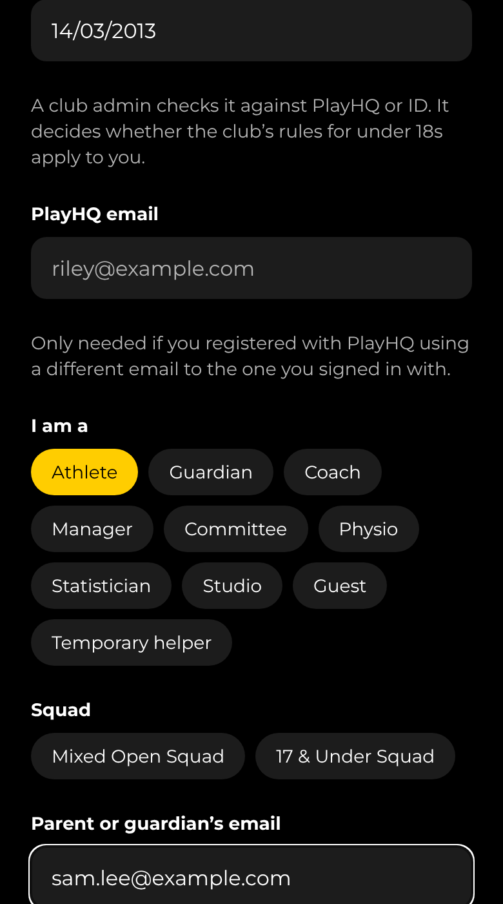

### Wait for approval

An admin checks your request against the club's PlayHQ registrations, sets your role and adds you
to your squad. Pull down on the home screen to check again, or tap **Edit request** to change
what you sent.

If the admin can't match you to a registration, they may ask you for the **6-digit code** shown on
your home screen. The code proves who you are, so the admin needs to get it from you in person or
over a channel they already trust. Only ever give it to a club admin, and never share it with
anyone else.

An athlete under 18 also sees **Ask your parent or guardian to join**, with the email they gave,
and the people they can talk to if anything worries them: the club's Child Safety Officer and
Complaints Manager, the governing body and helplines.

If your request isn't approved, the home screen says why and you can tap **Request again** after
fixing your details.

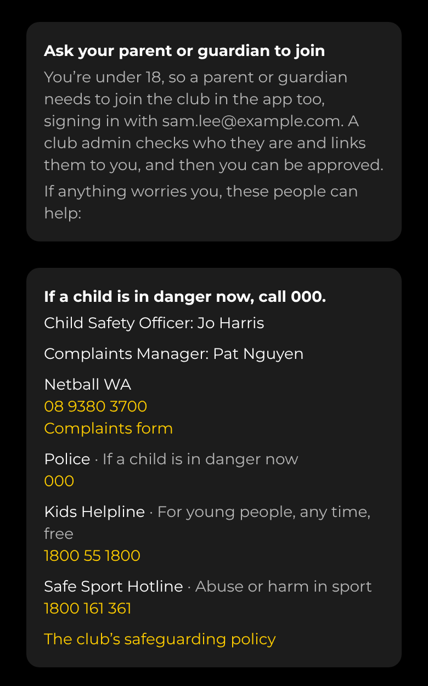

## 3. Things everyone can do

### The home screen

Once you're approved, the home screen is where everything starts. From the top:

- **To do**: things you need to do, such as your daily check-in, the code of conduct to accept, an
  award vote, integrity training due, goals to set or reflect on for a game, an injury past its
  expected return date, an injury a coach, manager or physio logged for you or your child, a KPI review to confirm or, for coaches, physios and the committee, an
  injury clearance to sign off, and, for coaches and managers, new or changed absences to review.
  Tap an item to go straight to it. Each item disappears once it's done. When there's nothing,
  it says "✓ You're all caught up." Your own [personal tasks](#your-own-tasks) come after the
  club's items.
  Anything overdue has a **red circle with !**, a red **Overdue** label and a red bar down its
  left edge, and moves to the top of the list. Anything due today or in the next 3 days has an
  **amber triangle with !**, an amber **Due soon** label and an amber bar, and comes next. This
  covers every to-do with a due date: your own tasks, integrity training, KPI reviews you write, game
  goals (due on game day) and an injury past its expected return date. For admins, Working With
  Children Checks work the same way (see [Admins](#10-admins)).
- **Cards** for the features your role uses: Messages, Daily check-in, Check-ins,
  Injuries, Attendance, Session plans, My attendance, Awards, Integrity training, Season KPIs,
  Concerns and Administration. Athletes fill in their own check-in from **Daily check-in**.
  Coaches read their athletes' check-ins from **Check-ins**, and committee members, physios and
  admins see the club's averages there. Parents and guardians see their child's check-ins from
  the cards for each child instead (see [Parents and guardians](#5-parents-and-guardians)). The
  Awards card shows while an award vote is open to you, and Session plans once a coach has shared
  one with you. A number in the club's colour means something new or waiting for you.
- **Coming up**: the next six events from your calendars, when the club uses the calendar. Tap
  **Full calendar** to see them all.
- **My squads and teams** (**My teams** in a club without squads): tap one to see who's in it. A
  team's page also has its [game goals](#game-goals) for its athletes and coaches. Committee
  members and admins only see this when they're in a squad or team, for example as a coach too.
- **Raise a concern**, for anyone signed in (see [Raising a concern](#raising-a-concern)).
- **Your details**, **Sign out**, **Switch club** and **Delete account** at the bottom.

Pull down on the home screen, the calendar and most lists to refresh them.

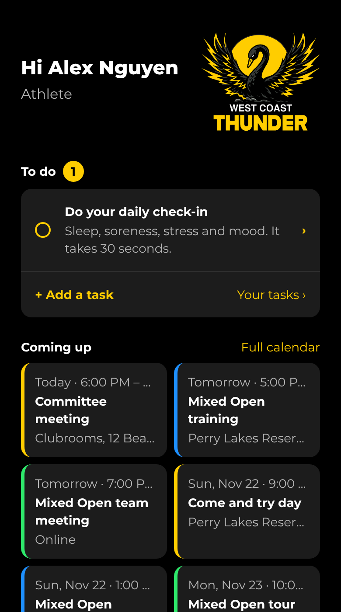

### Your own tasks

You can add your own tasks to your to-do list, such as "Wash my training kit" or "Book a physio
follow-up". They sit under what the club needs from you, marked **Personal**, soonest due first.
A task that's overdue or due within 3 days gets the red or amber warning and moves up the list
with the club's items (see [The home screen](#the-home-screen)).

- **Add one**: tap **+ Add a task** at the bottom of your to-do list and say what it is. To give
  it a due date, tap a day in the week (the arrows move a week at a time); leave it for no due
  date, or tap **Remove due date** to take one off. Then tap **Add task**.
- **Tick it off**: tap the circle next to it. It leaves your list, and **Undo** puts it back if
  you tapped by mistake.
- **Change or delete it**: tap the task, change it and tap **Save**, or tap **Delete task** and
  confirm with **Delete it**.
- **See them all**: tap **Your tasks** for everything still to do and the last 30 you ticked off.
  Tap a ticked-off task's circle to put it back on your list, or **Delete done tasks** (then
  **Delete them**) to clear them. **Add a task** is at the top of this screen too.

Only you can see your tasks. Your coaches, parents or guardians, the committee and the club's
admins can't, and a task can't be shared, assigned or sent to anyone. Members under 18 can add
tasks too, with the same privacy. You can have up to 100 tasks still to do. They're kept until you
delete them or your account.

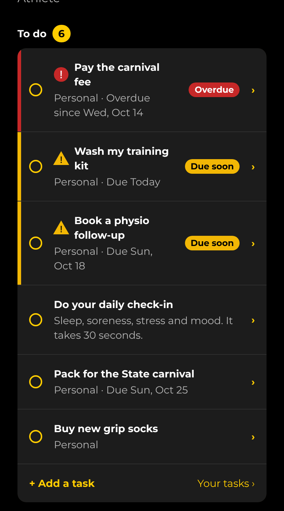
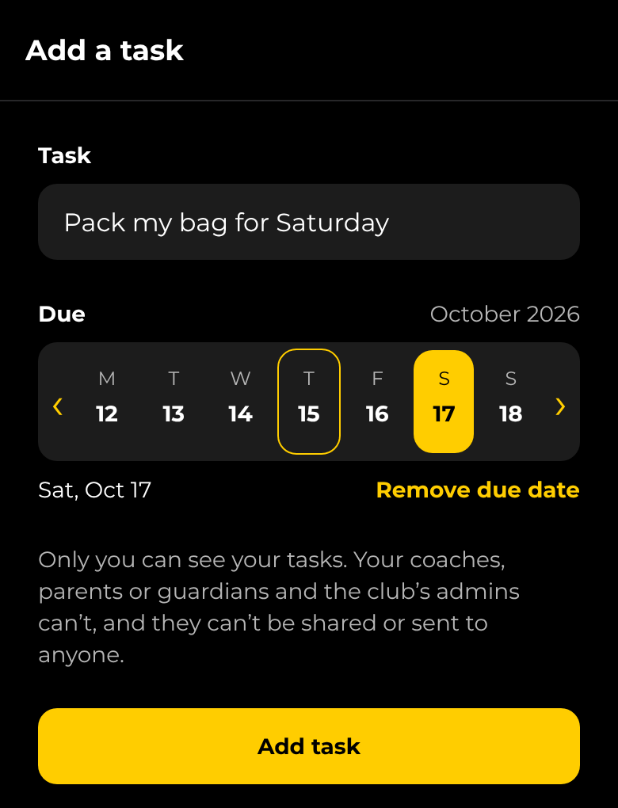

### Your preferred name

The home screen greets you by name. To be called something else, such as a nickname, tap **Your
details** at the bottom of the home screen, enter your **Preferred name** and tap **Save**. Leave it
blank to go back to your full name. Admins still see your full name, with your preferred name on
your member page, and can search for you by either.

Committee members and admins also see a **Title** field, for a position such as President,
Secretary or Treasurer. It shows under your name with your role, like "Committee · President".
Nobody else can set a title.

Coaches and managers get a title from the app instead, shown on **Your details** and under your
name, like "Coach · Head Coach, Open A" or "Manager · Manager, 17 & Under". It names the teams you
coach or manage. Until you're in a team, it names your squad. If you coach more than one team, it
lists them all, like "Assistant Coach, Open A and Open". Only an admin can change whether you're a
head or assistant coach.

### To-do notifications

On an installed app, your phone gets a notification when something new appears on your
[to-do list](#the-home-screen), such as a clearance to sign off, a survey to answer, an award vote opening, training
to complete or, for athletes, the day's check-in. Tap the notification to go straight to it. The
first time, your phone asks whether the app may send notifications: tap **Allow**.

- Notifications aren't sent between 8 pm and 7 am. Anything still on your list at 7 am arrives
  then, with several to-dos in one notification.
- Each to-do is sent once. Daily items, such as the check-in, come once a day while they're
  still to do; admins' child-safety and records follow-ups come once a month. A new concern or
  a newly reported absence sends again even if the earlier one is still on your list.
- Your own [personal tasks](#your-own-tasks) and admins' affiliation items stay on the
  home screen and aren't sent.
- Notifications can show on a locked phone, so they never include injury details or reviewers'
  notes. Open the app to see those.
- If you belong to more than one club, tapping a notification opens the club it came from.

To stop them, tap **Your details** at the bottom of the home screen and turn off **To-do
notifications**. It saves straight away and only changes your own notifications. If your phone is
blocking notifications from the app, Your details says so and **Open phone settings** takes you
there to allow them.

### Messages

Messages from your coaches, managers, captains, the committee and the club arrive in
**Messages**. Unread messages have a dot in the club's colour, and the home card shows how many
are new. Opening a message marks it as read, and the
sender can see that you've read it. **Report this message** on any message raises a concern
about it (see [Raising a concern](#raising-a-concern)).

Who a message went to is shown under the sender's name, for example "To Mixed Open Squad",
"To Physios" or "To Everyone in the club". Messages from **Club safeguarding** tell a family about a change, such
as a parent or guardian linked to or unlinked from a child.

Guests and temporary helpers don't get messages. Physios get messages sent to the Physio role and to the squads and teams
they're in, and messages sent to everyone in the club only when an admin turns that on.

If the club removes old records, the text of a message older than the club's keep period for
messages (a longer one when a child sent or received it) is replaced with "This message was removed after the club's keep period." Who sent it, who it went to
and who read it stay (see [Keeping records](#keeping-records)).

### Surveys

The committee and admins send surveys to everyone, a role, or a squad or team. Coaches and
managers send surveys and quick polls to their own squads and teams, and captains and vice captains
send polls to theirs, for example to find a night everyone is free. A survey you need
to answer shows in your to-do list until you answer it or it closes, and the **Surveys** card on
the home screen counts how many are waiting.

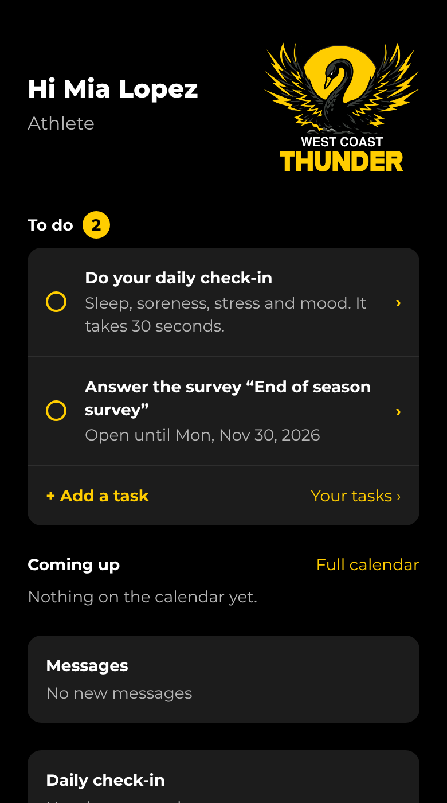

Each survey says at the top how your answers are kept:

- **Anonymous**: nobody can see who gave which answers, not whoever sent it and not admins. The app
  records only that you've answered, so you aren't reminded again, and never which answers were
  yours. Once sent, even you can't see them again.
- **Named**: your name goes with your answers, and you can read them back after you send them.
- **Name optional**: you choose **Give my name** or **Don't give my name** before you send.

Answer each question and tap **Send answers**. Questions marked (optional) can be skipped. You
can't change your answers once they're sent, and you can answer each survey once. The survey says
who sees answers, and it's never other members:

- a survey from the committee or an admin: whoever sent it, the committee and admins;
- a survey from a coach or manager: whoever sent it, plus admins for anything longer than a quick
  poll or with a written answer, and the committee too if the coach shared it;
- a poll from a captain: the captain who sent it and the squad or team's coaches and managers.

A survey marked **Everyone must answer** says so at the top and in your to-do list. A coach,
manager or captain can also share a poll's totals with the squad or team. Then everyone it went to,
and their parents or guardians, sees **Results for the team** on the survey once results show: how
many picked each choice and the average rating. It never shows names, written answers or who has
answered.

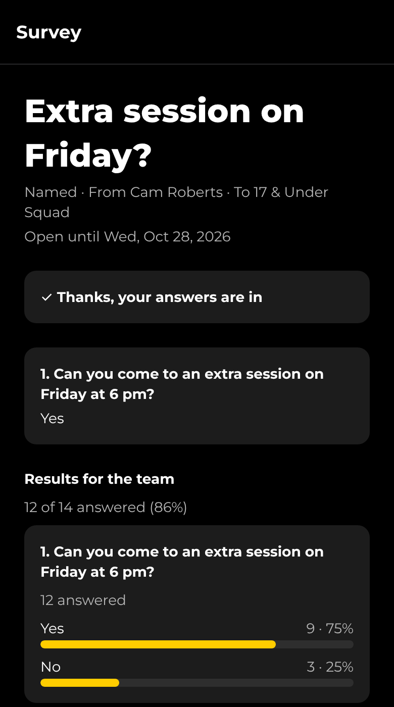

Athletes under 18 see a reminder on anonymous and name-optional surveys: nobody can reply to
something written without a name, so if something is worrying them they should tell a coach or
parent, or use **Raise a concern**.

 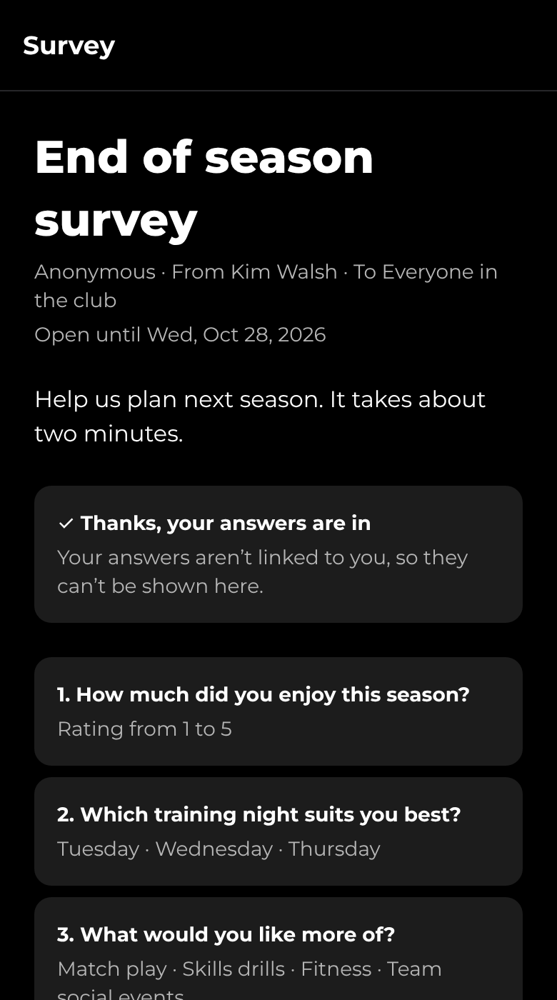

Guests and temporary helpers don't get surveys. Physios get surveys sent to the Physio role and to
the squads and teams they're in, and surveys sent to everyone only when Physios get club messages
is on.

### Calendar

The calendar shows events from the club's Outlook calendars. You see the club calendar, plus the
calendars of the squads and teams you belong to. Committee members and admins also see the
committee calendar.

- **List** shows a week strip and the events after it, grouped by day. Use the arrows to move
  between weeks, and **Load more** at the bottom to see further ahead. The list starts today, or at
  the week you move to.
- **Month** shows a month grid with that month's events below it. Dots under a day are events,
  coloured by calendar. Tap a day to see only its events, and tap it again (or **Show all of** the
  month) to see the whole month. Days from the months either side are greyed out.
- Switching from **Month** to **List** keeps the month you were looking at: the list starts at the
  1st of that month (or today, for this month).
- You can look back 12 months (to the start of that month) and ahead 12 months. The arrow fades
  out when you reach either end.
- The chips (**All**, **Club**, and each of your squads and teams with something on in that
  period) filter which calendars are shown.

Your teams' matches from PlayHQ appear in the calendar too, for example "Mixed Open A v Rockets"
with the venue and court. A match with no time yet, which includes most byes, shows as an all-day
event. Match times follow PlayHQ, so a changed time shows once an admin refreshes the fixtures.

Tap an event to see when and where it is. Tap the location to open it in maps, or **Copy** to copy
the address.

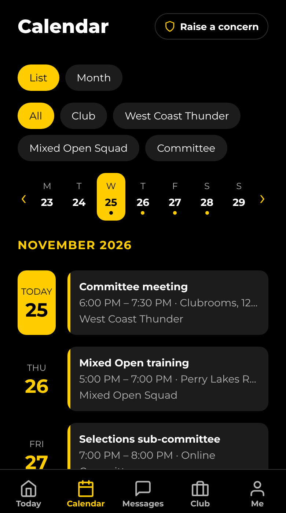
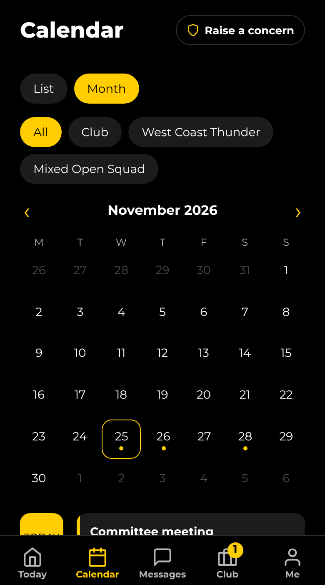

### Squads and teams

Tap a squad or team under **My squads and teams** to see everyone in it, with their position:
Head Coach, Assistant Coach, Manager, Physio, Athlete, Final team athlete or Training partner. Captains,
vice captains and club captains are marked next to their position. When Game goals is switched on,
a team's page also shows its [game goals](#game-goals) for its athletes and coaches. In a club
without squads the list is called **My teams**.

### Club awards

If the club has turned on awards, when it runs an award vote that includes you, it appears in your to-do list and on the
**Awards** card. Who can vote depends on the award: for example, every member votes for Volunteer
of the year, and athletes vote for their own team's Players' player. When an award has a winner for
each squad or team, you only see and vote for members of your own squad or team, even if it is open to
every member; committee members and admins vote in every squad's and team's part of such an award when it names them. Club-wide awards are open to everyone, or to the roles the club chose. Parents and
guardians, physios, statisticians, guests and temporary helpers don't vote, because they needn't be
club members. Someone with one of those roles who is also an athlete, coach, manager, committee
member or admin votes in that role.

1. Tap the vote. It shows the award, what to think about, and when voting closes.
2. Tap who you're voting for. For a 3-2-1 vote, tap three people in order: first place gets 3
   votes, second 2 and third 1. Tap someone again to take them off.
3. Tap **Vote**.

You can't vote for yourself. You can change your vote until it closes: open it again, change your
picks and tap **Change my vote**. Votes are secret. Nobody, admins included, can see who you voted
for, and only admins see the results.

Match awards, such as a coach's MVP, open for voting when each match starts and stay open for
the time the club set for that award (two days unless the club changed it), never past the
award's closing date. Each vote shows when it closes.

### Integrity training

If the club has turned on integrity training, each season it lists the integrity training its members must complete, such as Sports
Integrity Australia's Safeguarding in Sport or anti-doping courses, with a due date. Training is
set for roles (for example athletes and coaches), across the whole club or only some squads and
teams, so junior and senior athletes can have different courses.

Training you still need to complete shows in your **To do** list with its due date, and on the
**Integrity training** card. If you have more than two courses outstanding, the to-do list shows
them as one item with the soonest due date that says whose they are, such as "Complete 3
integrity training courses for you and Jordan"; open it to see each course. To complete it:

1. Tap **Open the course** and do the course on the provider's website. Download or photograph
   the certificate of completion at the end.
2. In the app, tap the to-do item or **Add a certificate** on the Integrity training screen.
3. Under **Certificate achieved**, tick each course the certificate shows you completed (or, for a
   parent uploading for their child, that the child completed). If one
   PDF holds several certificates or badges, tick them all and attach it once: each ticked course
   is checked with that file.
4. Choose the day you completed it, attach the certificate (a PDF or photo, up to 10 MB), add a
   note if you like and tap **Send for checking**.

The training then shows **Waiting to be checked** until a committee member or admin approves it
(**✓ Approved**). If they send it back, you'll see their note and the to-do comes back so you can
upload a new certificate. Certificates can't be removed once they're sent, so the club keeps a
record. Overdue training says **Overdue since** its due date.

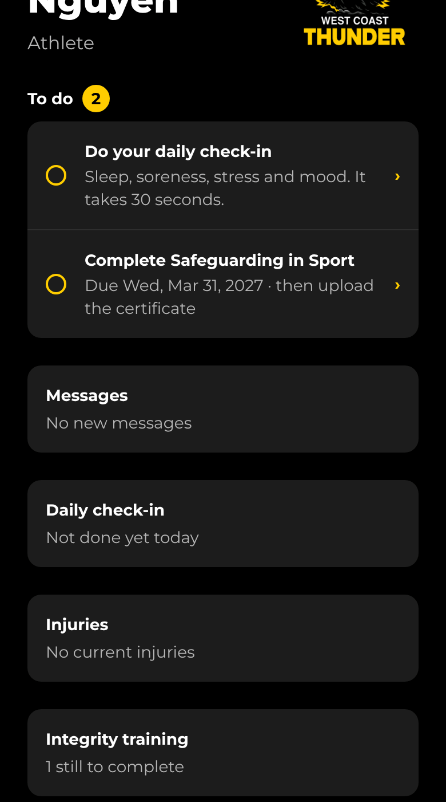

### The code of conduct

If the club asks members to accept its code of conduct in the app, every member accepts it once a
season. Clubs that already have members sign it another way, such as in their PlayHQ registration,
can leave this off. When it's on, your to-do list says **Accept the code of conduct** until you have. Open it, tap **Read the code of conduct**,
then tap **I agree** to accept the words shown:

> I've read the club's code of conduct and I'll follow it at training, at games and online.

The club keeps your name, the date, the words and the policy version as its record, and keeps it
if you later delete your account. Each season's
acceptance is listed under **Accepted** on the same screen. When the club starts a new season, the
to-do comes back.

Athletes under 18 with a parent or guardian linked don't accept it themselves: a verified parent or
guardian goes through it with them and accepts it for them (see [The code of conduct for your
child](#the-code-of-conduct-for-your-child)). Until an admin has verified one of their parents or
guardians, nobody can accept it for them: the athlete's code of conduct screen and the admin's
list both say **Waiting for verification**. Guests aren't asked, and temporary helpers accept it
when they join.

### Season KPIs

When the club turns on **Season KPIs**, coaches, managers and athletes can be given measures of
what they're working to achieve by the end of the season. They're different from game goals, which
are about one game. Each belongs to one person in one squad or team for that season.

**A development plan for assistant coaches.** Season KPIs are how a head coach works with each
assistant coach on their coaching development: the head coach sets their KPIs or OKRs for the
season, they record progress, and the two talk through each review. The committee and admins see
every assistant coach's plan, its progress and its reviews, can add to it, and admins can save them
all as a PDF for the board.

- **Who sets them.** The committee and admins set them for the coaches and managers of any squad
  or team. A head coach sets them for the assistant coaches of their squad or team. The coaches of a
  squad or team set them for its athletes.
- **KPI or OKR.** Whoever sets one chooses each time. A **KPI** is one measure with a target, such as
  "Squad attendance of 85%". An **OKR** is an objective, such as "Become a reliable goal shooter",
  with up to 5 **key results** that show it's been achieved. Each measure is either **a number**
  with a target and an optional unit and starting point (marked **Lower is better** for something
  like turnovers), or **done or not done**. A person can have up to 10 KPIs and OKRs in a squad or
  team.
- **Progress.** The person and whoever can set their KPIs both record where each measure is up to
  during the season: a number, or **Mark as done**. A bar shows how close it is to the target, and
  the last update shows who made it and when.
- **Results.** At the end of the season, whoever sets the KPIs records each one's **Result**:
  **Met**, **Partly met** or **Not met**, with an optional note. The person can't record their own
  result.
- **Reviews.** An admin sets the season's review dates, such as a mid-season and an
  end-of-season review (see [Season KPI reviews](#season-kpi-reviews)). From a week before each
  date, whoever set a person's KPIs has **Write …'s KPI review** on their to-do list until they
  write it. Each reviewer writes their own note (a head coach and the committee can both review an
  assistant coach), and the person sees every note. The person then has **Confirm your KPI review was
  done** on theirs, and taps **Confirm this review was done** once they've talked it through. If a
  note is changed afterwards, they confirm that one again. The person can also add **Your own view** at each review; whoever sets their KPIs
  can remove it if it shouldn't be there.
- **Past seasons.** When an admin archives a season, its KPIs, results and reviews stay, under
  **Past seasons**, and can be read but not changed. KPIs don't carry over to the next season.

Open **Season KPIs** on the home screen. **Yours** lists your own KPIs in each squad or team you're
in; below are the people you set KPIs for, by squad or team, with how many results and reviews are
in.

Who sees them: an athlete's KPIs are seen by the athlete, their coaches, their parents or
guardians if they're under 18, and admins. Teammates never see each other's, and the committee
doesn't see athletes'. A coach's or manager's KPIs are seen by them, the committee and admins, and
an assistant coach's by their head coach too. Athletes and parents never see coaches' or
managers'.

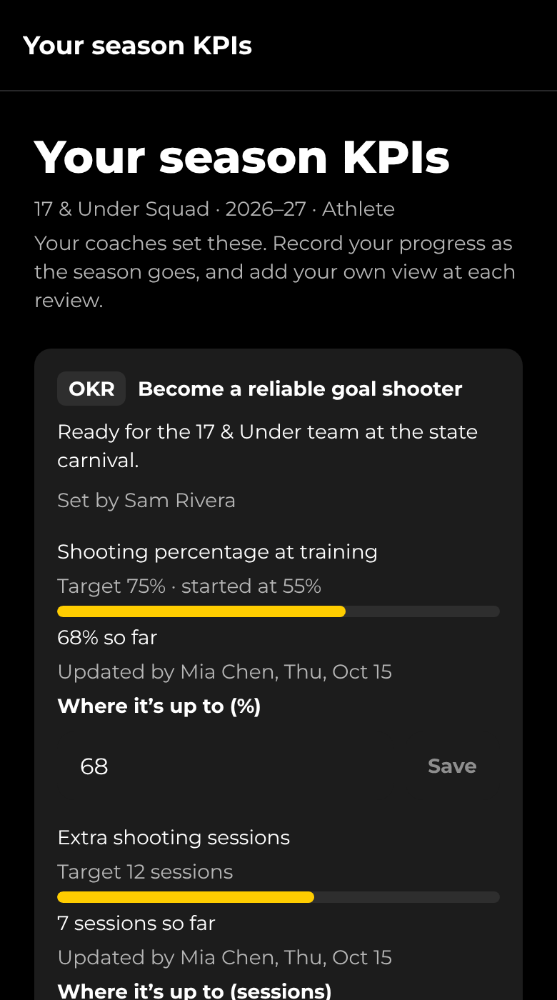

### Raising a concern

**Raise a concern**, at the bottom of the home screen, is for anyone signed in: athletes, parents,
coaches, guests and people still waiting for approval. Use it for anything that worries you about a
child or about how someone at the club behaves. You don't need to be sure. The same link is on the
daily check-in screen, on every injury and, as **Report this message**, on every message, so the
concern notes where it came from.

The screen starts with who to talk to: the club's **Child Safety Officer** and **Complaints
Manager**, the sport's governing body if the club has added it, and services anyone can call
(Police on 000, Kids Helpline and the Safe Sport Hotline). Tap a number to call it.

Then say what happened, and optionally who it's about (pick a coach, manager, physio, committee
member, admin or temporary helper by name, or describe anyone else in your own words), when it happened and whether a child's safety is involved. Choose **Show my name** or
**Don't show my name**. If you hide your name, the people who look into it won't see who you are,
so they can't ask you more; the app still keeps it with your account so you can follow it. If you
show your name, say whether they can contact you and how. Tap **Send to the club**.

The Child Safety Officer, the Complaints Manager and admins see it straight away, but the person
it's about never does, even if they're one of them. **Concerns you've raised** on the same screen
shows each one and where it's up to: Received, Referred, Being looked into or Closed.

### Deleting your account

**Delete account** at the bottom of the home screen permanently deletes your account at the club
you're in: your profile, your squad and team places, guardian links, your personal tasks and your
messages inbox. Messages you sent to a group stay with the people who received them. Tap
**Delete my account**, then **Delete my account permanently** to confirm. If you sign in again
later, you'll need to ask to join again. Now and then the club has to keep an account for a legal
matter; then the app says it can't be deleted at the moment and asks you to contact a club admin.

The club keeps your injury records after you leave, where only the committee and admins can see
them, for its keep period for injuries (7 years unless the club chose 3, 5 or 10), counted from
when you leave, and then deletes them. Nothing is deleted while the club has **Remove old records**
switched off. Clearance documents may go sooner, after the club's keep period for injury documents. It also keeps, under your name, your code of conduct acceptances,
any concerns you raised (unless you hid your name) and, if you coach or manage, your season KPIs
and their reviews. Deleting your account doesn't
change your PlayHQ registration or club membership, or your account at any other club in
FirstPass HQ.

## 4. Athletes

Athletes see Messages, Daily check-in, Injuries and My attendance on their home screen, plus
Session plans once a coach has shared one, Awards while a vote is open, Integrity training and
Season KPIs when the club uses them, their calendar and squads. Game goals are on each team's
page.

### Daily check-in

Once a day, answer four questions on a scale of 1 (bad) to 5 (good):

- How did you sleep?
- How does your body feel?
- How stressed are you?
- How's your mood?

You can add a note for your coach, such as "tight calves after Sunday's game". The line under the
note says who can read it: your coaches if you're 18 or over; if you're under 18, your parents or
guardians, and your coaches once a parent or guardian has given consent. Tap
**Save check-in**. It takes about thirty seconds. You can change today's answers until the end of
the day with **Update check-in**.

Your coaches see your answers so they can adjust training (if you're under 18, once a parent or
guardian has given consent). A score of 2 or less on any question
flags you so a coach knows to check in with you. The club's Child Safety Officer also sees that
you were flagged, the day and your lowest score, but never your answers or note, so someone still
notices if you're not in a squad or team (if you're under 18, once a parent or guardian has given
consent). Below the form you can see your last two weeks, with low scores marked.

Until you've checked in, "Do your daily check-in" stays in your to-do list.

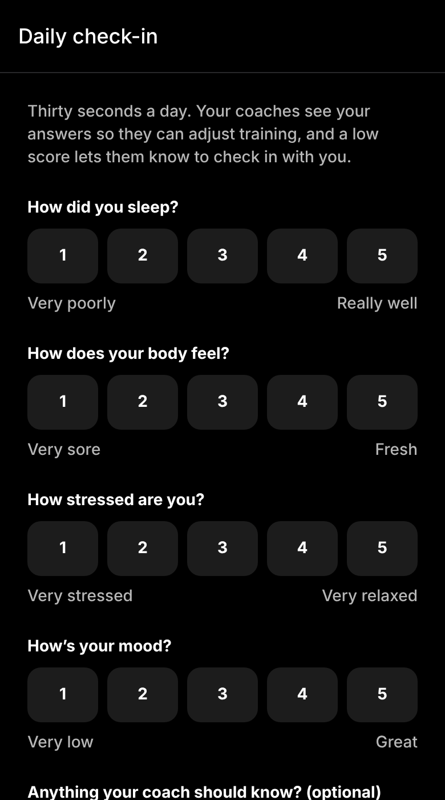
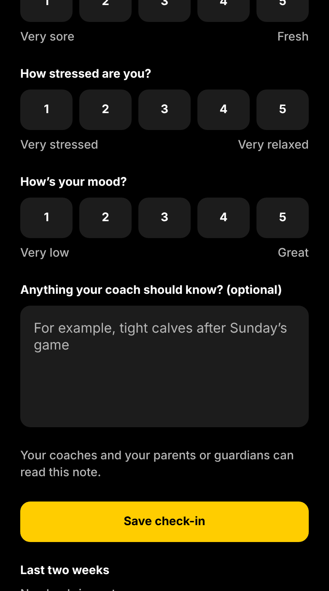

### Game goals

**Game goals** uses the club's PlayHQ fixtures, which belong to teams, so they start once you're
picked for a team. Tap your team under **My squads and teams** on the home screen: its page shows
the team's games at the top and the people in it underneath.

- **Before a game:** in the 7 days before your next game, open it under **Next game** and add
  your goals, up to 5, such as "win 3 centre pass receives each quarter". Only your next game is
  open for goals. You can change or remove your goals until the game starts (until the end of
  that day if PlayHQ had no start time). Your coaches can add
  goals for you too; those show "set by Coach …" and only a coach can change them. Until the game
  has a goal, yours or a coach's, "Set your goals for …" stays in your to-do list.
- **After the game:** about 90 minutes after the start (the next day if PlayHQ had no start time),
  the game moves to **Played games**. For each goal, pick **Achieved**, **Partly** or **Not yet**,
  write a few words about how it went and tap **Save reflection**. You can update it later. For a
  week after the game, "Reflect on …" stays in your to-do list until every goal has a reflection,
  with an item for each game you've played that week. Your coaches' comments show under each goal.
- **Played games** lists this season's games for that team, newest first, 10 at a time; tap **Load more** for
  older ones. Games drop off the list when an admin archives the season.

Your coaches can see your goals and reflections. If you're under 18, your parents or guardians can
see them too, but only you and your coaches set goals, and only you reflect on yours. Bye rounds are
left out.

**Team goals** that your coaches set for the whole team show at the top of the game,
above your own goals. After the game you'll see how the coaches think the team went on each one.
Everyone in the team has a say: tap **Comment** under a team goal, write what you think or what
you'll do to help, and tap **Add comment**. You can comment before or after the game. Your name
shows on your comment, and the team's athletes and coaches, the athletes' parents or guardians and
the club's admins can read it. The team's manager and physio can't. Tap **Remove** on your own comment to
take it down; your coaches can remove any comment.

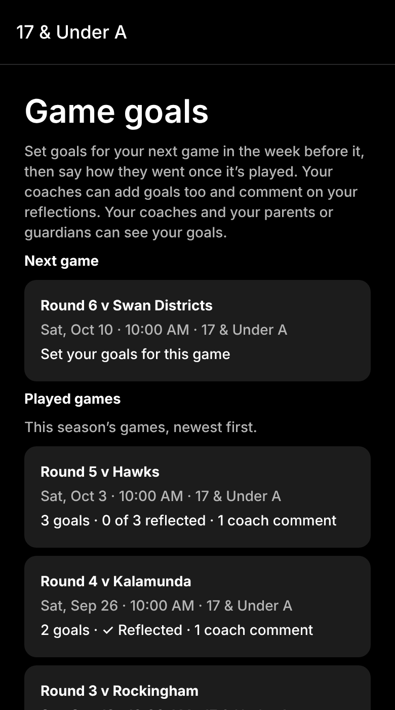

### Your season KPIs

If the club uses [Season KPIs](#season-kpis), your coaches may set you KPIs or OKRs for the season
in your squad or team. Open **Season KPIs** on the home screen and pick the squad or team under
**Yours**. Type where you're up to on a number and tap **Save**, or tap **Mark as done**, as the
season goes. At each review date, read what your coach wrote, tap **Confirm this review was done**,
and add **Your own view** if you want to. Your coaches record the result at the end of the season.
Your coaches and the club's admins see your KPIs and, if you're under 18, so do your parents or
guardians. Your teammates can't.

### Reporting an injury

1. Tap **Injuries**, then **Report an injury**.
2. Say where the injury is, what happened and when.
3. Add any restrictions (for example "no jumping") and choose when you expect to be back. It's
   required, but a best guess is fine; a physio update can change it.
4. If it might be a concussion (a knock to the head, face or neck, or any sign of concussion),
   switch on **Possible concussion**. See [Concussion](#concussion).
5. Tap **Report injury**.

Your coaches, the physios who look after you and the committee can see it straight away. If
you're under 18, they see it only once a parent or guardian has given consent for injuries, and
only committee members cleared to work with children see it; until
then only your parents or guardians and the club's admins see it, and nobody can clear you to play,
because a coach or physio has to see the injury to endorse your clearance. So ask a parent or
guardian to give consent for injuries.
An injury isn't an absence: injured
athletes are still expected at training to support the team. Until you're cleared, whoever takes
attendance sees **Injured** and your expected return date next to your name, and nothing else about
the injury.

### When a coach, manager or physio logs your injury

If you're hurt at training or a game, one of your coaches, managers or physios may log the injury
there and then. You and your parents or guardians are told straight away: your to-do list shows
**Look at the injury Casey Coach logged for you** until you open it. The injury is then yours like
any other: you add the physio's updates and ask for clearance. The history shows who logged it and
their role, for example "Casey Coach (coach)". Logging it doesn't change who sees it.

### Updating an injury

Open the injury to see its details and history. While you're injured:

- **Add physio update** records what the physio said, any change to restrictions or your expected
  return date (which is required), and optionally a physio report (up to 10 MB). Adults can attach a PDF or a photo.
  If you're under 18, attach the letter or report as a PDF or a photo of the letter, and switch
  on **This is a photo of the letter** before sending a photo. Never send a photo of the injury
  itself (see [Injury documents and photos](#injury-documents-and-photos)).
- A physio who looks after you can add their own updates too, shown with "(physio)" after their
  name.
- If your expected return date passes, your to-do list reminds you to ask for clearance or change
  the date.

### Getting cleared to play

When you're ready to return, tap **Ask for clearance** and attach **proof of clearance**, such as a
letter from your physio or doctor. Proof is required. The people who sign it off view it inside the
app, where they can zoom in to read it.

Two people then sign off, in order:

1. **One of your coaches, or a physio who looks after your squad or team (or the Head Physio),
   endorses it** (status "Waiting for a coach or physio").
2. **A committee member accepts it** (status "Waiting for the committee"). It must be someone other
   than the person who endorsed it. For an athlete under 18, it must be a committee member with a
   current Working With Children Check or a parent volunteer exemption.

If the club has turned on **Only physios endorse clearances**, only a physio endorses it.

Nobody signs off their own clearance or their own child's, so a coach or committee member who is
also your parent or guardian leaves it to someone else.

When it's accepted, the injury shows **Cleared to play**. If a coach, a physio who looks after
you or a committee member sends it back, you'll see their note in the history; fix what they ask
and ask for clearance again.

Nobody can remove a document once it's sent, so the record can't be altered later. If the club
removes old records, the files of a cleared injury are removed after the club's keep period: 1
year after it was cleared unless the club chooses 90 days or 3 years. The injury, its history, each document's name, who added it and who
viewed it all stay, and the document shows when its file was removed.

Under each document you see everyone who has opened or shared it, with their role and when (for
example "Viewed by Casey Coach (coach)"), and, for a photo, who confirmed what it shows. Your parents or guardians and the club's admins see the
same list.

### Concussion

Any knock to the head, face or neck, or any sign of concussion, is treated as a possible
concussion: **if in doubt, sit them out**. Whoever reports or logs it switches on **Possible
concussion**, and a physio can mark it later in an update. The injury then shows **Possible
concussion** at the top, and follows
[Netball Australia's concussion policy](https://netball.com.au/news/update-netball-australias-concussion-protocols):

- **See a doctor.** The athlete doesn't train or play until they're cleared.
- **Clearance waits.** You can't ask for clearance until 21 days after the injury (12 days if the
  club runs an elite program and chose 12). The injury shows **Clearance from** with the first day.
- **A doctor's clearance.** Attach the doctor's clearance and switch on **This is a doctor's
  clearance**. The history shows "Confirmed as a doctor's clearance".
- **Only a physio endorses it**, never a coach. A committee member then accepts it as usual.
- **Only a physio can rule it out**, by switching **Possible concussion** off in an update once a
  doctor has said it isn't one. The athlete and their parents or guardians can mark a concussion but
  can't unmark one.

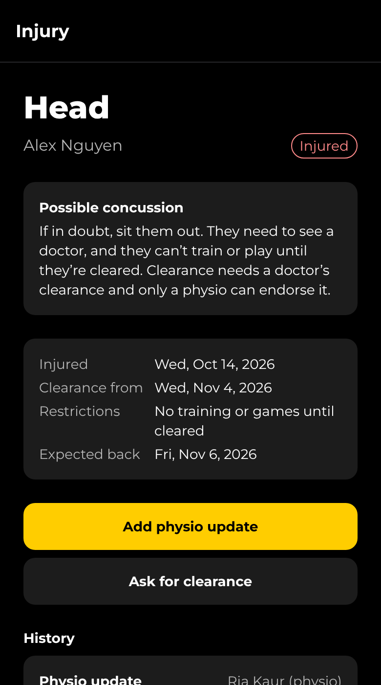

### Captains

If you're a **club captain**, a squad or team **captain** or a **vice captain**, you can send
messages:

- **Club captains** can send to **Everyone** in the club.
- **Captains and vice captains** can send to their own squad or team, like its coaches.

Open **Messages**, tap **New message**, choose who it goes to, write it and tap **Send**. You'll
see who has read it in **Sent**. Club admins can read every message. If you're under 18, your
parents or guardians get a copy of every message you send.

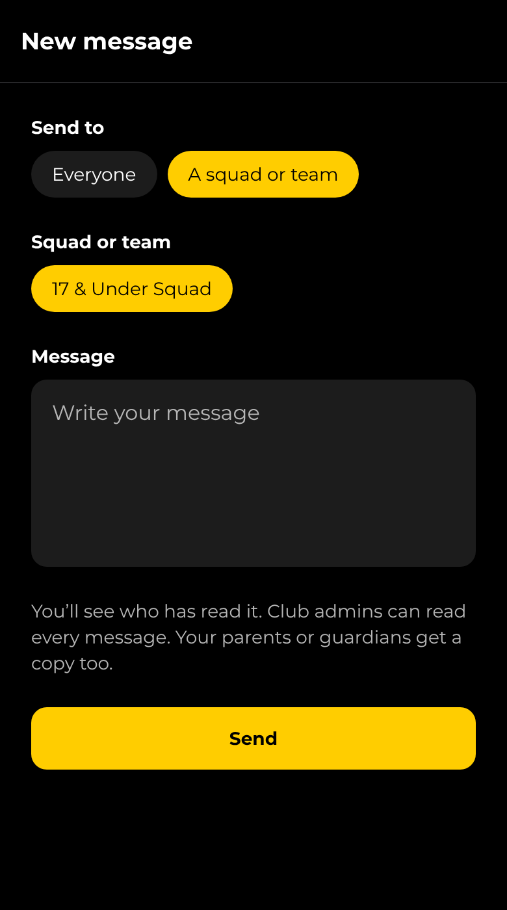

Captains and vice captains can also send a poll to their own squad or team, for example to find a
night everyone is free for a team dinner or to check who's coming to a social event. Open
**Surveys** from the home screen, tap **New survey**, choose your squad or team, and add up to 5
questions, each **One choice** or **Several choices**. Choose **Named** to see who picked what and
who hasn't answered yet. Choose **Everyone must answer** if you need an answer from everyone, and
**Share results with the squad or team** to let your teammates see the totals (see [Surveys and
polls for your squad or team](#surveys-and-polls-for-your-squad-or-team)). Your squad or team's coaches and managers see your poll and its results
too, and can close it. If you're under 18, your parents or guardians get a copy of your poll.
**My groups** lists the polls you've sent while you're captain. You read the results in the app;
only your coaches and managers can download them. Polls are on unless an admin switches off
**Captains' polls** in Club settings.

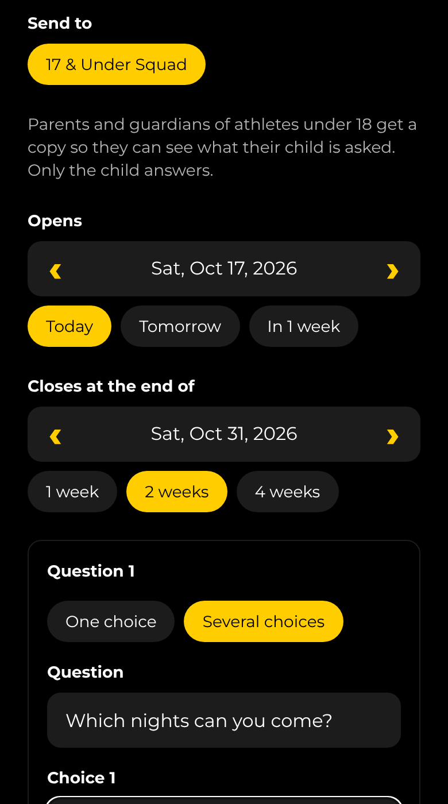

### Your attendance and absences

**My attendance** on your home screen shows every session your coaches took attendance for, and
whether you were marked **Present** or **Absent**, over 4 weeks, 3 months or 12 months. You see only
your own marks, not anyone else's. If you're under 18, your parents or guardians see the same.

If you'll be away, tap **Report an absence**, choose the first and last day, pick a reason from your
club's list (such as **Planned holidays**, **Personal illness**, **Caring duties** or **School or uni
exam**), add details if you like, and tap **Report absence**. You can report up to 12 months ahead,
or up to 14 days after if you forgot, for up to 3 months at a time. Your coaches and managers see it
when they take attendance, so they know you're not missing without a reason, and the committee
and admins see it too. Leave medical details
out of the details. An injury isn't an absence: report it under **Injuries**, and still come along
to support the team. **Withdraw** takes an absence back if your plans change. An
absence your parent or guardian reported shows here too, and you can withdraw it.

### Session plans from your coaches

When a coach shares a session plan with your squad or team, **Session plans** shows on your home
screen, with a number for plans you haven't opened yet. Your phone doesn't get a notification for
it: only admins' phones are set up for the app's notifications. Each plan shows the session, the day, who
wrote it, and any photos or files, such as a drills sheet. Plans are read only: nobody can reply to
them or react to them. If you're under 18, your parents or guardians can read the same plans.

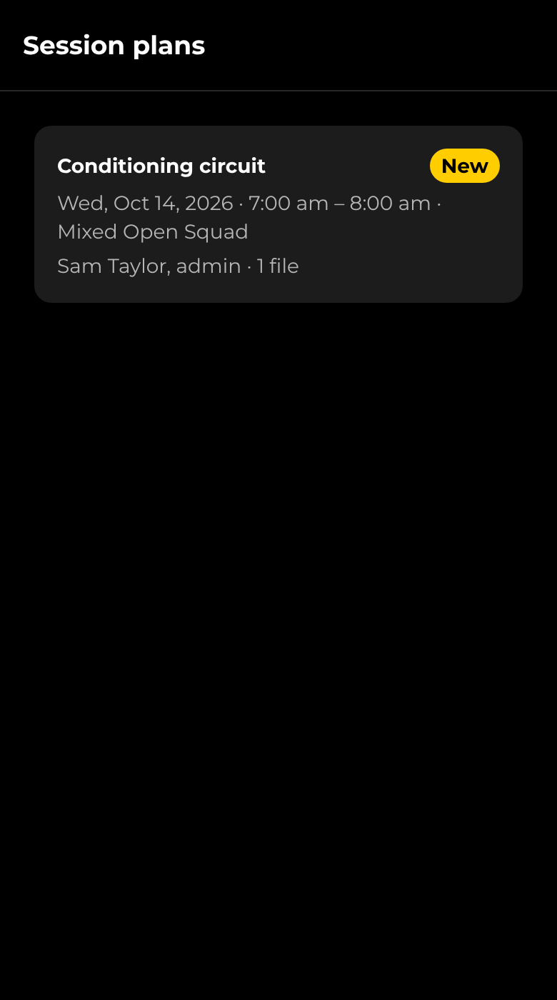

## 5. Parents and guardians

Parents and guardians of athletes under 18 sign in with their own Google account and ask to join
as **Guardian**, entering the email they used to register their athlete with PlayHQ. An admin
verifies who you are (against PlayHQ, by sighting your ID, or with the 6-digit code on your home
screen, shown under **Confirm who you are** until you're verified) and then links you to your
athlete. Every athlete under 18 must have at least one verified guardian before they're
approved. A guardian can be linked to more than one athlete, and an athlete can
have more than one guardian.

Whenever a guardian is linked to or unlinked from your child, you and your child's other guardians
get a message from **Club safeguarding** in **Messages**, naming the guardian and the admin who made
the change. Your child gets it too if they're 13 or over. If it isn't right, tell the club's Child
Safety Officer or an admin.

The home screen shows who you're the guardian of. Until an admin links you, it says so.

### Giving consent

Once you're linked and verified, **Consent** on your home screen lists each child under 18, and
your to-do list says **Give consent for** them until you have. Open it to choose who else sees two
kinds of information about your child:

- **Daily check-ins**: their answers and notes are seen by their coaches. When they score low,
  the club's Child Safety Officer sees the day and the lowest score, never their answers or notes.
- **Injuries and health information**: their injuries, restrictions, physio updates and documents
  are seen by their coaches, the physios who look after them and the committee members cleared to
  work with children, who sign off
  clearances.

Until you give a consent, only your child and you see their check-ins, and only your child, you
and the club's admins see their injuries. Their coaches, physios and the committee don't see your
child's check-ins or injuries at all, and an injury can't be cleared to play, because clearance
starts with a coach or physio endorsing it. Whoever takes attendance still sees that your child is injured and when
they're expected back, so they know to expect them at training, but nothing more. Links to the club's policies are on the same screen. Tap **Save**.

You can change your mind at any time: switch a consent off and save. Every consent given and
withdrawn is kept with who did it, when and the policy version, and listed under **History**. Any
of your child's parents or guardians can give or withdraw consent. A consent you gave stays in
force if you later delete your account, kept under your name, until another parent or guardian
withdraws it. Photos of injuries are separate:
you're asked each time (see [Injury documents and photos](#injury-documents-and-photos)).

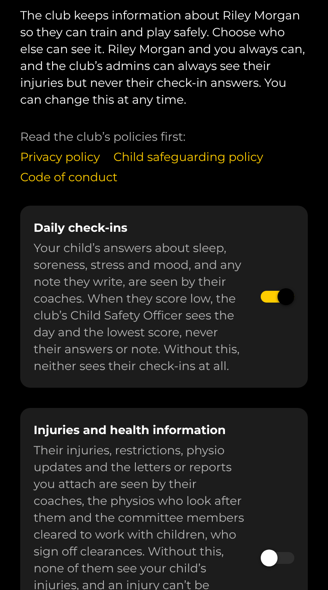

### The code of conduct for your child

If the club asks members to accept its code of conduct in the app, each season a verified parent or
guardian accepts it for each child under 18, and their own to-do list shows **Accept the code of conduct for** your child until one of you
has. Read it, go through it with your child, then tap **I agree** to accept:

> I've read the club's code of conduct and gone through it with my child. We'll both follow it at
> training, at games and online, and I'll follow it as a parent or guardian.

Once one parent or guardian has accepted, it's done for the season for all of them, and the record
shows who accepted it and when. Until an admin has verified you, you can't accept it for your
child, and your child's screen says **Waiting for verification**. If you also coach, manage or sit on the committee, you accept it
for yourself as well.

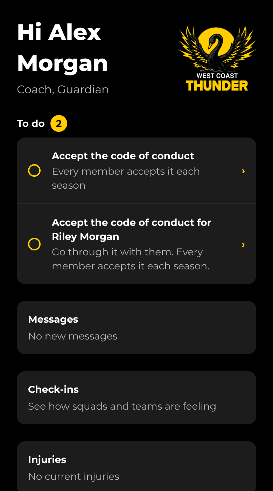

### Who has viewed your child's records

Once you're verified, **Who has viewed their records** on your home screen lists each child under
18. Open it to see everyone at the club who opened your child's injuries, injury documents,
check-ins, game goals, season KPIs, named survey answers or member record in the app: their name, their role (coach, physio, admin,
committee or safeguarding contact, or member for anyone else, such as a manager reading named
survey answers), what they opened and when, newest first. Sharing an injury
document is listed too. Your child's own views and those of their parents and guardians aren't
listed, and opening the same thing again within 30 minutes counts once. The list stops being
yours to see on your child's 18th birthday. If anything on it worries you, raise a concern (see
[Raising a concern](#raising-a-concern)).

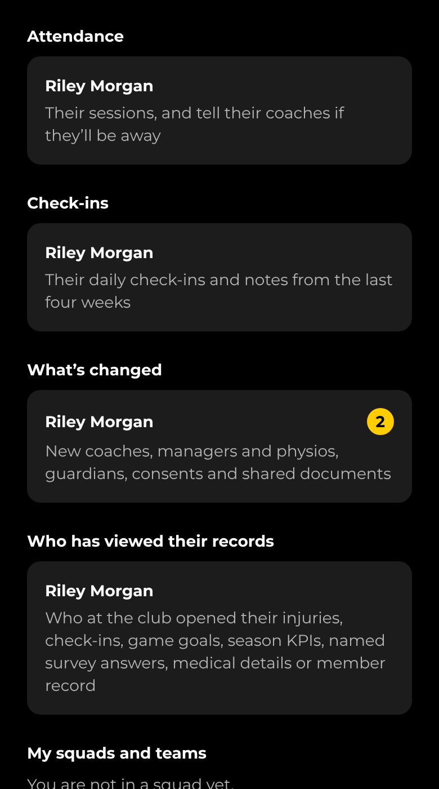
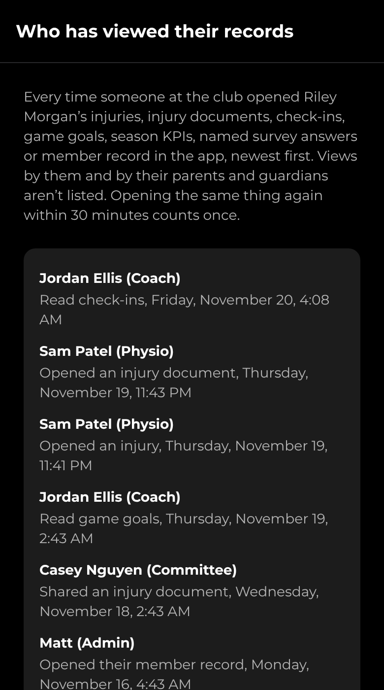

### Your child's attendance

**Attendance** on your home screen lists each child under 18. Open it to see the sessions their
coaches took attendance for in the last 4 weeks, 3 months or 12 months, and whether your child was
marked **Present** or **Absent**. You see only your child's marks, never other children's. If your child was marked absent and you didn't expect it,
ask their coach, or raise a concern if it worries you.

Tap **Report an absence** to tell the coaches your child will be away, or was away: choose the first
and last day, pick a reason such as **Planned holidays** or **Personal illness**, and add details if you like. It works
the same as for athletes (see
[Your attendance and absences](#your-attendance-and-absences)), and your child and their other
parents or guardians see what you report. An absent session that matches a reported absence shows as
**Absent, reported**. If plans change, tap **Withdraw** next to an absence you or your child
reported. You stop seeing your child's attendance on their 18th birthday.

### Your child's session plans

When a coach shares a session plan with your child's squad or team, you can read it too, under
**Session plans** on your home screen, until your child turns 18. There's no phone notification
for it; look for the number on **Session plans**. You see the same plans your
child does, and nobody can reply to them.

### Your child's season KPIs

If the club uses [Season KPIs](#season-kpis), **Season KPIs** on your home screen lists your child
under **Your children**, for each squad or team they have KPIs in. You can read their KPIs, their
progress, the results and the reviews, including what your child wrote, but you can't change
anything. Only your child confirms their reviews. Their teammates and the committee don't see
them.

### Your child's surveys

When a survey is sent to your child under 18, you get a copy naming your child, so you can see
what they're asked. Only your child answers it, even if you're placed in their squad or team
yourself: a survey to the squad is for the athletes in it. If the survey is named, you can read your child's
answers once they've sent them. If it's anonymous, or your child chose not to give their name,
nobody can see their answers, including you.

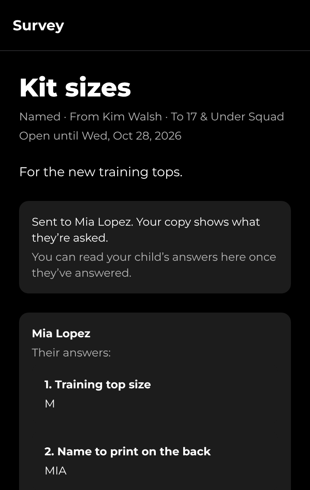

A survey sent to parents and guardians themselves, for example to all guardians, is yours to answer.

If your child under 18 is a captain and sends a poll to their squad or team, you get a copy saying
your child sent it, so you can see what they asked. You don't see their teammates' answers.

### What's changed for your child

**What's changed** on your home screen lists each child under 18, with a number when something has
happened since you last looked. Open it to see, newest first:

- a coach, manager or physio added to, or no longer in, a squad or team your child is in (from when
  your child joined it)
- your child added to or removed from a squad or team
- a parent or guardian linked or unlinked, and by which admin
- a consent given or withdrawn, and by whom
- one of your child's injury documents shared out of the app, and by whom
- an injury a coach, manager or physio logged for your child, and who logged it

If an adult is stood down, you see only that they're no longer in the group; the reason stays with
the club's admins. Ordinary views of your child's records are under
[Who has viewed your child's records](#who-has-viewed-your-childs-records). The list stops on your
child's 18th birthday.

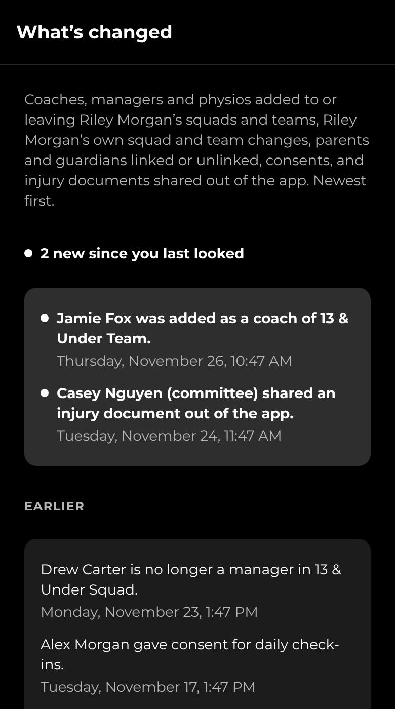

As a guardian you:

- **Receive a copy of every message** sent to your athlete, whether it went to their squad, their
  team, all athletes or the whole club. You get each message once, even if you're also in the
  squad. Your copy says which of your children it's for, such as "Copied to you as Jordan's and
  Riley's parent or guardian" when two of your children are in the same team.
- **Receive a copy of every message your athlete sends** if they're a captain, so you see what
  they send to their squad, team or the club. These copies say "Copied to you because Jordan sent
  it".
- **See your athlete's daily check-ins**, including any note they write. Tap your athlete under
  **Check-ins** on the home screen to see the last four weeks. Your athlete is told that you can
  read their notes.
- **See the calendar and matches** of the squad or team you're placed in: the squad you chose when
  you joined, or any an admin adds you to from your member page. While your child is under 18 you
  join each team they're put in, and leave it when they do, so you see its matches without asking.
- **See your athlete's game goals and reflections**: the goals they and their coaches set for
  each game, how your athlete thinks each one went, their coaches' comments and the team goals (see
  [Game goals](#game-goals)). Tap your athlete under **Guardian of** on the home screen to see all
  their games. You can't set goals or reflect: your athlete and their coaches do that in the app.
- **Report and update injuries** for your athlete, and ask for clearance, exactly as an athlete
  does (see [Athletes](#4-athletes)). If you look after more than one athlete, choose which one
  when reporting. Proof is the physio's or doctor's letter, as a PDF or a photo of the letter; with
  a photo you confirm it shows the letter, not the injury. If the club allows photos of injuries and
  your identity has been verified, you can choose **The injury** and add one after switching on
  **I consent**; your consent is kept with the photo. Your child can't add photos of injuries.
- **Hear straight away when staff log an injury**: if a coach, manager or physio logs an injury for
  your child at training or a game, your to-do list shows **Look at the injury Casey Coach logged
  for Jordan** until you open it, and it shows under **What's changed**. You then add the physio's
  updates and ask for clearance as usual (see
  [When a coach, manager or physio logs your injury](#when-a-coach-manager-or-physio-logs-your-injury)).
- **See who opened your athlete's injury documents**: under each document, every view and share,
  by whom and when, and what was confirmed about each photo.
- **See your athlete's attendance and report absences** (see
  [Your child's attendance](#your-childs-attendance)).
- **See what's changed around your athlete**: new adults in their groups, guardians, consents and
  shared documents (see [What's changed for your child](#whats-changed-for-your-child)).
- **See who has viewed your athlete's records**: everyone who opened their injuries, check-ins,
  game goals, season KPIs, named survey answers or member record (see [Who has viewed your child's records](#who-has-viewed-your-childs-records)).
- **Complete integrity training** for your athlete, and for yourself if the club sets a course
  for parents and guardians: their training shows in your to-do list and on the **Integrity
  training** screen under their name, and you upload their certificates exactly as they would (see
  [Integrity training](#integrity-training)).

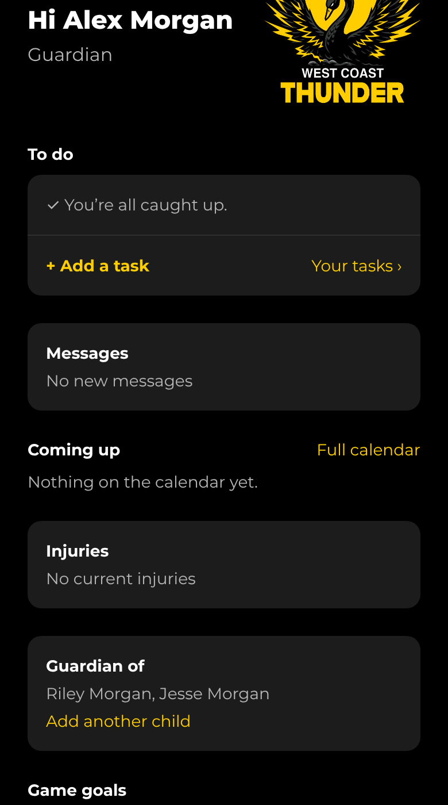
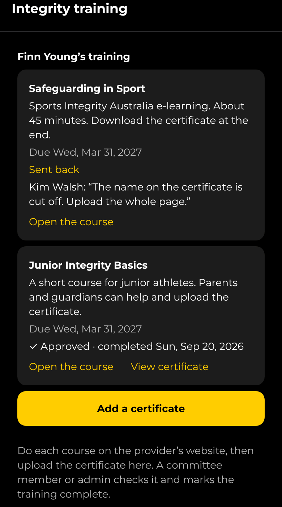
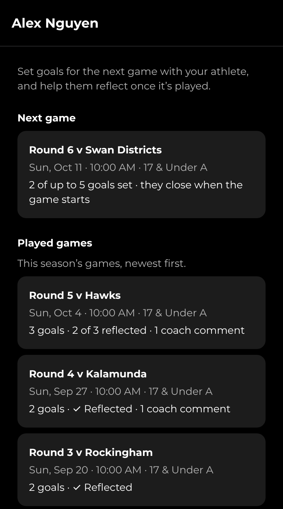

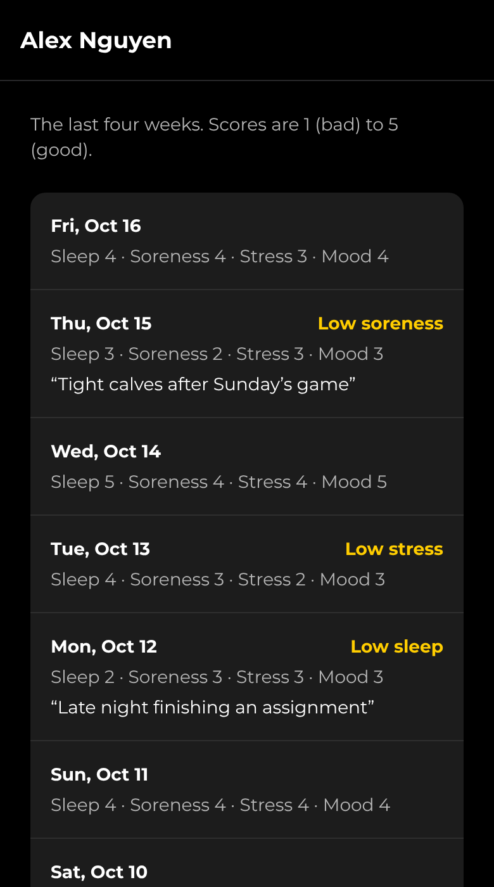

## 6. Coaches

Head coaches and assistant coaches have the same permissions, except that a head coach sets Season
KPIs for the group's assistant coaches. Everything below applies to the squads and teams you're
listed in as a coach. Your title, like "Head Coach, Open A", comes from your team, or your squad
until you're in a team (see [Your preferred name](#your-preferred-name)); more than one group or
role joins up, like "Head Coach, Open A and Open" or "Head Coach, Open A · Manager, 17 & Under".

Coaches and managers need a current Working With Children Check, recorded by an admin, before
they're approved (or an exemption or a lodged application recorded for them; the role stays paused
until they accept its declaration). The check is looked at every time you use the app: once the expiry date has
passed, your coach or manager role pauses and your home screen says so. You keep your squad and
team places, though they're hidden from your home screen until the role comes back, along with
the Messages, Attendance and Check-ins cards, so you can't read messages while paused; the
database closes your groups' rosters, calendars and fixtures too, not just the screen. Everything
returns as soon as an admin records the renewed check. Renew it well before it expires; admins are
reminded 60 days ahead, and 60 days before a parent or under-18 exemption ends.

### Volunteer exemptions

In WA, a parent who volunteers at the club their own child is in, and any volunteer under 18,
doesn't need a Working With Children Check and can't apply for one. If that's you, an admin
records an exemption instead of a card number, and you get a to-do: **Accept the exemption
declaration** (a temporary helper gets **Read the declaration** in their Before you help steps
instead). It opens the declaration, which says you're not paid for the role (the national
event declaration leaves this out), you don't have a
negative notice or an interim negative notice, no other state or territory has refused, suspended
or cancelled a working with children clearance for you, and you'll tell a club admin straight away
if any of that changes.
Tap **I agree** if it's true; if it isn't, don't agree and talk to a club admin. Your coach, manager
or physio role starts once you agree, and the club keeps the words you agreed to.

The exemption ends by itself when your child turns 18, stops being an athlete at the club or is
no longer linked to you, or, for a volunteer under 18, on your 18th birthday. Your role then pauses
and your home screen asks you to apply for a check. A parent's exemption doesn't cover overnight
camps.

Someone who doesn't normally live in WA, such as a visiting interstate or national coach, has two
more exemptions, and can use only one of them, once, in any 12 months before or after anywhere in WA:

- **Short-term visitor**: the two weeks from the day they arrive in WA.
- **National event or tour**: up to 30 days in a row, only for work at an event or tour run by a
  national or state body with children from more than one state, territory or country, such as a
  national championships.

The admin records the day they arrived, or the event, its organiser and first day. The declaration
names those dates, and the person confirms they haven't used either exemption anywhere in WA in the
last 12 months. The exemption applies only between its first and last day, then ends by itself, and
the app refuses a second one for the same person within 12 months of one that was accepted and
had started. Being supervised by someone
with a check is not an exemption in WA.

### Checks applied for

In WA you can start or keep doing child-related work while your Working With Children Check
application, new or a renewal, is being assessed, as long as you have the receipt. That stops if
you get a negative notice or an interim negative notice, if you're charged with or convicted of a
Class 1 offence as an adult, or if you withdraw the application. Show a club admin the receipt and
they record the application, and you get a to-do: **Confirm your Working With Children Check
application**. It opens a declaration naming the application and the day you lodged it, which
says none of those things applies and that you'll tell a club admin straight away if that
changes, and when your card arrives. Tap **I agree** if it's true; if it isn't, don't agree and
talk to a club admin. Your coach, manager, physio or committee role starts, or carries on, once
you agree, and the club keeps the words you agreed to.

It counts as your check until an admin records your card, which ends it. An admin confirms with
the Screening Unit every 30 days that it's still being assessed; if nobody does for 90 days it
lapses, your role pauses and your home screen says so. A notice from the Screening Unit stops it
straight away.

After an admin marks a squad's **squad phase complete**, coaches look after only the
athletes in their named teams. Before that, they look after everyone in the squad.

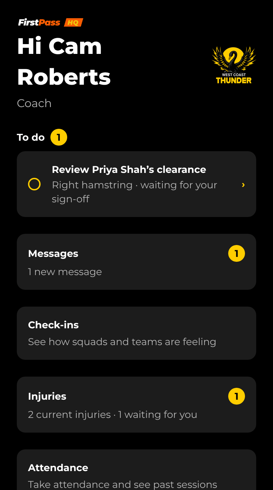

### Sending messages

1. Open **Messages** and tap **New message**.
2. Choose the squad or team (if you coach just one, it's already chosen).
3. Write the message and tap **Send**.

Everyone else in that squad or team gets it, including the parents and guardians listed in it.
Parents and guardians of athletes under 18 always get a copy, even if they aren't in the squad. Open
**Sent** to see how many of them have read each message, and open a message to see exactly who has
and hasn't read it. Club admins can read every message.

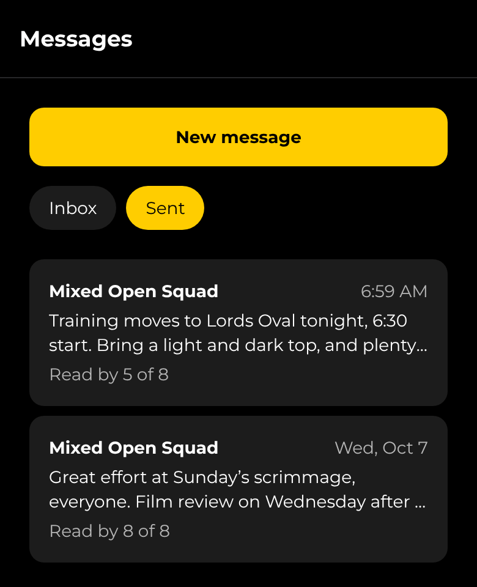

### Choosing captains

Coaches choose the captains and vice captains of the squads and teams they coach (admins can too).
Open the squad or team from **My squads and teams** and tap **Choose captains** at the bottom. For
each athlete choose **Captain**, **Vice captain** or **Neither**, then tap **Save captains**. A
group can have any number of captains and any number of vice captains, so it's up to you: co-captains
and no vice captains, one captain and four vice captains, or anything in between.

Captains and vice captains can then message everyone in that squad or team, like you. They must be
athletes in it, and they stop being able to message it if they leave it or the season is archived.
Messages from captains under 18 are copied to their parents or guardians.

### Athletes' check-ins

The **Check-ins** card shows how many of your athletes have checked in today and how many are
flagged. If any are flagged, your to-do list says "Check in with N athletes". Athletes under 18
show, and count, only once a parent or guardian has given consent for their check-ins. A squad
drops out once its squad phase is complete, and if that was your only group the card goes too.

- **Day by day** lists today's (or yesterday's) check-ins for a squad or team: athletes to check
  in with first, with what scored low and any note, then those feeling good, then who hasn't
  checked in. Tap any athlete, including one who hasn't checked in, to see their last four weeks.
- **Trends** graphs the group's average sleep, soreness, stress and mood over 2 weeks, 4 weeks or
  3 months, with the number who checked in each day. Each day's score averages that day and the
  two before it, so a small group whose athletes don't check in every day still gets a line. A day
  shows scores once at least 3 athletes checked in over those three days, so no one athlete's
  answers show. The red line is 2, the score that flags an athlete. Tap a day to see its
  numbers in every chart, and use the chips to switch group.

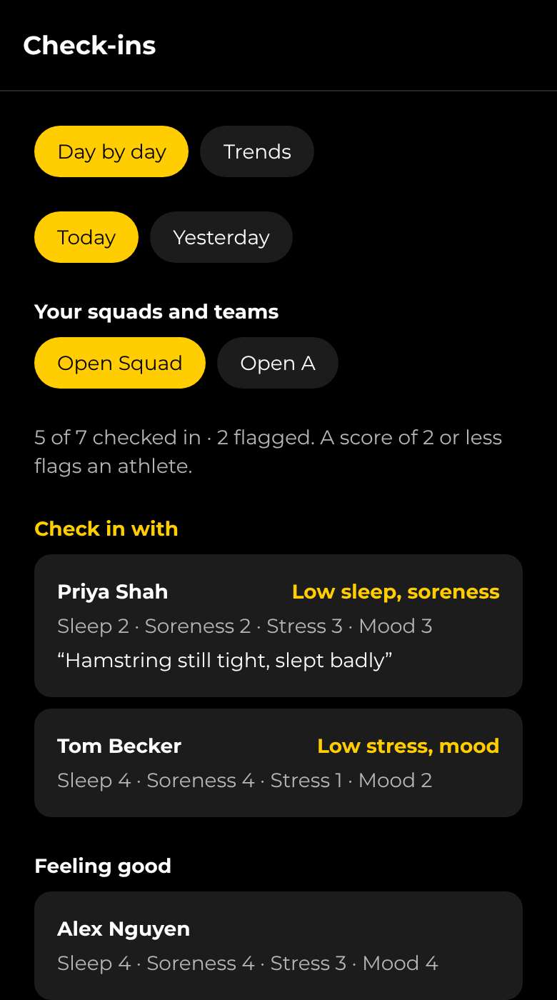

### Game goals

Game goals are on the page of each team you coach: tap it under **My squads and teams**. Squads
don't have PlayHQ games, so their pages don't show goals.
**Team goals** sits at the top, and under **People** each athlete shows their next game (within
7 days) and how many goals they've set.

- Tap an athlete, then their next game, and type under **Add a goal for the athlete**. Their goals
  and yours show together; you can change or remove goals set by a coach until the game starts,
  but not the athlete's own.
- After the game, open it from **Played games** to read how the athlete thinks each goal went, and
  tap **Comment on this goal** to reply. Any of the athlete's coaches can comment.
- A number next to an athlete counts reflections no coach has commented on yet, and your to-do list
  says "Comment on N goal reflections", which opens the team. Under **Played games**, each game
  shows how many goals were set, how many the athlete has reflected on and how many coach comments
  there are, with **Load more** for older games.
- Opening an athlete under 18's game goals is recorded for their parents (see [Who has viewed your
  child's records](#who-has-viewed-your-childs-records)).

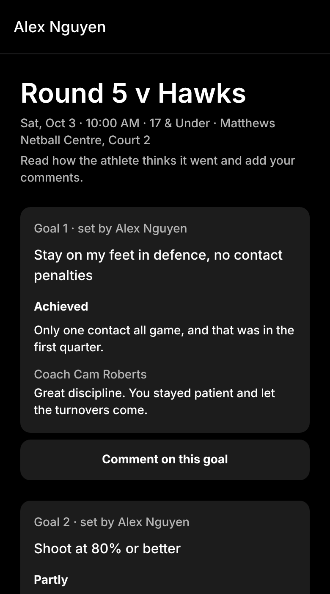

#### Team goals

At the top of a team's page, **Team goals** shows its next game (within 7 days) and its
last played game.

- Open the next game and add goals for the whole team under **Add a team goal**, up to 5, such as
  "win the third quarter". You can change or remove them until the game starts. Any coach of the
  team can. Until a team goal is set, "Set team goals for …" stays in your to-do list.
- The team's athletes and their parents or guardians see the team goals above each
  athlete's own goals. Team goals are for the team's coaches and athletes: its managers and
  physios don't see them. Admins can read them and the comments, from the team's page.
- The team's athletes and coaches can comment on a team goal, before or after the game, so every
  athlete has a say. Their comments show under each goal, and you can add your own with
  **Comment**. Coaches can **Remove** any comment on their team's goals; athletes can remove only
  their own.
- After the game, open the last game, pick **Achieved**, **Partly** or **Not yet** for each team
  goal, add a few words for the team and tap **Save review**. Athletes see your review, and you
  can change it later.

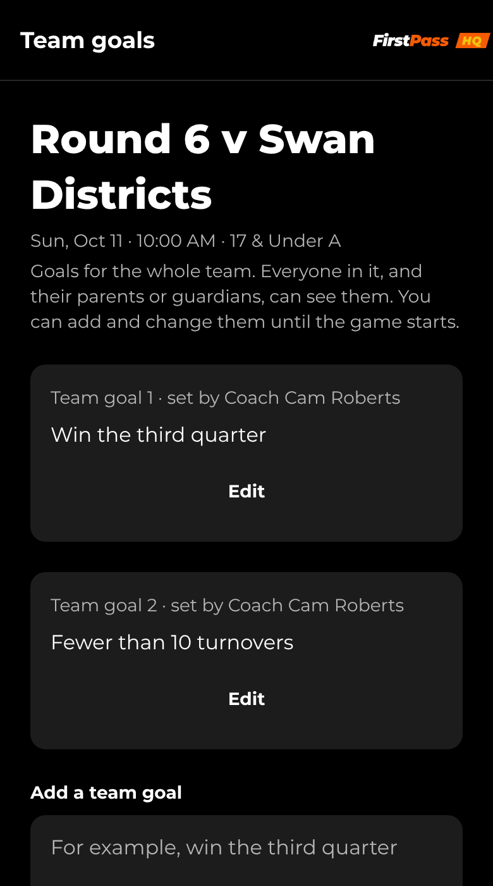
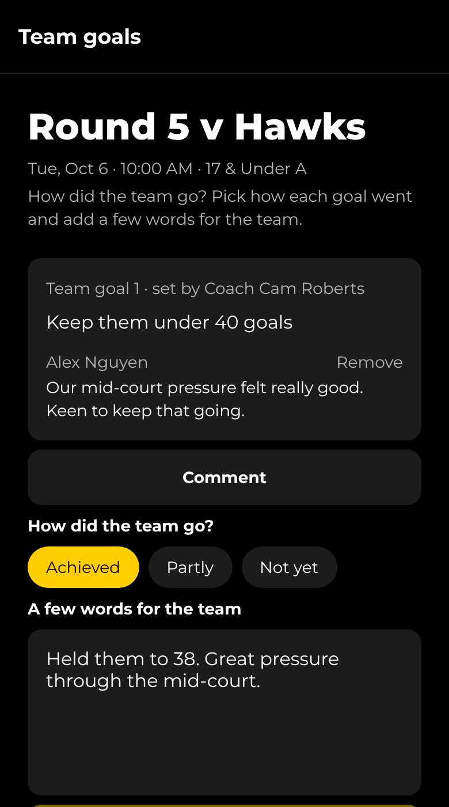

### Setting season KPIs

If the club uses [Season KPIs](#season-kpis), open **Season KPIs** on the home screen. Under each
squad or team you coach are its athletes and, if you're its head coach, its assistant coaches. Head
and assistant coaches can both set athletes' KPIs. Of the coaches, only a head coach sets
assistants'; the committee and admins can set them too.

1. Tap a person, then **Add a KPI or OKR**.
2. Choose **KPI: one measure** or **OKR: objective and key results**, and name it.
3. For each measure, choose **A number** (with a target, an optional unit such as % or sessions,
   an optional starting point, and **Lower is better** if fewer is the aim) or **Done or not done**.
   For an OKR, **Add a key result** for up to 5.
4. Add **Details** if the name needs explaining, then tap **Save**. A person can have up to 10 in
   each squad or team. **Edit KPI** or **Edit OKR** changes it later; progress already recorded
   stays with each measure you keep. **Remove KPI** or **Remove OKR**, on the edit screen, takes
   it away with its progress and result.

During the season, you and the person record progress. At each review date the club sets, write
your review under the review's name and tap **Save**; if you set any of their KPIs, it's on your
to-do list from a week before. Your note is yours alone: if the committee or an admin also reviews
the person, their note sits beside yours. The person then confirms it was done and can add their own view,
which you can remove. At the end of the season, pick each KPI's **Result**, add a note on it if
you like, and tap **Save result**; **Clear result** takes it back. Opening an athlete under 18's KPIs is recorded for their parents (see [Who has
viewed your child's records](#who-has-viewed-your-childs-records)).

If you're a head coach, your assistant coaches' KPIs and OKRs are their coaching development plan
for the season: what they're working on as coaches, how they're tracking and your reviews with
them. The committee and admins see these plans too.

Your own KPIs, set by the committee or your head coach, are under **Yours**.

### Match awards

Awards such as the coach's MVP can be voted on by coaches after every match. Each match your team
plays opens its own vote when it starts, under **Awards** with the match beneath the award's name,
such as "Mixed Open A · Round 3 v Rockets", and in your to-do list as "Vote for Coach's MVP" (or
"Vote in N awards"). Some awards also have one **Preseason** vote, which counts for a set share of
the result.

### Injuries and clearances

**Injuries** lists your athletes' current injuries with their restrictions and expected return
date. Choose **Including cleared** to see past injuries too. An athlete under 18's injuries show
only once a parent or guardian has given consent for injuries; until then, nobody can endorse
or send back their clearance.

Open an injury to see its full history, including the physio's updates and documents, and to
**Raise a concern** about it. Opening an under 18's injury is itself recorded for their parents,
separately from opening its documents.

When one of your athletes asks for clearance, it appears under **Waiting for your sign-off** and in
your to-do list. Open it, check the proof in the history (tap **View**), then:

- **Endorse clearance** to pass it to the committee, with an optional note such as "trained fully
  on Tuesday", or
- **Send back** with a note saying what's missing.

A physio who looks after the athlete can endorse a clearance too. Admins can't endorse a clearance unless
they're also the athlete's coach or a physio; they accept it like the committee. You can't endorse a
clearance for your own child: another coach or a physio does it. You can't endorse a suspected
concussion's clearance either: only a physio can (see [Concussion](#concussion)). If the club has
turned on **Only physios endorse clearances**, every clearance waits for a physio.

#### Logging an injury at training or a game

When one of your athletes is hurt at training or a game, log it there and then:

1. Tap **Injuries**, then **Log an injury**.
2. Choose the athlete. Only athletes in the squads and teams you coach, manage or look after as a
   physio are listed.
3. Say where the injury is and what happened, including any first aid, and when. Restrictions and
   an expected return are optional.
4. For a knock to the head, face or neck, or any sign of concussion, switch on **Possible
   concussion**. If in doubt, sit them out.
5. Tap **Log injury**.

The athlete and their parents or guardians are told straight away, and it goes on the athlete's
injury record, where they add the physio's updates and ask for clearance. Logging it gives you no
extra access: you see the injury only as you'd see any of your athlete's injuries, so an under 18's
shows only once a parent or guardian has given consent.

#### Viewing proof documents

**View** opens a document inside the app. A photo fills the screen: pinch to zoom in on the
details, drag to move around, and double-tap to zoom in or back out. A PDF shows its pages one
under the next, and you can pinch to zoom there too. There's no save or share button, and the
document isn't kept on your phone. Each time you open a document, your name, role and the time are
recorded and shown to the athlete, their parents or guardians and admins.

### Taking attendance

1. Tap **Attendance**, then **Take attendance**.
2. Choose the squad or team (it's already chosen if you lead only one). You can also choose
   **Whole squad** for any current squad (**Another team**, in a club without squads), or
   **Whole club** for club events, where every approved athlete is on the register.
3. Name the session. If a calendar event is on now (from an hour before it starts to 30 minutes
   after it ends), its name is filled in for you; other events from today are offered as chips.
   You can change the name after it's filled in.
4. Mark each athlete **Present** or **Absent**, or tap **Mark the rest present**; everyone must be
   marked before you can save a new session (when correcting one later, athletes can stay **Not
   marked**). Athletes whose
   absence was reported for that day show **Away** under their name, with the reason and any
   details. Injured athletes show **Injured** and when they're expected back, and nothing else about the
   injury. Injured athletes are still expected to come and support the team, so mark them like
   anyone else.
5. Tap **Save attendance**.

If attendance was already taken for the same group within 3 hours of the session's time, a warning
shows who took it, in case it's a duplicate. You can open that record, or carry on if it really is a different
session.

### Attendance records

- **Sessions** lists past sessions (managers, who have no **Athletes** tab, find the list under the
  absence cards). Open one to see who was there, and **Change attendance** to
  correct it; athletes who joined the group since show as **Not marked**.
- **Athletes** shows each athlete's attendance over 4 weeks, 3 months or 12 months, with the last
  time they were there. Tap an athlete to see every session.
- **New or changed absences**, under the **Take attendance** button, lists the absences reported
  or withdrawn for athletes in the squads and teams you coach or manage since you last tapped
  **Mark as reviewed** (the last 7 days, the first time), each marked **New** or **Withdrawn**,
  with the days, reason, details, who told the club and when. Tap **Mark as reviewed** once you've
  read them; opening the screen doesn't clear them. Until then, your **To do** list on the home
  screen says **Review N new or changed absences**, and tapping it opens this screen. Absences you
  reported or withdrew yourself aren't included, and nor are absences that ended more than two
  weeks ago.
- **Away in the next 4 weeks** lists the absences athletes or their parents have
  reported for the squads and teams you coach or manage (everyone's, for the committee and admins),
  with the reason, such as **Planned holidays** or **Personal illness**, and any details. Absences
  reported before reasons were added show only their details.

### Surveys and polls for your squad or team

Coaches and managers can send a survey, or a one-question poll such as "Can you come to an extra
session on Friday?", to the squads and teams they coach or manage. Open **Surveys** from the home
screen and tap **New survey**. It works the same way as for the committee (see [Surveys for the
club](#surveys-for-the-club)), except that **Send to** only offers your own groups; if you lead
just one, it's picked for you. A **Named** survey with one **One choice** question makes a quick
poll, and shows who hasn't answered yet.

Under **Who else sees it**, choose:

- **Just me**: only for a quick poll, up to 5 questions with choices or ratings and no written
  answers. It stays in the team.
- **Admins**: needed for anything longer, or with a written answer, so the club knows what members
  are asked. Admins see the results; anonymous answers stay anonymous.
- **Admins and committee**: for example, a survey about the season the committee should read.

You can't change this once it's sent.

Under **Answering**, choose **Optional** or **Everyone must answer**. When everyone must answer,
named results wait until everyone has answered; otherwise they show once 3 people have answered.
Anonymous and name-optional results still wait until the survey closes, or until everyone has
answered. Whatever you choose, results show when it closes, and you can close it early and accept
the answers you have.

Under **Share results with the squad or team**, choose **Yes, the totals** to let everyone it went
to see how many picked each choice and the average rating, once results show. They never see
names, written answers or who has answered. Captains have the same two choices for their polls.

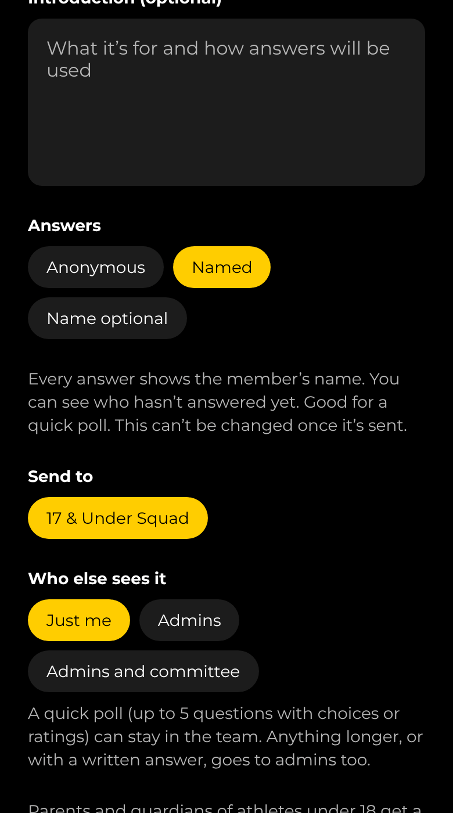 

**My groups** lists your own surveys and the polls your captains send, with who else sees each one. You see the results of the
surveys you sent, while you still coach or manage that squad or team with a current check,
including after the season ends. You don't see other coaches' surveys. You also see your squad or
team's captains' polls and their results, and can tap **Close it now** on one. The same rules keep
anonymous answers anonymous, and opening named answers from an athlete under 18 is recorded in
their record views. You can download your surveys' and your captains' polls' results as a PDF
summary or an Excel spreadsheet (see [Surveys for the club](#surveys-for-the-club)).

### Session plans

Keep a plan for each session, before or after it, so the club has a record of what was coached.
Head coaches and assistant coaches can both add plans, for the squads and teams they coach. Adding
a plan, being shared one and being told about one all need a current check or exemption.

1. Tap **Session plans** on your home screen, then **Add a session plan**.
2. Choose the squad or team.
3. To save typing, tap a session under **Fill in from the calendar**: it fills in the name, day,
   times and place from your squad or team's calendar and the club's (the 8 sessions closest to
   today, within two weeks either side). The plan keeps what was filled in: if the calendar changes
   later, the plan doesn't, so change it yourself if you need to. You can also type everything in:
   **Today**, **Yesterday** and **Tomorrow** pick the day, and the start and finish times and the
   place are optional.
4. Write the plan under **Plan**, and add up to 5 photos or files, 10 MB each: **Choose photos**
   from your phone's photos, **Take a photo** (for example of a whiteboard), or **Attach a PDF or
   Word document**. Take photos of the plan, not of athletes; **Leave out** drops a photo or file
   before you save. A plan needs writing or at least one photo or file.
5. Choose who to share it with: **The other coaches of this squad or team** (ticked to start),
   **Its athletes** (parents and guardians of athletes under 18 see it too), and any **Coaches of
   other squads and teams** by name.
6. Tap **Save session plan**.

**Session plans** has two tabs: **My plans**, the plans you added, and **Shared with me**, plans
other coaches and admins shared with you, marked **New** until you open them. When a plan is first
shared with an admin, their phone gets a notification saying who shared it, the session's name, its
squad or team and its day, if they've allowed the app's notifications; tapping it opens the plan.
Only admins' phones are set up for notifications, so coaches, athletes and parents don't get one;
they see the plan marked **New**. Changing a plan sends nothing to anyone already told; anyone you
share it with for the first time is told then. A plan shared with nobody says "Not shared. Only you
and the club's admins can see it".

Open a plan to read it and its photos and files. Photos and PDFs open in the app; Word documents
open in your phone's viewer. On your own plans, while your check or exemption is current, **Change this plan** lets you edit
anything, share it differently or remove a photo or file; the plan then shows when it was last changed and by
whom. **Use again for another session**, on your own plans and on plans shared with you, starts a
new plan copied from this one, files included, for today, in a squad or team you coach. You can't
delete a plan: ask an admin if one was added by mistake.

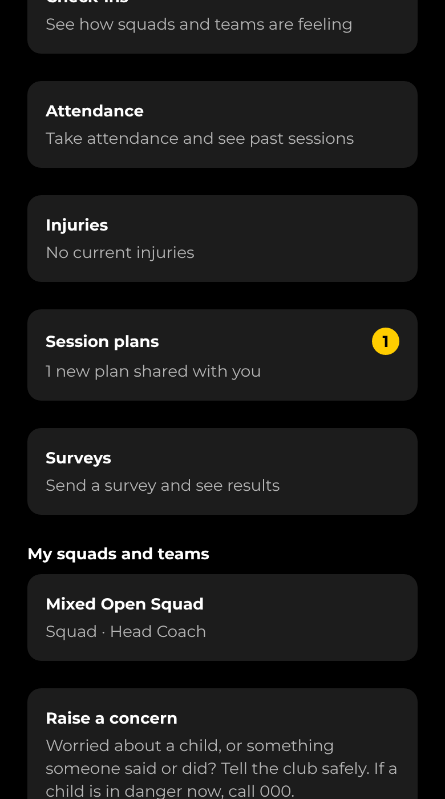
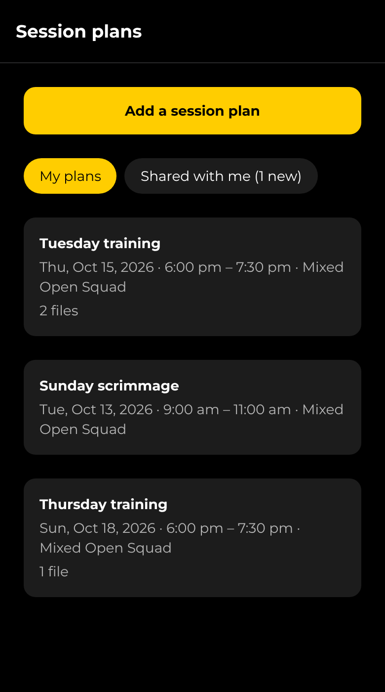
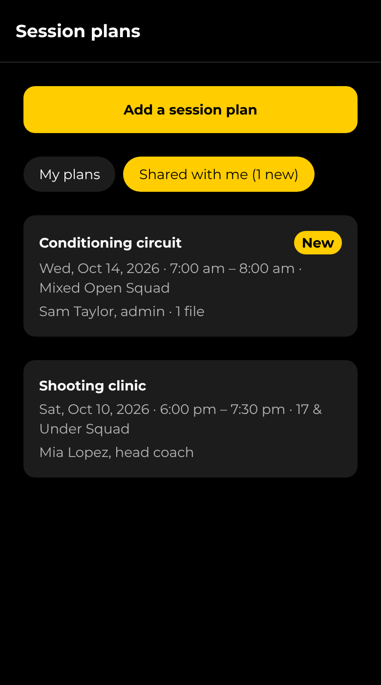

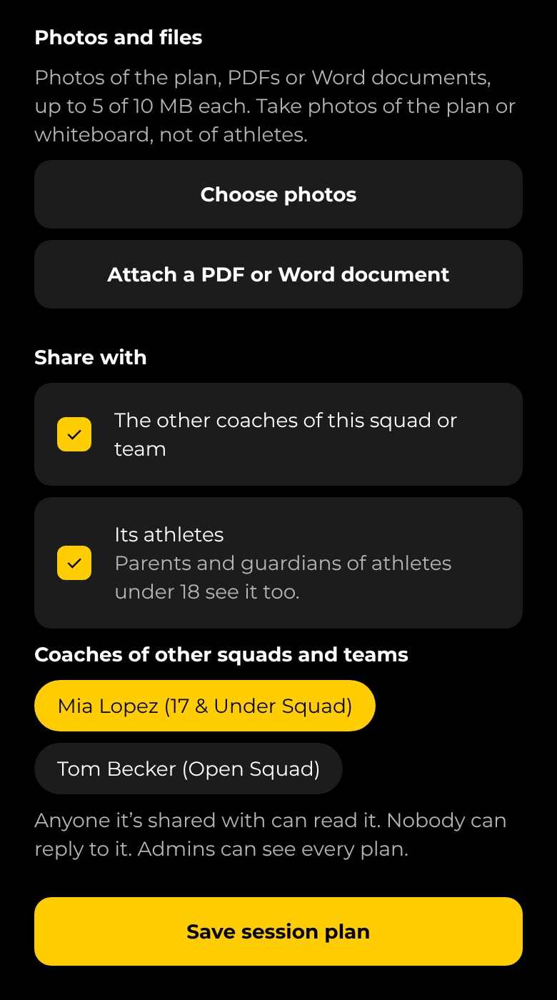
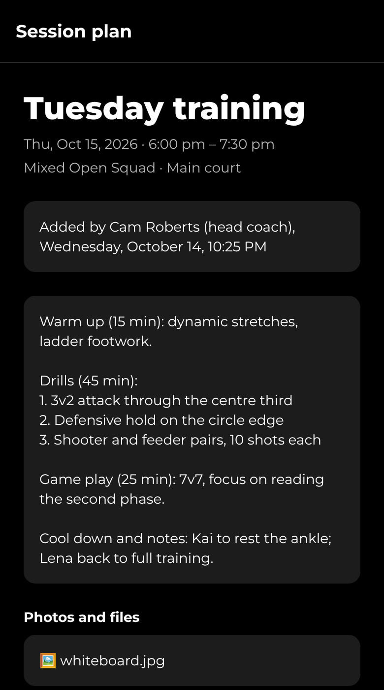

## 7. Managers

Managers look after the logistics of their squads and teams. The app titles you from your team, or
your squad until you're in a team, like "Manager, 17 & Under", and your home screen shows your role
and title together, like "Manager · Manager, 17 & Under". As a manager you can:

- **Send messages** to the squads and teams you manage, and see read receipts, the same way as
  coaches (see [Sending messages](#sending-messages)). Physios placed in your group get them too,
  and if you're also on the committee you choose between **Everyone** and **A squad or team**.
- **Send surveys and polls** to the squads and teams you manage, and see their results (see
  [Surveys and polls for your squad or team](#surveys-and-polls-for-your-squad-or-team)).
- **Take attendance** for your groups, a whole squad or the whole club, and see and correct your
  own groups' sessions, every whole-club session and any session you took yourself (see
  [Taking attendance](#taking-attendance)). With a manager role but no squad or team yet, you can
  still take whole-squad and whole-club attendance.
- **Work on your season KPIs**, if the club uses them: the committee and admins set them, and you
  record your progress, add a note on the result and confirm your reviews (see
  [Season KPIs](#season-kpis)). The card shows once you're in a current squad or team.
- **Vote in club awards** that name managers, or every member, as voters, and be nominated in
  awards open to any member (see [Club awards](#club-awards)).
- **Log an injury** when one of your athletes is hurt at training or a game: the **Injuries** card
  reads "Log an injury at training or a game". The athlete and their parents or guardians are told
  straight away and keep the record from there (see
  [Logging an injury at training or a game](#logging-an-injury-at-training-or-a-game)). You don't
  see injury records, including the ones you log.

Managers see the absences reported for their groups, on the register and under **Away in the next 4
weeks**. Like coaches, they get a **To do** item when an absence is reported or withdrawn for one
of their groups, and clear it with **Mark as reviewed** under **New or changed absences** (see
[Attendance records](#attendance-records)). The register also shows who took each session, each
absence's reason, and **Injured, back** with the date for an injured athlete, whatever the consent
choices, and nothing else about the injury. Managers don't see athletes' attendance histories,
check-ins, injury records, game goals, team goals or session plans.

While your check has expired, or an exemption has ended or hasn't been accepted yet, your home
screen says **Manager (paused)** and the Messages, Attendance and My squads and teams cards are
hidden: you can't read or send messages, take attendance or open your groups until an admin records
the renewed check, and the database closes those too, not just the screen. A stand-down removes
your squad and team places for the season; lifting it puts them back.

## 8. Committee

Committee members oversee the club's athletes without seeing anyone's private check-in answers.
Like coaches, they need a current Working With Children Check, recorded by an admin, unless an
admin exempts them with a reason. A committee member who also coaches, manages or is a physio
can't be exempted. If a check an admin recorded expires, or was recorded without an expiry date,
the committee role pauses until the renewed one is recorded.

Committee members approved before checks were needed keep their role without one until the
club's **committee checks date**, set under Safeguarding as **Committee checks required from** (90
days after the rule started, unless an admin brought it forward). Until then their home screen
says when the role will pause, and admins' to-do list already counts them as missing a check. From
that day, a committee member with no check and no exemption has their committee role paused until
an admin records a check or exempts them.

When you ask to join, choose **Committee**; no squad, team or card number is asked for. Add your
title later under **Your details** (such as President, Secretary or Treasurer), or an admin adds
it on your member page. The home screen header lists every role you hold, then your title, then
any coach or manager title, such as "Coach, Committee · President · Head Coach, Open A". While the
committee role is paused the header reads "Committee (paused)" without the title (the title is
kept), and the Messages, Check-ins, Injuries, Attendance, Season KPIs and certificate-checking
cards, the committee calendar and club-wide messaging go until an admin records a check or an
exemption. The code of conduct, your own integrity training, award votes, personal tasks and
**Raise a concern** stay.

Any committee member with a current check (or a volunteer exemption, not an exemption with a
reason) can be named by an admin as the club's Child Safety Officer, Complaints Manager or WWC
Registration Officer. If you're the Child Safety Officer or Complaints Manager, your home screen
also has **Concerns** (see [The concerns register](#the-concerns-register)): the register, each
concern's notes and steps (**Referred to** the governing body or Police, **Being looked into**,
**Closed** with a note), and **Export the register as a PDF**. A concern about you is never shown
to you. The Child Safety Officer also has **Wellbeing flags** (see [Wellbeing
flags](#wellbeing-flags)). If your check lapses, Concerns, wellbeing flags and their to-dos go
until a renewed check is recorded.

### Messages to the club

Committee members can send a message to everyone in the club (every member except guests,
temporary helpers and, unless the club turns on **Physios get club messages**, physios). Open
**Messages**, tap **New message**, write it (up to 4,000 characters) and tap **Send**. Guardians
of athletes under 18 get a copy, and **Sent** shows who has read it. Only admins can message a
single role, such as all coaches. A committee member who also coaches, manages or captains a squad
or team can choose **A squad or team** to message it instead.

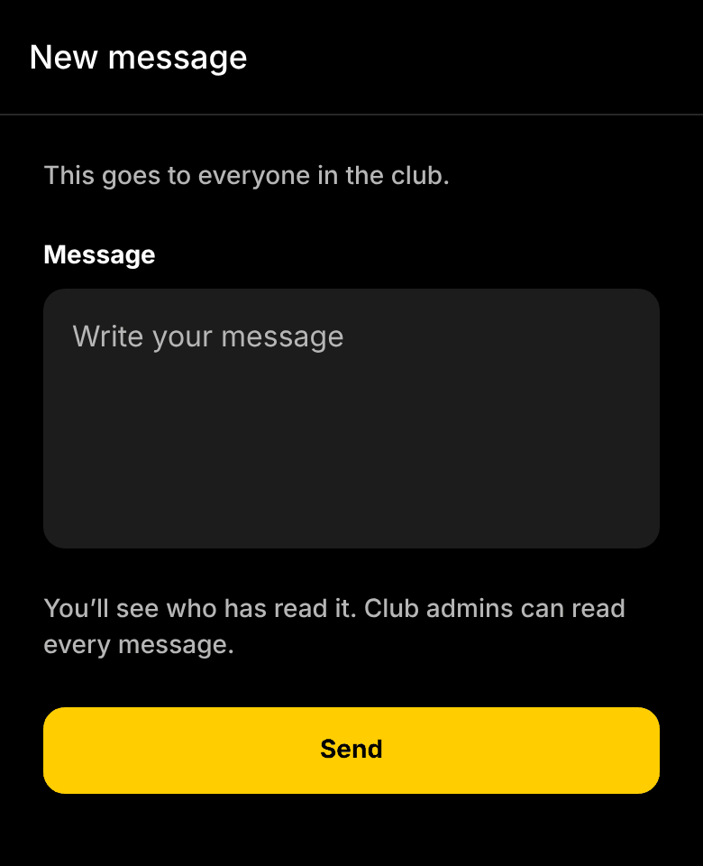

### Surveys for the club

Committee members and admins make surveys and read their results. Coaches' and managers' quick
polls and captains' polls stay with the team, so they don't show here. Admins also see every
coach or manager survey that's longer than 5 questions or has a written answer, and the committee
sees the ones a coach shares with them. Open **Surveys** from the
home screen and tap **New survey**.

1. Give it a title, and an introduction if you like.
2. Choose how answers are kept: **Anonymous**, **Named** or **Name optional**. This can't be
   changed once it's sent.
3. Choose who gets it: **Everyone**, **A role** (such as all coaches or all guardians) or **A
   squad or team**. Parents and guardians of athletes under 18 get a copy of their child's survey,
   but only the child answers.
4. Choose the day it opens and the day it closes. It closes at the end of that day.
5. For a **Named** survey, choose when results show: **From 3 answers**, once **20%**, **50%** or
   **80%** have answered, or **Everyone must answer**. For an anonymous or name-optional survey,
   choose **Optional** or **Everyone must answer** under **Answering**. Results always show when
   it closes.
6. Add questions. Each is **One choice**, **Several choices**, **Rating** (1 to 5 or 1 to 10) or
   **Written answer**, and can be **Must answer** or **Can skip**. Up to 30 questions.
7. Tap **Send survey**. Questions can't be changed once it's sent, so everyone answers the same
   survey.

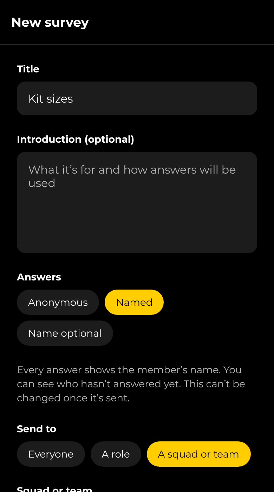  

**Club surveys** lists the committee's and admins' surveys and the coach and manager surveys you
can see, with who it went to, when it opens or closes, and how many have answered. Open one and tap
**See results**. The person who made a survey, or an admin, can tap **Close it now** to stop more
answers. While results are waiting, the results page shows how many have answered and a **Close
now and see results** button, so a survey that won't reach its target, such as one everyone must
answer, can be closed and its answers accepted as they are.

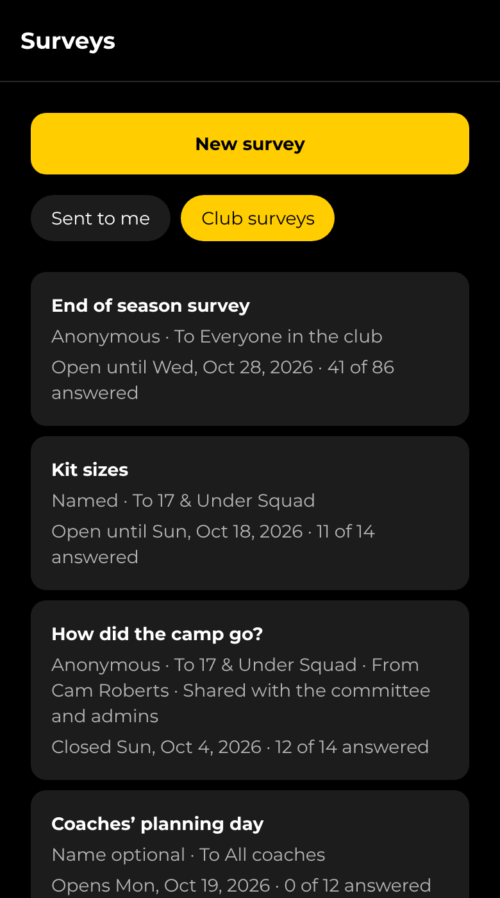

Results show how many picked each choice or rating, the average rating, and every written answer.

- **Named surveys** show each person's answers with their name once the survey reaches its target:
  3 answers, the percentage you chose, or everyone when everyone must answer. Until then you see
  how many have answered, the percentage, and who hasn't answered yet, so you can remind them.
- **Anonymous and name-optional surveys** show results only once the survey has closed, or once
  everyone has answered, **and** at least 3 people have answered. That way nobody can work out who said what by watching the results
  change as each person answers, or by sending a survey to one or two people. Written answers are
  listed in alphabetical order, not the order they came in, and you see how many have answered but
  never who. In a name-optional survey, answers given with a name show it.

 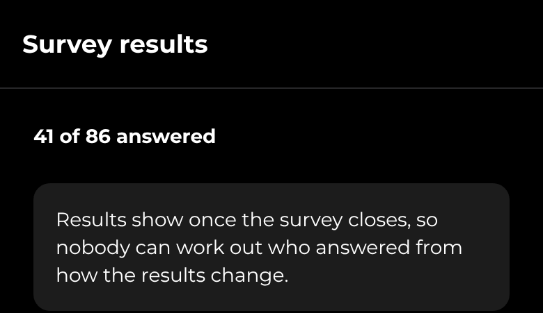 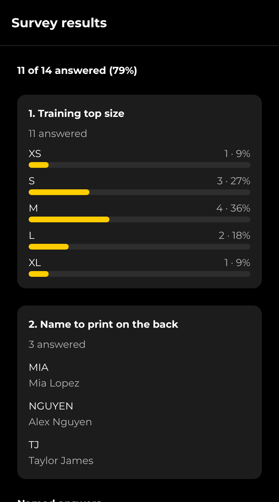

When you open results that name an athlete under 18, the app records it in that child's record
views, which their parents or guardians can see. Opening an anonymous survey's results is never
recorded against anyone, because nothing in it says who answered.

Once results show, two buttons at the bottom download them:

- **Download PDF summary**: the title, who it went to and when, how many answered, each question's
  counts and percentages, average ratings, every written answer, and for a named survey who hasn't
  answered.
- **Download spreadsheet**: an Excel file with a **Summary** tab, an **All answers** tab with one
  row for each set of answers, a tab for each question, and for a named survey a **Not answered
  yet** tab. Anonymous answers have no names or times, and are listed in order of their answers,
  not the order they came in. Answers given with a name show it.

On a phone, each opens the share sheet so you can save or send the file. Files with members' names
leave the app, so keep them safe and delete them when you're done. Every download that names an
athlete under 18 is recorded in their record views, even straight after you viewed the results.

### Check-in averages

**Check-ins** shows average scores for each squad, and for each team once its squad phase is
complete, plus how many checked in and how many are flagged. **Trends** graphs the
averages for one group or the whole club, each day averaging that day and the two before it.
Scores only show once at least 3 athletes in a group have checked in (over the three days, in
Trends), and the overview never says who checked in, so the scores can't point to one person.
Athletes under 18 count only once a parent or guardian has given consent for their check-ins.
Individual answers are only for the athlete, their guardians and their coaches.

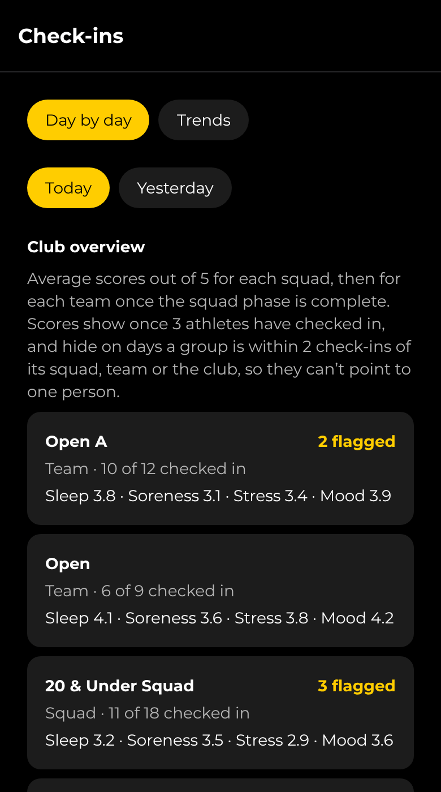

### Accepting clearances

The committee sees every athlete's injuries, except an athlete under 18 whose parents haven't yet
given consent for injuries (admins can see those, but nobody can endorse or accept a clearance
until a parent gives consent). An under 18's injuries, and accepting or sending back their
clearances, are only for committee members cleared to work with children: a current Working With
Children Check, or a parent volunteer exemption. A committee member with any other exemption, or
with no check yet before the club's **Committee checks required from** date, sees adults' injuries
only. Admins see every injury, unless their own check has been missing or expired for over 30
days (see [Approving members](#approving-members)): then they see adults' injuries only. Athletes who have left the club stay listed under **Including
cleared** for 12 months. When a coach or physio endorses a clearance, it appears under **Waiting
for your sign-off** and in the to-do list of every committee member and admin except the person
who endorsed it and the athlete's own parents or guardians. Open it, check the proof, then:

- **Accept clearance** clears the athlete to train and play, or
- **Send back** with a note.

The committee can also send back a request that no coach or physio has looked at yet, and a
committee member may send back a request about their own child (only accepting needs someone
else). Nobody can send back an under 18's clearance before a parent or guardian has given consent
for injuries. Tap **View**
on a document to read it in the app (see [Viewing proof documents](#viewing-proof-documents)).
While a clearance is waiting for the committee, every committee member or admin who could accept
it also gets **Share**, to save its documents to the club's records, such as OneDrive (on the web,
Share opens the document in a new tab). Share disappears once it's accepted or sent back, and
nobody else can save or share documents. Every share is recorded and shown to the athlete, their
parents or guardians and admins.

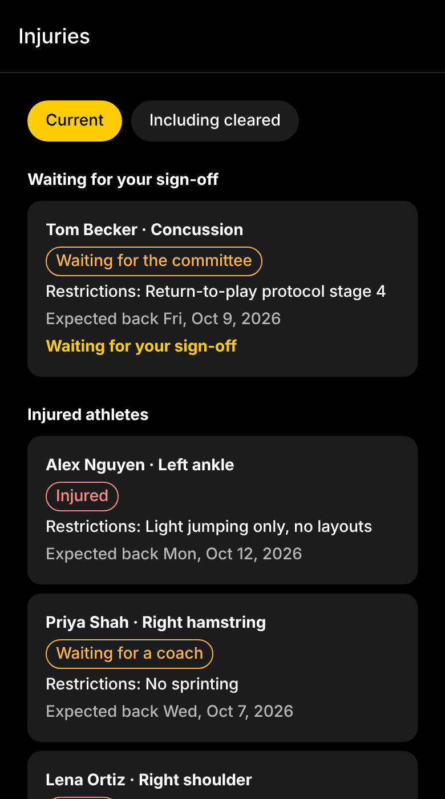

### Checking training certificates

When someone uploads an integrity training certificate, every committee member and admin who can
check it gets a **Check training certificates** to-do (if the club uses Integrity training). Open **Integrity training** › **Check certificates** to see
each one with the member, the course, the day they completed it and who uploaded it. Tap the
📎 file to read the certificate in the app, then:

- **Approve** marks that training complete for the member, or
- **Send back** with a note saying what to fix, such as a cut-off name. The member sees the note
  and uploads a new certificate.

Nobody checks their own certificate or their own child's; those wait for someone else.

**Everyone's progress** lists one season's training (with season chips once there are two), with
how many members are approved and how many certificates are waiting. Open one to see every member
who must complete it, filter to **Still to do**, **Waiting** or **Approved**, and **Export CSV**
for Sports Integrity Australia or the club's records.

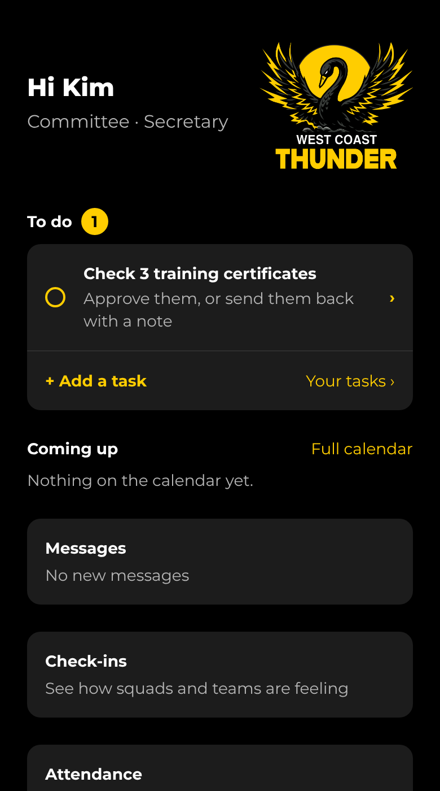

### Attendance

Committee members can take attendance for any whole squad or the whole club (or any team, in a
club without squads), and see every session, every athlete's attendance and everyone's reported
absences under **Away in the next 4 weeks** (see [Taking attendance](#taking-attendance)). You
can change a whole-club session anyone took, or a session you took yourself, but not another
person's squad session. Reviewing new absences stays with the group's coaches and managers.

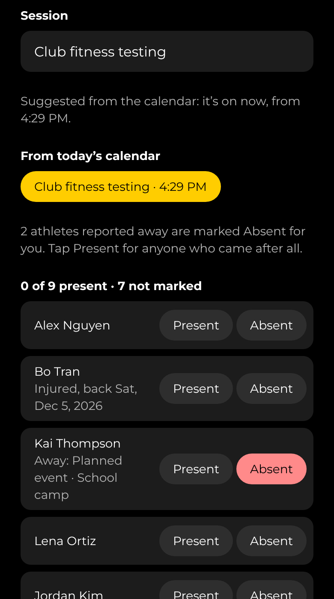

### Season KPIs for coaches and managers

If the club uses [Season KPIs](#season-kpis), the committee sets the KPIs and OKRs for every squad
and team's coaches and managers. Open **Season KPIs** on the home screen: each squad or team lists
its coaches and managers. Tap one to add a KPI or OKR, follow their progress, write their reviews
and record the results, the same way coaches do for athletes (see [Setting season
KPIs](#setting-season-kpis)); never for yourself. That includes each assistant coach's development
plan set by their head coach: you see its KPIs, progress and reviews, and can add to, change or
remove them. A to-do such as **Write Alex's KPI review** comes for each person whose KPIs you set.
Your review note is separate from the head coach's; the person sees both.
You don't see athletes' KPIs. Admins can save every coach's and
manager's KPIs as a PDF for the board (see [Reports](#reports)).

### Committee calendar

Calendars an admin shares with the **Committee** appear only for committee members and admins,
with their own colour and filter in the calendar. A paused committee member doesn't see them.

## 9. Physios, statisticians, guests and temporary helpers

Physios see the squads and teams they're placed in and the club calendar; guests see the club
calendar only. Neither votes in club awards, so their home screen has no **Awards** card. Guests don't get messages. Physios have a **Messages**
card and get messages an admin sends to the Physio role, and messages sent to the squads and teams
they're in. They also get messages sent to everyone in the club when an admin turns on **Physios get
club messages** in [Club settings](#club-settings).

### Physios

Physios need a current Working With Children Check, recorded by an admin, before they're approved,
or a [volunteer exemption](#volunteer-exemptions) if they volunteer unpaid at their child's club or
are under 18. Like a coach's, the physio role pauses once the check's expiry date has passed and comes back when an admin
records the renewed one.

Some clubs have one physio, and some have a physio for each team. An admin can place a physio in
one or more squads or teams, where they show on the roster as **Physio**, and can mark one physio
as **Head Physio**. Which athletes a physio looks after:

- **Head Physio**: every athlete, whether or not the Head Physio is in a squad or team.
- **A physio in squads or teams**: the athletes in those squads and teams. Unlike a coach, a physio
  in a squad keeps looking after all its athletes, in its teams or not, after the squad's phase is
  complete; a physio moved into a team looks after that team's athletes.
- **A physio in no squad or team**: no athletes, and the home screen says "You are not in a
  squad yet." A club with one physio should mark them **Head Physio**; otherwise place them in
  the squads and teams they look after.

While the physio role is paused the header reads "Physio (paused)" and a **Physio paused** card
says what to do. Messages a physio gets are labelled "To Physios", "To {squad or team}" or "To
Everyone in the club". On a roster the Head Physio shows as **Physio**; "Head Physio" appears on
their own home screen and the Members list.

- **Check-ins** shows the same squad, team and club averages the committee sees, for every
  squad and team in the club whatever the physio is placed in (see
  [Check-in averages](#check-in-averages)). Physios never see an individual athlete's answers.
- **Injuries** lists, under **Injured athletes**, the injuries, restrictions and proof documents
  of the current athletes they look after (an athlete under 18 only once a parent or guardian has
  given consent); the card reads "N current injuries · N waiting for you".
- **Add physio update** on an injury of an athlete you look after records your notes, restrictions,
  expected return date and a report (a PDF or photo for adults; for an under 18, the letter or
  report, never a photo of the injury). It shows in the history as "Your name (physio)". The athlete
  and their parents or guardians can still add updates, but only they ask for clearance. You can
  mark a **Possible concussion** in an update, and you're the only one who can switch it off once a
  doctor has ruled it out (see [Concussion](#concussion)).
- **Log an injury** for an athlete you look after when it happens (see
  [Logging an injury at training or a game](#logging-an-injury-at-training-or-a-game)).
- When an athlete asks for clearance, it appears under **Waiting for your sign-off** and as
  a to-do such as **Review Jordan's clearance** in the physio's to-do list. Open it, check the proof, then **Endorse clearance** to pass it to the committee, or
  **Send back** with a note. A committee member other than the physio then accepts it. A physio
  endorses for the athletes they look after whether or not the athlete has a coach, so once a squad's
  phase is complete the squad's physio (or the Head Physio) is the only one who can endorse for an
  athlete not picked for a team. Only a physio endorses a suspected concussion's clearance, and
  then only with a doctor's clearance attached; if the club turns on **Only physios endorse
  clearances**, every clearance waits for a physio. A physio who is also on the committee
  can accept clearances, but never one they endorsed.

### Guests

Guests, such as the club's partners and sponsors, can only look at the club calendar. The Guest
role is for adults: an admin can't approve a guest under 18, because guests get none of the
protections the app gives children. They are
never in a squad or team, so **My squads and teams** on their home screen always says "You are
not in a squad yet." Their to-do list holds only their own tasks, and Your details is just a
preferred name. Guests can't be stood down and need no Working With Children Check.

### Statisticians

Statisticians record live game stats on a tablet in FirstPass Vantage, and the game's coaches
watch them live in FirstPass Vision. This guide covers only what the role means in FirstPass HQ;
recording a game happens in Vantage.

- **Who.** Anyone but a guest or temporary helper can be a statistician. Choose **Statistician**
  when you ask to join, or an admin adds it to another role from your member page, such as a
  manager or an athlete 18 or over helping at a game they aren't playing in.
- **What you see in HQ.** Everything in [Things everyone can do](#3-things-everyone-can-do), plus
  every match the club imports from PlayHQ in your calendar, because you may record any of the
  club's games. You get messages sent to the whole club and to the Statistician role. Being a
  statistician doesn't put you in a squad or team, so on its own it shows you no check-ins,
  injuries, attendance, game goals or session plans.
- **Games and stats.** Statisticians see every game the club records, in Vantage. A game's
  coaches and managers see their own squad's or team's games; athletes, guardians, physios and the
  committee don't (see [Who can see what](#11-who-can-see-what)).
- **Checks.** Statisticians often sit courtside at junior games, so the role needs a current
  Working With Children Check, an application being assessed (see [Checks applied
  for](#checks-applied-for)), or a volunteer exemption, such as a parent recording their child's
  games. If you only record opens games, or code from video and never work with children, an admin
  can exempt you with the reason instead. A new statistician isn't approved without one of these.
  Statisticians approved before checks were needed keep the role until the club's **Statistician
  checks required from** date (90 days after the rule came in, unless an admin brings it forward);
  until then your home screen says when it will pause. From that day, or the day after a recorded
  check expires, the statistician role pauses, in HQ and in Vantage, until an admin records a
  check, an application or an exemption.

  
- **Awards.** Statisticians don't vote in club awards, unless they also hold a role that votes.
- **Stand-downs.** An admin can stand a statistician down like a coach or manager. The role stops
  at once, in HQ and in Vantage, and comes back only when the stand-down is lifted.

### Temporary helpers

In WA there's no exemption for helping for only a few hours or a day, and being supervised by
someone with a check doesn't count, so everyone who works with children at the club needs a
Working With Children Check or an exemption. **Temporary helper** is for people helping for a
day or a short time, paid or unpaid, such as a bench helper at a carnival or a visiting coach at
a clinic. A paid helper needs a Working With Children Check or the national event exemption; the
parent, under-18 and short-term visitor exemptions are for people who aren't paid.

**A temporary helper isn't necessarily a member of the club.** It's only a role, and the app is
only their onboarding process: the club uses it to check they're cleared to work with children,
record the policies they've accepted, and keep that record for governance and reporting. The
helper gets nothing else from the app. They don't see squads and teams (beyond their names on
the join form), the calendar, awards, training, check-ins or messages, and can't be sent
messages. The short-term visitor and national event exemptions can each be used once in any 12
months (see [Volunteer exemptions](#volunteer-exemptions)). Joining this way doesn't make them a
member, and doesn't replace the club's own membership or registration process.

1. Sign in, tap **Request to join** and choose **Temporary helper**. Say **What you'll help
   with**, your **First day** and **Last day** (up to 12 months), and how you're screened: **I have
   a WA Working With Children Check** (with the card number), **I'm visiting WA from interstate or
   overseas**, **I'm in WA for a national event or tour**, **I'm a parent of an athlete at the
   club**, **I'm under 18**, or **I don't have a check yet**.
2. Your home screen then shows **Before you help**, with each step and where it's up to:
   - **Your details**, which you can edit until you're approved.
   - **Who you are**: an admin may ask for the code shown.
   - **Working With Children Check**: an admin checks your card online, or records your exemption,
     and you tap **Read the declaration** and **I agree** (see [Volunteer
     exemptions](#volunteer-exemptions)).
   - **Club policies**: read the club's code of conduct and child safeguarding policy, and tap
     **I agree**. The club keeps the words you agreed to and the policy version.
   - **Approved by a club admin**.
3. Once approved, your home screen says what you're helping with and when. After your last day it
   says your time has finished; ask an admin to change your dates if you help again. Your account
   stays until an admin removes it, and you can still be named in a concern.

**Raise a concern** is on your home screen the whole time.

## 10. Admins

Admins can do everything above except endorse injury clearances (they accept them, like the
committee, and endorse only if they're also a coach or physio), read athletes' check-in answers or
set their game goals (unless they also coach them), plus run the club's set-up from **Administration** on the home
screen. Admins' to-do lists include join requests waiting for approval and clearances waiting for
sign-off, plus child-safety follow-ups: new concerns, athletes with no date of birth, athletes under 18 with
no guardian linked, Working With Children Checks to sort out, volunteer exemptions that end within
60 days, athletes turning 18 within 30 days, Screening Unit notices still to report to the
governing body, no WWC Registration Officer, Child Safety Officer or Complaints Manager, and a
clearance nobody can endorse. Every card problem shares one to-do, **Sort out Working With Children
Checks**, which counts each person once and says underneath how many are missing or expired,
expiring within 60 days, waiting to be validated and waiting to be registered with the club. It
is marked like an overdue to-do: red (**Missing**) and at the top of the list when anyone's check
is missing or expired, otherwise amber (**Expiring**, **Validate** or **Register**). Tapping a
child-safety to-do opens **Members**, where the people behind it are listed
first under **Needs checking**. **Nobody can endorse Jordan's clearance** (or **Nobody can endorse
2 clearances**) is amber, marked **Stuck**: the athlete has asked to be cleared, but their squad's
phase is complete so its coaches no longer look after them, and the club has no Head Physio and no
physio in their squad or team. Make a physio Head Physio, or place a physio in the athlete's squad
or team, and it goes. Nobody's access changes on its own. While **Remove old records** is off, the list also shows **Old
records are kept forever**, which opens Club settings so you can switch it on (see [Keeping
records](#keeping-records)), and **Members have had no team or role for 2 years** when anyone
has (see [Approving members](#approving-members)). When Affiliation records are on, the list also has affiliation
items still to do, members to check in PlayHQ, members not registered in PlayHQ and a reminder
when the yearly affiliation return is due (see [Affiliation](#affiliation)). On an installed app, admins also get a push notification for each
new join request, unless they have turned off [to-do notifications](#to-do-notifications).

Because admins can read every child's records, they need a current Working With Children Check,
or an exemption with a reason that another admin records, like committee members (see
[Approving members](#approving-members)).

### Inviting members

**Administration > Invite members** shows the club's QR code, club code and invite link. Put the
QR code on a screen or a printed sign at training, or tap **Share invite** to send the link and
code by message or email (**Copy link** copies just the link). Scanning the code or opening the
link opens FirstPass HQ with your club picked, ready to sign in. People still ask to join, with the
[club password](#club-password) if you've set one, and you approve them as below. The password
isn't part of the invite, so share it separately.

### Approving members

**Members** lists everyone, grouped into **Waiting for approval**, **Members**, **No team or role
for 2 years**, **Signed in, no request yet** and **Not approved**. Search by name or email.

**No team or role for 2 years** lists members who may have left the club: they have no place in
this season's squads and teams, aren't a guardian of anyone who has, hold no club-wide role
(admin, committee, temporary helper or Head Physio), and haven't signed in or changed groups for 2 years.
Each shows when they were last active. Open them and tap **Delete member** if they've left; the
app never deletes them by itself. Once **Remove old records** is on, join requests are removed 90
days after they're turned down or if nobody answers them for 90 days, people who signed in but
never asked to join after 90 days, and temporary helpers a year after their last day.

**Needs checking**, at the top, lists the members behind the child-safety to-dos on your home
screen, with the reason under each name: no Working With Children Check recorded, one that has
expired or expires within 60 days, a volunteer exemption waiting for the declaration, ending within
60 days or no longer applying, a check application waiting for the declaration, due to be
confirmed, lapsed or stopped by a notice (a visitor or national event exemption is short by design, so it only
shows once it has ended; a temporary helper shows only between their first and last day), someone who is stood down, an athlete under 18 with no guardian
linked, an athlete with no date of birth, an athlete about to turn 18, a card never validated or
validated over a year ago, or a card not registered with the club. They also show "Needs checking" in the main list. Open someone to fix it; once saved,
they drop off the list.

Open a request to see the person's sign-in email, PlayHQ email, the date of birth they gave and
what they asked for. An athlete under 18 also shows the guardian email they gave. In the
waiting list, "Says they're under 18" marks an athlete whose date of birth makes them a child.
Check them against PlayHQ, then:

1. Choose their **Role**.
2. Choose their **Squads** and, once teams are named, **Teams**. For coaches, choose **Head Coach**
   or **Assistant Coach** for each group. For athletes in a team, choose **Final team athlete** or
   **Training partner**. For physios, choose **Physio** or **Head Physio** under **Physio title**,
   and place them in the squads or teams they look after. Only the Head Physio looks after every
   athlete; a physio in no squad or team sees no athletes.
3. For athletes, check their date of birth against PlayHQ or ID and enter it under **Date of
   birth** (DD/MM/YYYY). If it matches what they gave, tap **I've checked it: use** that date. If
   you enter a different date, the page notes the one they gave. The page shows who recorded the
   date and when. Anyone under 18 gets a **Parents and guardians** section, with the search
   started from the email the child gave: tap a guardian to link them (tap ✕ to unlink). Only
   verified guardians can be linked; unverified ones show "(not verified)".
4. For coaches, managers, physios, temporary helpers, committee members and admins, enter their **Working With Children
   Check** card number and expiry date. Cards last three years, so a later expiry is refused. Once
   the card is saved, **Validation** records checking it: enter the **Name on the card**, choose
   how you checked it (**Checked online** on the Screening Unit's website, **Card sighted** or
   **Screening Unit letter**), switch on **Registered card with** your club once you've
   registered the card with the club through the Screening Unit, so the Unit tells the club if the
   card's status changes, and tap **Record validation**. The
   page shows who validated it, how and when. Validate every card at least once a year and again
   when it's renewed: a new card number or expiry needs a new validation. You can't validate your
   own card. A committee member or admin who doesn't need one, such as a
   treasurer who is never at training or games, can be marked **Exempt** instead: write why, and
   the app records who exempted them and when. Exemptions are for the committee and admin roles
   only; someone who also coaches, manages or is a physio still needs a check. You can't exempt yourself, so ask
   another admin.

   A coach, manager or physio who is a parent volunteering at their child's club, or is under 18,
   doesn't need a check in WA. Choose **Parent volunteer** (and their child, who must be an
   athlete under 18 they're linked to as a guardian) or **Under-18 volunteer** (which needs their
   date of birth) instead of **Has a check**. A temporary helper can't be linked as a guardian, so
   for them you search for and name their child from the club's athletes under 18 instead. Once you save, they get a to-do to accept the
   exemption declaration (a temporary helper sees **Read the declaration** in their steps), and
   their role starts when they do. The page shows where it's up to and
   who recorded it. Choosing **Has a check** again ends the exemption; every exemption stays on
   their page and in the report.

   For someone who doesn't normally live in WA, choose **Short-term visitor** and enter the **Day
   they arrived in WA**, or **National event or tour** and enter its **First day**, the **Event or
   tour** and who it's **Organised by**. The exemption covers two weeks from their arrival, or 30
   days in a row from the event's first day, and ends by itself. The app refuses a visitor or
   national event exemption for someone who has used either one in the 12 months before or after,
   counting from when they accepted it and it started; one replaced before its first day doesn't
   count. **Read the rules at the source** links to the Working with Children (Screening) Act, the
   Screening Unit's guide to who needs a check, and its fact sheets on national events and tours,
   parent volunteers, who can't use an exemption, and sport and recreation, and to its page on
   applying, and working while an application is assessed.

   Someone who has applied for a check, new or a renewal, and has the receipt, can start or keep
   working while it's assessed. Under **Check applied for**, tap **Record an application**, enter
   the **Application number** and the **Day it was lodged** from the receipt (within the last 90
   days), choose **New check** or **Renewal**, tap **Attach the receipt** (a PDF or photo, kept
   where only admins can open it) and tap **Save application**. They get a to-do to accept a
   declaration that they've had no negative or interim negative notice, aren't charged with or
   convicted of a Class 1 offence as an adult and haven't withdrawn it, and their role starts when
   they do. It then counts as their check: you can approve them, and they can be a safeguarding
   contact. Every 30 days you get a to-do to look it up (**Check its status online** opens the
   Screening Unit's online services, which need the application number and family name) and tap
   **Still being assessed**. If nobody does for 90 days it lapses and their role pauses until
   someone does. Recording their card ends it by itself; if it's withdrawn or refused, tap **It's
   ended**, choose why and add what happened. A Screening Unit notice stops it, and you can't
   record an application lodged before the notice. **Open the receipt** shows it in the app. You
   can't record or confirm your own; ask another admin. Ended applications stay listed under
   **Earlier** and in the report.
5. For a **Temporary helper**, check **What they'll help with** and their **First day** and
   **Last day**. The page shows what they said about their check, the card number they gave and
   when they accepted the club's policies. Tap **Save for now** to record their card or exemption
   while you wait for them to accept it.
6. Tap **Approve**.

The app won't approve or save:

- an athlete without a date of birth. Athletes approved before this was needed keep their access,
  show "No date of birth" under **Needs checking**, and need one the next time you save them;
- an athlete under 18 without at least one verified guardian;
- a coach, manager or physio without a current Working With Children Check, a check application
  that hasn't ended, lapsed or been stopped, or a volunteer exemption. One still waiting for their
  declaration lets you approve them, but their role waits for them to accept it;
- a new committee member without a current Working With Children Check, an application like that,
  or an exemption. Committee
  members approved before checks were needed keep their access until the club's committee checks
  date (see [Safeguarding contacts](#safeguarding-contacts)), and show under **Needs checking**
  until you record a check or exempt them;
- a new admin without a current Working With Children Check, an application like that, or an
  exemption. Admins approved
  before checks were needed keep their access and show under **Needs checking** in the same way;
- a new statistician without a current Working With Children Check, an application like that, a
  volunteer exemption, or an exemption with a reason, such as one who only records opens games.
  Statisticians approved before checks were needed keep the role until the club's statistician
  checks date, and show under **Needs checking** until you record a check or exempt them;
- a temporary helper without their task and dates, whose last day has passed, who hasn't
  accepted the club's policies, or whose card doesn't last to their last day and who has no
  exemption they've accepted covering every day they help. Changing an approved helper's dates
  is refused too if their check or exemption doesn't cover the new ones.

Approval isn't the only time the check counts. A coach's, manager's or physio's role pauses the day
after their check expires, and so does a committee member's when a check you recorded for them
expires. They keep their squad and team places and see a note on their home screen; the role
comes back as soon as you record the renewed check. A volunteer exemption works the same way: the
role pauses when it ends by itself, and **Needs checking** lists them 60 days before. So does a
check application: the role pauses if it lapses or a notice stops it. An admin's
role doesn't pause when their check expires, so the club can never be locked out of its own app;
they show under **Needs checking** and on every admin's to-do list until the renewed card is
recorded, and they can still be stood down. But 30 days after their card expired, or 30 days after
the club's committee checks date if they have none, they stop seeing under 18s' injuries and
accepting their clearances, and their home screen says so. Everything else an admin does still
works. A current check, an application in force or a parent volunteer exemption brings it back; an
exemption with a reason doesn't. A statistician's role pauses the same way as a committee
member's: the day after a recorded check expires, or from the club's statistician checks date.

**Verifying someone.** Guardians must be verified before they can be linked to a child. Get the
6-digit code from their home screen yourself (it shows while they wait for approval, and for a
guardian until they're verified), in person or over a channel you already trust, enter
it under **Their code** and tap **Check code**. Or, under **How you checked**, choose **Matched to
PlayHQ** (their PlayHQ email matches the parent on the registration) or **ID sighted**, write what
you checked under **What you checked**, and tap **Record check**. The member then shows as
"Verified", with how and, under **What was checked**, your note. You can't verify yourself, change your own date of birth or card details, or exempt yourself; ask another admin. An admin can't approve a member who hasn't given their name.

**Linking guardians.** Linking or unlinking a guardian takes effect when you save. Add a **Reason for
the change** if there is one, such as a parenting order you've seen; only admins see it. When you
save, the child's guardians, and the child if they're 13 or over, get a message naming the
guardian and you, without the reason. **Guardian link history** on the child's page, and on the
guardian's, lists every link and unlink with who made it, when and why. If you're one of the
child's guardians, another admin has to change who their guardians are.

**Who has viewed their records.** An approved athlete under 18's page has **Who has viewed their
records**: everyone other than the athlete and their guardians who opened their injuries, injury
documents, check-ins, game goals, season KPIs, named survey answers or member record, with their role and when, newest first. Opening
a child's member page is itself recorded, so your own views are listed too. The child's verified
parents and guardians see the same list from their home screen.

When an athlete turns 18 their guardians lose access to them that day (injuries, check-ins, goals,
certificates and the home screen list); the next time you save the athlete the links are removed.

To turn someone down, choose a reason (**PlayHQ email doesn't match**, **Not registered with the
club** or **Other**) and tap **Don't approve**. They see the reason and can request again.

### Changing or removing members

Open any member to change their role, squads, teams or titles, then tap **Save changes**. A
committee member's or admin's page has a **Title** field (President, Secretary and so on), which
shows on their home screen and in the Members list. Other members don't have this field. A coach's
or manager's title is set by the app from their teams, or their squad until they're in a team, and
shows under their squads and teams as "Their title in the app"; choose **Head Coach** or
**Assistant Coach** for each group under **Head or assistant coach in**. A physio's page has **Physio title**, where
you can make them the **Head Physio**; it shows as "Head Physio" on their home screen and in the
Members list. The card at the top shows their **Preferred
name** if they've set one.

**Other roles** adds roles on top of their main one, such as Coach for an athlete who also coaches
juniors, or Guardian for a coach whose child plays. The rules in
[Combining roles](#1-roles-at-a-glance) apply, and the page says what's wrong before you save. When
someone has more than one squad or team role, each squad shows **Role in** so you can pick which
role they're there as; its teams follow the squad. Coaches, managers and physios need a current
Working With Children Check whichever role it is, and that includes athletes under 18 who coach.

- **Remove access** stops someone using the app but keeps their account. Choose a reason first.
- **Stand down** is for when someone must be kept away from children straight away, for example
  when the Working with Children Screening Unit sends an interim negative notice or a negative
  notice, an interstate decision bars them, or an allegation is being looked into. Choose the
  reason (and write it down for **Other**), then tap **Stand down now**. Their coach, manager,
  physio, committee, admin, statistician and temporary helper roles stop at once, and they're taken out of the squads and teams
  they coach, manage or treat. They also stop seeing what they made in those roles: attendance
  they took, their session plans and the messages they sent, with who read them. Plans they shared
  stay with the squad or team. Messages they got as a coach, manager, physio, committee member or
  admin go from their inbox too. Their athlete and guardian roles carry on, so a parent still sees
  their own child, whole-club messages and the messages that reached them as a parent or athlete. Their home screen says their role is paused and to talk to a club admin. Only
  admins see the reason. **Lift stand-down** ends it and puts back their places in this season's
  squads and teams. Every stand-down is kept on their page and in the Working With Children Checks
  report, with who started and lifted it, even if the member is later deleted. You can't stand
  yourself down.
- **Screening Unit notices** records every notice the Working with Children Screening Unit sends
  about a member: choose the kind (**Interim negative notice**, **Negative notice**, **Interstate
  decision**, **Card cancelled or suspended** or **Other notice**), the date it arrived and what
  the club did, then tap **Record notice**. Any kind but **Other notice** stands them down straight
  away if they hold a coach, manager, physio, committee or admin role. Tell the governing body in
  writing, then enter the date and tap **Governing body told**; until you do, it stays on your
  to-do list. Notices are kept on their page and in the Working With Children Checks report. You
  can't record a notice about yourself.
- **Delete member** permanently deletes their account, details, squad and team places and guardian
  links. The club's safeguarding records about them stay, under the name they had: their
  attendance, training certificates, message receipts, consents, code of conduct acceptances,
  policy acknowledgements, exemptions (ended on the day), stand-downs, Screening Unit notices, and
  who viewed their records. Each goes when its own keep period ends (see [Keeping
  records](#keeping-records)). Messages they sent stay, and their injury records are kept for the
  club's period for cleared injuries, counted from when they left. You can't delete a member a
  concern names: the app says so, and their account and records stay while the concern names
  them. The member is only told to contact an admin. In the attendance report and a message's read receipts they show with "(deleted)" after
  their name.

### Squads, teams and selections

**Starting setup.** A new club starts with no squads or teams. The first time an admin opens
**Squads and teams**, they choose a starting setup to match the club's competition:

- **AMMNA State Teams**: five squads (Mixed Open Squad, Open Squad, 20 & Under Squad, 17 & Under
  Squad, Lightning Academy) with squads on. Members join a squad and teams are named from it at
  selections.
- **WA Netball League**: four teams (Mens Team, Opens Team, 21 & Under Team, Futures Team) with
  squads off. Members join a team straight away.
- **Blank**: nothing is added. Add your own squads or teams below.

The squads or teams are added to this season, and squads are switched on or off in
[Club settings](#club-settings) to match. Rename, add or remove them afterwards as usual. A club
that chose Blank can still pick a setup with **Use a starting setup instead** until it adds its
first squad or team. Clubs that already had squads or teams don't see this choice.

**Squads and teams** lists the current season's squads with the teams named from each. The note at
the top says whether the club uses squads and what that means.
If the club has switched squads off in [Club settings](#club-settings), it's called **Teams** and
works more simply:

- **Add a team**: give it a name. There are no squads to choose from.
- **Choose who is in a team** (tap it): every approved athlete, coach and manager is listed. Pick
  **Final team**, **Training partner** or **Not selected** for athletes, and **In this team** or
  **Not in this team** for coaches and managers. For a coach in the team, choose **Head Coach** or
  **Assistant Coach**. The parents and guardians of an athlete under 18 follow them into and out of
  the team by themselves.
- On a member's page, **Teams** replaces **Squads**, and athletes are picked as a final team athlete
  or training partner for each team.
- There is no squad phase to mark complete: coaches look after their team's athletes from the start.

Switching squads off part way through a season moves nobody and deletes nothing: the squads you
already have, and the teams named from them, keep working until that season ends, and the next
season starts with teams only. If you don't want to wait, **End squads now instead** on the Teams
screen does it straight away after an **Are you sure?** step: every team leaves its squad and the
squads are removed from the season. Athletes who are only in a squad, not in a team, then drop off
coaches' lists and stop getting squad messages until you add them to a team. Nothing is deleted.
Switching squads on when you only have teams works the other way:
add squads as usual, and **Put in a squad** under a team puts it in a squad of the same season.
Everyone in the team joins the squad too and keeps their place in the team.

With squads on:

- **Add a squad or team**: choose Team or Squad, give it a name, and for a team pick the squad it's
  named from.
- **Name a team** (tap it): for each person in the squad, choose **Final team**, **Training partner**
  or **Not selected** for athletes, and **In this team** or **Not in this team** for coaches and
  managers and physios. For a coach in the team, choose **Head Coach** or **Assistant Coach**; they
  start with the one they have in the squad. People not selected stay in the squad, and so do the
  athletes, coaches and managers selected. A physio selected for a team moves out of the squad
  into it (a physio left in the squad looks after the athletes in all its teams); they can be in
  several of the squad's teams, and other squads and teams they're in are untouched. Once they're
  selected for none of the squad's teams they go back into the squad. The parents and guardians of
  an athlete under 18 follow them, joining the team when the athlete is put in it and leaving when
  the athlete does (unless another of their children is in it), so they see its calendar, matches
  and people.
- **Rename** or **Remove** a squad or team. Removing it takes it off this season's lists, home
  screens and coaches' to-dos; its attendance and other records are kept and you can **Bring
  back** it later.
- **Mark squad phase complete** when a squad's teams are named. From then on, coaches only
  look after their own team's athletes. Physios are unchanged: one left in the squad still looks
  after everyone in it. So only the squad's physio or the Head Physio can endorse the clearance of an
  athlete left only in the squad; admins can't. If neither exists, every admin's to-do list shows
  **Nobody can endorse Jordan's clearance** until you make a physio Head Physio or place one in the
  squad. You can **Undo** it.

### Seasons

**Seasons** handles the change-over to a new season:

1. **Start the next season.** This creates empty squads with the same names, and their squad
   calendars, for the new season (for example 2027–28). Nobody is moved, and last season keeps
   running alongside.
2. **Place returning members.** Open each new squad and pick who's coming back from last season's
   squads. They keep their club role, and coaches keep their title. New people still send a join
   request and join the newest season's squads.
3. **Archive the old season once it has finished.** The app allows this only once the next season
   has been started. Its squads and teams leave everyone's home
   screen, calendars, messages and to-dos. Attendance, injuries and check-ins are kept, and you can
   bring the season back.

Nothing is deleted when a season is archived.

In a club without squads, starting a season copies last season's teams (and their calendars)
instead, and you place returning members in each team. Athletes keep being a final team athlete or
training partner, as they were last season. If the club has just switched squads off, the new
season starts with the teams that were named from last season's squads.

### Awards

**Awards** lists the club's awards by season. Tap **New award**. You can tap one of the club's
past awards under **Start from a past award** to fill in its settings, then enter the **Name** and
**Description** (what voters should think about).

The rest of the form is in sections. Each one shows a one-line summary of what it is set to; tap
it to open it and change the settings. A section opens by itself, with its summary in colour,
when something in it needs a look. If **Save award** is greyed out, the line above it says what's
still needed.

- **Season and closing date**: the season, and when **Voting closes**. Pick the day on the
  calendar, using the arrows to move to later months.
- **Voters**: **The whole club**, or **Chosen squads and teams**. For chosen groups, pick **One
  winner** or **A winner for each** squad or team. With a winner for each, members vote only in
  their own group, and **Any member** nominees mean the members of that squad or team. Then the **Roles that vote**. Athletes, coaches and managers vote in
  the squads and teams they're in. Committee and admins vote wherever they are. Parents and
  guardians, physios, statisticians, guests and temporary helpers don't vote, unless they also hold
  one of those roles. **Every member** opens it to every athlete, coach, manager, committee member
  and admin (for a winner-for-each award, to the members of that squad or team).
- **Nominees**: **Athletes** or **Coaches** in the voting groups, **Any member**, or **Names I
  list**, one per line, for people who aren't in the app, such as umpires.
- **Age restricted** (not for listed names): **Any age**, or **Set ages** to match the committee's
  definition of the award, such as Rising Star. Enter a **Minimum age**, a **Must be under** age,
  or both: minimum 16 and under 21 means nominees aged 16 to 20. Then choose when ages are
  measured: **The day voting closes**, or **A day I choose** such as 1 January. Only people with a
  date of birth can be voted for, so the award's page says in colour how many possible nominees
  have none: add it on their page in **Members**. The ages can't change once anyone has voted.
- **Ballot**: **One vote**, **3-2-1 votes** or **5-4-3-2-1 votes**. For awards with a winner for
  each group, **When people vote**: **Once, before it closes**, or **After every match**, using
  the PlayHQ fixtures. Match votes stay open for a set time after each match starts (see **How
  match awards find their games** below). Match awards can also have a **Preseason share of the
  result**: voters get one preseason ballot, and with 25% the result is 25% each nominee's share
  of the preseason points and 75% their share of the match points.

Open an award to see its standings for each squad or team, and how many people have voted in each
match or ballot. Once voting has closed, **Full results report** shows the full voting result as a
report you can save as a PDF (see [Reports](#reports)). Once anyone has voted, only the name, description, closing dates, match voting
window and listed names can change, and the award can't be removed.

**How match awards find their games.** When you import fixtures, each PlayHQ team is linked to
one squad or team in the app (step 3 under **Fixtures**). A match award only opens votes for the
games linked to the exact squads and teams it names. For example, if "West Coast Thunder Mixed" is
linked to **Mixed Open A**, an award for **Mixed Open Squad** gets no match votes for those games:
choose **Mixed Open A** in the award, or change the link under **Fixtures**. A team's games don't
count for its squad, or the other way round. The award form shows how many PlayHQ games each
chosen squad or team has, and warns in colour when it has none. Each award's page shows the next
match for each squad or team, or says that none are linked.

**Duplicate** on an award opens a new award with the same settings, ready for this season, so
you can run it again. Pick when voting closes, check the rest and tap **Save award**. It picks the
squads and teams with the same names in the chosen season. Teams are usually named after the
season starts, so it says when a team has no match yet: add it once the team is named.

### Fixtures

**Fixtures** brings in match fixtures from PlayHQ:

1. On playhq.com, open the competition and copy its link, for example
   `https://www.playhq.com/netball-australia/org/…/australian-championships-summer-202526/ec69e46d`.
2. Paste it under **Add a PlayHQ competition** and tap **Look up**. A **PlayHQ check** shows how
   quickly PlayHQ answered, how many teams it found, and how many games the competition has in the
   last 12 months and scheduled in the next 12 months. Once you link teams it adds the same counts
   for our teams. A red note means PlayHQ has no games within 12 months of today, so check the link
   is for the right season.
3. Teams with "Thunder" in their name are listed. To find another, type part of its name under
   **Find a team**. Tap each of our teams and choose the squad or team it is. Choose the same
   squad or team your match awards name: match votes only open for games linked to exactly that
   squad or team (see **How match awards find their games** under **Awards**).
4. Tap **Import games**.

The games then show in each team's calendar, open match award votes and let athletes set game
goals. PlayHQ changes times and
courts as a competition goes on, so tap **Refresh from PlayHQ** to pick up changes, or
**Change teams** to link more teams. A refresh shows the PlayHQ check on that competition again, so
it is also the way to confirm PlayHQ is still working. **Coming up** lists the next matches.

If a look-up or refresh fails, the message says which part failed: PlayHQ itself, your connection,
an expired sign-in, or the club's PlayHQ service not being set up on the server. The details also
go to the app's log on your phone.

### Calendars

**Calendars** connects the club's Outlook calendars. In Outlook, publish the calendar and copy its
ICS link, then paste it under **Add a calendar**, give it a name and choose who it's shown to:
**Everyone**, the **Committee**, or one squad or team. Each calendar has a colour, used for its
events in the app. **Edit name or link** and **Delete** change or remove one.

### Absence reasons

**Absence reasons** (when Attendance is on) is the list athletes and parents choose from when they
report an absence. It starts with **Planned holidays**, **Personal illness**, **Caring duties**,
**Planned event**, **National team**, **Volunteering**, **West Coast Fever** (Western Australia's
Super Netball team; switch it off if it isn't yours), **Representative or elite program**, **School or uni exam**,
**Work commitment** and **Other**. Switch off any your club doesn't use, and add your own under **Add
a reason**. Reasons can't be deleted, so an absence reported with a reason you later switch off keeps
it. If every reason is off, members report absences without one. The **Attendance** report counts
absences by these reasons (see [Reports](#reports)). Injuries aren't an absence reason: injured
athletes are still expected at training, and their injury is recorded under **Injuries**.

### Club captains

**Club captains** in Administration (when Messages is on) lists the athletes in the current season's squads and teams.
Tap the athletes who are club captains (yellow means chosen) and tap **Save club captains**. Club
captains can message everyone in the club until that season is archived; choose new ones each
season. If last season is still running alongside the new one, pick the season first. Athletes
under 18 are marked, and their parents or guardians get a copy of everything they send.

Admins can also choose any squad or team's captains and vice captains, the same way coaches do (see
[Choosing captains](#choosing-captains)).

### Messages to the club or a role

Admins can send a message to **Everyone**, to **A role** (such as all guardians or all coaches), or
to **A squad or team**. Admins can read every message and its read receipts.

### Integrity training

**Integrity training** in Administration lists the courses members must complete each season, with
how many are approved. Tap **Add training** and fill in:

- **Course**, such as "Safeguarding in Sport", with optional **Details** and a **Course link**
  (for example Sports Integrity Australia's e-learning site).
- **Due by**: the day it must be done.
- **Who must complete it**: one or more of Athletes, Coaches, Managers, Physios, Committee, Admins
  and Guardians. Guests can't be asked.
- **All squads and teams**, or switch it off and choose squads and teams, such as the 17 & Under
  Squad and Lightning Academy for a junior course. A squad includes the teams named from it, and only the athletes, coaches, managers and physios
  placed in those groups with a chosen role must complete it. A course for guardians, the
  committee or admins needs **All squads and teams**: training for the whole club reaches everyone
  with a chosen role, including committee members and admins, who aren't in a squad or team.

Members see it in their to-do lists straight away. Open a course to see who has done it, and tap **Change** to edit it. On that screen, **Archive**
takes it off everyone's to-do list but keeps its certificates, and you can bring it back later;
**Remove** is only for training added by mistake, before anyone uploads a certificate.

**Add the safeguarding induction** adds Sport Integrity Australia's free **Child Safeguarding in
Sport Induction** to the season in one tap, for coaches, managers, physios and the committee across
the whole club, due in 3 months, with its course link. Open it afterwards to change who does it or
when. The button goes while the season has the course, and comes back if that course is archived.

Training is set per season because it must be done every year. When a new season starts, open it in Integrity training and tap **Copy 2026–27 training** (last
season's). The button shows while last season has a course this season doesn't have yet. Each
such course is copied with its due date a year on, and its squads and teams matched by name (a
squad to a squad, a team to a team) in the new season; archived courses aren't copied. Check each
copied course's squads and teams, then archive last season's courses once everyone is done.

### Season KPI reviews

When Season KPIs are on, **Season KPI reviews** in Administration sets when each season's KPIs are
reviewed. Pick the season, tap **Add a review date**, name it (such as "Mid-season review") and
pick the date. Tap one to change it. A date can be removed only while nobody has written or confirmed a review for it. From a week before each date, whoever set a person's KPIs gets a to-do to write their
review, and the person then confirms it was done.

Admins set KPIs for coaches and managers the same way the committee does (see [Season KPIs for
coaches and managers](#season-kpis-for-coaches-and-managers)), and can read athletes' KPIs once their coaches have set some; only their coaches change
them. Opening an under 18's KPIs is recorded for their parents.

### Injury report

**Injury report** lists injuries reported or cleared in the last few months (3 by default), plus
every injury not yet cleared, with totals. **Export PDF** saves it as a PDF, like the other
[Reports](#reports): injuries not yet cleared first, then those cleared, with each one's
restrictions, expected return and who endorsed and cleared it. Medical documents aren't included.
**Export CSV** saves the same list for a spreadsheet, with each athlete's email address, when they
left, when the injury was cleared and how many updates and documents it has. Both open the share sheet so you can save to
OneDrive or attach to an email. It's also listed under **Reports**.

### Session plans for admins

Admins can add a session plan for any squad or team, for example for a conditioning session the
club's strength and conditioning partner runs. It works like a coach's plan (see
[Session plans](#session-plans)), with a **Run by** field for whoever ran the session. The plan
shows that an admin added it. Admins can open every plan, from the
[Session plans report](#reports), and **Delete this plan** removes a plan and its photos and files
for everyone, for example one added by mistake. It can't be undone.

### Reports

**Reports** in Administration has governance and compliance reports. Each one shows on screen
with its totals, and **Export PDF** saves the same report as a PDF through the share sheet (on a
computer it downloads), ready for the committee, an audit or OneDrive. The PDF has the club's
name, the date it was made and page numbers, and anything that needs attention is in red.

- **Working With Children Checks**: printed across the page, with the WWC Registration Officer
  at the top. Every approved coach, manager, physio, statistician, temporary helper (while helping), committee member and admin with their name on the
  card, date of birth, roles, squads and teams, card number, expiry date, when and how the card was
  last validated and by whom, when it was registered with the club, and status. Checks that
  are missing, have no expiry date, have expired, expire within 60 days, were never validated or
  were validated over a year ago, or aren't registered with the club are listed first under
  **Needs attention**, then the rest under **Current**. Committee members, admins and statisticians exempted with a reason are listed next, under **Exempted with a reason**, with the reason, who
  exempted them and when. **Exempt from a check** lists every exemption of an approved member, and every ended one,
current ones first, with the child, or the event, organiser and dates, who recorded it, when the declaration was accepted and where
it's up to, then ended ones with who ended them. An exemption only counts in place of a check while it
applies: until the declaration is accepted, after the child turns 18 or is unlinked, or outside its dates, the
person is counted and listed as needing a check. **Checks applied for** lists every lodged
application, open ones first, then ones that ended in the last year, with the number, new or
renewal, the day it was lodged, who recorded it, when the declaration was accepted, who last
confirmed it's still being assessed, and where it's up to or how it ended. Like an exemption, an
application only counts in place of a check while it's in force; the totals count those as
**Check applied for**. **Temporary helpers** lists everyone approved
as one, newest first, with what they helped with, their dates, the card or exemption that covered
them, when they accepted the club's policies, and whether they're upcoming, helping now, finished
or stood down. **Screening Unit notices** lists every notice,
newest first, with what the club did and when the governing body was told. **Stand-downs** lists
everyone ever stood down, newest first, with the
  reason, who stood them down and lifted it, and when.
- **Under 18s and their guardians**: every approved athlete under 18 with their date of birth and
  age, squad or team, parents or guardians with their email addresses, the consent given
  (check-ins, injuries, both or none), when this season's code of conduct was accepted and by whom,
  and how many times other people viewed their records in the
  last 12 months, and by how many people. Athletes with no parent or guardian linked come first, and
  guardians who haven't been verified are marked. It prints across the page.
- **Integrity training** (when Integrity training is on): pick the season; archived courses aren't
  included. **Still to finish**
  lists everyone with a course not yet approved, in red if a due date has passed, then each course
  lists who must complete it, where they're up to, when they completed it and who checked it.
- **Injuries** (when Injuries is on): opens the [Injury report](#injury-report).
- **Attendance** (when Attendance is on): pick the **Period** (last 4 weeks, last 3 months, this
  season, or **Choose dates** for a from and to date) and the **Squads and teams**: **All**,
  **Whole club events**, or any squads and teams. A squad includes the teams named from it. Each
  group lists its athletes with sessions present, absent and their attendance rate, followed by
  every session with who took it. **Reported absences by reason** then counts the absences
  athletes or their parents reported in the period by reason (**Planned holidays**, **Personal illness** and
  so on): how many, for how many athletes, and the days away inside the period. For chosen squads and
  teams it counts the athletes marked on their registers in the period. It shows reasons only, never the details
  people typed.
- **Affiliation** (when Affiliation records are on): the club's affiliation details, the
  checklist with required items not done in red, an association's officers and when each
  completed the safeguarding induction, and every athlete, coach and manager's PlayHQ
  registration this season, not registered and still to check first.
- **Session plans** (when Session plans are on): pick the **Period** (last 3 months to start, last
  4 weeks, this season or **Choose dates**) and the **Squads and teams**. **By squad or team** shows
  how many plans each has, on how many days, and its latest session, with groups that have none in
  red. **Every plan** lists each plan by day with its squad or team, session, who added it and
  their position (head coach, assistant coach, coach or admin), who ran it, whether it holds writing or
  files (empty plans in red), and when it was added and last changed. The plans themselves aren't
  in the report: tap one under **Open a plan** to read it. Plans aren't matched against the calendar.
- **Season KPIs** (when Season KPIs are on): pick the season. Each squad and team lists its coaches
  and managers with each KPI or OKR, who set it, where each measure is up to against its target, the
  result and each review (written, confirmed or overdue). Anyone with no KPIs, or a review overdue,
  is in red. Coaches and managers who had KPIs and have since deleted their account stay on it, with the day
  they left. It prints across the page. Athletes' KPIs aren't in it.
- **Award results** (when Awards are on): awards whose voting has closed. Open one for its full
  result: each squad or team's standings with points and how many 1st, 2nd and 3rd place votes
  (and so on) each nominee got, how many ballots were cast, and for match awards the points from
  each match and how many people voted in it. Ballots stay secret: it never shows who voted for whom.

The PDFs hold members' personal details, such as dates of birth, check numbers and email
addresses, so keep them somewhere only the committee can reach.

### Club settings

**Club settings** sets up the app for the club. Anything left empty uses the app's built-in
FirstPass look: the name "FirstPass HQ", the FirstPass 1P mark as the logo, and blaze orange
(`#F75C03`) on deep navy (`#0F172A`). West Coast Thunder's name, logo and yellow-on-black colours are saved here,
so leave them filled in.

- **Club name** is used in the app's wording and read out by screen readers for the logo. The **short name** (for example
  "Thunder") finds the club's teams when importing PlayHQ fixtures and names exported files.
- **Logo**: **Choose logo** to upload a square PNG or JPEG up to 2 MB. It shows on the home screen
  and the sign-in screen, and under the FirstPass 1P mark when the app opens. **Use the FirstPass
  mark** goes back to the built-in FirstPass 1P mark. "Powered by" and the FirstPass HQ logo always
  stay at the foot of every screen, and the 1P mark on the opening screen.
- **Colours**: type a colour code such as `#FFCD00` for the **background** and the **hero
  colour** (buttons, links and highlights), and choose **Light text** or **Dark text** to suit the
  background. Panels and the softer text for details are worked out from these (on the built-in deep navy
  they use the FirstPass brand guide's panel and text colours). The preview shows
  how they look together and warns when text or buttons would be hard to read. **Use the built-in
  colours** goes back to deep navy, white and blaze orange.
- **Features**: switch off any of Messages, Calendar, Daily check-ins, Injuries, Attendance,
  Session plans, Surveys, Captains' polls, Awards, Game goals, Integrity training and Season KPIs
  (see below). Switching
  off **Captains' polls** stops captains sending new polls and leaves the rest of Surveys on; polls
  already sent stay readable. A switched-off feature disappears from every member's home screen, to-do list and menus,
  and its Administration pages are hidden. Nothing is deleted, so switching it back on brings
  everything back.
- **Squads**: **Members join a squad first** is on unless the club switches it off. Switched off,
  members join a team straight away, admins add teams without squads and choose their athletes from
  the whole club, attendance takers can take attendance for any team, and each new season copies
  the teams. Squads the club already has stay until that season ends, and nobody is moved.
- **Physios get club messages**: when on, messages sent to everyone in the club also go to
  physios. Physios always get messages sent to the Physio role. It starts off.
- **Season KPIs**: off unless you turn it on. It adds **Season KPIs** to the home screen for the
  committee, coaches, managers, athletes and parents, **Season KPI reviews** to Administration and
  the **Season KPIs** report (see [Season KPIs](#season-kpis)).
- **Affiliation records**: off unless you turn it on. For a club or association that reports to
  its association or Netball WA, it adds **Affiliation** to Administration and Reports (see
  [Affiliation](#affiliation)). Only admins see it.

Tap **Save club settings**. Members see the changes the next time they open the app. Someone
who has just installed the app sees the FirstPass look on the sign-in screen until they sign in.
The app's icon (the FirstPass 1P HQ mark), its name under the icon (FirstPass HQ) and the splash screen are
part of the app build and don't change here.

### Affiliation

When **Affiliation records** is on in Club settings, **Administration > Affiliation** keeps what
your association or Netball WA asks for each year. The checklist follows Netball WA's Membership
Policy (NWA-POL-07): section 4 for affiliated clubs and section 3 for associations. Only admins see
it.

1. Under **This club is**, choose **Affiliated club** (a club whose teams play in a member
   association's competition) or **Association** (a member association or member entity of
   Netball WA). An association also picks its **Tier**, from Tier 1 (450 or more members) to Tier 4
   (a member entity).
2. Fill in the **Details**: the **Incorporation number** (blank if not incorporated), who the club
   is **Affiliated with**, and the day it **last registered with them** (for a club) or **signed
   the annual agreement** (for an association), as DD/MM/YYYY. The number of teams this season is
   shown, because a club with 5 or more teams must be incorporated. Under **Send affiliation
   returns to**, enter the email address your association (or Netball WA) uses for affiliations.
3. Choose two **Primary contacts**, two different adults the association and Netball WA can
   contact. Their names and emails go in the affiliation return, so let them know.
4. An association names its **Officers**: the President, the Association Development Officer and
   the Association Umpire Development Officer, another committee member, or a single representative
   for Tier 4, as its tier needs. Enter the day each completed Sport Integrity Australia's
   **Safeguarding Children and Young People in Sport Induction**, and keep their certificates.
5. The **Checklist** shows each criterion for your club or tier, marked **Required** or
   **Recommended**. Items the app can work out from what you've recorded show ✓ or ✗; tick the
   rest yourself, such as following Netball Australia and Netball WA policies. Criteria that
   don't apply to your tier aren't listed.
6. Add any **Notes**, such as where the evidence is kept, and tap **Save**. The screen shows who
   saved it last and when.

A registration or agreement counts for a year, so it comes back on the checklist 12 months after
the date you entered. Until every required item is done, your to-do list shows **Finish N
affiliation items**.

**PlayHQ registrations.** Every member must register through PlayHQ each season. **PlayHQ
registrations** lists every approved athlete, coach and manager in the newest season that isn't
archived.
Look each one up in PlayHQ and tap **Registered** or **Not registered**; the app keeps who checked
and when. Filter by **To check**, **Not registered**, **Registered** or **All**, or search by
name or email. Your to-do list shows how many are still to check, and how many aren't registered
so you can ask them to register.

**Affiliation return.** Once a year, send your association a summary from **Affiliation >
Affiliation return**. It shows exactly what will be sent: the details, the primary contacts and
their emails, the checklist, an association's officers and inductions, PlayHQ registration counts,
the club's safeguarding contacts and policy links, and counts from the Working With Children
Checks and Integrity training reports. It names no member under 18 and has nothing about any
child. Turn off **Working With Children Check counts** or **Integrity training counts** if your
association doesn't ask for them. Tap **Send return**: on a phone the share sheet opens, so choose Mail and send the PDF to
the address shown; on the web the PDF downloads and an email to that address opens, so attach the
PDF and send it. The app records who sent it, when and the address it was for, as soon as the share sheet closes
or the download starts, and shows it on the Affiliation screen. Once you've entered the email address, your to-do list shows **Send the affiliation
return** whenever none has gone in the last year.

The **Affiliation** report in Reports puts the details, the checklist (required items not done in
red), the officers and their inductions, and the season's PlayHQ registrations into one PDF to
send to the association or keep for an audit.

#### Keeping records

A club should keep personal information only while it needs it. **Keeping records**, at the
bottom of Club settings, sets how long the club keeps each kind of record, for everyone, adults
and children alike. Each setting says which period is recommended, and a club that hasn't saved
its periods starts on those.

- **Remove old records** starts off, and nothing is removed while it's off. Until you switch it on,
  every admin's to-do list shows **Old records are kept forever**. When it's on, each night (a scheduled job at about 2 am Perth time) the app permanently
  removes records older than their keep period. They can't be brought back, so
  save a report first if the club needs a copy.
- **Daily check-ins**, counted from the day of the check-in: 3 months, 6 months, 1 year
  (recommended) or 2 years.
- **Game goals, reflections and athletes' season KPIs**: game goals counted from the game, with
  their comments and the team's goals; athletes' season KPIs and reviews counted from their last
  change, once their season is archived. 1 year (recommended) to 5 years. Coaches' and managers'
  KPIs are the club's own governance record and stay.
- **Message text**: 1, 2, 3 (recommended), 5 or 7 years. Only the text goes; the message stays
  with who sent it, who it went to and who read it, so a complaint can still be traced.
- **Message text involving a child**: messages sent by or to anyone who was under 18 when they
  were sent. 3, 5, 7 (recommended), 10 or 15 years, and never less than **Message text**.
- **Attendance** (with absences and session plans and their files, counted from the day of the
  session): 1 year (recommended) to 5 years, 10 years or 15 years. Keep it longer if your insurer
  or governing body asks for proof of who was at training.
- **Training certificates** (with their files, counted from when they were added): 1 year
  (recommended) to 5 years.
- **Surveys**, counted from when each survey closes, with its questions, answers and who it went
  to. There are three periods:
  - **Surveys from the committee and admins**: 1, 2, 3 (recommended), 5 or 7 years.
  - **Squad and team surveys shared with admins or the committee** (every coach or manager survey
    longer than a quick poll or with a written answer, and any they chose to share): 1, 2
    (recommended), 3, 5 or 7 years.
  - **Squad and team polls kept in the team** (coaches' and managers' quick polls nobody else sees,
    and captains' polls): 3 months, 6 months (recommended), 1 year or 2 years.

  Who viewed a child's survey answers stays in their record views, under that setting's own period.
- **Who viewed a child's records**: 3, 5, 7 (recommended), 10 or 15 years.
- **Injury documents**: the letters, reports and photos of a cleared injury go 90 days, 1 year
  (recommended) or 3 years after it was cleared. The injury, its sign-offs, each document's name,
  who added it and who viewed or shared it stay. Documents of injuries that aren't cleared yet
  stay.
- **Cleared injuries**: the injury itself, with its updates, sign-offs and who viewed its
  documents, goes 3, 5, 7 (recommended) or 10 years after it was cleared, once its documents have
  gone. 7 years covers the time limits for injury claims, including for children. Injuries that
  aren't cleared stay. When an athlete leaves the club, the same period counts from the day they
  leave instead, for every one of their injuries, cleared or not; files of an injury that was never
  cleared stay until the injury goes.
- **Safeguarding records**: stand-downs, Screening Unit notices, volunteer exemptions, parents'
  consents, code of conduct acceptances, policy acknowledgements and guardian link history go 7,
  10, 15, 20, 30 (recommended) or 45 years after each one ended, or are kept for good: when a
  stand-down was lifted, a notice arrived, an exemption or consent ended, or a code of conduct or
  link change was recorded. Anything still in force stays, including a member's latest policy
  acknowledgement. The Royal Commission into Institutional Responses to Child Sexual Abuse
  recommended keeping these records at least 45 years, because survivors often come forward
  decades later.
- **Who voted for whom in awards**: 1 (recommended), 2, 3 or 5 years after the award closes. Only
  who cast each vote goes; the points and results stay.
- **Awards and their results**: the award with all its votes goes 3, 5, 10 (recommended) or 20
  years after it closes, or choose **Keep for good**. Never shorter than who voted for whom.

A period the club saved before these choices changed (such as 7 years for attendance) stays as it
is, shown as its own choice, until an admin picks another.

Concerns are never removed. While a concern names a member (open or closed), nothing about them
is removed either, whatever these periods say: their attendance and the sessions they were at, messages they
sent or received, check-ins, game goals, season KPIs, absences, training certificates, injuries
and their documents, safeguarding records, who viewed their records and who viewed what with
them, award votes, survey answers given by name, and a join request that's still waiting. Their
squad and team places and roles are never removed by the clean-up anyway. This legal hold lasts as
long as the concern names them, so the club can still answer an investigation, insurer or court.
Nothing at all is removed while **Remove old records** is off,
including the injuries of athletes who have left. Once it's on, join requests go 90 days after they're turned down or left
unanswered, and temporary helpers with no other role a year after their last day; their
safeguarding records stay for their own periods. Members who stop coming are never removed automatically:
admins see them under **No team or role for 2 years** (see [Approving
members](#approving-members)). **Last changed by** shows which admin last saved the periods, and when.
Tap **Save keep periods** to save.

### Safeguarding contacts

**Administration > Safeguarding** names the club's **Child Safety Officer**, **Complaints
Manager** and **WWC Registration Officer**. Search for each by name. All three must be approved adults (not guests or temporary helpers) with
a current Working With Children Check (or an exemption that applies), and the Child Safety
Officer and Complaints Manager must be two different people, so a concern about one can go to the
other. You can't name yourself unless someone else is the other contact.
If a contact's check lapses or they're stood down, they stop being shown and stop seeing concerns
until the check is recorded again or the stand-down is lifted, or you choose someone else.

The **WWC Registration Officer** is an admin or committee member with a current check (or an
exemption that applies) who keeps
the club's Working With Children Check records, registers members' cards with the club through
the Screening Unit and receives its notices. They're named on the Working With Children Checks report,
and your to-do list asks you to choose one until you do.

**Committee checks required from** is the day from which every committee member needs a current
check or an exemption. It starts 90 days after the rule came in. Committee members without a check keep their role until then; from that day their committee role
pauses until you record a check or exempt them. You can bring the date forward, for example to
today, but not push it back, so the club can't keep putting it off. Exempt anyone who never works
with children, such as a treasurer who works from home, with the reason, on their member page.

An admin with no check recorded stops seeing under 18s' injuries 30 days after the committee
checks date, until a check, an application or a parent volunteer exemption is recorded.

**Statistician checks required from** works the same way for statisticians. It starts 90 days
after statisticians first needed a check. Statisticians without one keep their role until then;
from that day their statistician role pauses, in HQ and in Vantage, until you record a check, an
application or a volunteer exemption, or exempt them with a reason, such as one who only records
opens games. You can bring the date forward but not push it back.

Add the sport's **governing body**: its name, phone or hotline, and complaints form link. Add the
club's **safeguarding policy** link too. Everyone sees these on **Raise a concern**. Links must
start with https://.

Under **Club policies**, add links to the club's **child safeguarding policy**, **privacy
policy** and **code of conduct**, hosted on your club's website, and the **policy version**. The
links show on Join, Your details and the parents' consent screen. Each parent's consent is
kept with the version in force when they gave it, and so is each code of conduct acceptance, so
change the version when you change a policy.

**Code of conduct each season** is off by default. Turn it on to have every member accept the code
of conduct in the app once a season (see [The code of conduct](#the-code-of-conduct)); it needs the
code of conduct link above. Leave it off if members already sign your code of conduct another way,
such as in their PlayHQ registration. Turning it off stops the asking and keeps every acceptance
already made.
Templates to adapt are in [docs/policies](policies/README.md).

**Photos of under 18s' injuries** is off by default, so injury proof for athletes under 18 is the
physio's or doctor's letter, as a PDF or a photo confirmed to show the letter. Turn it on only if
your club's policy allows photos of injuries; even then, only a verified parent or guardian can add
one, after confirming their consent, and athletes under 18 can never add one themselves.

Under **Injury clearances**:

- **Only physios endorse clearances** is off by default, so one of the athlete's coaches or a
  physio who looks after them endorses a return to play. Turn it on only if every squad and team
  has a physio, or the club has a Head Physio, or clearances will wait with nobody to endorse them.
  A suspected concussion always needs a physio, whatever this says. Clearances already waiting
  when you turn it on that no physio can endorse show on your to-do list, as they do whenever a
  clearance has nobody to endorse it.
- **Concussion: earliest return** is **21 days**, Netball Australia's minimum for community and
  pathway netball. Choose **12 days (elite program)** only for an elite program, where Netball
  Australia allows 12. Either way, the athlete needs a doctor's clearance and a physio's
  endorsement (see [Concussion](#concussion)).

**Code of conduct** in Administration lists who still has to accept the code of conduct this
season and who has, with the date and, for an under 18, the parent or guardian who accepted. An
under 18 whose linked parents or guardians aren't verified yet shows **waiting for a parent or
guardian to be verified**: verify one of them and they can accept it. Tap
someone to see every season they've accepted it and the words accepted.

### The concerns register

The Child Safety Officer, the Complaints Manager and admins open **Concerns** from the home screen.
New concerns also appear in their to-do list until someone records something about them. Open
concerns are listed first, newest at the top. Nobody sees a concern about themselves.

Open a concern to see what was raised, by whom (unless they hid their name), how to contact them,
and where it was raised from. While a concern that may involve a child's safety is open and hasn't been referred, a red note at the top says to refer child abuse or a serious crime to Police and the
governing body straight away and not to resolve it within the club. Then record what you did:

- **Referred to** the governing body, or **Referred to Police**, with an optional note such as a
  reference number. Either sets the status to Referred.
- **Add note** for anything else: who you spoke to and what was decided.
- **Change status** to Being looked into, or **Closed** with a note saying why.
- **Who it's about**: name the member it's about. From then on they can't see it, even if they're
  an admin or handle concerns. Nothing about them is removed under [Keeping
  records](#keeping-records) while the concern names them, even once it's closed: their
  attendance, messages, check-ins, injuries and safeguarding records are kept as a legal hold.

Every step is kept with who did it and when. **Export the register as a PDF** gives the whole
register with every step, except any concern about you, for the committee, the governing body or
an auditor.

### Wellbeing flags

A score of 2 or less on any daily check-in question flags the athlete to their coaches. Once a
squad's selections are done, athletes who weren't selected drop out of every coach's check-ins, so
the club's **Child Safety Officer** also sees every athlete's flags, selected or not. Only the Child
Safety Officer does: not the Complaints Manager, and not admins unless one of them is the Child
Safety Officer.

**Concerns > Wellbeing flags** lists the last 14 days, one card per athlete, with the day and the
lowest score of each flagged check-in. The four answers and the athlete's note are never shown.
Anyone flagged on 3 days in the last 7 is listed first, and the to-do list says **Look at N
athletes flagged 3 times this week** until the run of low scores stops. An athlete under 18 shows
only once a parent or guardian has given consent for check-ins, the same consent their coaches
need, and each time you open the page it's recorded in that child's record views. If you're
worried, talk to the athlete or their parent, or **Raise a concern** from the same page. The page
goes when the club turns off Daily check-ins.

### Club password

**Club password** sets a password new members must enter to ask to join. It stops strangers who
find the app from sending requests. Approved members never need it. For security it can't be shown
once saved, only replaced or removed, and anyone who gets it wrong five times in a row has to wait
15 minutes before trying again.

## 11. Who can see what

| Information             | Who can see it                                                                                                              |
| ----------------------- | --------------------------------------------------------------------------------------------------------------------------- |
| Your profile and squads | You, the people in your squads and teams (names and positions only), and admins. Your name also shows to anyone choosing who a concern is about if you're a coach, manager, physio, committee member, admin or temporary helper, and on absences you report. The committee and admins see every athlete's name on the whole-club register, attendance histories and absences, every coach's and manager's name under Season KPIs, and the name of everyone who must complete a training course. |
| Preferred name and title | You and admins; your preferred name then shows wherever your name does.                                                 |
| To-do notifications     | Only you, on the phones you're signed in on. They name the to-do but never injury details or reviewers' notes. Your on/off choice is yours alone. |
| Your own personal tasks | Only you. Not your parents or guardians, coaches, the committee or admins. They can't be shared or sent to anyone. |
| Captains                | Club captains: every member. A squad or team's captains: the people in it, and admins.                                     |
| Date of birth, Working With Children Check and exemption | You and admins. Awards with an age limit use it to decide who can be voted for, without showing it.   |
| Date of birth given at Join, and a child's parent or guardian email | You and admins. Admins also see who recorded your checked date of birth and when. |
| How a member was verified | You and admins: the method, and what the admin checked. |
| Guardian link history   | Admins only: every link and unlink, by whom, when and the reason. The child's guardians, and the child from 13, get a message about each change, without the reason. |
| Stand-downs             | Admins only. The member sees that their role is paused, not the reason.                                                     |
| Screening Unit notices and card validations | Admins only.                                                                                            |
| Check applications, receipts and declarations | The member (their own application and declaration, not the receipt) and admins. Kept, with the receipt, if the member deletes their account. |
| Volunteer exemptions and declarations | The volunteer (their own) and admins. Kept under the member's name if they delete their account; the exemption ends that day. |
| Temporary helpers' task, dates and policy acceptance | The volunteer and admins. Temporary helpers see nothing of the club's members, squads, calendar or messages. If a helper deletes their account, their policy acceptance and any exemption declaration are kept under their name; their task and dates go with the account. |
| Concerns                | The Child Safety Officer, the Complaints Manager and admins, never the person a concern is about when they were named from the list (a concern that only describes someone in words is not hidden from anyone who handles concerns). Whoever raised it sees its status. A hidden name is never shown to them. |
| Safeguarding contacts   | Everyone signed in, including guests and people waiting for approval.                                                       |
| Committee checks date   | Everyone signed in. Only admins change it, and only to bring it forward; who changed it and when is kept. |
| Messages                | The people they were sent to, the sender, and admins. A stood-down member doesn't see the messages they sent, or the ones they got as a coach, manager, physio, committee member or admin. Guardians of athletes under 18 get a copy of every message sent to their athlete, and of every message their athlete sends as a captain. Guests don't get messages; physios get messages sent to the Physio role and to their squads and teams, and whole-club messages only if an admin turns that on. |
| Read receipts           | The sender and admins.                                                                                                      |
| Survey answers          | Whoever sent the survey. The committee and admins for their own surveys and ones a coach or manager shared with them. A coach or manager's survey to their own squad or team is seen by them while they still coach or manage it, by admins unless it's a quick poll (up to 5 questions with choices or ratings), and by the committee if they shared it. A captain's poll is seen by the captain while they're captain, and by the squad or team's coaches and managers. Named answers show the member's name; parents and guardians of an athlete under 18 also read their child's named answers. Anonymous answers, and name-optional answers given without a name, are kept with no name, no member and no time, so nobody can see who gave them, admins included; their results show only once the survey has closed, or everyone has answered, and at least 3 people have answered. Named results show once 3 people have answered, a club survey's chosen 20%, 50% or 80%, or everyone when everyone must answer; every survey's results show once it closes. Members never see each other's answers. Whoever sees the results can download them as a PDF or spreadsheet, except captains. |
| Survey totals shared with a team | When a coach, manager or captain shares a poll's results with the squad or team: everyone it went to and their parents or guardians, once results show. Only how many picked each choice and average ratings: never names, written answers or who has answered. |
| Who has answered a survey | Named surveys: whoever can see the results sees who hasn't answered yet. Anonymous and name-optional surveys: only how many have answered. Each member sees whether they've answered themselves. |
| Daily check-in answers and notes | The athlete, their guardians and their coaches. For an athlete under 18, their coaches only once a parent or guardian consents, and until then their check-ins count in no average. The committee, physios and admins see only group averages, hidden below 3 check-ins (over three days, in Trends). |
| Wellbeing flags | Only the Child Safety Officer: for every athlete, selected or not, the day and lowest score of each check-in scoring 2 or less in the last 14 days, never the answers or notes. Under 18s only once a parent or guardian consents to check-ins. |
| Injuries and documents  | For an athlete under 18 whose parents haven't given consent for injuries: only the athlete, their guardians and admins. Otherwise the athlete, their guardians, their coaches, the physios who look after them (the Head Physio and physios in their squad or team), the committee and admins. For an athlete under 18, only committee members with a current Working With Children Check or a parent volunteer exemption, and admins unless their own check has been missing or expired for over 30 days. Managers don't see injuries, including ones they log. A coach, manager or physio who logs an injury sees it only as their role already allows. Whoever takes attendance (coaches, managers, the committee and admins) sees only that an athlete is **Injured** and their expected return date, whatever the consent. While a clearance waits for the committee, any committee member or admin who could accept it can share its documents; everyone else views them in the app. |
| Who opened injury documents | The athlete, their guardians and admins: every view and share, by whom, their role and when, and each photo consent. |
| Who has viewed a child's records | For an athlete under 18: their verified parents or guardians (until the athlete turns 18) and admins. Lists every time someone other than the athlete or their guardians opened the athlete's injuries, injury documents, check-ins, game goals, season KPIs, named survey answers or member record. Opening a child's records is recorded whoever you are; nobody can switch it off or delete entries by hand, and old entries are removed only under the club's Keeping records settings. |
| Consents for a child    | The athlete, their parents or guardians and admins, with every consent given and withdrawn. Only a verified parent or guardian can give or withdraw one. |
| Club policies           | Everyone signed in, including people asking to join.                                                                        |
| Code of conduct acceptances | The member, their parents or guardians and admins: each season's acceptance, who accepted it, when, the words and the policy version. Kept under the member's name if they delete their account. |
| Game goals and reflections | The athlete, their guardians and their coaches. Only the athlete and their coaches set goals, and only the athlete reflects; guardians just read them. The committee, managers, physios and admins don't see them. |
| Season KPIs, progress and reviews | An athlete's: the athlete, their coaches in that squad or team, their parents or guardians (read only, until 18) and admins (read only). Not teammates, the committee or physios. A coach's or manager's: them, the committee and admins, and an assistant coach's head coach. Only those who set KPIs change them, record results and write reviews; the person records progress, confirms reviews and adds their own view. A coach's or manager's KPIs and reviews are kept under their name if they delete their account, and stay on the admin report. |
| Live game stats         | Admins and statisticians (while their statistician role isn't paused for a check): every game the club records. The coaches and managers of the game's squad or team see the team's games at every stage and who has paired with each, and the stats once they pair with its code in FirstPass Vision. Athletes, guardians, physios and the committee don't see them. |
| Team goals              | The team's athletes, their guardians, its coaches and admins. Only its coaches set and review them. Athletes and coaches in the team can comment; guardians and admins read the comments. Managers and physios placed in the team don't see them. |
| Integrity training certificates | The member, their parents or guardians, the committee and admins. Coaches, managers and physios don't see them. Certificates can't be changed or removed once sent. |
| Attendance records      | The committee and admins see every session. Coaches and managers see their own groups' sessions, whole-club sessions and any they took themselves, while their check is current and they aren't stood down. An athlete sees their own marks, and their parents or guardians see them until the athlete turns 18; neither sees other athletes on the register. |
| What's changed for a child | Their parents or guardians (until the child turns 18) and admins: adults joining or leaving the child's squads and teams, the child's own group changes, guardian links, consents and shared injury documents. A stand-down shows only as the adult leaving. |
| Session plans           | The coach or admin who added the plan (while their check is current and they aren't stood down), and admins. The people the author shares it with: the other coaches of its squad or team, its athletes and the parents and guardians of those under 18, and coaches of other groups chosen by name. Read only: nobody can reply or react. Only the author and admins change it; only admins delete it. Managers, physios and the committee don't see plans unless they also coach. |
| Reported absences       | The athlete, their parents or guardians, the coaches and managers of the athlete's squads and teams, the committee and admins, with the reason and details. Physios don't see them. The Attendance report counts reasons only, never the details. |
| Absence reasons         | Every approved member sees the list. Only admins switch reasons off or add them.                                             |
| Committee calendar      | Committee members and admins.                                                                                               |
| Award votes             | Only the voter sees their own ballot. Nobody, admins included, can see who someone voted for. Who cast each vote is removed after the club's keep period (1 year recommended). |
| Award results           | Admins only: standings and how many people have voted, and once voting closes, how many votes each nominee got at each place. |
| Affiliation records and PlayHQ registration checks | Admins only. |
| Affiliation returns     | Admins only, until an admin sends one. A sent return goes to the email address the club entered and holds club facts and counts, naming no member under 18. |
| Reports and their PDFs  | Admins only. A saved PDF is a copy outside the app, so whoever it's shared with can read it.                                |
| Match fixtures          | The members of each squad or team, statisticians and admins.                                                                |
| How long records are kept | Admins: the keep periods, whether old records are removed and who last changed them. |
| Club name, colours and logo | Every signed-in member. The logo file is public so it can show before sign-in. Only admins can change them.            |
| Other clubs' members and records | Nobody in this club. Each club's members, messages, injuries and documents are kept in that club's own database, which other clubs can't reach. |

When someone leaves, their injury records are visible only to the committee and admins. Once an
admin switches on **Remove old records**, they go after the club's period for cleared injuries (7
years recommended), counted from when the athlete left, and
check-ins, game goals, athletes' season KPIs from archived seasons, attendance, session plans and
training certificates go after 1 year, message text after 3 years (7 years when a child sent or
received it), record views after 7 years, the files of a cleared injury 1 year after
clearance and the injury 7 years after, safeguarding records 30 years after they end, who voted
for whom in awards after 1 year and awards with their results after 10 years, unless the club
chooses other periods (see [Keeping records](#keeping-records)). Join requests then go 90 days after they're turned down or left unanswered, and temporary
helpers with no other role a year after their last day. Deleting a member keeps the club's safeguarding records about them for their own periods.
Concerns are never removed, and nothing about a member a concern names is removed while it names
them.

## 12. Child safety and safeguarding

Children are the club's first responsibility. This section brings together everything the app does
to keep them safe, for parents, young people, coaches and volunteers, committees and boards, and
the sport's governing body. The details are in each role's section.

### Raising a concern

Anyone signed in can raise a concern, from the home screen, the check-in screen, any injury or any
message, and can hide their name (see [Raising a concern](#raising-a-concern)). It goes to the
club's Child Safety Officer, Complaints Manager and admins, never to the person it's about when
they were named from the list. Police
(000), Kids Helpline, the Safe Sport Hotline and the governing body's contacts are shown on the same
screen. Every concern and every step taken is kept in the [concerns
register](#the-concerns-register), which prints as a PDF.

### Who counts as a child

Everyone gives their date of birth when they ask to join. It's never taken on trust: an admin
checks it against PlayHQ or ID and records it, and the app keeps who recorded it and when. An
athlete can't be approved without a checked date of birth, so a missed field can never approve a
child as an adult. A child also gives a parent's or guardian's email, and while they wait they're
asked to have that parent or guardian join and shown who they can talk to. Athletes approved before
dates of birth were needed show under **Needs checking** until an admin adds one.

### Injury documents and photos

Netball's image rules ask for a parent's consent before a club keeps a photo of a child, and for
images to stay inside the club. So for athletes under 18:

- **Proof is the letter, not the injury.** The athlete or their guardian attaches the physio's or
  doctor's letter or report, as a PDF or a photo of the letter. Before a photo is sent, whoever adds
  it switches on **This is a photo of the letter or report, not of the injury**. That confirmation
  is kept with the photo, with their name and when, and shown under the document. A photo without
  it is refused, including one renamed to look like a PDF.
- **Photos of injuries only with consent.** If an admin allows them under Safeguarding, a verified
  parent or guardian can choose **The injury** and add one after switching on **I consent**. The
  consent is kept with the photo and shown with the document. Athletes under 18 can never add one.
- **Every view is recorded.** A document can only be opened after the app records who is opening
  it, their role and when. The athlete, their parents or guardians and admins see the list under
  each document.
- **Sharing is limited.** Only a committee member or admin who could accept a clearance can share its documents,
  while it's waiting for them, and each share is recorded in the same list.
- **Documents don't stay forever.** Once the club removes old records, a cleared injury's letters,
  reports and photos are removed 1 year after clearance (or the club's chosen period: 90 days or
  3 years). The record that they were added, checked and viewed stays (see
  [Keeping records](#keeping-records)).
- **Physios see only their own athletes.** A physio sees the injuries of the athletes in their own
  squads and teams. Only the Head Physio sees every athlete; a physio in no squad or team sees none
  until an admin places them.
- **A clearance can't wait unseen.** If an athlete asks to be cleared and nobody can endorse it
  (their squad's phase is complete, and the club has no Head Physio and no physio in their squad or
  team), every admin's to-do list says so until an admin names a Head Physio or places a physio.
  Admins still can't endorse it themselves, and nobody's access to the injury changes.

Athletes who are 18 or over attach a PDF or a photo, and see who opened their documents too.

Nobody checks themselves: an admin can't verify themselves or record their own date of birth or
Working With Children Check, and another admin must do it.

### Injuries, concussion and return to play

- **Parents hear about an injury straight away.** When a coach, manager or physio logs an injury
  at training or a game, the athlete and their parents or guardians get a to-do until they open it,
  and it shows under **What's changed** with who logged it. Logging an injury gives the person who
  logged it no extra access: a manager never sees injury records, and an under 18's injury still
  shows to their coaches and physios only once a parent has consented.
- **Physios write their own updates.** A physio who looks after the athlete adds updates directly,
  labelled with their role, so the record is the physio's own words. Only the athlete or a parent
  or guardian asks for clearance.
- **A concussion pathway.** A suspected concussion follows
  [Netball Australia's concussion policy](https://netball.com.au/news/update-netball-australias-concussion-protocols): if in doubt, sit them
  out; no clearance can be asked for until 21 days after the injury (12 for an elite program, if the
  club chooses); clearance needs a doctor's clearance, confirmed by whoever sends it; and only a
  physio can endorse it. Only a physio can say it isn't a concussion. See [Concussion](#concussion).
- **Physio-only clearances, if the club wants.** An admin can turn on **Only physios endorse
  clearances**, so no coach signs off a return to play. A clearance that nobody can endorse shows
  on every admin's to-do list.
- **Only screened committee members handle children's injuries.** A committee member sees an under
  18's injuries, and accepts or sends back their clearances, only with a current Working With
  Children Check or a parent volunteer exemption. A committee member exempted for another reason,
  such as a treasurer who never works with children, or one with no check before the club's
  **Committee checks required from** date, sees adults' injuries only.
- **Admins lose children's injuries when their check lapses.** An admin keeps every admin power
  when their check expires, so the club is never locked out, but 30 days after it expired, or after
  the committee checks date if none is recorded, they stop seeing under 18s' injuries and
  accepting their clearances until a check, an application or a parent volunteer exemption is
  recorded. An exemption with a reason doesn't count.

### For parents and guardians

- **You're verified before you're linked.** An admin checks you against the club's registration,
  by sighting ID, or with a code shown on your phone, before linking you to your child, and the
  app keeps how and what they checked.
- **Guardians are adults.** Someone under 18, by date of birth or because an admin marked them
  under 18, can't be made a parent or guardian.
- **You're told when another guardian is added or removed.** You get a message naming the guardian
  and the admin who made the change, and every link and unlink is kept. An admin who is also your
  child's parent can't change who your child's guardians are.
- **No child is approved without you.** Every athlete under 18 needs a date of birth checked by an
  admin and at least one verified guardian before an admin can approve them. Your child gives your
  email when they ask to join, so the admin knows who to look for.
- **You see what your child sees.** You get a copy of every message sent to your child, and of every
  message your child sends as a captain, and each copy names the child it's for. You can read their daily check-ins and notes, their game
  goals, their season KPIs and reviews, and their injuries, and whether they were at each session.
- **You're told when something changes.** A new coach, manager or physio in your child's group,
  your child moving group, a guardian linked or unlinked, a consent changing or an injury document
  shared out of the app all show under **What's changed** (see
  [What's changed for your child](#whats-changed-for-your-child)).
- **You see every survey your child is sent.** You get a copy naming your child, and you can read
  your child's answers to a named survey. Nobody, including you, can read anonymous answers (see
  [Your child's surveys](#your-childs-surveys)).
- **You read what the coaches share with your child.** Any session plan a coach shares with your
  child's squad or team, you can read too (see [Your child's session plans](#your-childs-session-plans)).
- **You can tell the club your child will be away**, so an absence you didn't report stands out
  (see [Your child's attendance](#your-childs-attendance)).
- **Nothing is shared without your consent.** Your child's check-ins and injuries are seen by
  their coaches, physios and the committee members cleared to work with children only after you consent in the app (see [Giving
  consent](#giving-consent)), and until then none of them can endorse, accept or send back your
  child's clearance. The one exception is the attendance register: whoever takes
  attendance sees that your child is injured and when they're expected back, and nothing else, so
  they know to expect your child at training to support the team. You can withdraw it at any time, and every change is kept.
- **You and your child agree how to behave.** If the club asks for it in the app, each season you
  go through the club's code of
  conduct with your child and accept it for both of you (see [The code of conduct for your
  child](#the-code-of-conduct-for-your-child)).
- **Your access ends at 18.** Guardian access ends on your child's 18th birthday.
- **Injury photos need your consent.** Injury proof for under 18s is the letter or report, as a PDF
  or a photo confirmed to show the letter. Only if the club allows it can you, as a verified
  guardian, add a photo of your child's injury, and only after confirming your consent, which is
  kept with the photo. If the club removes old records, letters and photos go soon after your
  child is cleared, and the record of who saw them stays.
- **You see who has viewed your child's records.** Every time a coach, physio, committee member,
  admin or safeguarding contact opens your child's injuries, injury documents, check-ins, game goals,
  season KPIs or member record, the app records who, their role, what and when, and you can read the list (see
  [Who has viewed your child's records](#who-has-viewed-your-childs-records)).

### For children and young people

- **Nobody can message you privately.** There are no direct messages and no replies. Messages go to
  whole squads, teams or roles, and your parents or guardians get a copy.
- **Session plans are read only.** Plans your coaches share can't be replied to, liked or passed
  on, and your parents or guardians can read them too.
- **Your season KPIs stay with your coaches and your family.** If your coaches set you KPIs, only
  you, your coaches, your parents or guardians and the club's admins see them. Your teammates
  don't, and there's nothing to like or share.
- **Anonymous surveys really are anonymous.** Nothing in the app links an anonymous answer to you,
  and nobody can reply to it. If something is worrying you, tell a coach or parent, or raise a
  concern. Surveys come only from the committee, admins, your own coaches and managers, and polls
  from your own captains. Other members never see your answers, and your parents or guardians see
  every survey you're sent. Captains' polls only have choices to pick from, so nobody writes to you
  through them. When a coach or captain shares a poll's results with your team, the team sees only
  the totals, never who picked what.
- **Your own tasks are just for you.** Tasks you add to your to-do list are private reminders:
  nobody else can see them, and they can't be shared, liked or sent to anyone.
- **You're told who sees what you write**: on the check-in, on injury reports, on game goals and
  when you join. Your coaches see your check-ins and injuries once a parent or guardian agrees.
- **You're told who your guardians are.** From 13, you get the same message as your parents when a
  parent or guardian is added or removed.
- **Your parent or guardian joins too.** When you ask to join, you give your date of birth and a
  parent's or guardian's email. While you wait, the app shows who you can talk to if anything
  worries you.
- **You can tell someone safely.** The check-in screen has a link to raise a concern, and you can
  hide your name. Kids Helpline (1800 55 1800) is free, any time.
- **Everyone can agree to the same code of conduct**, coaches and parents included, every season,
  covering training, games and online, when the club asks for it in the app.
- **No photos of your injuries.** Attach your physio's or doctor's letter instead, as a PDF or a
  photo of the letter. Only a verified parent or guardian can add a photo of the injury itself,
  with their consent recorded, and only if the club allows it. You can see everyone who has
  opened it.

### For coaches, managers, physios and volunteers

- **A check before you start.** Coaches, managers and physios need a current Working With Children
  Check before they're approved, and new committee members, admins and statisticians need one or
  an exemption with a reason (a statistician who only records opens games, for example). An admin validates the card, online or by
  sighting it, at least once a year and whenever it's renewed, and registers it with the club
  through the Screening Unit, so the club hears if the card's status changes.
- **Applied, and waiting for the card.** In WA someone who has applied for a check, new or a
  renewal, can work while it's assessed, with the receipt, unless they've had a negative or
  interim negative notice, been charged with or convicted of a Class 1 offence as an adult, or
  withdrawn it. An admin records the application and the receipt, the person accepts a
  declaration saying so, and an admin confirms with the Screening Unit every 30 days that it's
  still being assessed. Without that it lapses after 90 days and the role pauses. A Screening Unit
  notice stops it at once, and recording the card ends it (see [Checks applied
  for](#checks-applied-for)).
- **Parent and under-18 volunteers.** In WA a parent volunteering at their child's club, or a
  volunteer under 18, is exempt instead and accepts a declaration in the app (see [Volunteer
  exemptions](#volunteer-exemptions)). The exemption ends by itself when the child or volunteer
  turns 18.
- **Your role pauses the day after your check expires**, and comes back when an admin records the
  renewed check. While it's paused the database closes your groups' rosters, calendars, fixtures,
  attendance and plans; they aren't only hidden on the screen. Messages are hidden from the screen
  while your check has lapsed, and closed at the database too while you're stood down. Admins are
  reminded 60 days ahead, and 60 days before a parent or under-18 exemption ends.
- **Helping for a day still needs a check.** WA has no exemption for a few hours or a day, and
  being supervised by a cardholder doesn't count. Someone helping briefly joins as a **Temporary
  helper**: they can't be approved until they've accepted the club's code of conduct and
  safeguarding policy and a check or an accepted exemption covers every day they help, and they see
  nothing else in the app (see [Temporary helpers](#temporary-helpers)).
- **The code of conduct, every season.** If the club asks for it in the app, every coach,
  manager, physio, committee member and admin accepts the club's code of conduct once a season, and the club can add Sport Integrity
  Australia's Child Safeguarding in Sport Induction to integrity training in one tap.
- **A record of what was coached.** Session plans, written before or after each session, show
  what each squad or team did and who ran it (see [Session plans](#session-plans)). Photos are of
  the plan, not of athletes.
- **Opening a child's records is recorded.** If your role lets you open an under 18's injuries,
  injury documents, check-ins, game goals or season KPIs, the app records it when you do, and their verified parents
  and guardians can see who looked and when.
- **Visitors from outside WA.** The short-term visitor exemption (two weeks from arrival) and the
  national event or tour exemption (up to 30 days at the event) each record their dates, end by
  themselves, and can be used only once between them in any 12 months; the app refuses a second.

### For committees, boards and admins

> **Get legal advice on the Privacy Act.** A club with a turnover of $3 million or less is usually
> exempt, but keeping injury records, physio updates and medical letters may make the club a
> "health service provider", and then the Act applies to that information whatever the club's
> size. Ask a lawyer whether it applies to your club. Until you have an answer, treat injury
> records as covered by the Act. The app is built to the Act's standards either way, and the
> reasons are in the [privacy and social media
> assessment](security/privacy-and-social-media-assessment-2026-10-13.md).

- **Stand-downs.** An admin can stand someone down straight away, for example on an interim
  negative notice from the Working with Children Screening Unit. Their coach, manager, physio,
  committee, admin, statistician and temporary helper roles stop and they leave the squads and teams they lead. They no longer
  see attendance they took, their session plans, the messages they sent or the messages they got in
  those roles. Every stand-down is
  kept (see [Changing or removing members](#changing-or-removing-members)).
- **Committee checks have a deadline.** Committee members approved before checks were needed
  keep their role without one only until the club's committee checks date. From that day their
  committee role pauses unless a check is recorded, an application they've lodged is in force, or
  an admin exempts them with a reason. Admins
  can bring the date forward but never push it back. Statisticians, who often sit courtside at
  junior games, have their own date that works the same way; from it, their role pauses in HQ and
  in Vantage without a check, an application, a volunteer exemption or an exemption with a reason.
- **Admins are screened too.** Admins can read every child's records, so they need a current
  check (or an application being assessed), or an exemption with a reason that another admin records; nobody exempts themselves. An
  admin's role doesn't pause when the check expires, so the club can't be locked out of its own
  app, but it stays on every admin's to-do list until renewed, and an admin can be stood down. After
  30 days without one they stop seeing under 18s' injuries.
- **Safeguarding contacts.** Name a Child Safety Officer and a Complaints Manager, two different
  adults with a current check, a check application in force or a volunteer exemption (an exemption
  with a reason doesn't count;
  an officer whose check lapses loses the register until it's renewed), and add the governing body's contacts and the club's policy (see
  [Safeguarding contacts](#safeguarding-contacts)). Name a WWC Registration Officer to keep the
  club's check records.
- **Screening Unit notices.** Record every notice on the member's page. An interim negative
  notice, negative notice, interstate decision or cancelled card stands them down at once, and
  stays on your to-do list until you record telling the governing body in writing.
- **Check-ins are only ever averages.** The committee, physios and admins never see who checked in
  or any one athlete's answers, only a group's average scores, and only once at least 3 athletes in
  the group have checked in. The one exception is below.
- **The Child Safety Officer sees repeated low check-ins.** A low score flags an athlete to their
  coaches, but athletes who aren't selected drop out of every coach's check-ins. So the Child
  Safety Officer sees every athlete's flags, the day and lowest score only, never answers or
  notes, and gets a to-do when the same athlete is flagged on 3 days in 7. A child's flags show
  only with the parent's consent for check-ins, which says so, and every look is recorded in the
  child's record views.
- **Screens only for those who use them.** Each screen opens only for the roles it's for, even
  from a shared link or a typed web address: for example, only coaches, the committee, physios and
  admins open Check-ins, only an athlete's coaches and parents or guardians open their check-ins,
  and only the Child Safety Officer, the Complaints Manager and admins open the concerns register.
  Someone waiting for approval, a guest, a temporary helper, or someone whose role is paused or
  stood down is taken back to the home screen. What each screen shows is still decided by the
  club's database.
- **Record views are logged.** Every time someone other than a child or their guardians opens an
  under 18's injuries, injury documents, check-ins, game goals, season KPIs, named survey answers or member record, it's recorded.
  Admins see the list on the child's member page, and parents and guardians on their home screen.
- **Admins see what coaches ask children.** Only a coach or manager's quick poll, up to 5
  questions with choices or ratings, can stay within the team. Any longer survey, or any survey
  with a written answer, is always seen by admins too.
- **Downloads of children's answers are recorded.** Downloading a survey's results as a PDF or
  spreadsheet is recorded in the record views of every athlete under 18 it names. Captains read
  their polls' results in the app but can't download them.
- **Anonymous surveys protect children.** An anonymous answer is stored with no name, member or
  time, its results show only after the survey closes and once at least 3 people have answered,
  and children are reminded to raise a concern rather than write a worry nobody can reply to.
  Parents and guardians get a copy of every survey sent to their child and read their child's named
  answers. Captains can send their own squad or team polls with choices only, no written answers,
  the group's coaches and managers see each poll and its results and can close it, and a captain
  under 18's parents or guardians get a copy. Surveys and their answers are removed under
  Keeping records, with their own periods.
- **Records aren't kept forever.** Set how long the club keeps check-ins, game goals, message text,
  surveys, attendance, training certificates, record views, injury documents, cleared injuries,
  safeguarding records and award votes under [Keeping records](#keeping-records), and switch on
  **Remove old records**. The text of messages
  sent by or to a child is kept at least 3 years (7 recommended) and never less than other
  messages, and who viewed a child's records at least 3 years (7 recommended); concerns are never
  removed.
- **Guardian changes leave a trail.** Every guardian link and unlink is kept with who made it,
  when and why, and the family is told. An admin can't change their own child's guardians.
- **Policies and consent.** Link the club's safeguarding policy, privacy policy and code of
  conduct under Safeguarding; templates are in [docs/policies](policies/README.md). The under 18s
  report shows which children still need a parent's consent. Clubs that don't already have members
  sign the code of conduct, for example in PlayHQ, can turn on **Code of conduct each season**:
  every member then accepts it in the app each season, a verified parent or guardian for an under
  18, and **Code of conduct** in Administration shows who still has to.
- **Safeguarding education.** **Add the safeguarding induction** in Integrity training sets Sport
  Integrity Australia's Child Safeguarding in Sport Induction for coaches, managers, physios and
  the committee, and the committee checks each certificate.
- **Images of children.** Photos of under 18s' injuries are off unless you turn them on under
  Safeguarding, and then need a verified guardian's consent. Only a committee member or admin who
  could accept a clearance can share its documents, while it waits for the committee.
- **Temporary helpers are cleared, not just let in.** Each one's task, dates, check or exemption
  and policy acceptance are recorded before an admin can approve them, and the Working With Children
  Checks report lists them all. The admin's member page links to the Act and the Screening Unit's
  fact sheets so exemptions can be checked at the source.
- **Your to-do list does the chasing**: new concerns, missing or expiring checks (missing or
  expired checks in red at the top, checks to validate, register or renew in amber), volunteer
  exemptions ending, declarations not yet accepted (counted with missing checks), cards to validate
  or register with the club, notices to report to the governing body, no WWC Registration Officer,
  no cleared Child Safety Officer or Complaints Manager, athletes with no date of birth, athletes under 18 without a guardian, athletes turning 18 in the
  next 30 days, and old records kept
  forever while **Remove old records** is off.
- **Session plans for every session.** The Session plans report shows which squads and teams have
  a plan for which days, who added each one and who ran it, with groups that have none in red.
- **Reports for your records.** The Working With Children Checks report follows the Screening
  Unit's record layout: every check with the name on the card, date of birth, card number, expiry
  and validation, plus every exemption, notice and stand-down. The under 18s report lists every child, their guardians and how often their records were viewed in the last 12 months. Each saves as a PDF.
  The concerns register, on the Concerns card for the Child Safety Officer, Complaints Manager and
  admins, exports as a PDF listing every concern and what was done, except any about the person exporting it.

### For the governing body and auditors

- **Two-deep messaging is enforced by the app**, not just by policy: no direct messages or replies,
  guardians copied on everything to and from a child, and admins can see every message.
- **Records are kept with who did what and when**: how each guardian was verified and what was
  checked, every guardian link and unlink with the admin and the reason, who recorded each date of birth, checks and
  who validated each card and how, Screening Unit notices and when the governing body was told,
  exemptions and the declarations accepted (with the dates and event for visitor and national event
  exemptions), check applications with their receipts, declarations and each confirmation that
  they're still being assessed, temporary helpers' tasks, dates and acceptance of the club's policies,
  stand-downs, every concern with each referral, note and status, every view and share of an
  injury document, every time someone other than a child or their guardians opened an under 18's
  injuries, check-ins, game goals, season KPIs, named survey answers or member record, every parent's consent with the policy version they agreed to, and each season's code of conduct
  acceptance with who accepted it, the words and the policy version. A document can't be opened without the view being recorded first.
- **Records are kept as long as they're needed, then removed.** Each club sets its keep periods
  and the app removes older records each night once the club switches it on. Concerns are never
  removed. The text of messages sent by or to a child is kept at least 3 years (7 recommended)
  and never less than other messages, and the record of who viewed a child's records at least 3
  years (7 recommended); a removed message keeps who sent it, who it went to and who read it. A
  child's injury letters and photos go a set time after they're cleared (1 year recommended, or
  90 days or 3 years), while the record that they were checked and who viewed them stays. The
  injury itself, with who endorsed and accepted its clearance, is kept 7 years (or the club's 3, 5
  or 10), counted from its clearance or, for a child who has left the club, from when they left,
  so the club can still answer a claim made years later. Nothing is removed until the club
  switches on **Remove old records**. Safeguarding records (stand-downs, Screening Unit notices, exemptions, consents, code of conduct
  acceptances, policy acknowledgements and guardian link history) are kept 7 to 45 years after
  they end (30 recommended), or for good, and anything still in force stays. While a concern names
  a member, a legal hold keeps everything about them, whatever the periods say: attendance,
  messages, check-ins, injuries, safeguarding records and the rest.
- **Deleting a member doesn't delete the safeguarding trail.** Their attendance, training
  certificates, message receipts, consents, code of conduct acceptances, exemptions and who viewed
  their records stay under the name they had, until each one's own keep period ends, so the club
  can still show who was with which children and that its people were trained and screened.
  A member a concern names can't be deleted at all, by an admin or by themselves, so nothing
  about them is lost while the concern stands; they're only asked to contact an admin, so the
  concern isn't given away.
- **Child abuse and serious crimes go out, not in.** The register prompts the club to refer them to
  Police and the governing body straight away, and records that it did.
- **Each club's data is kept apart**, in that club's own database.
- **Not social media, by design.** The app is a club administration tool: no replies or direct
  messages, feeds, profile pictures, likes or following, and posts never reach beyond a member's
  own squads and teams. That keeps it outside the under-16 social media ban, and the rule is
  written into how the app is built. Whether the Privacy Act binds a club depends on its turnover
  and whether keeping injury records makes it a health service provider. **Each club should get
  legal advice on this** and treat injury records as covered until it has; the app is built to the
  Act's standards either way. Both assessments, with their reasons, are kept with the app's code
  and reviewed each year.
- **Affiliation evidence in one place.** A club or association that turns on Affiliation records
  keeps its primary contacts, incorporation, registration with its association and each season's
  PlayHQ registrations, and an association records when its President and other officers
  completed the Safeguarding Children and Young People in Sport Induction (see
  [Affiliation](#affiliation)).
- **Nothing about a child goes up to the association.** The yearly affiliation return holds the
  club's records and counts only (for example how many people need a Working With Children Check
  and how many are current). The app builds it, an admin sees exactly what it holds before sending
  it, and every return sent is recorded with who sent it and when.

## 13. Keeping this guide up to date

This guide lives in the app's repository at `docs/user-guide.md`, with its screenshots in
`docs/user-guide/`. Any change that adds, removes or changes something a member can see or do must
update the matching section, the tables in sections 1 and 11, and any screenshot that no longer
matches, in the same pull request. A change that touches children's safety also updates section 12.

Screenshots are taken from the web build with sample data (no real club data), at a 390 × 844
phone screen at 2× scale. The tooling (`shoot.mjs`, `serve.py` and the fixtures, including
`user-guide.mjs` for screens only this guide uses) is kept in the project's shared files under
`thunder/screenshots/`.
